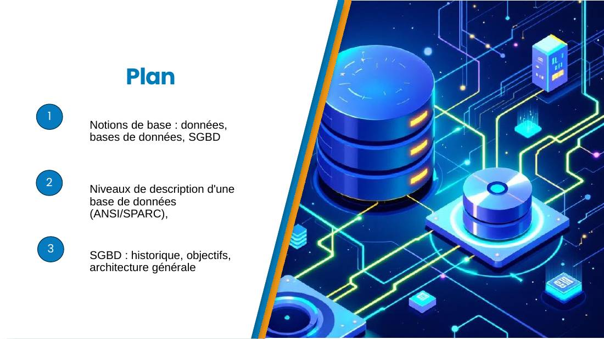
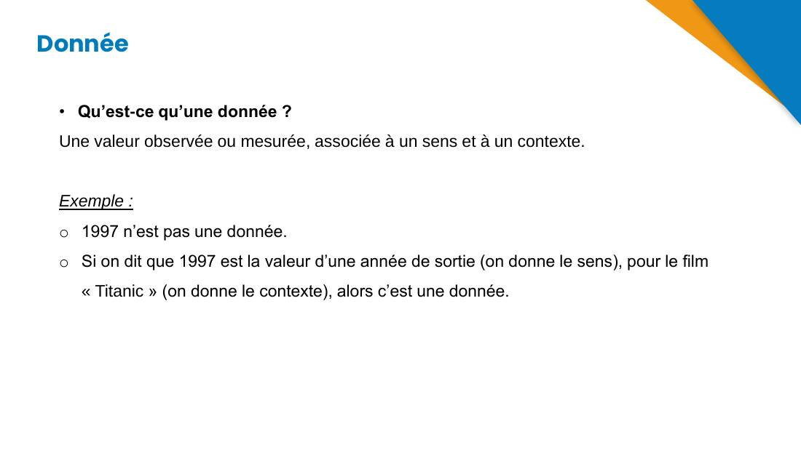
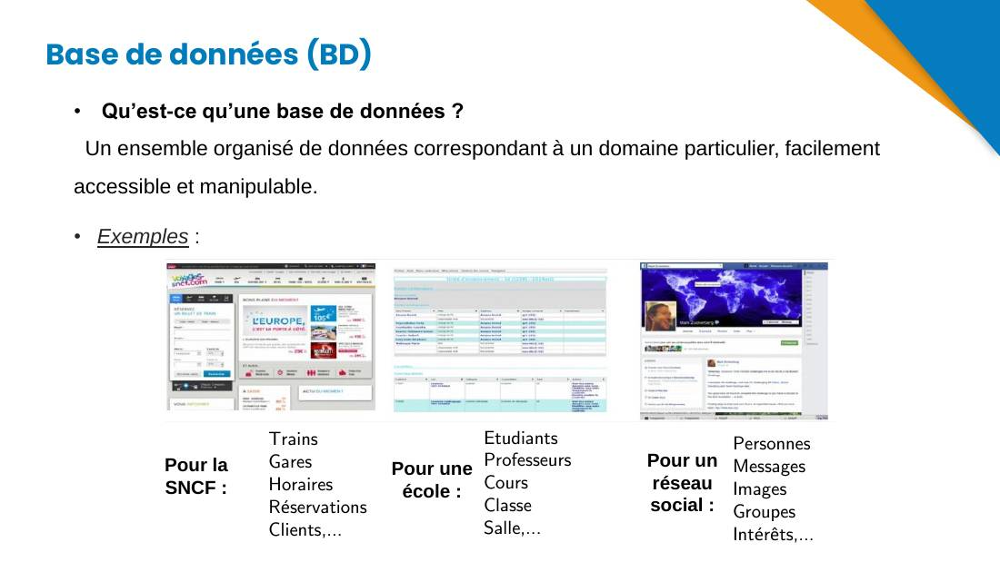
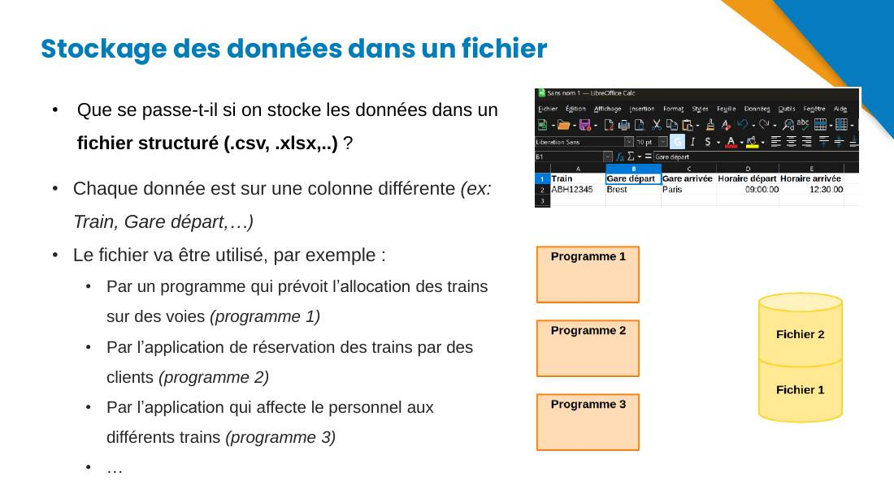
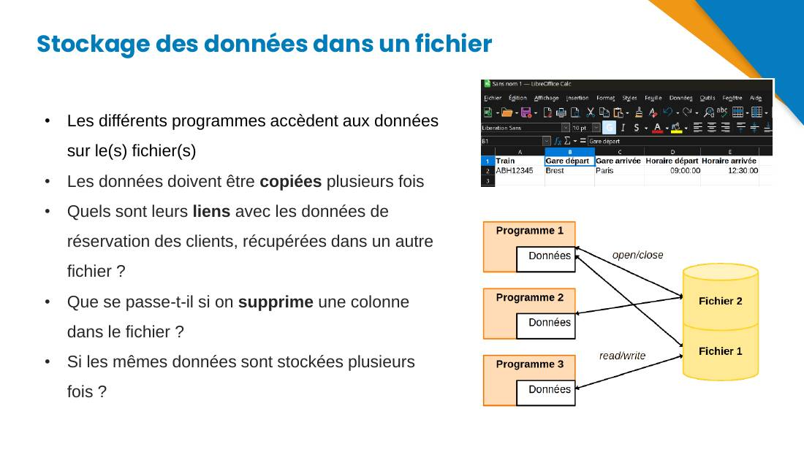
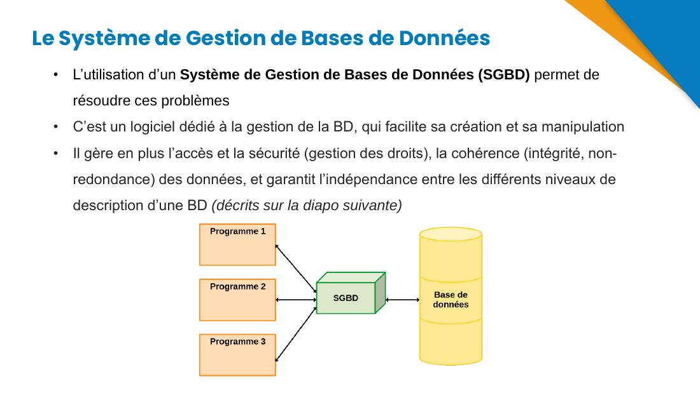
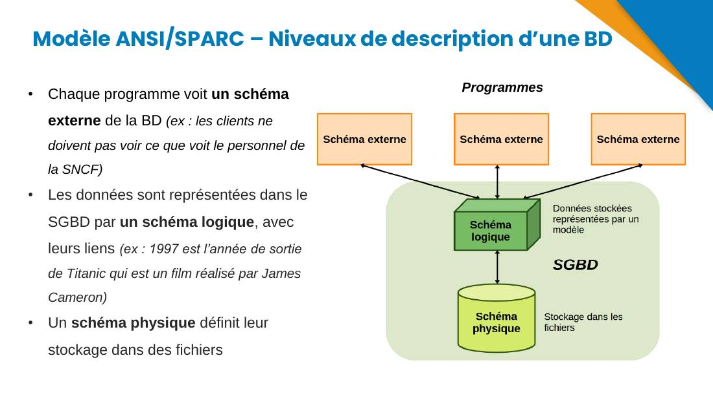
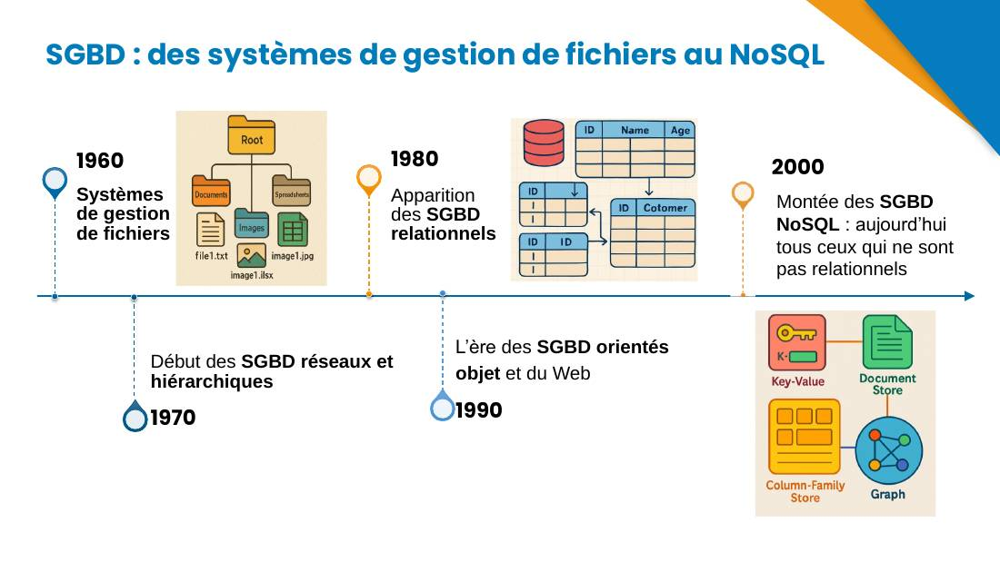
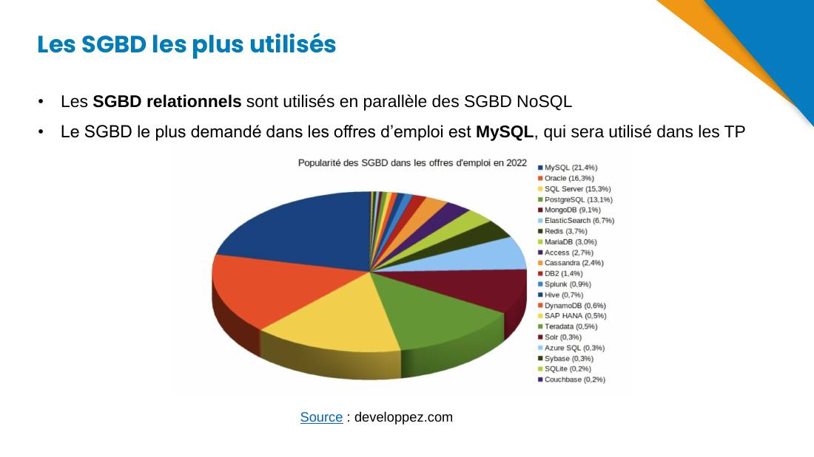

# Chapitre 0 — Introduction aux bases de données

=== "Version simplifiée"

    ## Donnée, base de données, SGBD

    - Une **donnée** est une information élémentaire (un nom, une date, un prix…).
    - Une **base de données (BD)** est un ensemble structuré de données sur un
      domaine, stocké de façon durable et partagé entre plusieurs utilisateurs.
    - Stocker dans des **fichiers** pose problème : redondance, incohérences,
      accès concurrents difficiles, pas de contrôle d'accès.

    !!! definition "SGBD (Système de Gestion de Bases de Données)"
        Logiciel qui stocke, protège et donne accès aux données. Objectifs :
        **indépendance** physique et logique, **intégrité** (contraintes),
        **non-redondance**, **partage** (accès concurrents), **sécurité**,
        **langage de haut niveau** (SQL).

    ## Les trois niveaux ANSI/SPARC

    | Niveau | Ce qu'il décrit |
    |---|---|
    | **Externe** | les vues propres à chaque utilisateur ou application |
    | **Conceptuel** (logique) | la structure globale des données et leurs liens |
    | **Interne** (physique) | le stockage réel sur disque (fichiers, index) |

    On peut changer un niveau sans casser les autres : c'est l'**indépendance des données**.

    ## Familles de SGBD

    Fichiers → hiérarchique → réseau → **relationnel** (SQL : MySQL, PostgreSQL,
    Oracle, SQL Server, SQLite) → objet → **NoSQL** (documents, clé-valeur,
    graphes ; MongoDB, Redis, Neo4j). Dans ce module : **relationnel avec MySQL**.

    ## La démarche du module (méthode Merise)

    ```mermaid
    flowchart LR
        A[Besoins] --> B["MCD<br/>entités / associations"]
        B --> C["MLD<br/>relations, clés"]
        C --> D["MPD<br/>CREATE TABLE"]
        D --> E["Requêtes<br/>algèbre et SQL"]
    ```

=== "Version papier"

    Les diapos du chapitre telles que projetées en cours (L. Trébaul, 2025-2026).

    <!-- papier: pdf/TI404P/0-introduction-aux-bd.pdf | Introduction aux BD — support 2025-2026 | ch0 | diapo -->

    [{ loading=lazy .papier }](papier/ch0/p01.jpg)
    <p class="papier-legende">TI404 – Bases de données : Concepts · Introduction aux BD — support 2025-2026, diapo 1</p>

    [{ loading=lazy .papier }](papier/ch0/p02.jpg)
    <p class="papier-legende">Notions de base : données, · Introduction aux BD — support 2025-2026, diapo 2</p>

    [{ loading=lazy .papier }](papier/ch0/p03.jpg)
    <p class="papier-legende">Qu’est-ce qu’une donnée ? · Introduction aux BD — support 2025-2026, diapo 3</p>

    [{ loading=lazy .papier }](papier/ch0/p04.jpg)
    <p class="papier-legende">Base de données (BD) · Introduction aux BD — support 2025-2026, diapo 4</p>

    [{ loading=lazy .papier }](papier/ch0/p05.jpg)
    <p class="papier-legende">Stockage des données dans un fichier · Introduction aux BD — support 2025-2026, diapo 5</p>

    [{ loading=lazy .papier }](papier/ch0/p06.jpg)
    <p class="papier-legende">Stockage des données dans un fichier · Introduction aux BD — support 2025-2026, diapo 6</p>

    [{ loading=lazy .papier }](papier/ch0/p07.jpg)
    <p class="papier-legende">Le Système de Gestion de Bases de Données · Introduction aux BD — support 2025-2026, diapo 7</p>

    [{ loading=lazy .papier }](papier/ch0/p08.jpg)
    <p class="papier-legende">Modèle ANSI/SPARC – Niveaux de description d’une BD · Introduction aux BD — support 2025-2026, diapo 8</p>

    [{ loading=lazy .papier }](papier/ch0/p09.jpg)
    <p class="papier-legende">SGBD : des systèmes de gestion de fichiers au NoSQL · Introduction aux BD — support 2025-2026, diapo 9</p>

    [{ loading=lazy .papier }](papier/ch0/p10.jpg)
    <p class="papier-legende">Les SGBD les plus utilisés · Introduction aux BD — support 2025-2026, diapo 10</p>

    [{ loading=lazy .papier }](papier/ch0/p11.jpg)
    <p class="papier-legende">Prochain chapitre · Introduction aux BD — support 2025-2026, diapo 11</p>

    <!-- /papier -->
