# Chapitre 2 — Du MCD au MLD : le modèle relationnel

=== "Version simplifiée"

    ## Le modèle relationnel

    !!! definition "Relation, attribut, domaine, clés"
        - Une **relation** est une table : un ensemble de **tuples** (lignes) ayant
          les mêmes **attributs** (colonnes), chacun pris dans un **domaine** (type).
        - **Clé primaire** (soulignée) : identifie chaque tuple, unique et non nulle.
        - **Clé étrangère** (précédée de `#`) : référence la clé primaire d'une autre relation.

    Notation : `Eleve = (id_eleve INT, nom VARCHAR(50), #id_maison INT)`.

    ## Les règles de transformation

    !!! methode "MCD → MLD"
        1. **Entité** → relation ; identifiant → clé primaire ; attributs → colonnes.
        2. **Association `(X,1)-(X,n)`** → la clé de l'entité côté `(X,n)` devient
           **clé étrangère** dans la relation côté `(X,1)`. Pas de nouvelle table.
        3. **Association `(X,n)-(X,n)`** → **nouvelle relation** dont la clé primaire
           est la concaténation des deux clés (qui sont aussi clés étrangères) ;
           les attributs de l'association y vont.
        4. **Association n-aire** (toutes cardinalités) → nouvelle relation, clé =
           concaténation des identifiants des entités participantes.
        5. **Association réflexive** : `(X,1)-(X,n)` → clé étrangère vers la même table
           (ex. `#id_manager`) ; `(X,n)-(X,n)` → nouvelle table avec deux clés étrangères
           vers la même table.
        6. **`(0,1)-(1,1)`** → la clé côté `(0,1)` devient clé étrangère côté `(1,1)`.

    !!! example "Commande et produits"
        Commande `(0,n)` — *contient* (quantité) — `(0,n)` Produit devient :
        `Commande = (id_commande, date)`, `Produit = (id_produit, nom, prix)`,
        `Contient = (#id_commande, #id_produit, quantite)`.

    !!! methode "MLD → MCD (sens inverse)"
        - Relation sans clé étrangère → **entité**.
        - Relation avec clé(s) étrangère(s) hors clé primaire → **entité** liée par une association `(X,1)-(X,n)`.
        - Relation dont la clé primaire est formée de plusieurs clés étrangères →
          **association** `(X,n)-(X,n)` ou n-aire (ses autres attributs sont portés par l'association).
        - Clé primaire = clé étrangère + attribut propre → **entité faible**.

=== "Version papier"

    Les diapos du chapitre telles que projetées en cours (L. Trébaul, 2025-2026).

    <!-- papier: pdf/TI404P/2-mld.pdf | Chapitre 2 MLD — support 2025-2026 | ch2 | diapo -->

    [{ loading=lazy .papier }](papier/ch2/p01.jpg)
    
CHAPITRE 2 : · Chapitre 2 MLD — support 2025-2026, diapo 1

    [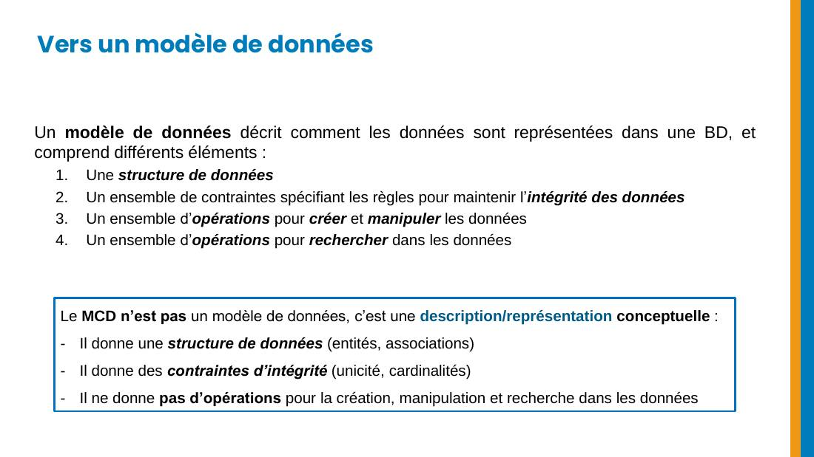{ loading=lazy .papier }](papier/ch2/p02.jpg)
    
Vers un modèle de données · Chapitre 2 MLD — support 2025-2026, diapo 2

    [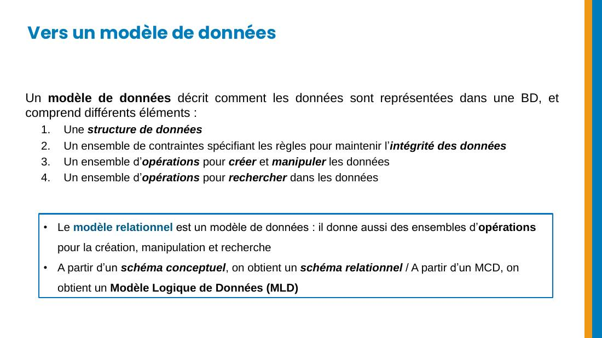{ loading=lazy .papier }](papier/ch2/p03.jpg)
    
Vers un modèle de données · Chapitre 2 MLD — support 2025-2026, diapo 3

    [{ loading=lazy .papier }](papier/ch2/p04.jpg)
    
Partie 1 : Le Modèle · Chapitre 2 MLD — support 2025-2026, diapo 4

    [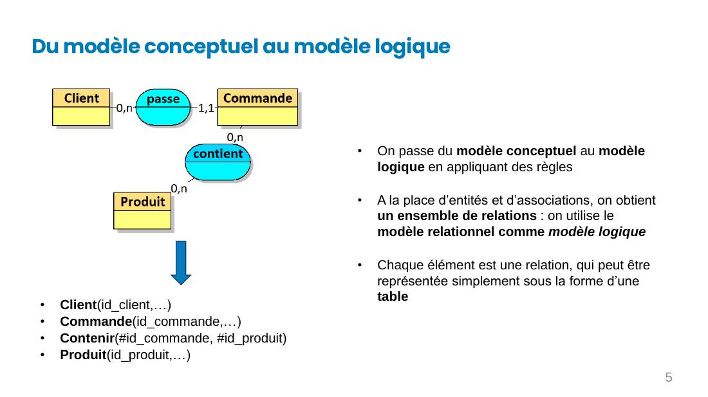{ loading=lazy .papier }](papier/ch2/p05.jpg)
    
Du modèle conceptuel au modèle logique · Chapitre 2 MLD — support 2025-2026, diapo 5

    [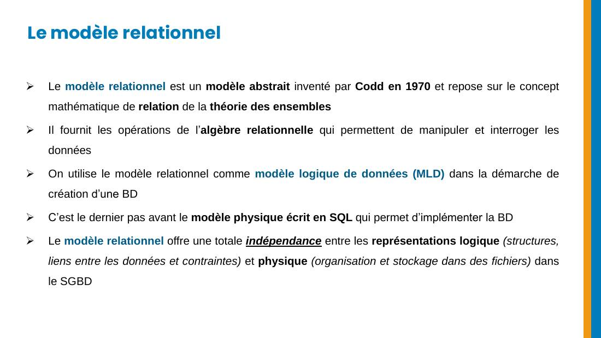{ loading=lazy .papier }](papier/ch2/p06.jpg)
    
Le modèle relationnel · Chapitre 2 MLD — support 2025-2026, diapo 6

    [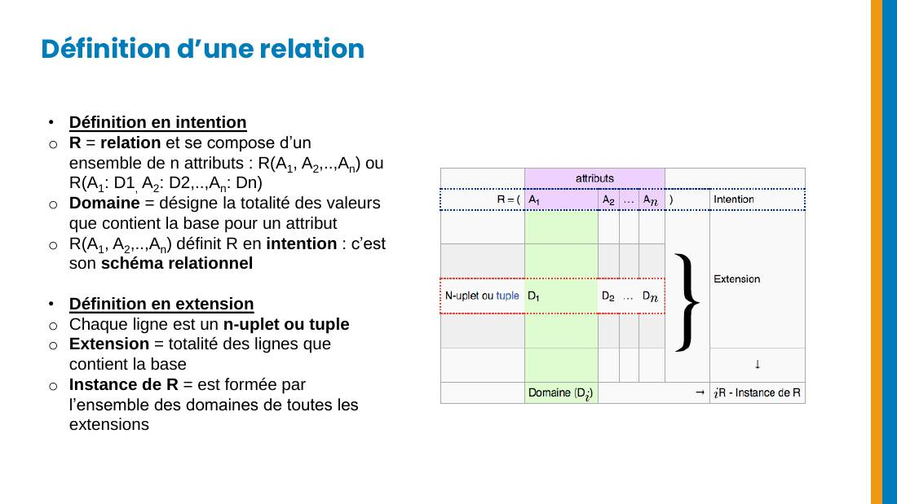{ loading=lazy .papier }](papier/ch2/p07.jpg)
    
Définition d’une relation · Chapitre 2 MLD — support 2025-2026, diapo 7

    [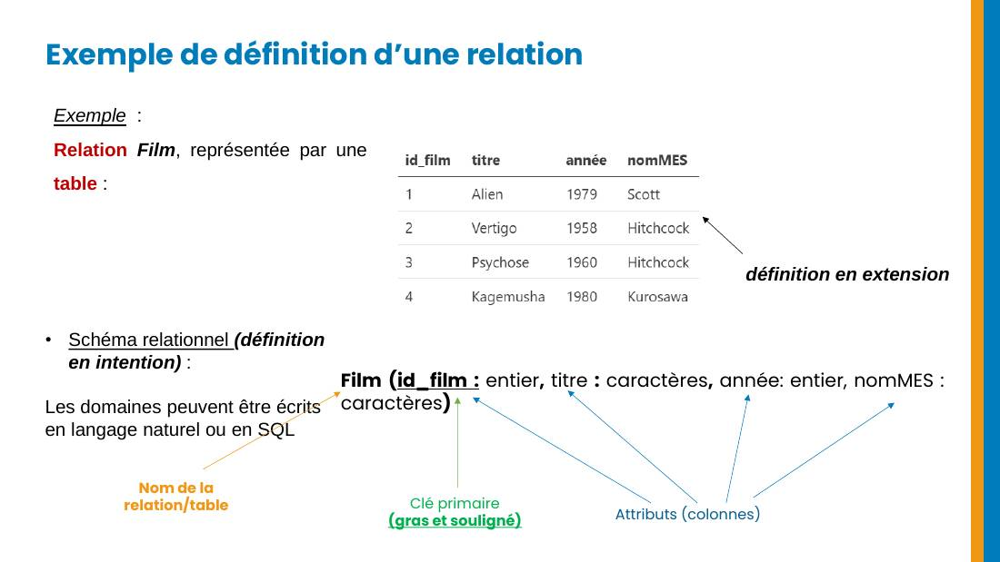{ loading=lazy .papier }](papier/ch2/p08.jpg)
    
Exemple de définition d’une relation · Chapitre 2 MLD — support 2025-2026, diapo 8

    [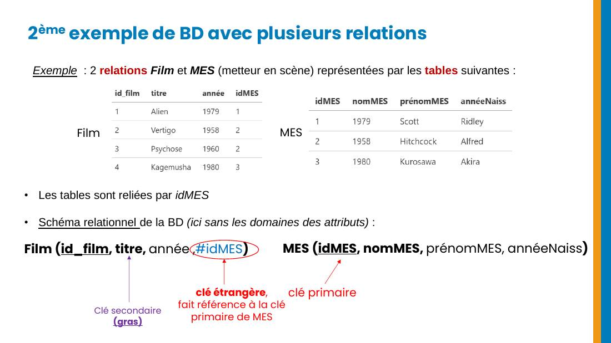{ loading=lazy .papier }](papier/ch2/p09.jpg)
    
2ème exemple de BD avec plusieurs relations · Chapitre 2 MLD — support 2025-2026, diapo 9

    [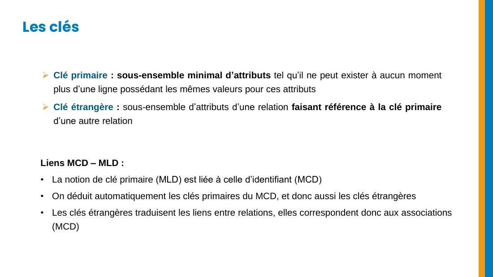{ loading=lazy .papier }](papier/ch2/p10.jpg)
    
Les clés · Chapitre 2 MLD — support 2025-2026, diapo 10

    [{ loading=lazy .papier }](papier/ch2/p11.jpg)
    
Partie 2 : Règles de · Chapitre 2 MLD — support 2025-2026, diapo 11

    [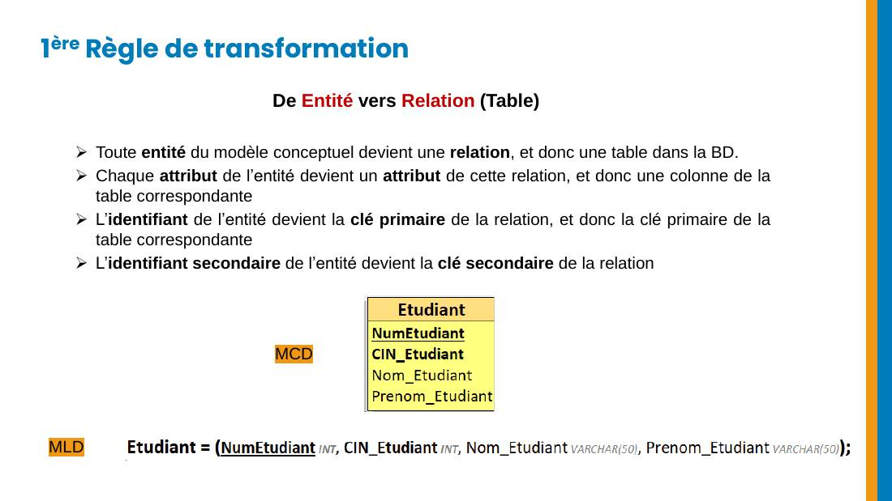{ loading=lazy .papier }](papier/ch2/p12.jpg)
    
1ère Règle de transformation · Chapitre 2 MLD — support 2025-2026, diapo 12

    [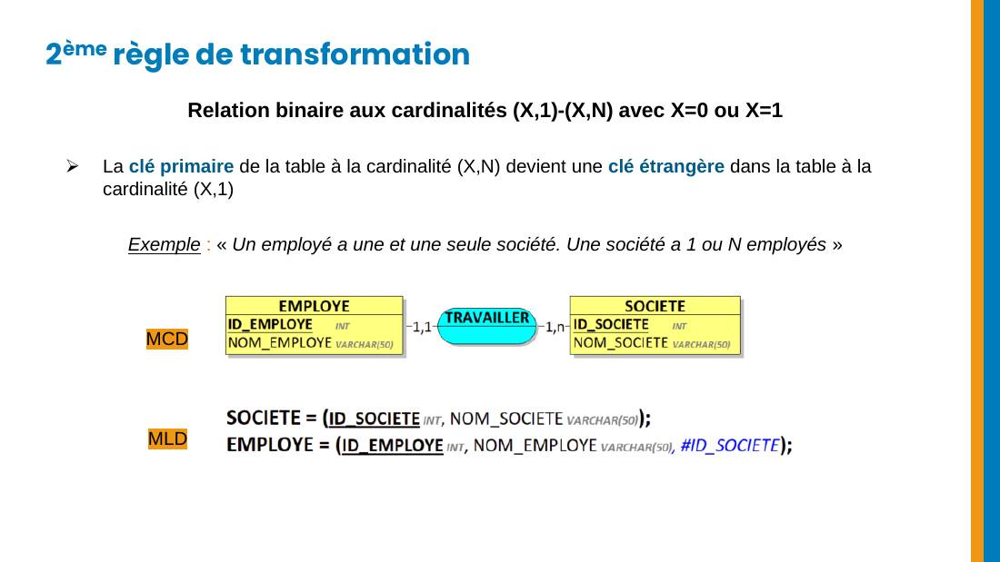{ loading=lazy .papier }](papier/ch2/p13.jpg)
    
2ème règle de transformation · Chapitre 2 MLD — support 2025-2026, diapo 13

    [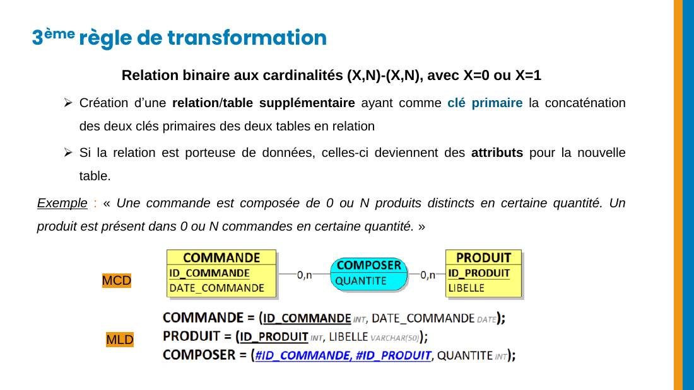{ loading=lazy .papier }](papier/ch2/p14.jpg)
    
3ème règle de transformation · Chapitre 2 MLD — support 2025-2026, diapo 14

    [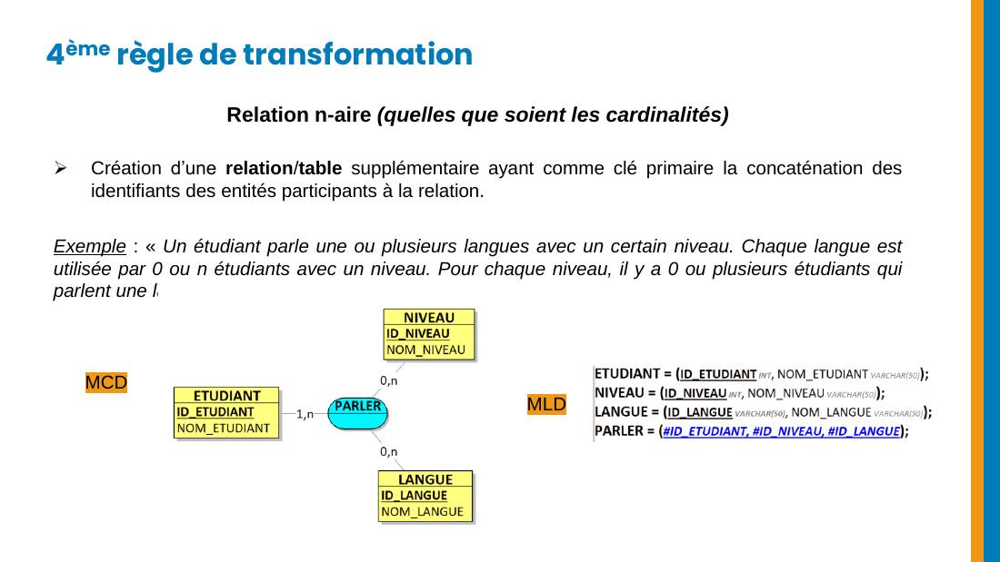{ loading=lazy .papier }](papier/ch2/p15.jpg)
    
4ème règle de transformation · Chapitre 2 MLD — support 2025-2026, diapo 15

    [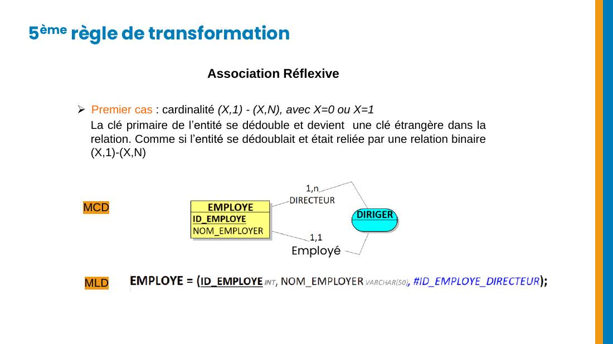{ loading=lazy .papier }](papier/ch2/p16.jpg)
    
5ème règle de transformation · Chapitre 2 MLD — support 2025-2026, diapo 16

    [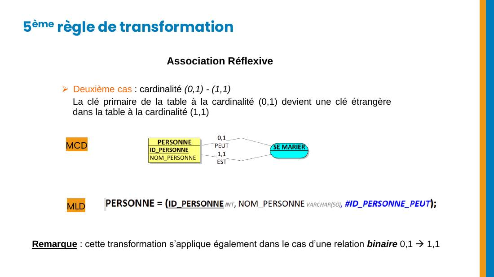{ loading=lazy .papier }](papier/ch2/p17.jpg)
    
5ème règle de transformation · Chapitre 2 MLD — support 2025-2026, diapo 17

    [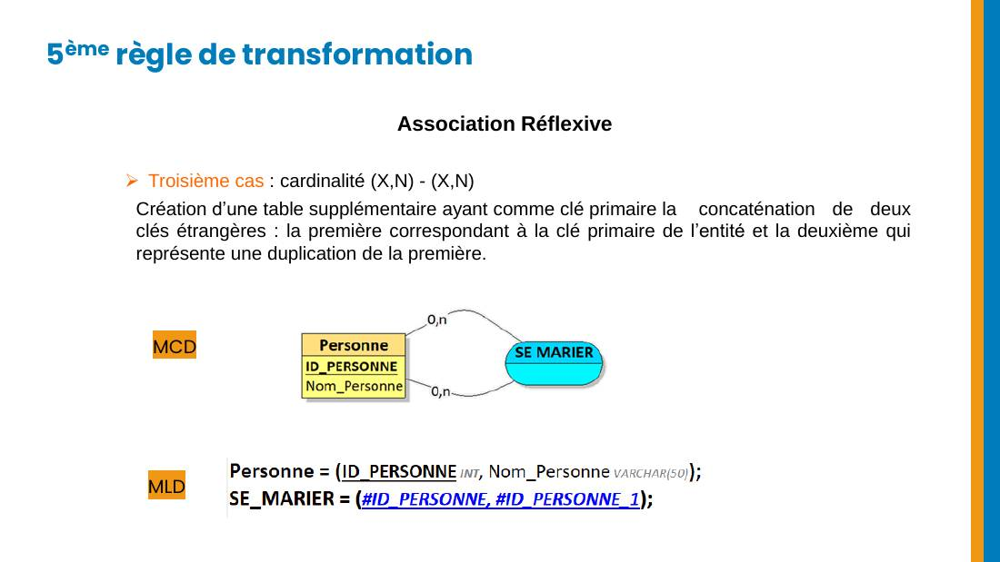{ loading=lazy .papier }](papier/ch2/p18.jpg)
    
5ème règle de transformation · Chapitre 2 MLD — support 2025-2026, diapo 18

    [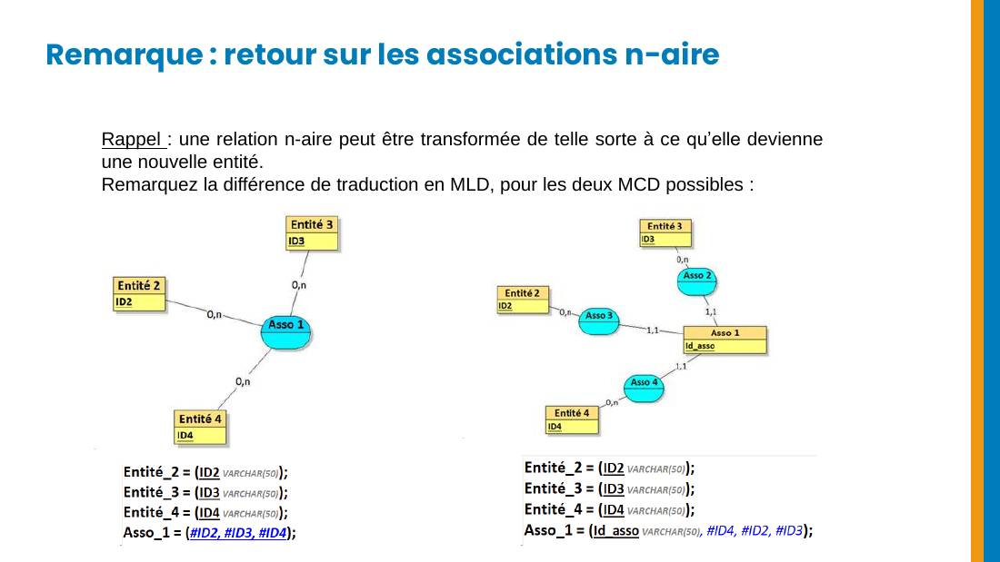{ loading=lazy .papier }](papier/ch2/p19.jpg)
    
Remarque : retour sur les associations n-aire · Chapitre 2 MLD — support 2025-2026, diapo 19

    [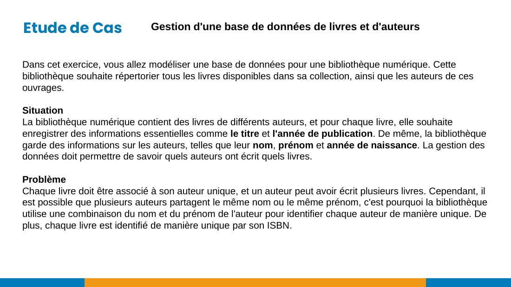{ loading=lazy .papier }](papier/ch2/p20.jpg)
    
Etude de Cas · Chapitre 2 MLD — support 2025-2026, diapo 20

    [{ loading=lazy .papier }](papier/ch2/p21.jpg)
    
1. Etablir le MCD · Chapitre 2 MLD — support 2025-2026, diapo 21

    [{ loading=lazy .papier }](papier/ch2/p22.jpg)
    
Prochain chapitre · Chapitre 2 MLD — support 2025-2026, diapo 22

    <!-- /papier -->
