# Chapitre 3 — SQL : créer la base (LDD) et modifier les données (LMD)

=== "Version simplifiée"

    **SQL** est un langage **déclaratif** : on dit *ce qu'on veut*, pas *comment*
    l'obtenir. On passe du MLD au **MPD** (modèle physique) : le code `CREATE TABLE`
    pour un SGBD donné (ici MySQL).

    | Sous-langage | Rôle | Commandes |
    |---|---|---|
    | **LDD** (définition) | structure | `CREATE`, `ALTER`, `DROP` |
    | **LMD** (manipulation) | contenu | `INSERT`, `UPDATE`, `DELETE` |
    | **LQD / DQL** (interrogation) | lecture | `SELECT` (chapitre 4) |

    ## Types courants

    `INT`, `DECIMAL(p, s)` (nombres exacts, montants), `FLOAT`, `CHAR(n)`,
    `VARCHAR(n)`, `TEXT`, `DATE`, `TIME`, `DATETIME`, `BOOLEAN`.

    ## Créer une table avec ses contraintes

    ```sql
    CREATE TABLE Maison (
        ma_id     INT          PRIMARY KEY,
        ma_nom    VARCHAR(30)  NOT NULL UNIQUE,
        ma_devise VARCHAR(100) DEFAULT 'Aucune'
    );

    CREATE TABLE Eleve (
        el_id     INT PRIMARY KEY AUTO_INCREMENT,
        el_nom    VARCHAR(50) NOT NULL,
        el_annee  INT CHECK (el_annee BETWEEN 1 AND 7),
        ma_id     INT NOT NULL,
        FOREIGN KEY (ma_id) REFERENCES Maison(ma_id)
            ON DELETE CASCADE ON UPDATE CASCADE
    );

    -- Table d'association (n,n) : clé primaire composée
    CREATE TABLE Suit (
        el_id INT, co_id INT, note DECIMAL(4,2),
        PRIMARY KEY (el_id, co_id),
        FOREIGN KEY (el_id) REFERENCES Eleve(el_id),
        FOREIGN KEY (co_id) REFERENCES Cours(co_id)
    );
    ```

    !!! definition "Contraintes d'intégrité"
        - **De clé** : `PRIMARY KEY` (unique + non nulle), `UNIQUE`.
        - **De domaine** : type, `NOT NULL`, `DEFAULT`, `CHECK (condition)`.
        - **Référentielle** : `FOREIGN KEY … REFERENCES …` ; on ne peut pas référencer
          une ligne qui n'existe pas.

    !!! methode "Que faire quand la ligne référencée change ?"
        Par défaut, la modification ou suppression est **refusée**. On peut la
        **répercuter** avec `ON DELETE` / `ON UPDATE` :

        - `CASCADE` : on supprime ou modifie aussi les lignes qui la référencent ;
        - `SET NULL` : la clé étrangère passe à `NULL`.

        Pour une **entité faible**, on met `ON DELETE CASCADE` : supprimer le livre
        supprime ses exemplaires.

    ## Modifier ou supprimer la structure

    ```sql
    ALTER TABLE Eleve ADD COLUMN el_email VARCHAR(100);
    ALTER TABLE Eleve MODIFY el_nom VARCHAR(80);
    ALTER TABLE Eleve DROP COLUMN el_email;
    ALTER TABLE Eleve ADD CONSTRAINT ck_annee CHECK (el_annee >= 1);
    ALTER TABLE Suit ADD CONSTRAINT fk_cours FOREIGN KEY (co_id) REFERENCES Cours(co_id);
    DROP TABLE Suit;          -- supprimer d'abord les tables qui référencent les autres
    ```

    ## Manipuler les données

    ```sql
    INSERT INTO Maison (ma_id, ma_nom, ma_devise) VALUES (1, 'Lionpierre', 'Courage');
    UPDATE Eleve SET el_annee = el_annee + 1 WHERE ma_id = 1;
    DELETE FROM Eleve WHERE el_id = 42;
    ```

    !!! piege "Ordre des opérations"
        Insérer d'abord les tables **référencées** (Maison) puis celles qui les
        référencent (Élève) ; supprimer dans l'ordre inverse. Un `UPDATE` ou
        `DELETE` **sans `WHERE`** touche **toutes** les lignes.

=== "Version papier"

    Les diapos du chapitre telles que projetées en cours (L. Trébaul, 2025-2026).

    <!-- papier: pdf/TI404P/3-sql-ldd-lmd.pdf | Chapitre 3 SQL — support 2025-2026 | ch3 | diapo -->

    [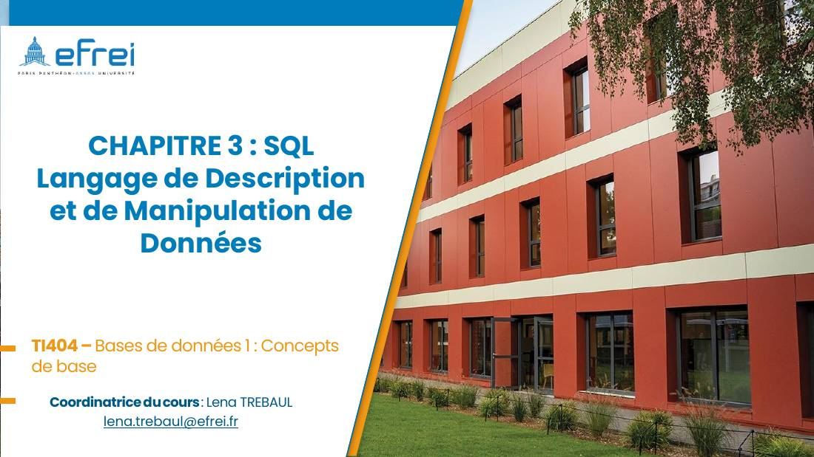{ loading=lazy .papier }](papier/ch3/p01.jpg)
    <p class="papier-legende">CHAPITRE 3 : SQL · Chapitre 3 SQL — support 2025-2026, diapo 1</p>

    [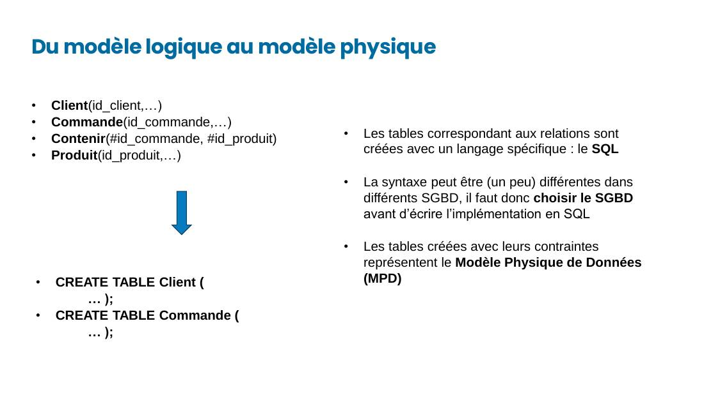{ loading=lazy .papier }](papier/ch3/p02.jpg)
    <p class="papier-legende">Du modèle logique au modèle physique · Chapitre 3 SQL — support 2025-2026, diapo 2</p>

    [{ loading=lazy .papier }](papier/ch3/p03.jpg)
    <p class="papier-legende">Partie 1 : Structured · Chapitre 3 SQL — support 2025-2026, diapo 3</p>

    [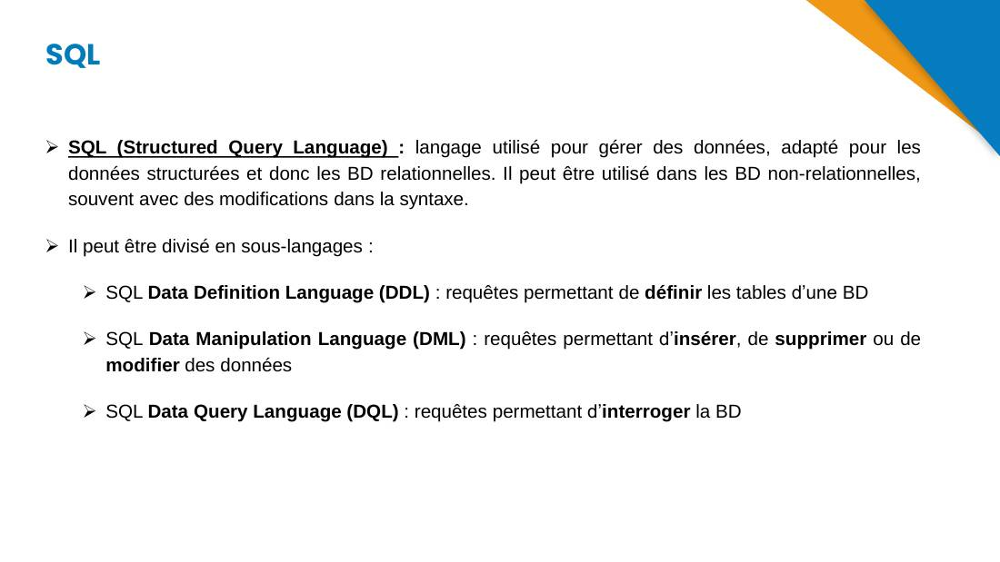{ loading=lazy .papier }](papier/ch3/p04.jpg)
    <p class="papier-legende">➢ SQL (Structured Query Language) : langage utilisé pour gérer des données, adapté pour le… · Chapitre 3 SQL — support 2025-2026, diapo 4</p>

    [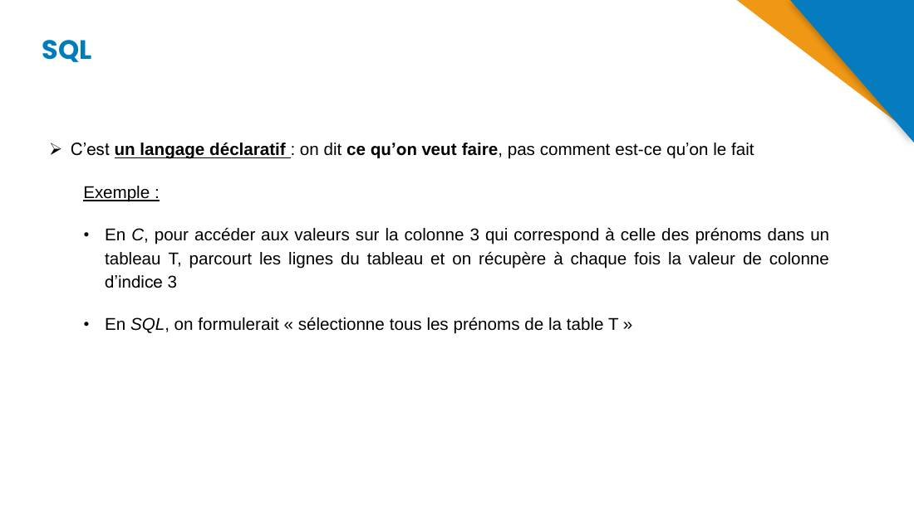{ loading=lazy .papier }](papier/ch3/p05.jpg)
    <p class="papier-legende">➢ C’est un langage déclaratif : on dit ce qu’on veut faire, pas comment est-ce qu’on le fa… · Chapitre 3 SQL — support 2025-2026, diapo 5</p>

    [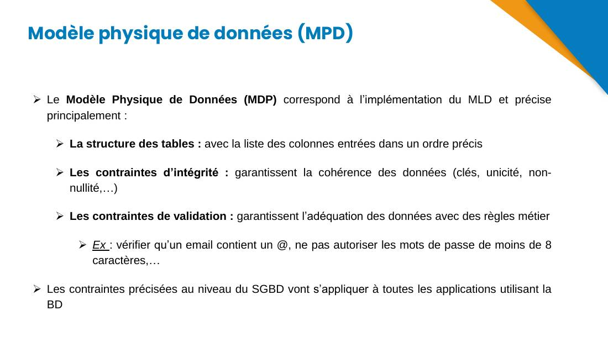{ loading=lazy .papier }](papier/ch3/p06.jpg)
    <p class="papier-legende">Modèle physique de données (MPD) · Chapitre 3 SQL — support 2025-2026, diapo 6</p>

    [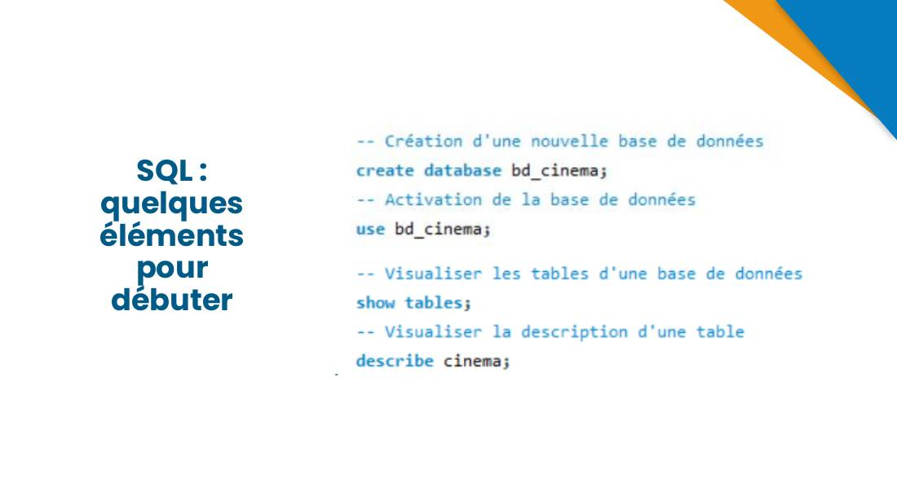{ loading=lazy .papier }](papier/ch3/p07.jpg)
    <p class="papier-legende">Chapitre 3 SQL — support 2025-2026, diapo 7</p>

    [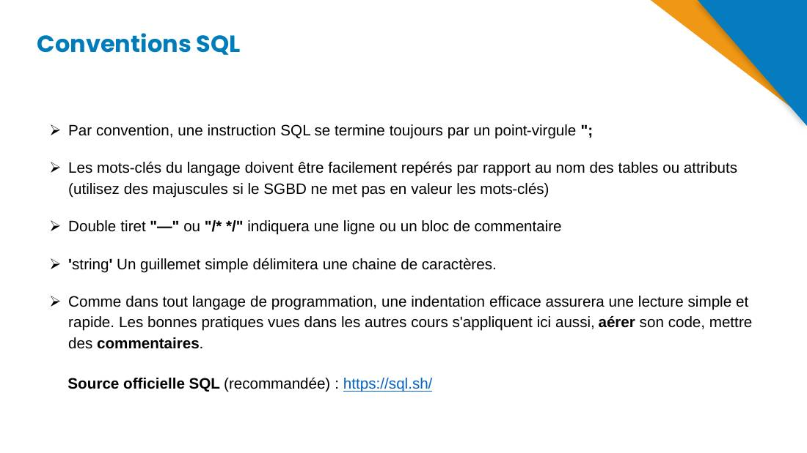{ loading=lazy .papier }](papier/ch3/p08.jpg)
    <p class="papier-legende">Conventions SQL · Chapitre 3 SQL — support 2025-2026, diapo 8</p>

    [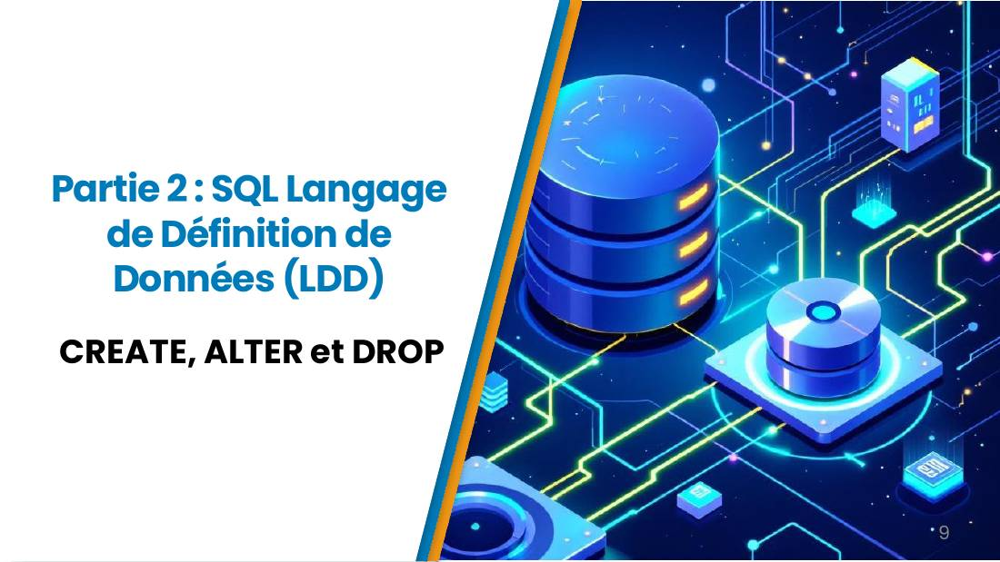{ loading=lazy .papier }](papier/ch3/p09.jpg)
    <p class="papier-legende">Partie 2 : SQL Langage · Chapitre 3 SQL — support 2025-2026, diapo 9</p>

    [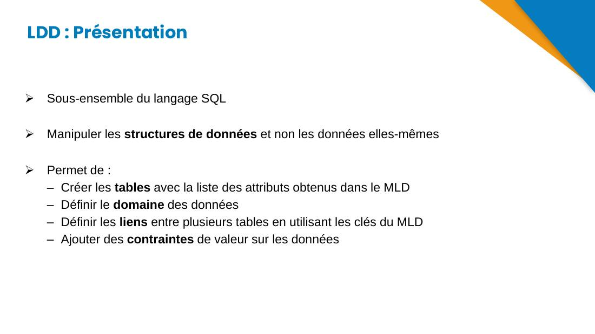{ loading=lazy .papier }](papier/ch3/p10.jpg)
    <p class="papier-legende">LDD : Présentation · Chapitre 3 SQL — support 2025-2026, diapo 10</p>

    [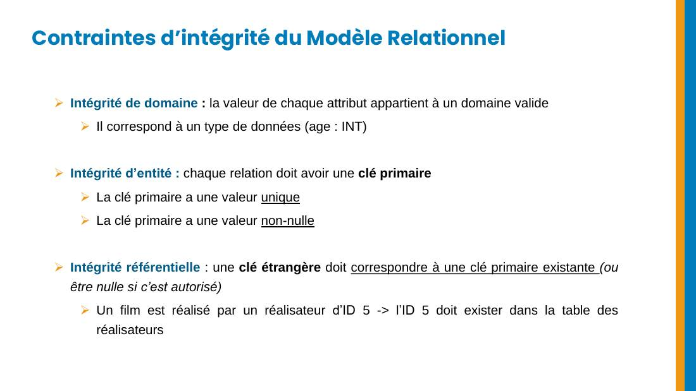{ loading=lazy .papier }](papier/ch3/p11.jpg)
    <p class="papier-legende">Contraintes d’intégrité du Modèle Relationnel · Chapitre 3 SQL — support 2025-2026, diapo 11</p>

    [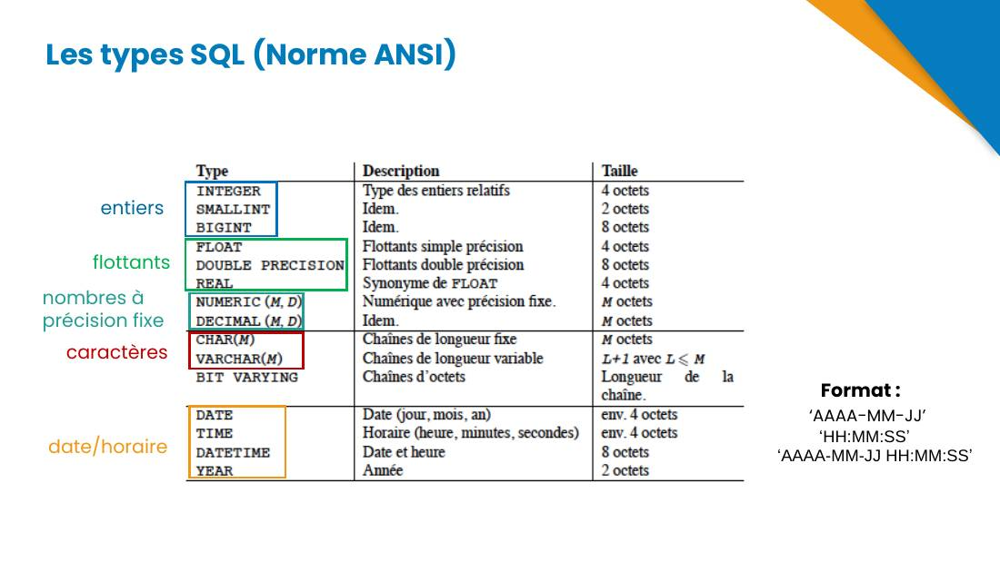{ loading=lazy .papier }](papier/ch3/p12.jpg)
    <p class="papier-legende">Les types SQL (Norme ANSI) · Chapitre 3 SQL — support 2025-2026, diapo 12</p>

    [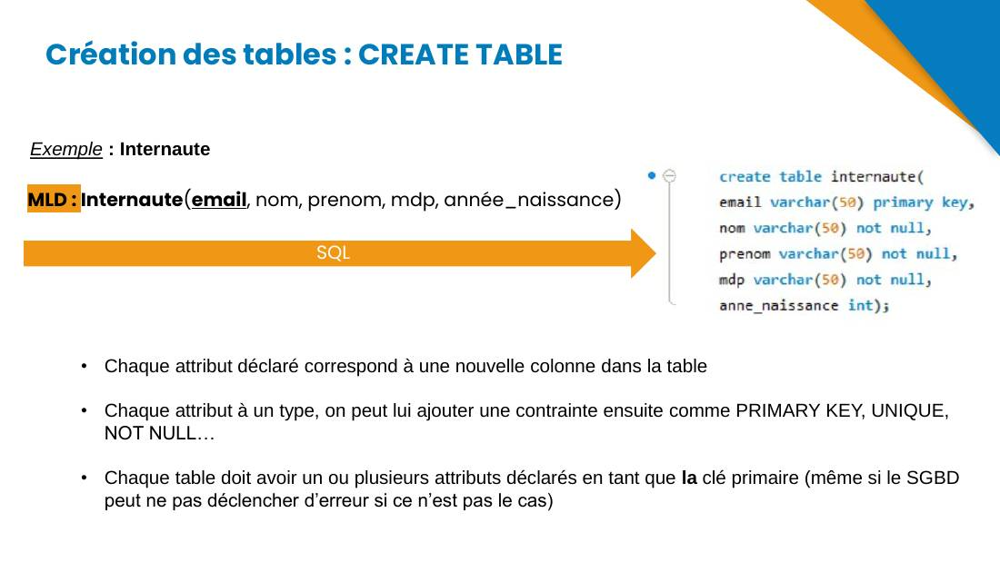{ loading=lazy .papier }](papier/ch3/p13.jpg)
    <p class="papier-legende">Création des tables : CREATE TABLE · Chapitre 3 SQL — support 2025-2026, diapo 13</p>

    [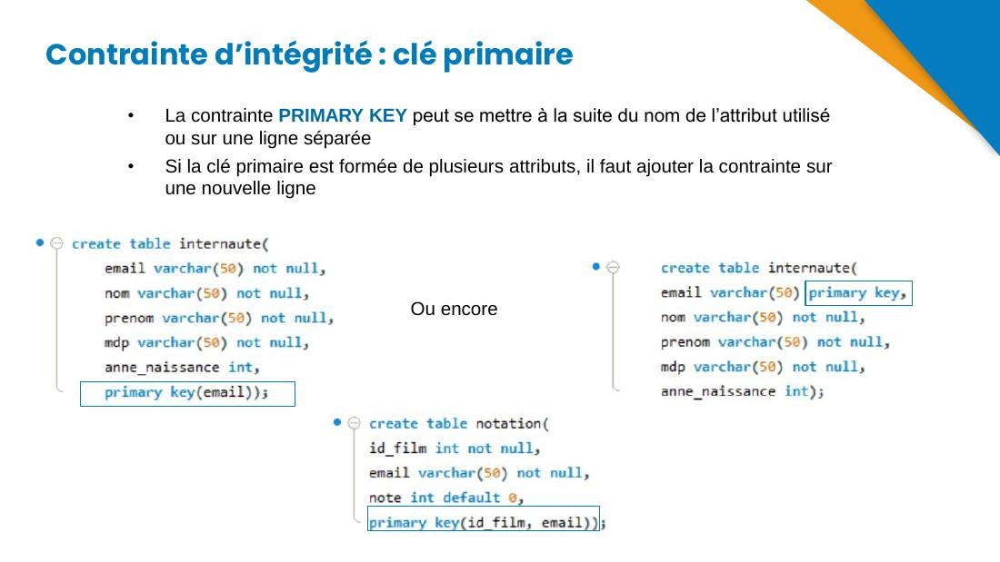{ loading=lazy .papier }](papier/ch3/p14.jpg)
    <p class="papier-legende">Contrainte d’intégrité : clé primaire · Chapitre 3 SQL — support 2025-2026, diapo 14</p>

    [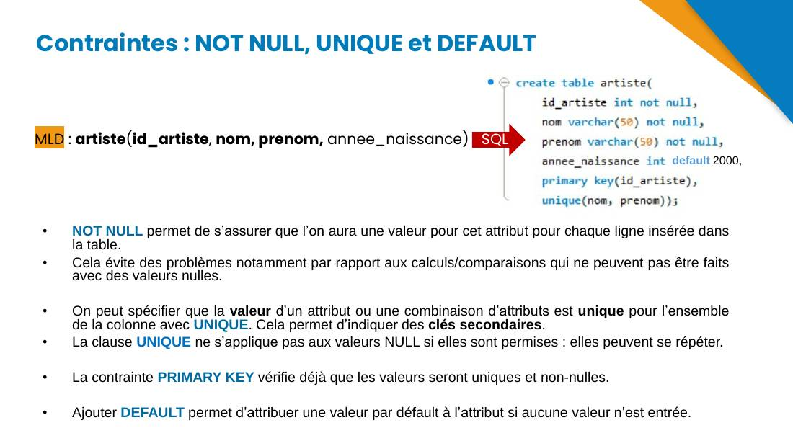{ loading=lazy .papier }](papier/ch3/p15.jpg)
    <p class="papier-legende">Contraintes : NOT NULL, UNIQUE et DEFAULT · Chapitre 3 SQL — support 2025-2026, diapo 15</p>

    [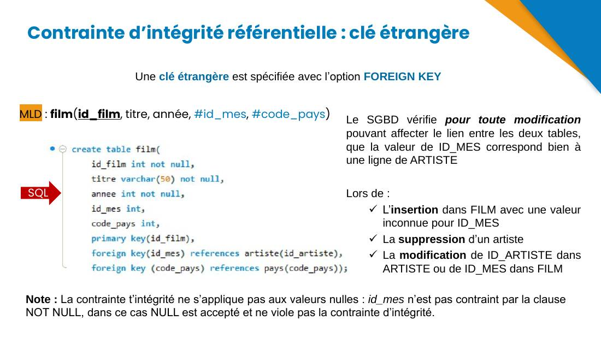{ loading=lazy .papier }](papier/ch3/p16.jpg)
    <p class="papier-legende">Contrainte d’intégrité référentielle : clé étrangère · Chapitre 3 SQL — support 2025-2026, diapo 16</p>

    [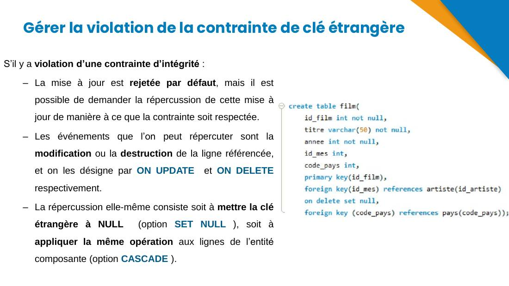{ loading=lazy .papier }](papier/ch3/p17.jpg)
    <p class="papier-legende">Gérer la violation de la contrainte de clé étrangère · Chapitre 3 SQL — support 2025-2026, diapo 17</p>

    [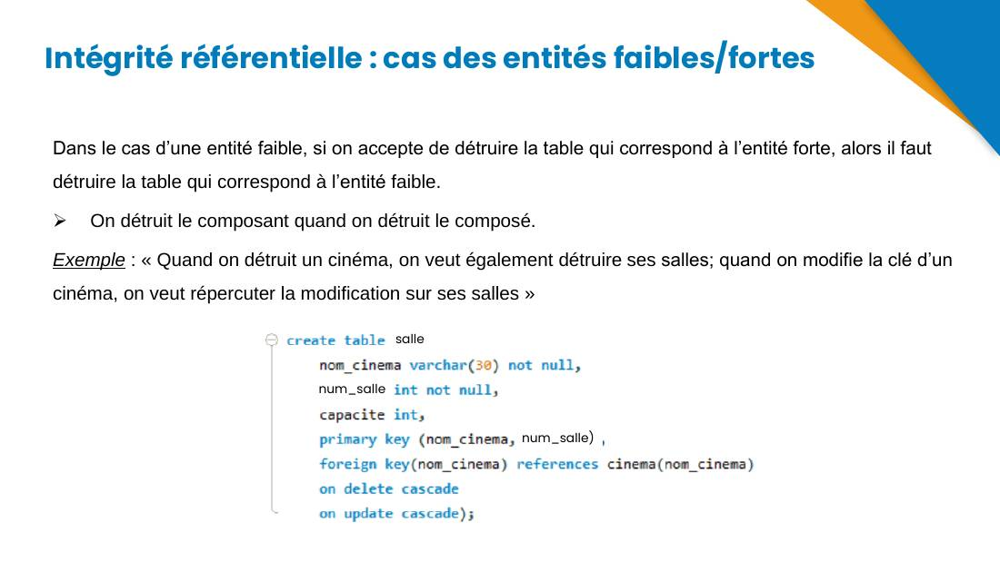{ loading=lazy .papier }](papier/ch3/p18.jpg)
    <p class="papier-legende">Intégrité référentielle : cas des entités faibles/fortes · Chapitre 3 SQL — support 2025-2026, diapo 18</p>

    [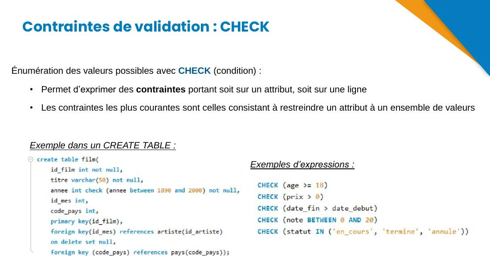{ loading=lazy .papier }](papier/ch3/p19.jpg)
    <p class="papier-legende">Contraintes de validation : CHECK · Chapitre 3 SQL — support 2025-2026, diapo 19</p>

    [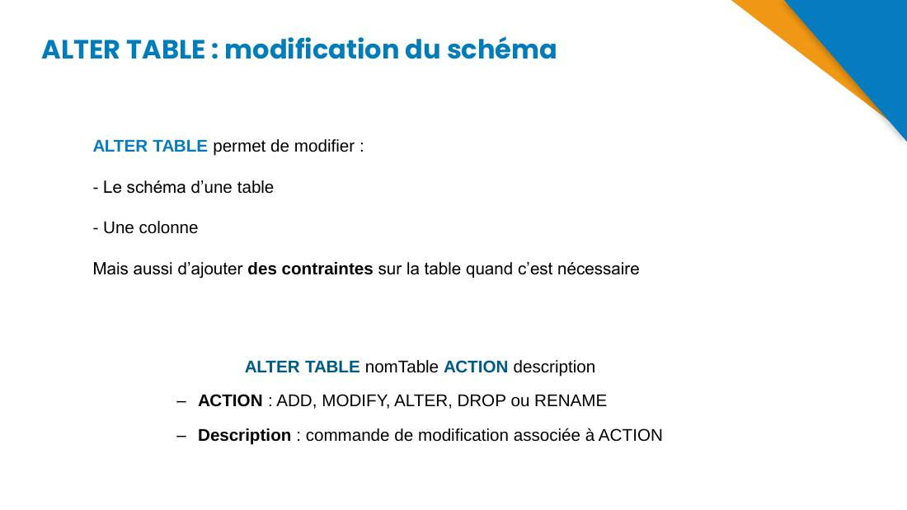{ loading=lazy .papier }](papier/ch3/p20.jpg)
    <p class="papier-legende">ALTER TABLE : modification du schéma · Chapitre 3 SQL — support 2025-2026, diapo 20</p>

    [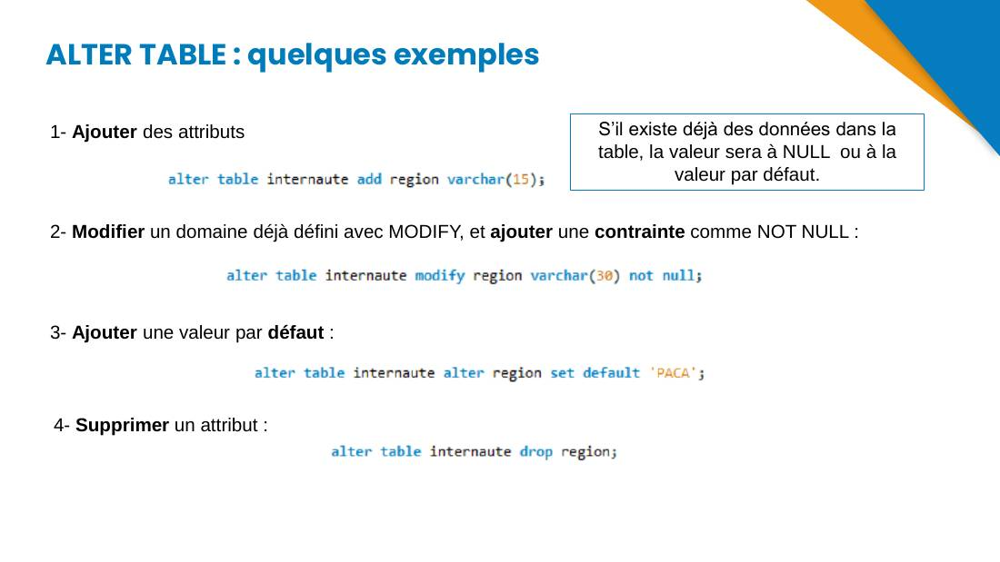{ loading=lazy .papier }](papier/ch3/p21.jpg)
    <p class="papier-legende">ALTER TABLE : quelques exemples · Chapitre 3 SQL — support 2025-2026, diapo 21</p>

    [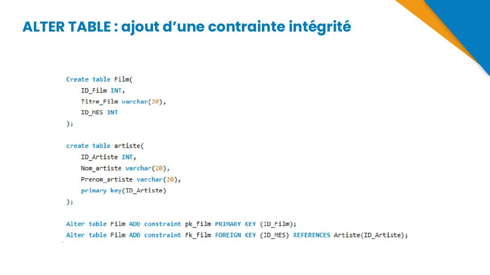{ loading=lazy .papier }](papier/ch3/p22.jpg)
    <p class="papier-legende">ALTER TABLE : ajout d’une contrainte intégrité · Chapitre 3 SQL — support 2025-2026, diapo 22</p>

    [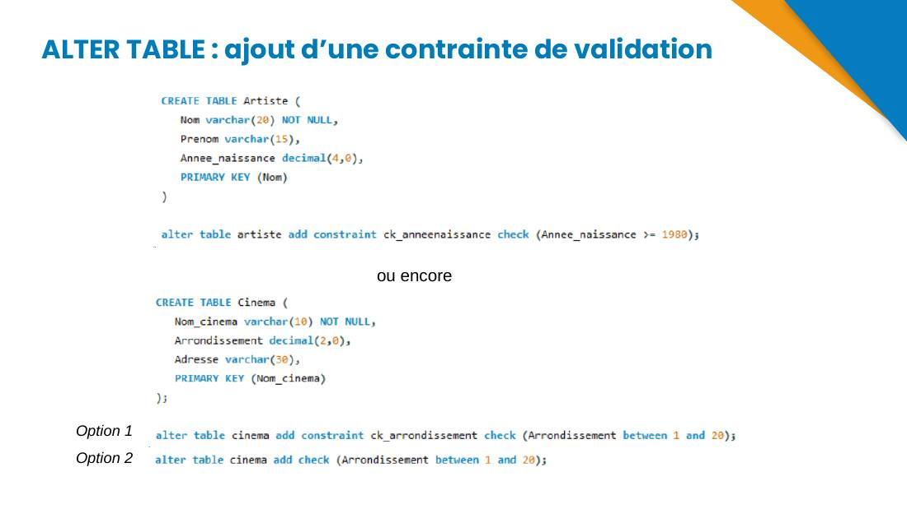{ loading=lazy .papier }](papier/ch3/p23.jpg)
    <p class="papier-legende">ALTER TABLE : ajout d’une contrainte de validation · Chapitre 3 SQL — support 2025-2026, diapo 23</p>

    [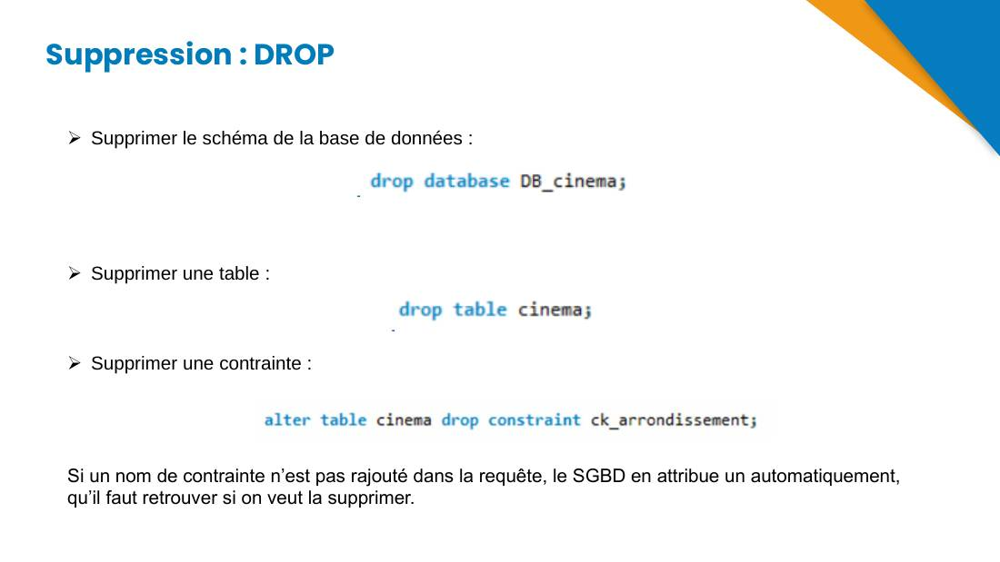{ loading=lazy .papier }](papier/ch3/p24.jpg)
    <p class="papier-legende">Suppression : DROP · Chapitre 3 SQL — support 2025-2026, diapo 24</p>

    [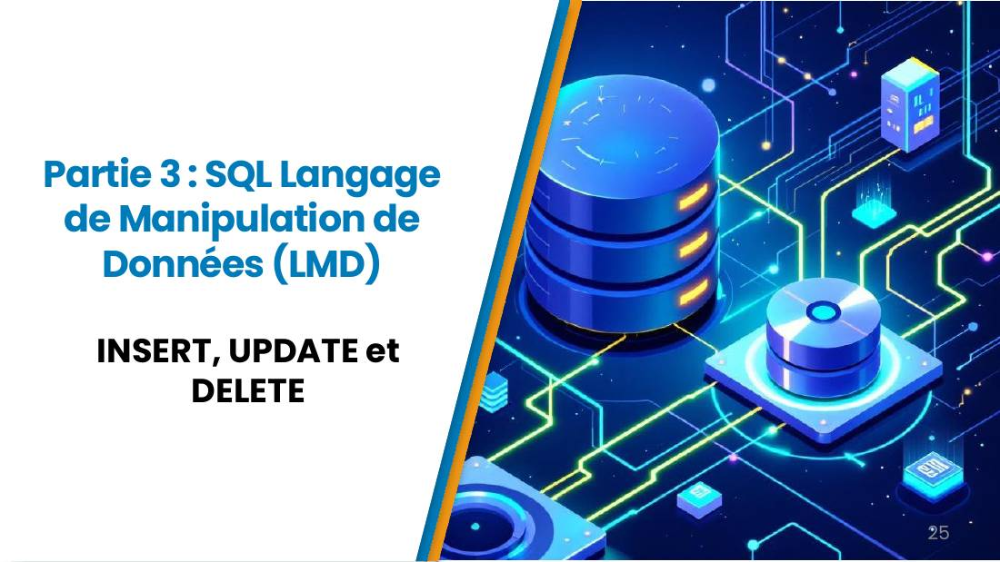{ loading=lazy .papier }](papier/ch3/p25.jpg)
    <p class="papier-legende">Partie 3 : SQL Langage · Chapitre 3 SQL — support 2025-2026, diapo 25</p>

    [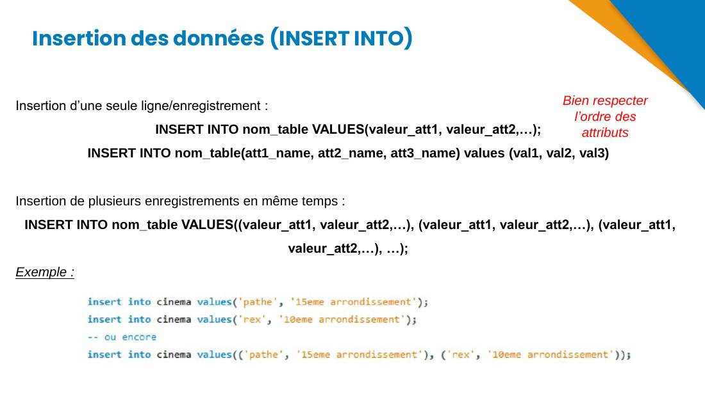{ loading=lazy .papier }](papier/ch3/p26.jpg)
    <p class="papier-legende">Insertion des données (INSERT INTO) · Chapitre 3 SQL — support 2025-2026, diapo 26</p>

    [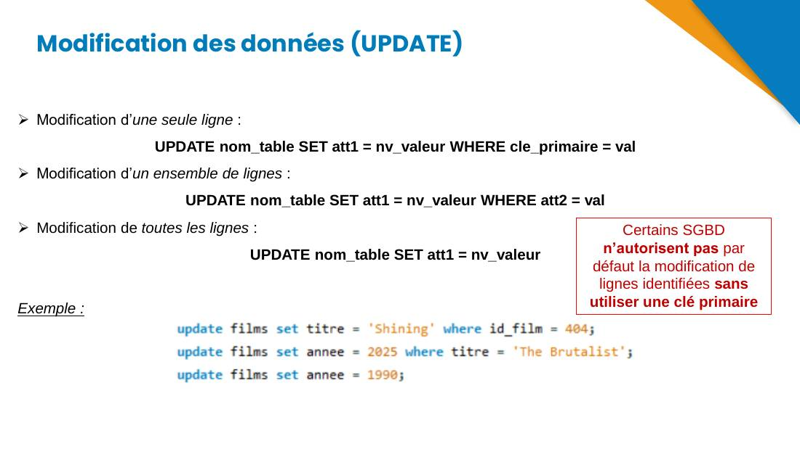{ loading=lazy .papier }](papier/ch3/p27.jpg)
    <p class="papier-legende">Modification des données (UPDATE) · Chapitre 3 SQL — support 2025-2026, diapo 27</p>

    [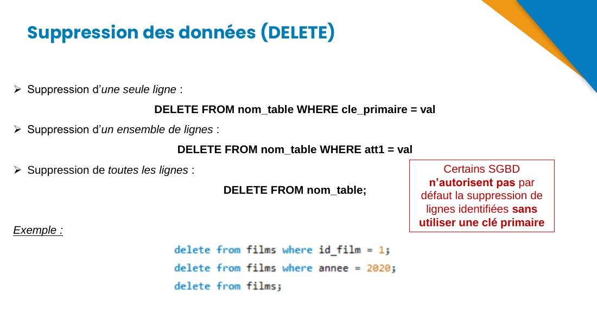{ loading=lazy .papier }](papier/ch3/p28.jpg)
    <p class="papier-legende">Suppression des données (DELETE) · Chapitre 3 SQL — support 2025-2026, diapo 28</p>

    [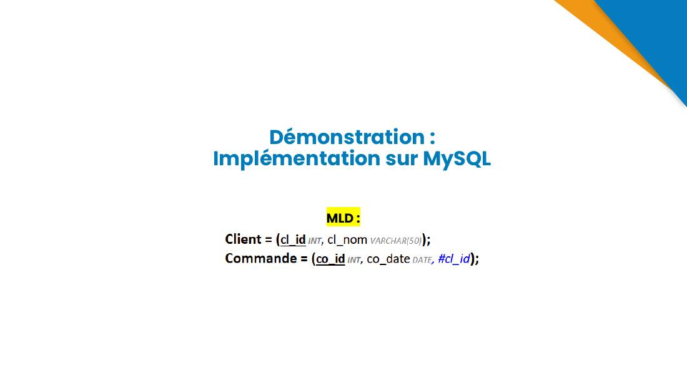{ loading=lazy .papier }](papier/ch3/p29.jpg)
    <p class="papier-legende">Démonstration : · Chapitre 3 SQL — support 2025-2026, diapo 29</p>

    [{ loading=lazy .papier }](papier/ch3/p30.jpg)
    <p class="papier-legende">Prochain CHAPITRE: · Chapitre 3 SQL — support 2025-2026, diapo 30</p>

    <!-- /papier -->
