# Chapitre 4 — Interroger : algèbre relationnelle et SQL

=== "Version simplifiée"

    Chaque opérateur de l'**algèbre relationnelle** prend des relations et renvoie
    une relation ; chacun a son équivalent SQL.

    ## Opérateurs unaires

    | Algèbre | Sens | SQL |
    |---|---|---|
    | $\pi_{A,B}(R)$ — projection | garder des colonnes (sans doublons) | `SELECT DISTINCT A, B FROM R` |
    | $\sigma_{cond}(R)$ — restriction | garder des lignes | `SELECT * FROM R WHERE cond` |
    | $\rho$ — renommage | renommer | `AS` |
    | $\tau_{A\uparrow}(R)$ — tri | ordonner | `ORDER BY A ASC` |
    | $\gamma_{A;\ \text{count}(B)\to N}(R)$ — agrégation | regrouper et calculer | `SELECT A, COUNT(B) AS N FROM R GROUP BY A` |

    Conditions SQL utiles : `IS NULL`, `IN (…)`, `BETWEEN a AND b`,
    `LIKE 'A%'` (`%` = n'importe quelle suite, `_` = un seul caractère).

    ## Agrégats, GROUP BY, HAVING

    ```sql
    SELECT habitat, chercheur, AVG(nombre) AS moyenne
    FROM Observation
    WHERE nombre > 0              -- filtre les LIGNES avant regroupement
    GROUP BY habitat, chercheur
    HAVING COUNT(*) >= 2          -- filtre les GROUPES après regroupement
    ORDER BY moyenne DESC;
    ```

    !!! piege "Règle du GROUP BY"
        Toute colonne du `SELECT` qui n'est pas dans une fonction d'agrégat
        (`COUNT`, `SUM`, `AVG`, `MIN`, `MAX`) doit figurer dans le `GROUP BY`.
        `WHERE` ne peut pas contenir d'agrégat : c'est le rôle de `HAVING`.

    ## Opérateurs binaires : produit et jointures

    - **Produit cartésien** $R \times S$ : toutes les paires (|R|·|S| lignes) — `FROM R, S` ou `CROSS JOIN`.
    - **Jointure** $R \bowtie_{cond} S = \sigma_{cond}(R \times S)$ — `R JOIN S ON cond`.

    | Jointure | Garde |
    |---|---|
    | `INNER JOIN` | seulement les lignes qui ont un correspondant |
    | `LEFT JOIN` | toutes les lignes de gauche (+ `NULL` si pas de correspondant) |
    | `RIGHT JOIN` | toutes les lignes de droite |
    | `FULL OUTER JOIN` | tout (en MySQL : `LEFT JOIN … UNION … RIGHT JOIN`) |
    | auto-jointure | une table jointe avec elle-même, avec deux alias |

    ## Sous-requêtes

    ```sql
    -- IN / NOT IN
    SELECT nom FROM Equipe WHERE id IN (SELECT id_equipe FROM Epreuve WHERE nom_epreuve = 'Le Trésor');
    -- EXISTS (sous-requête corrélée)
    SELECT nom FROM Equipe e WHERE EXISTS (SELECT * FROM Epreuve p WHERE p.id_equipe = e.id);
    -- ALL / ANY
    SELECT nom FROM Epreuve WHERE gain >= ALL (SELECT gain FROM Epreuve);
    ```

    ## Opérateurs ensemblistes

    Union $\cup$ (`UNION`, sans doublons ; `UNION ALL` les garde), intersection
    $\cap$ (`INTERSECT`), différence $\setminus$ (`EXCEPT`, ou `NOT IN` / `NOT EXISTS`).
    Les deux requêtes doivent avoir **le même nombre de colonnes, de types compatibles**.

    ## Arbre relationnel et optimisation

    Une requête se représente par un **arbre** (relations aux feuilles, opérateurs
    aux nœuds). Pour l'optimiser : **faire les restrictions le plus tôt possible**,
    puis **projeter avant les jointures** pour ne garder que les colonnes utiles :
    les jointures portent alors sur des relations plus petites.

=== "Version papier"

    Les diapos du chapitre telles que projetées en cours (L. Trébaul, 2025-2026).

    <!-- papier: pdf/TI404P/4-interrogation-algebre-sql.pdf | Chapitre 4 Algèbre et SQL — support 2025-2026 | ch4 | diapo -->

    [{ loading=lazy .papier }](papier/ch4/p01.jpg)
    <p class="papier-legende">CHAPITRE 4 : · Chapitre 4 Algèbre et SQL — support 2025-2026, diapo 1</p>

    [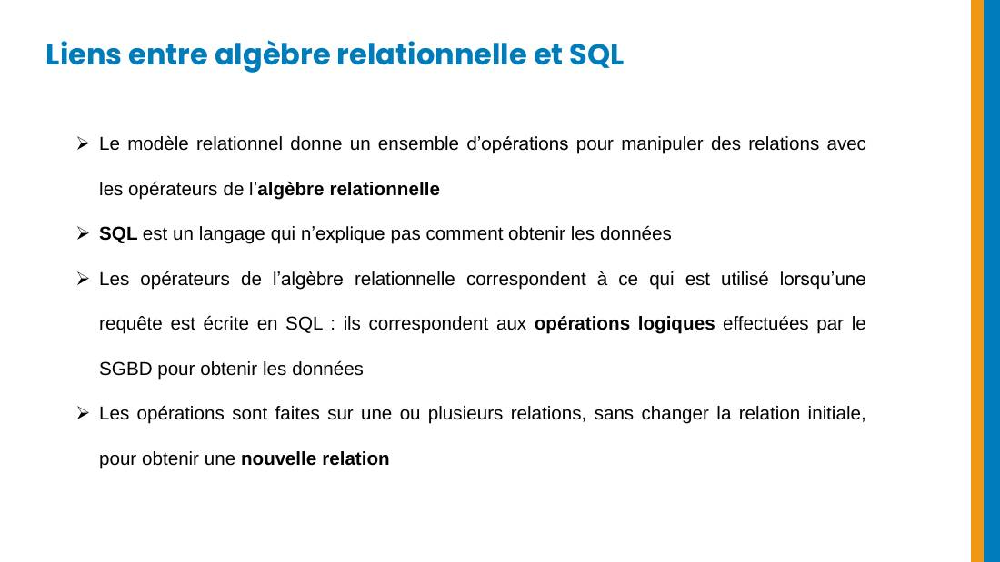{ loading=lazy .papier }](papier/ch4/p02.jpg)
    <p class="papier-legende">Liens entre algèbre relationnelle et SQL · Chapitre 4 Algèbre et SQL — support 2025-2026, diapo 2</p>

    [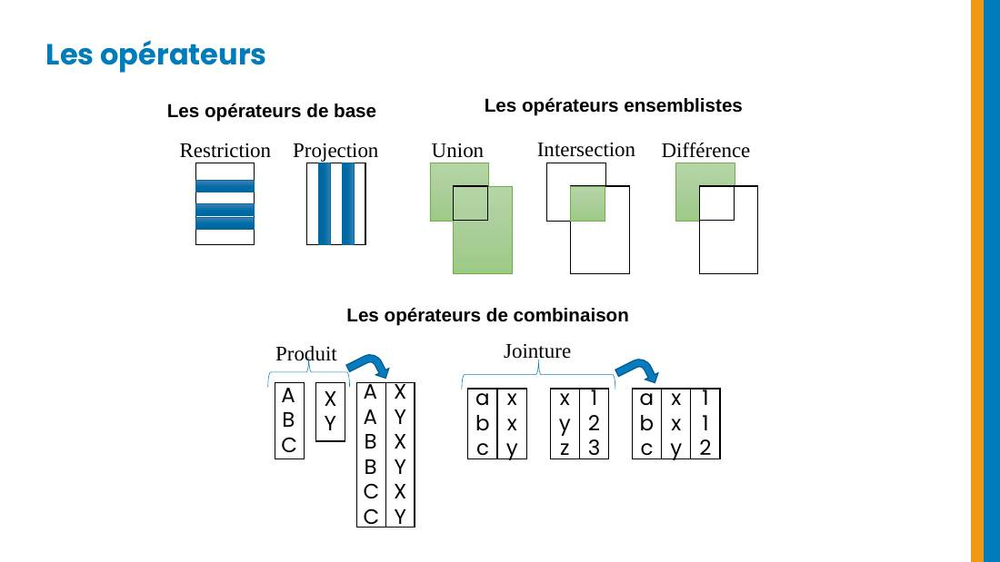{ loading=lazy .papier }](papier/ch4/p03.jpg)
    <p class="papier-legende">Les opérateurs · Chapitre 4 Algèbre et SQL — support 2025-2026, diapo 3</p>

    [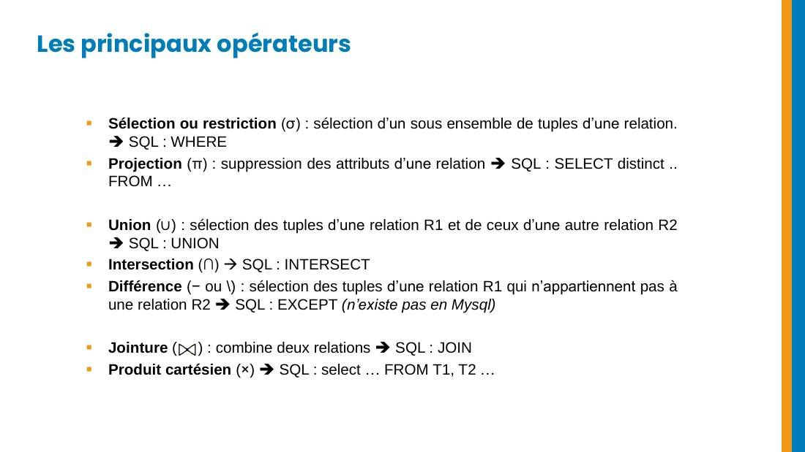{ loading=lazy .papier }](papier/ch4/p04.jpg)
    <p class="papier-legende">Les principaux opérateurs · Chapitre 4 Algèbre et SQL — support 2025-2026, diapo 4</p>

    [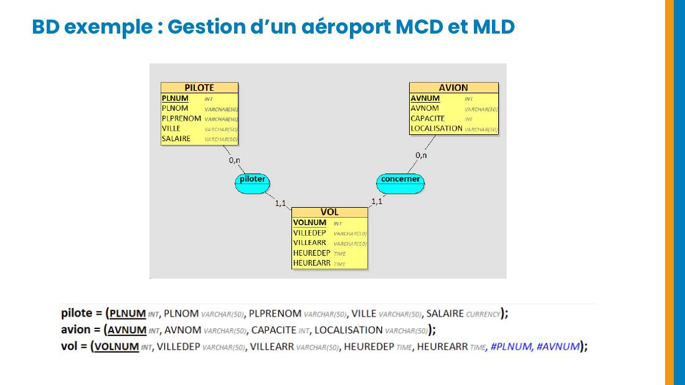{ loading=lazy .papier }](papier/ch4/p05.jpg)
    <p class="papier-legende">BD exemple : Gestion d’un aéroport MCD et MLD · Chapitre 4 Algèbre et SQL — support 2025-2026, diapo 5</p>

    [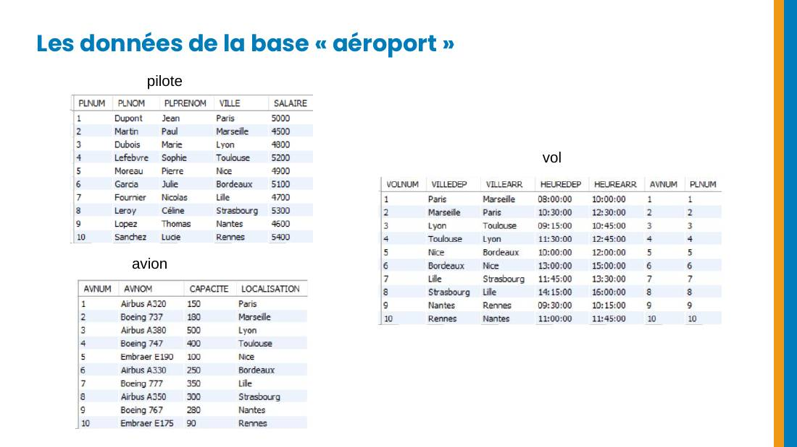{ loading=lazy .papier }](papier/ch4/p06.jpg)
    <p class="papier-legende">Les données de la base « aéroport » · Chapitre 4 Algèbre et SQL — support 2025-2026, diapo 6</p>

    [{ loading=lazy .papier }](papier/ch4/p07.jpg)
    <p class="papier-legende">Partie 1 : Opérateurs · Chapitre 4 Algèbre et SQL — support 2025-2026, diapo 7</p>

    [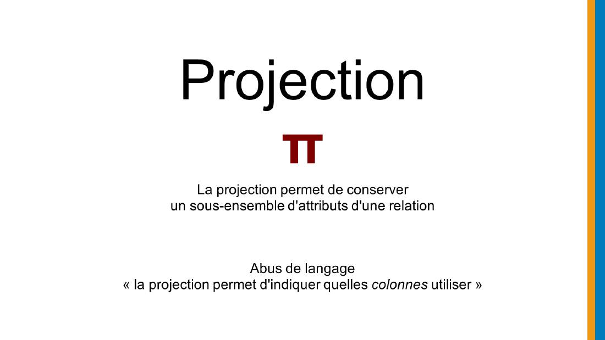{ loading=lazy .papier }](papier/ch4/p08.jpg)
    <p class="papier-legende">Chapitre 4 Algèbre et SQL — support 2025-2026, diapo 8</p>

    [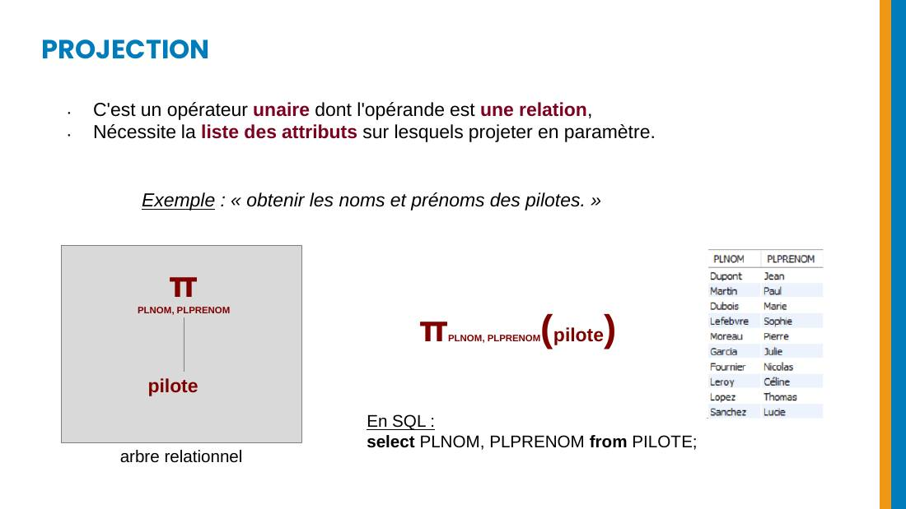{ loading=lazy .papier }](papier/ch4/p09.jpg)
    <p class="papier-legende">C&#x27;est un opérateur unaire dont l&#x27;opérande est une relation, · Chapitre 4 Algèbre et SQL — support 2025-2026, diapo 9</p>

    [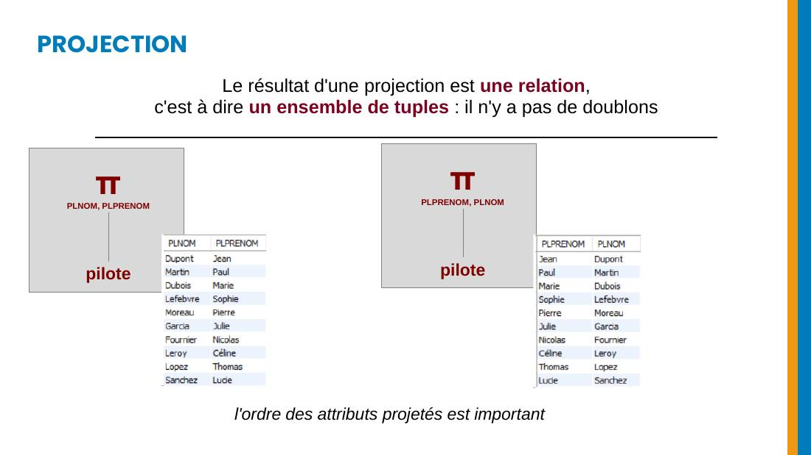{ loading=lazy .papier }](papier/ch4/p10.jpg)
    <p class="papier-legende">Le résultat d&#x27;une projection est une relation, · Chapitre 4 Algèbre et SQL — support 2025-2026, diapo 10</p>

    [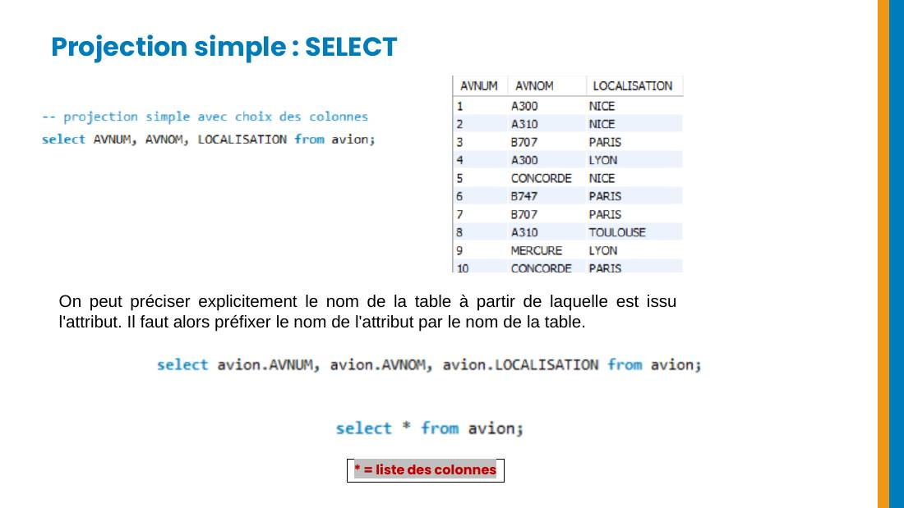{ loading=lazy .papier }](papier/ch4/p11.jpg)
    <p class="papier-legende">Projection simple : SELECT · Chapitre 4 Algèbre et SQL — support 2025-2026, diapo 11</p>

    [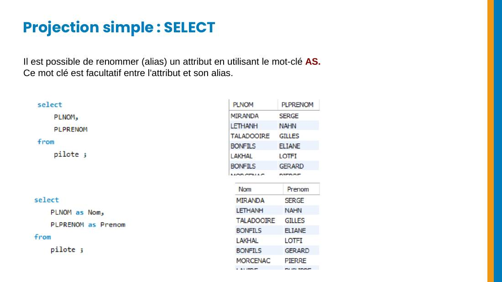{ loading=lazy .papier }](papier/ch4/p12.jpg)
    <p class="papier-legende">Projection simple : SELECT · Chapitre 4 Algèbre et SQL — support 2025-2026, diapo 12</p>

    [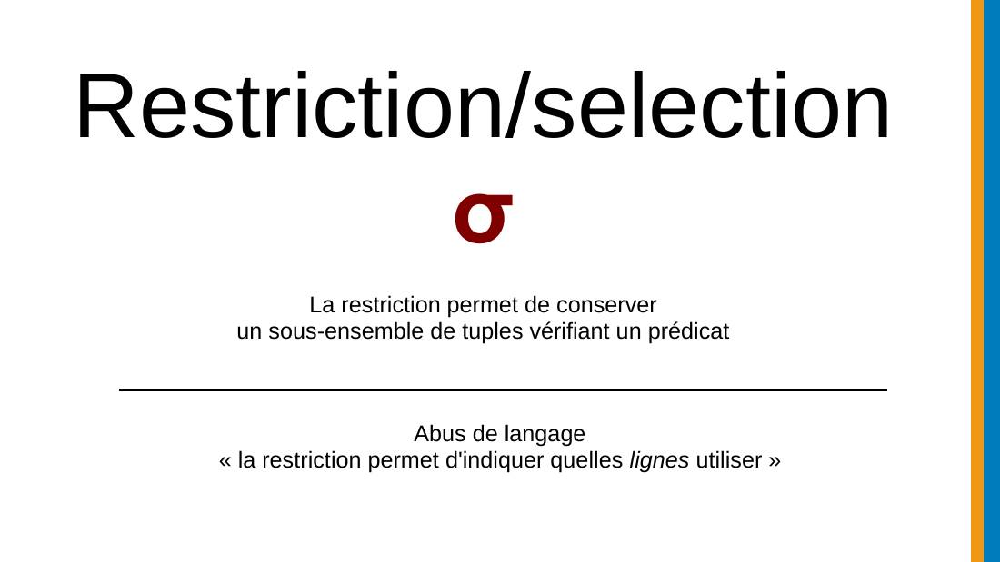{ loading=lazy .papier }](papier/ch4/p13.jpg)
    <p class="papier-legende">La restriction permet de conserver · Chapitre 4 Algèbre et SQL — support 2025-2026, diapo 13</p>

    [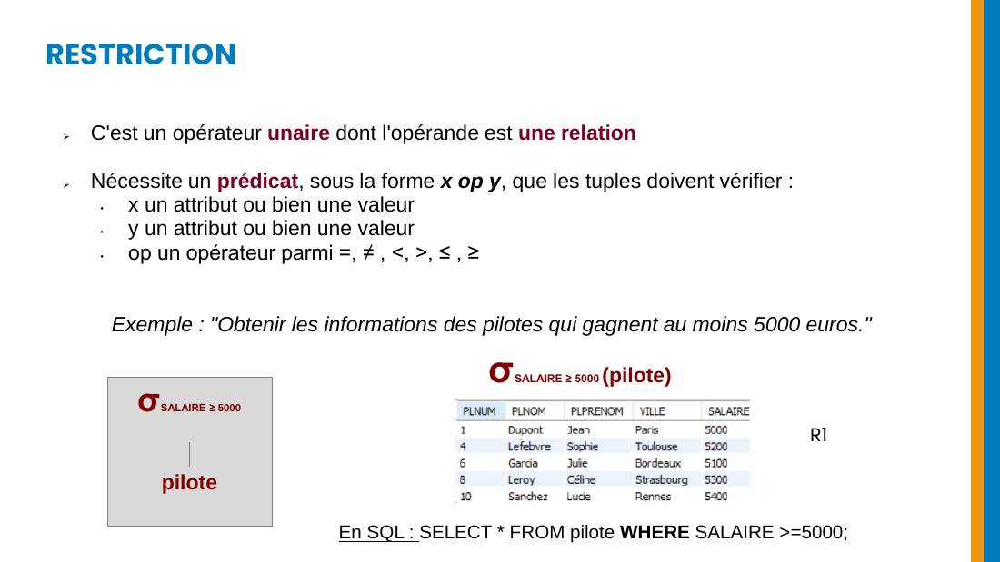{ loading=lazy .papier }](papier/ch4/p14.jpg)
    <p class="papier-legende">C&#x27;est un opérateur unaire dont l&#x27;opérande est une relation · Chapitre 4 Algèbre et SQL — support 2025-2026, diapo 14</p>

    [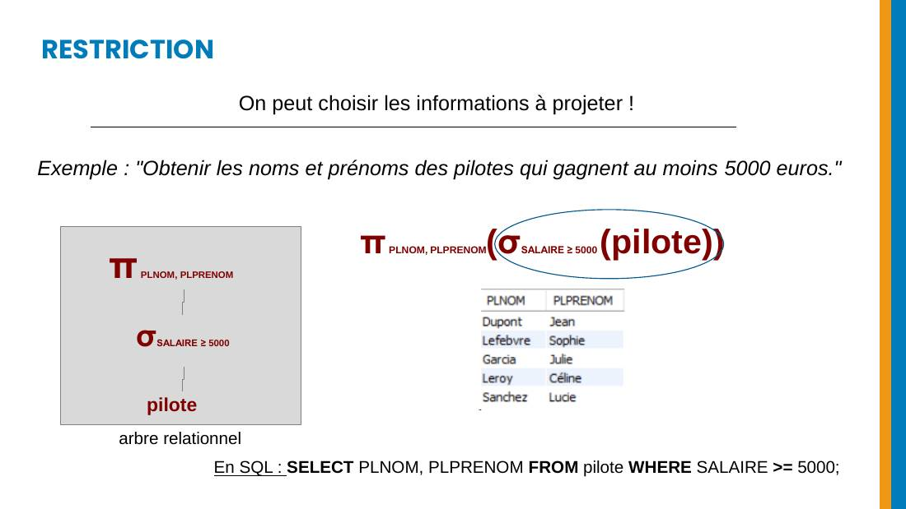{ loading=lazy .papier }](papier/ch4/p15.jpg)
    <p class="papier-legende">On peut choisir les informations à projeter ! · Chapitre 4 Algèbre et SQL — support 2025-2026, diapo 15</p>

    [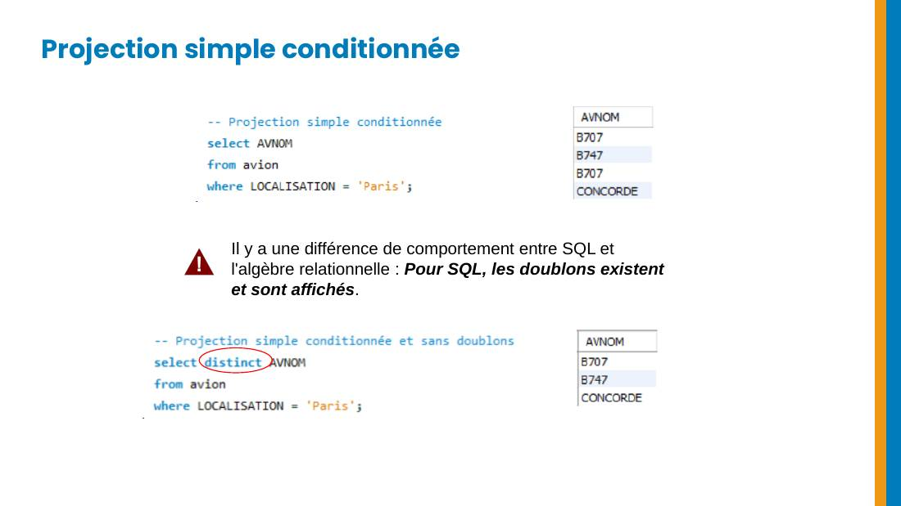{ loading=lazy .papier }](papier/ch4/p16.jpg)
    <p class="papier-legende">Projection simple conditionnée · Chapitre 4 Algèbre et SQL — support 2025-2026, diapo 16</p>

    [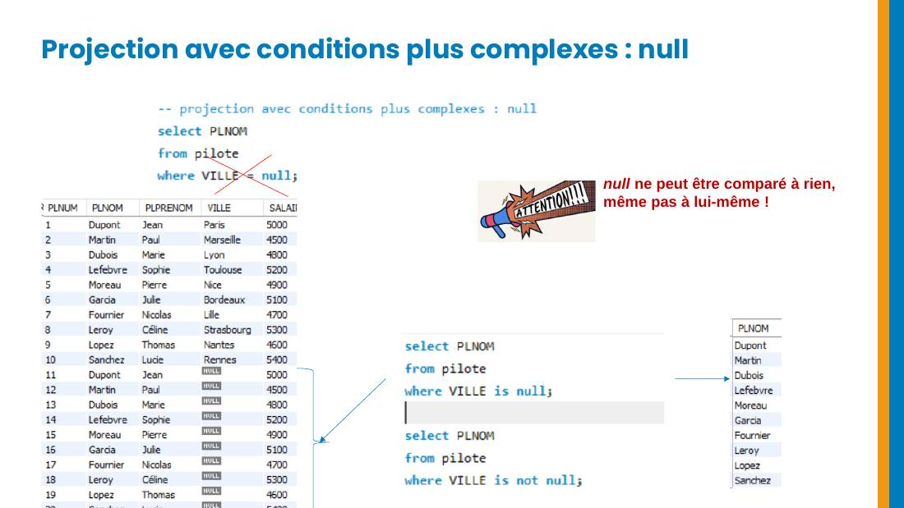{ loading=lazy .papier }](papier/ch4/p17.jpg)
    <p class="papier-legende">Projection avec conditions plus complexes : null · Chapitre 4 Algèbre et SQL — support 2025-2026, diapo 17</p>

    [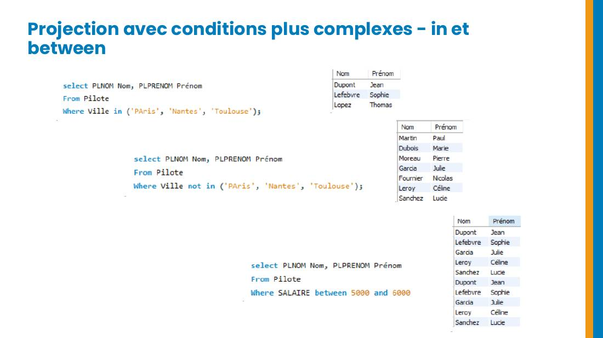{ loading=lazy .papier }](papier/ch4/p18.jpg)
    <p class="papier-legende">Projection avec conditions plus complexes - in et · Chapitre 4 Algèbre et SQL — support 2025-2026, diapo 18</p>

    [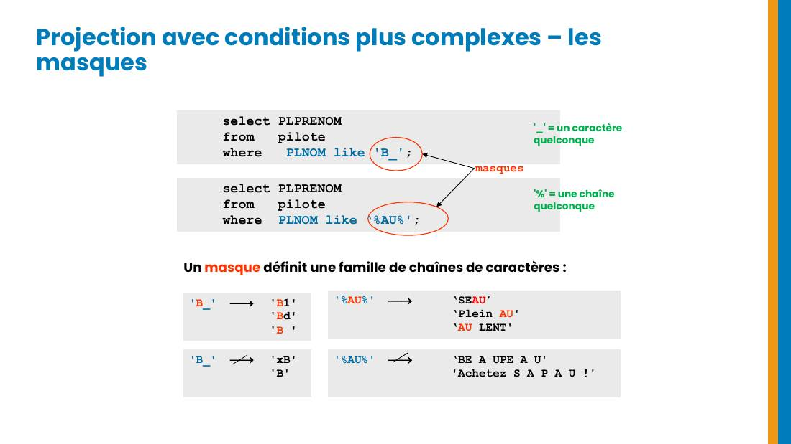{ loading=lazy .papier }](papier/ch4/p19.jpg)
    <p class="papier-legende">Projection avec conditions plus complexes – les · Chapitre 4 Algèbre et SQL — support 2025-2026, diapo 19</p>

    [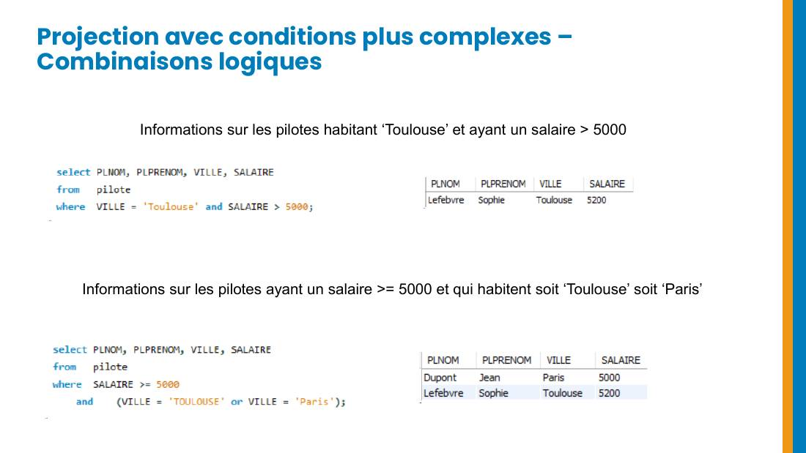{ loading=lazy .papier }](papier/ch4/p20.jpg)
    <p class="papier-legende">Projection avec conditions plus complexes · Chapitre 4 Algèbre et SQL — support 2025-2026, diapo 20</p>

    [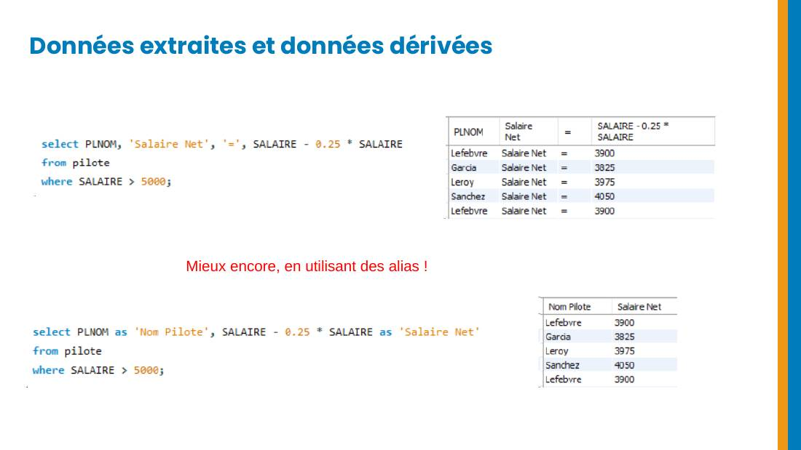{ loading=lazy .papier }](papier/ch4/p21.jpg)
    <p class="papier-legende">Données extraites et données dérivées · Chapitre 4 Algèbre et SQL — support 2025-2026, diapo 21</p>

    [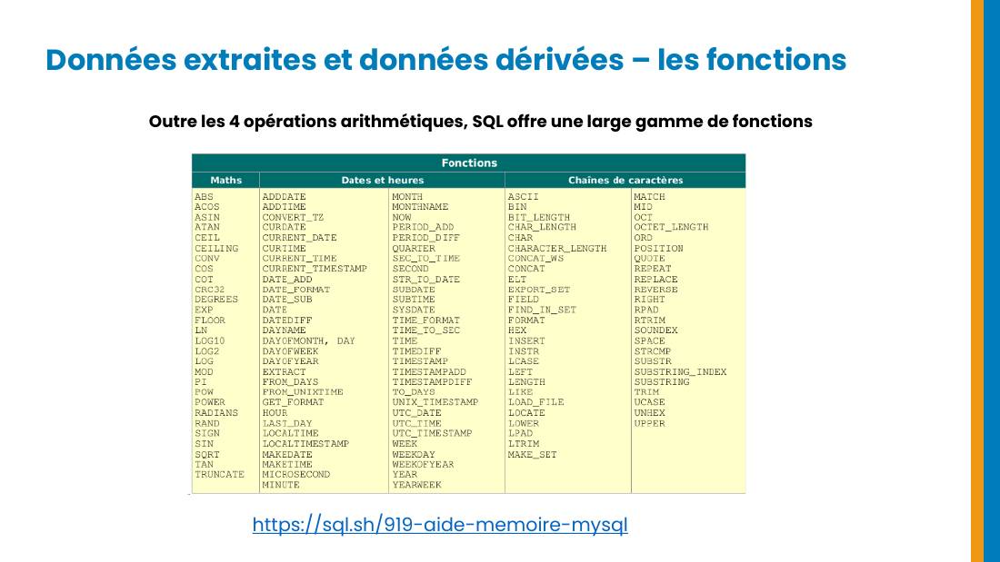{ loading=lazy .papier }](papier/ch4/p22.jpg)
    <p class="papier-legende">Données extraites et données dérivées – les fonctions · Chapitre 4 Algèbre et SQL — support 2025-2026, diapo 22</p>

    [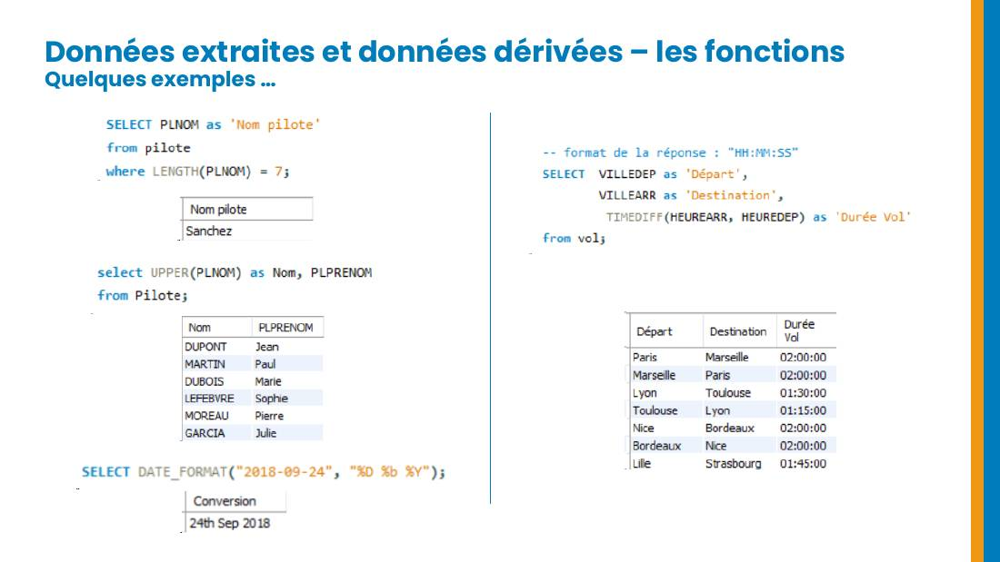{ loading=lazy .papier }](papier/ch4/p23.jpg)
    <p class="papier-legende">Données extraites et données dérivées – les fonctions · Chapitre 4 Algèbre et SQL — support 2025-2026, diapo 23</p>

    [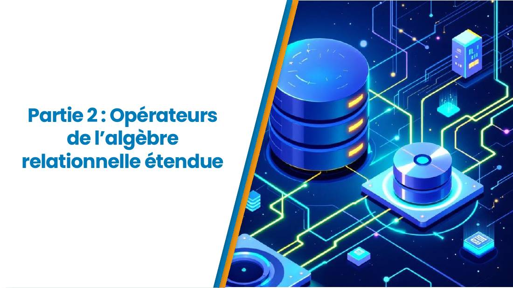{ loading=lazy .papier }](papier/ch4/p24.jpg)
    <p class="papier-legende">Partie 2 : Opérateurs · Chapitre 4 Algèbre et SQL — support 2025-2026, diapo 24</p>

    [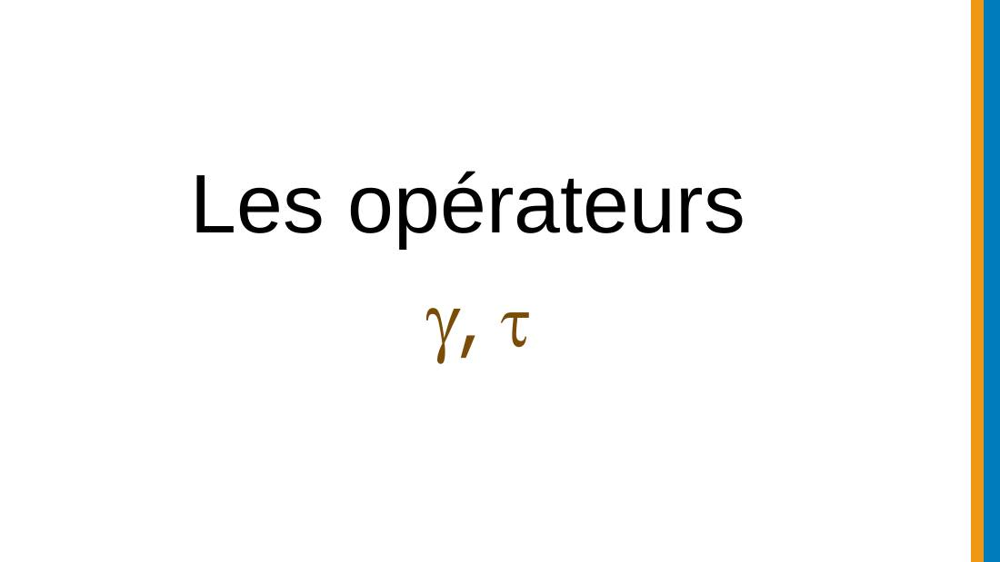{ loading=lazy .papier }](papier/ch4/p25.jpg)
    <p class="papier-legende">Les opérateurs · Chapitre 4 Algèbre et SQL — support 2025-2026, diapo 25</p>

    [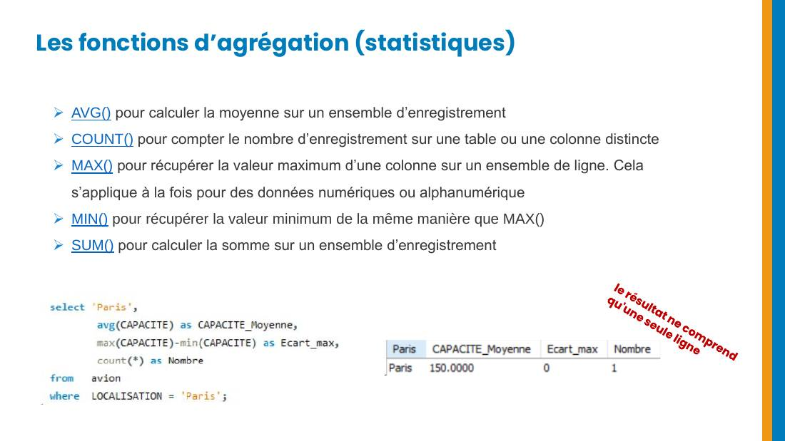{ loading=lazy .papier }](papier/ch4/p26.jpg)
    <p class="papier-legende">Les fonctions d’agrégation (statistiques) · Chapitre 4 Algèbre et SQL — support 2025-2026, diapo 26</p>

    [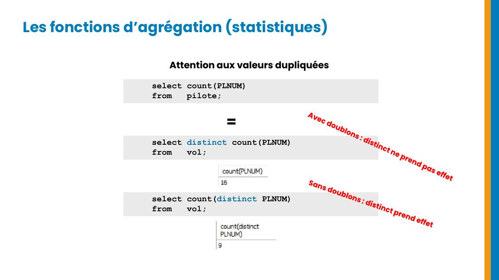{ loading=lazy .papier }](papier/ch4/p27.jpg)
    <p class="papier-legende">Les fonctions d’agrégation (statistiques) · Chapitre 4 Algèbre et SQL — support 2025-2026, diapo 27</p>

    [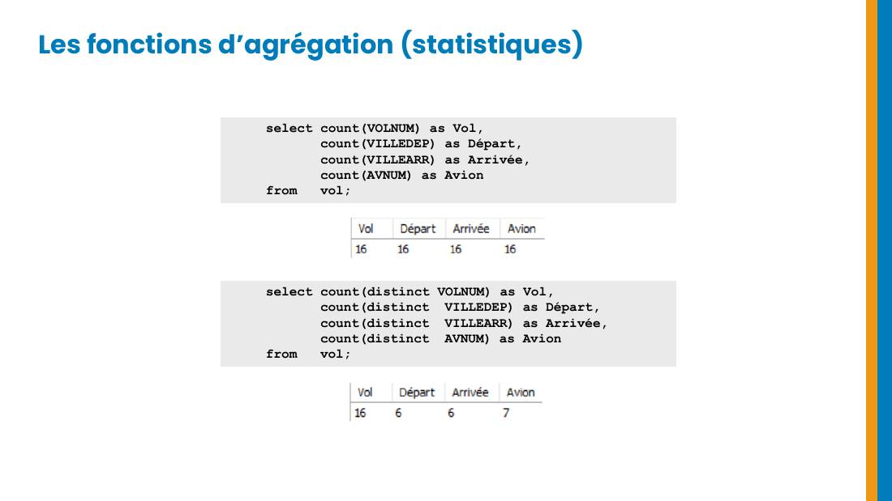{ loading=lazy .papier }](papier/ch4/p28.jpg)
    <p class="papier-legende">Les fonctions d’agrégation (statistiques) · Chapitre 4 Algèbre et SQL — support 2025-2026, diapo 28</p>

    [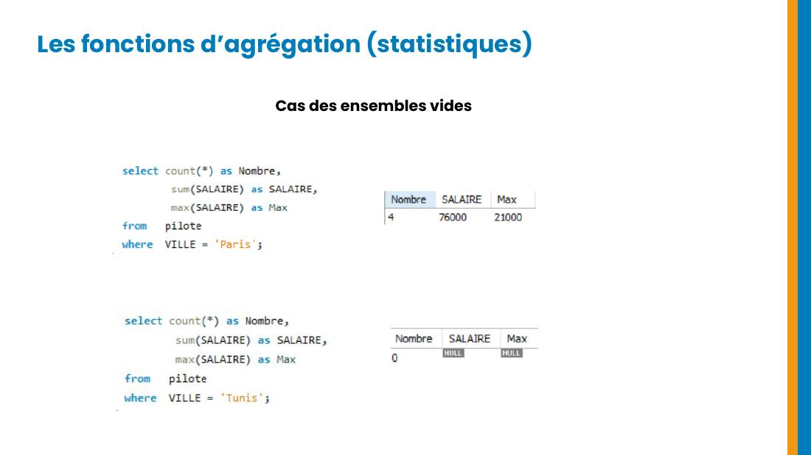{ loading=lazy .papier }](papier/ch4/p29.jpg)
    <p class="papier-legende">Les fonctions d’agrégation (statistiques) · Chapitre 4 Algèbre et SQL — support 2025-2026, diapo 29</p>

    [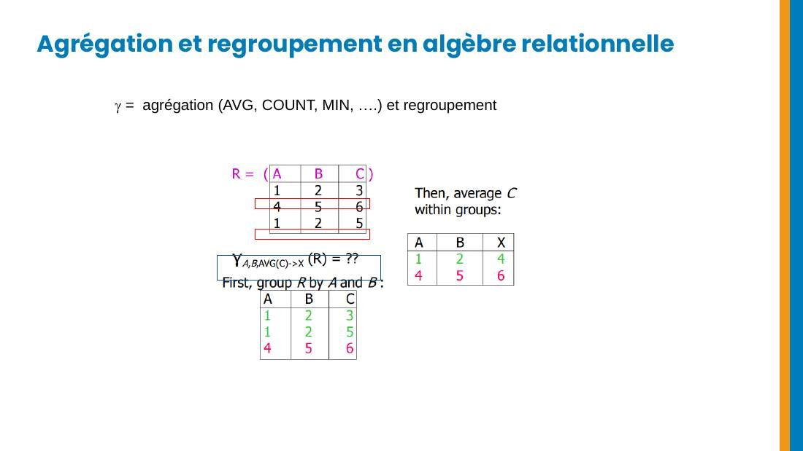{ loading=lazy .papier }](papier/ch4/p30.jpg)
    <p class="papier-legende">Agrégation et regroupement en algèbre relationnelle · Chapitre 4 Algèbre et SQL — support 2025-2026, diapo 30</p>

    [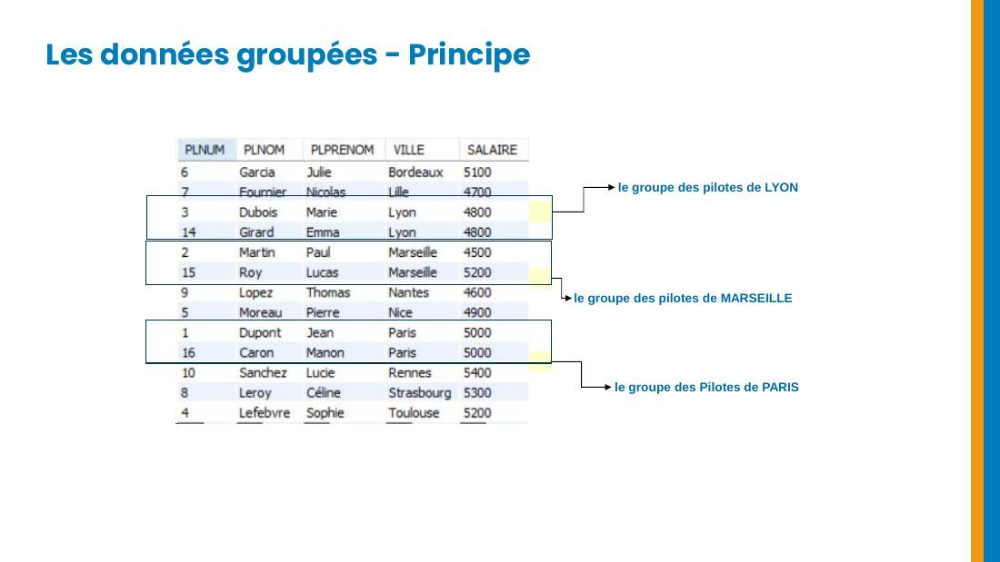{ loading=lazy .papier }](papier/ch4/p31.jpg)
    <p class="papier-legende">Les données groupées - Principe · Chapitre 4 Algèbre et SQL — support 2025-2026, diapo 31</p>

    [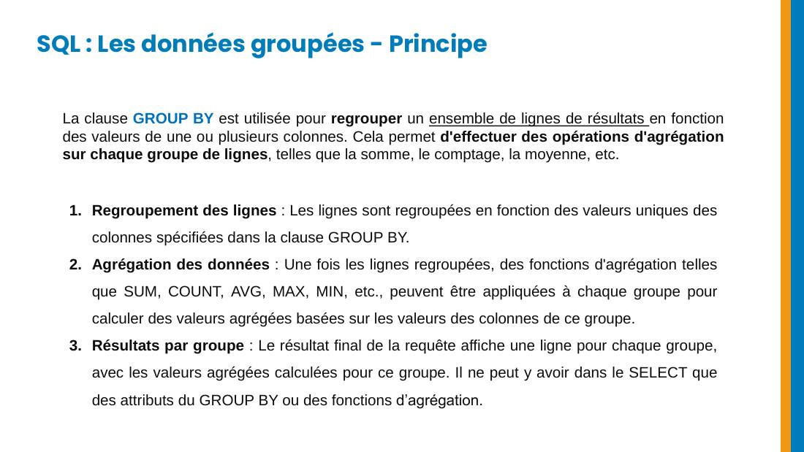{ loading=lazy .papier }](papier/ch4/p32.jpg)
    <p class="papier-legende">SQL : Les données groupées - Principe · Chapitre 4 Algèbre et SQL — support 2025-2026, diapo 32</p>

    [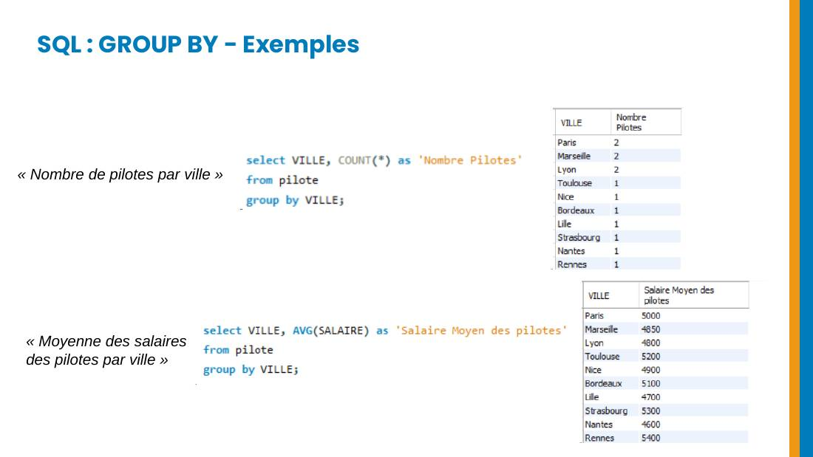{ loading=lazy .papier }](papier/ch4/p33.jpg)
    <p class="papier-legende">SQL : GROUP BY - Exemples · Chapitre 4 Algèbre et SQL — support 2025-2026, diapo 33</p>

    [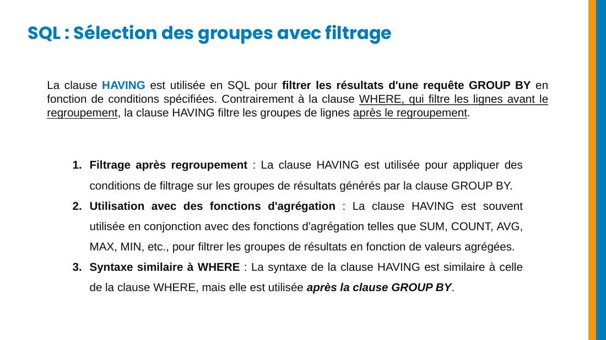{ loading=lazy .papier }](papier/ch4/p34.jpg)
    <p class="papier-legende">SQL : Sélection des groupes avec filtrage · Chapitre 4 Algèbre et SQL — support 2025-2026, diapo 34</p>

    [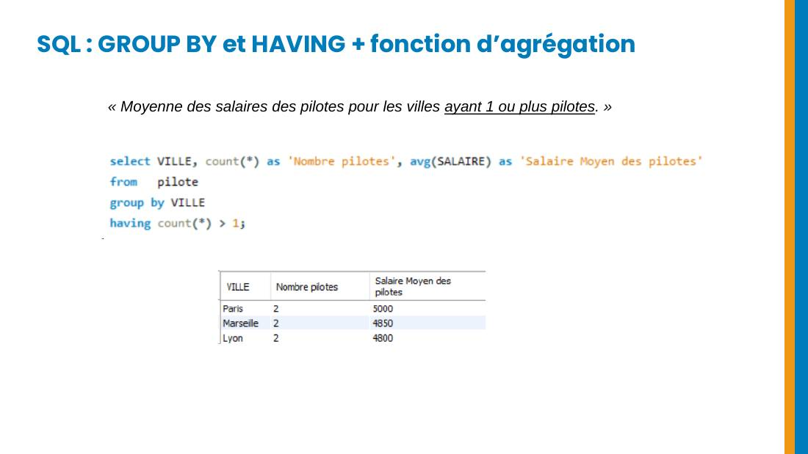{ loading=lazy .papier }](papier/ch4/p35.jpg)
    <p class="papier-legende">SQL : GROUP BY et HAVING + fonction d’agrégation · Chapitre 4 Algèbre et SQL — support 2025-2026, diapo 35</p>

    [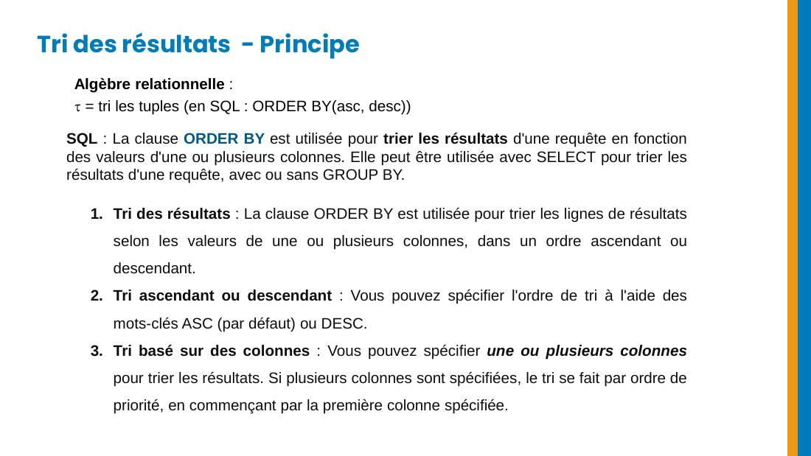{ loading=lazy .papier }](papier/ch4/p36.jpg)
    <p class="papier-legende">Tri des résultats - Principe · Chapitre 4 Algèbre et SQL — support 2025-2026, diapo 36</p>

    [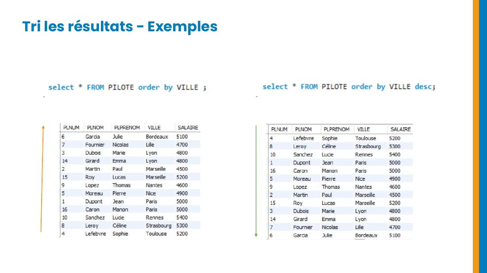{ loading=lazy .papier }](papier/ch4/p37.jpg)
    <p class="papier-legende">Tri les résultats - Exemples · Chapitre 4 Algèbre et SQL — support 2025-2026, diapo 37</p>

    [{ loading=lazy .papier }](papier/ch4/p38.jpg)
    <p class="papier-legende">Partie 3 : Opérateurs · Chapitre 4 Algèbre et SQL — support 2025-2026, diapo 38</p>

    [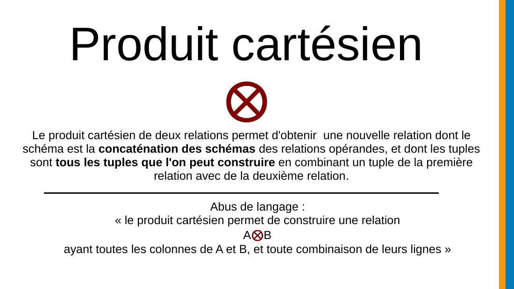{ loading=lazy .papier }](papier/ch4/p39.jpg)
    <p class="papier-legende">Produit cartésien · Chapitre 4 Algèbre et SQL — support 2025-2026, diapo 39</p>

    [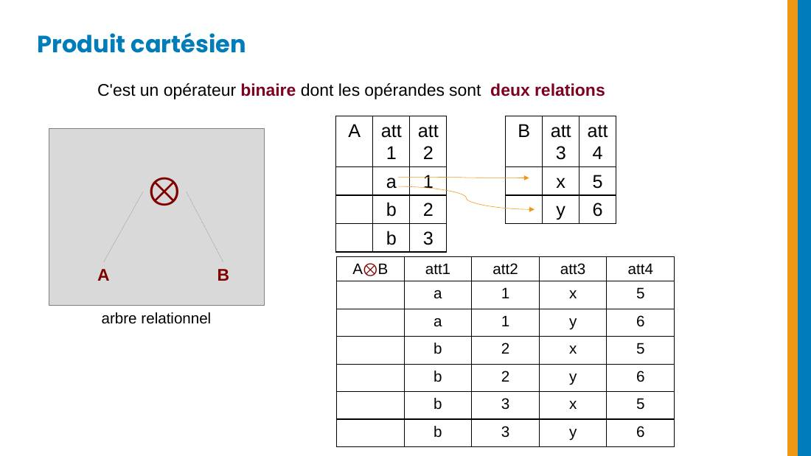{ loading=lazy .papier }](papier/ch4/p40.jpg)
    <p class="papier-legende">Produit cartésien · Chapitre 4 Algèbre et SQL — support 2025-2026, diapo 40</p>

    [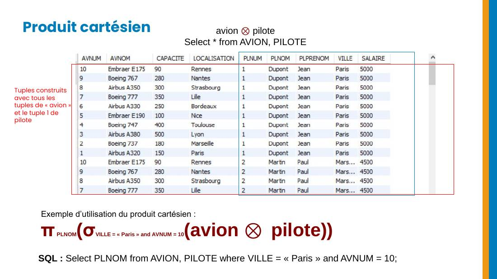{ loading=lazy .papier }](papier/ch4/p41.jpg)
    <p class="papier-legende">Produit cartésien · Chapitre 4 Algèbre et SQL — support 2025-2026, diapo 41</p>

    [{ loading=lazy .papier }](papier/ch4/p42.jpg)
    <p class="papier-legende">Un opérateur spécifique pour associer des relations selon un lien logique · Chapitre 4 Algèbre et SQL — support 2025-2026, diapo 42</p>

    [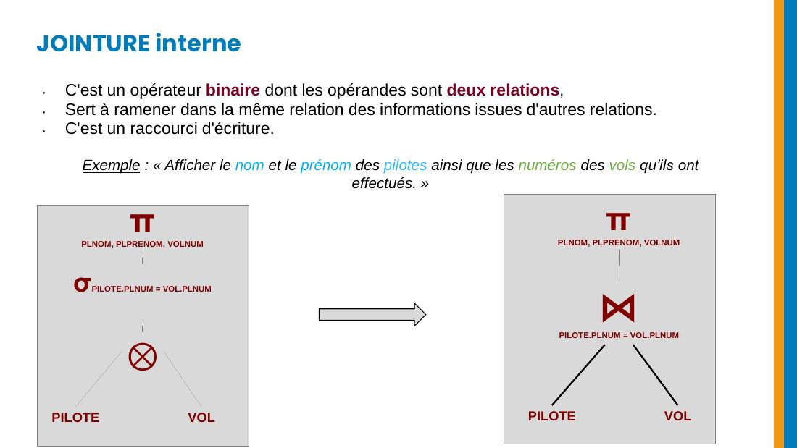{ loading=lazy .papier }](papier/ch4/p43.jpg)
    <p class="papier-legende">JOINTURE interne · Chapitre 4 Algèbre et SQL — support 2025-2026, diapo 43</p>

    [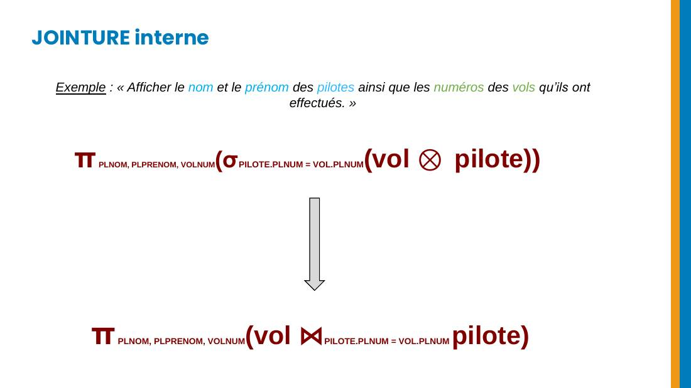{ loading=lazy .papier }](papier/ch4/p44.jpg)
    <p class="papier-legende">JOINTURE interne · Chapitre 4 Algèbre et SQL — support 2025-2026, diapo 44</p>

    [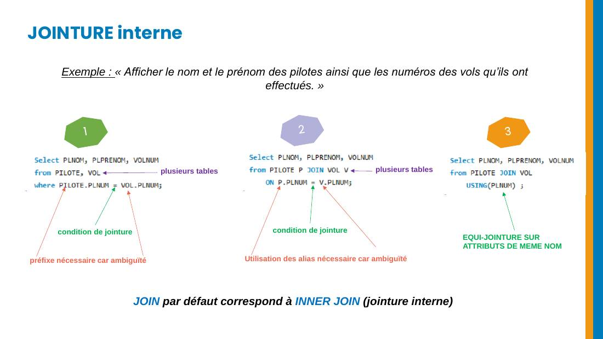{ loading=lazy .papier }](papier/ch4/p45.jpg)
    <p class="papier-legende">JOINTURE interne · Chapitre 4 Algèbre et SQL — support 2025-2026, diapo 45</p>

    [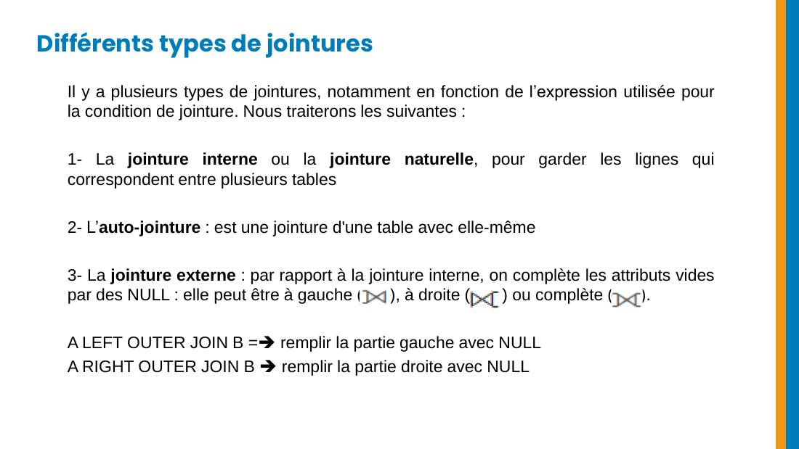{ loading=lazy .papier }](papier/ch4/p46.jpg)
    <p class="papier-legende">Différents types de jointures · Chapitre 4 Algèbre et SQL — support 2025-2026, diapo 46</p>

    [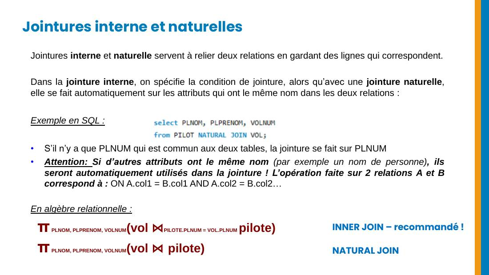{ loading=lazy .papier }](papier/ch4/p47.jpg)
    <p class="papier-legende">Jointures interne et naturelles · Chapitre 4 Algèbre et SQL — support 2025-2026, diapo 47</p>

    [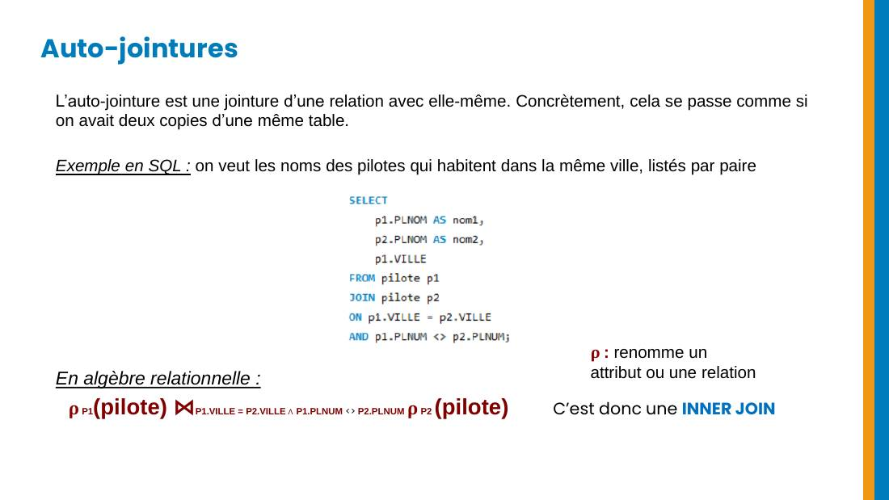{ loading=lazy .papier }](papier/ch4/p48.jpg)
    <p class="papier-legende">L’auto-jointure est une jointure d’une relation avec elle-même. Concrètement, cela se pass… · Chapitre 4 Algèbre et SQL — support 2025-2026, diapo 48</p>

    [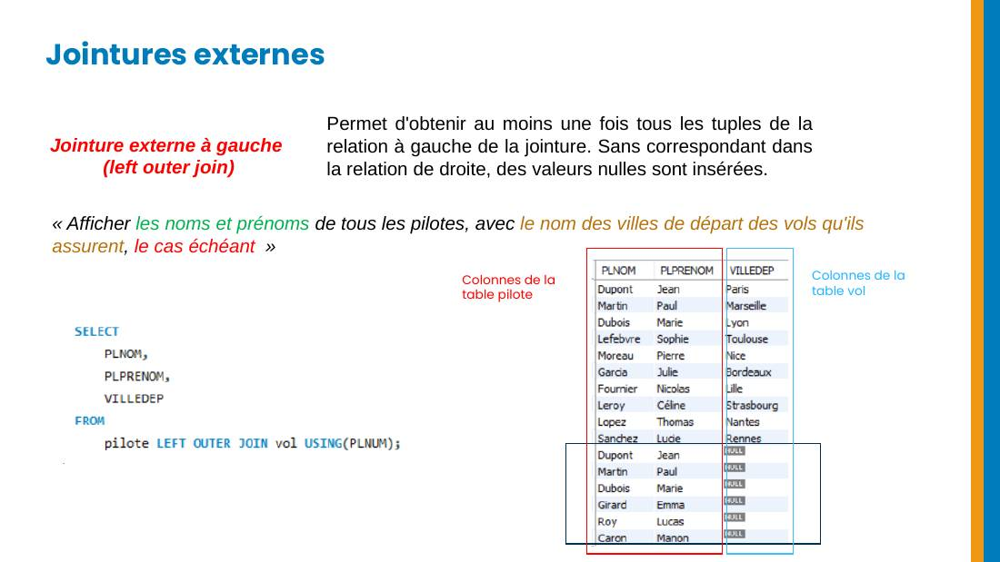{ loading=lazy .papier }](papier/ch4/p49.jpg)
    <p class="papier-legende">Jointures externes · Chapitre 4 Algèbre et SQL — support 2025-2026, diapo 49</p>

    [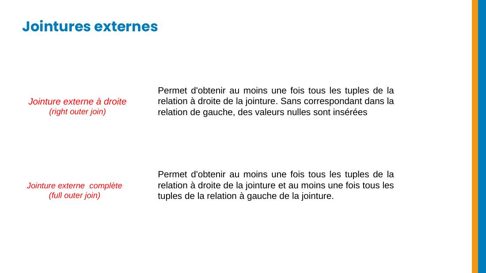{ loading=lazy .papier }](papier/ch4/p50.jpg)
    <p class="papier-legende">Jointures externes · Chapitre 4 Algèbre et SQL — support 2025-2026, diapo 50</p>

    [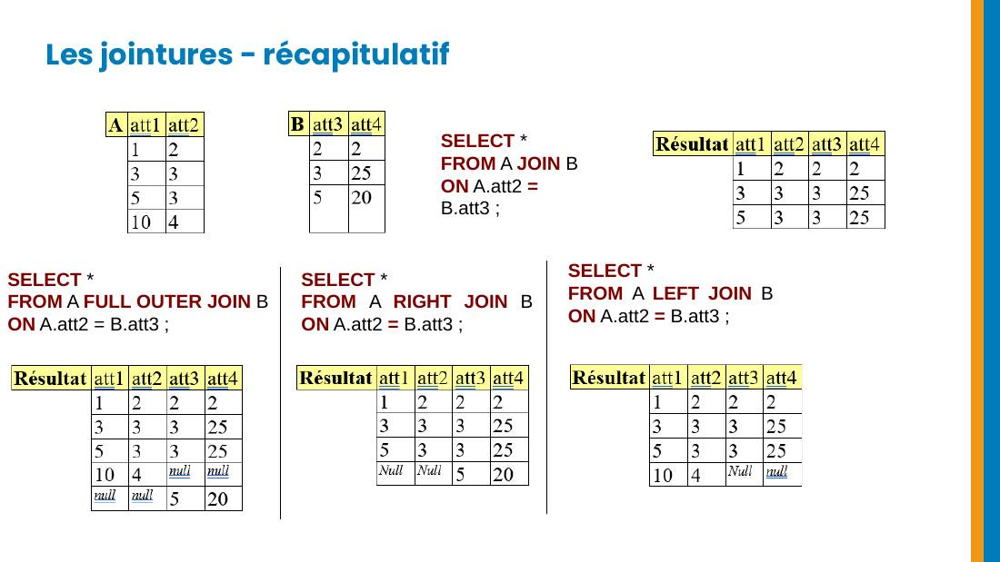{ loading=lazy .papier }](papier/ch4/p51.jpg)
    <p class="papier-legende">Les jointures - récapitulatif · Chapitre 4 Algèbre et SQL — support 2025-2026, diapo 51</p>

    [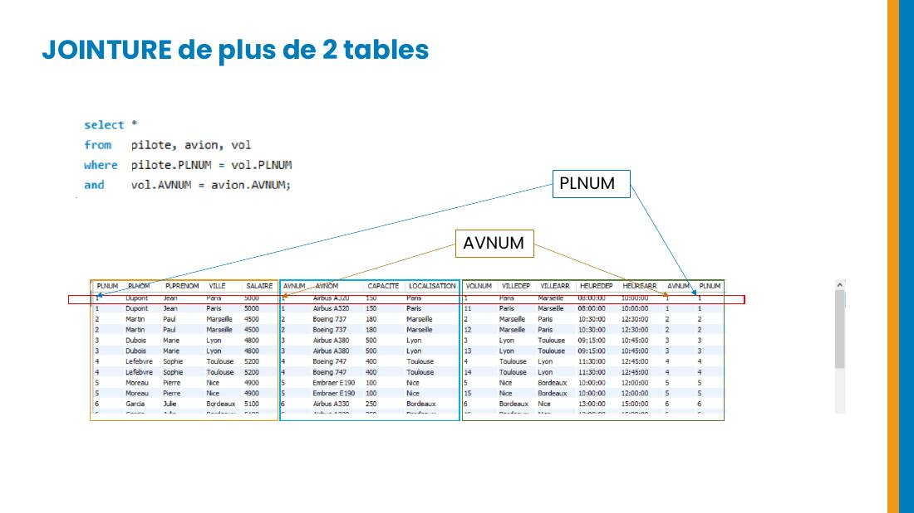{ loading=lazy .papier }](papier/ch4/p52.jpg)
    <p class="papier-legende">JOINTURE de plus de 2 tables · Chapitre 4 Algèbre et SQL — support 2025-2026, diapo 52</p>

    [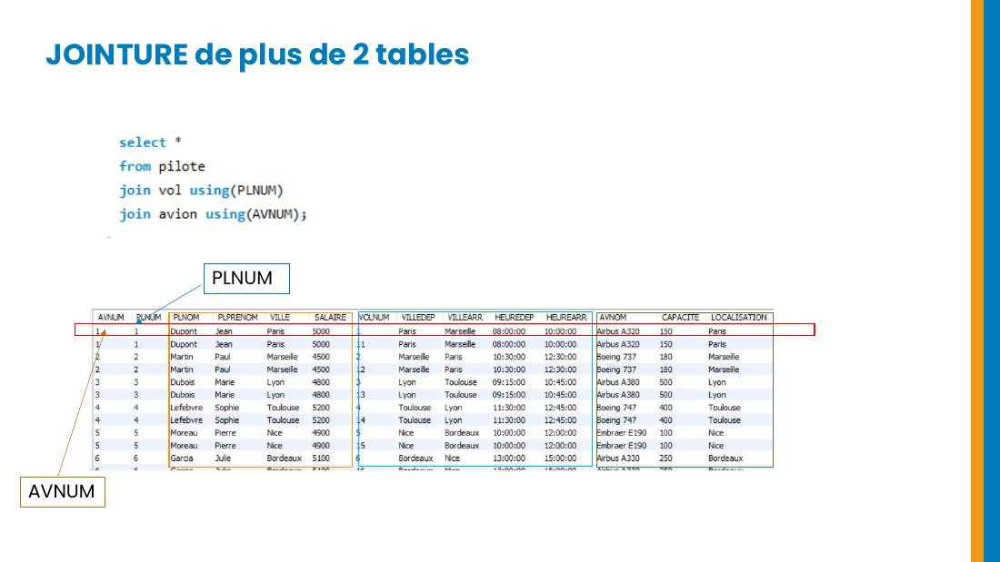{ loading=lazy .papier }](papier/ch4/p53.jpg)
    <p class="papier-legende">JOINTURE de plus de 2 tables · Chapitre 4 Algèbre et SQL — support 2025-2026, diapo 53</p>

    [{ loading=lazy .papier }](papier/ch4/p54.jpg)
    <p class="papier-legende">Les sous-requêtes/ · Chapitre 4 Algèbre et SQL — support 2025-2026, diapo 54</p>

    [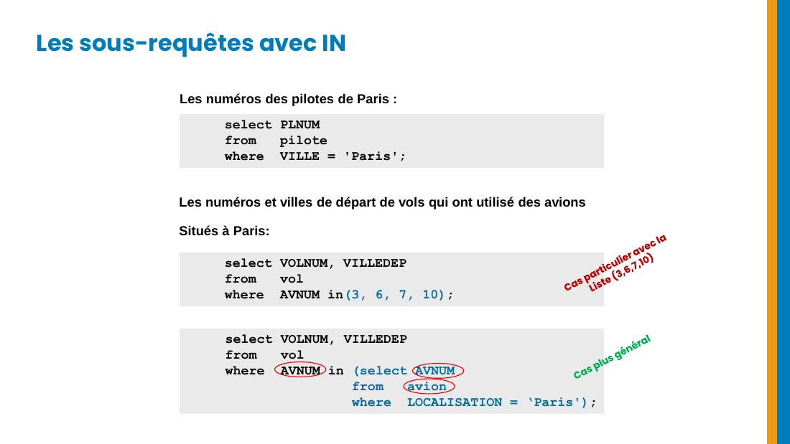{ loading=lazy .papier }](papier/ch4/p55.jpg)
    <p class="papier-legende">Les sous-requêtes avec IN · Chapitre 4 Algèbre et SQL — support 2025-2026, diapo 55</p>

    [{ loading=lazy .papier }](papier/ch4/p56.jpg)
    <p class="papier-legende">Les sous-requêtes avec IN · Chapitre 4 Algèbre et SQL — support 2025-2026, diapo 56</p>

    [{ loading=lazy .papier }](papier/ch4/p57.jpg)
    <p class="papier-legende">Les sous-requêtes – conditions d’association · Chapitre 4 Algèbre et SQL — support 2025-2026, diapo 57</p>

    [{ loading=lazy .papier }](papier/ch4/p58.jpg)
    <p class="papier-legende">Les sous-requêtes – Références multiples · Chapitre 4 Algèbre et SQL — support 2025-2026, diapo 58</p>

    [{ loading=lazy .papier }](papier/ch4/p59.jpg)
    <p class="papier-legende">Les sous-requêtes – Références multiples · Chapitre 4 Algèbre et SQL — support 2025-2026, diapo 59</p>

    [{ loading=lazy .papier }](papier/ch4/p60.jpg)
    <p class="papier-legende">Les quantificateurs ensemblistes - EXISTS, NOT EXISTS · Chapitre 4 Algèbre et SQL — support 2025-2026, diapo 60</p>

    [{ loading=lazy .papier }](papier/ch4/p61.jpg)
    <p class="papier-legende">Equivalence requêtes imbriquées et jointures · Chapitre 4 Algèbre et SQL — support 2025-2026, diapo 61</p>

    [{ loading=lazy .papier }](papier/ch4/p62.jpg)
    <p class="papier-legende">Les quantificateurs ensemblistes - ALL, ANY · Chapitre 4 Algèbre et SQL — support 2025-2026, diapo 62</p>

    [{ loading=lazy .papier }](papier/ch4/p63.jpg)
    <p class="papier-legende">Les quantificateurs ensemblistes - ALL, ANY · Chapitre 4 Algèbre et SQL — support 2025-2026, diapo 63</p>

    [{ loading=lazy .papier }](papier/ch4/p64.jpg)
    <p class="papier-legende">Défi 1 : Tester vos connaissances ! · Chapitre 4 Algèbre et SQL — support 2025-2026, diapo 64</p>

    [{ loading=lazy .papier }](papier/ch4/p65.jpg)
    <p class="papier-legende">Défi 1 : Tester vos connaissances ! · Chapitre 4 Algèbre et SQL — support 2025-2026, diapo 65</p>

    [{ loading=lazy .papier }](papier/ch4/p66.jpg)
    <p class="papier-legende">Défi 2 : Tester vos connaissances ! · Chapitre 4 Algèbre et SQL — support 2025-2026, diapo 66</p>

    [{ loading=lazy .papier }](papier/ch4/p67.jpg)
    <p class="papier-legende">Défi 2 : Tester vos connaissances ! · Chapitre 4 Algèbre et SQL — support 2025-2026, diapo 67</p>

    [{ loading=lazy .papier }](papier/ch4/p68.jpg)
    <p class="papier-legende">Partie 4 : Opérateurs · Chapitre 4 Algèbre et SQL — support 2025-2026, diapo 68</p>

    [{ loading=lazy .papier }](papier/ch4/p69.jpg)
    <p class="papier-legende">∪ Union · Chapitre 4 Algèbre et SQL — support 2025-2026, diapo 69</p>

    [{ loading=lazy .papier }](papier/ch4/p70.jpg)
    <p class="papier-legende">∩ Intersection · Chapitre 4 Algèbre et SQL — support 2025-2026, diapo 70</p>

    [{ loading=lazy .papier }](papier/ch4/p71.jpg)
    <p class="papier-legende">\ Différence · Chapitre 4 Algèbre et SQL — support 2025-2026, diapo 71</p>

    [{ loading=lazy .papier }](papier/ch4/p72.jpg)
    <p class="papier-legende">SQL : Opérations ensemblistes · Chapitre 4 Algèbre et SQL — support 2025-2026, diapo 72</p>

    [{ loading=lazy .papier }](papier/ch4/p73.jpg)
    <p class="papier-legende">SQL : Opérations ensemblistes · Chapitre 4 Algèbre et SQL — support 2025-2026, diapo 73</p>

    [{ loading=lazy .papier }](papier/ch4/p74.jpg)
    <p class="papier-legende">SQL : Opérations ensemblistes – les multi-ensembles · Chapitre 4 Algèbre et SQL — support 2025-2026, diapo 74</p>

    [{ loading=lazy .papier }](papier/ch4/p75.jpg)
    <p class="papier-legende">SQL : Opérations ensemblistes – Expressions complexes · Chapitre 4 Algèbre et SQL — support 2025-2026, diapo 75</p>

    [{ loading=lazy .papier }](papier/ch4/p76.jpg)
    <p class="papier-legende">Partie 5 : Arbre · Chapitre 4 Algèbre et SQL — support 2025-2026, diapo 76</p>

    [{ loading=lazy .papier }](papier/ch4/p77.jpg)
    <p class="papier-legende">Algèbre relationnelle : Représentation graphique · Chapitre 4 Algèbre et SQL — support 2025-2026, diapo 77</p>

    [{ loading=lazy .papier }](papier/ch4/p78.jpg)
    <p class="papier-legende">Pourquoi connaître l’algèbre relationnelle ? · Chapitre 4 Algèbre et SQL — support 2025-2026, diapo 78</p>

    [{ loading=lazy .papier }](papier/ch4/p79.jpg)
    <p class="papier-legende">Quelques règles pour l’optimisation · Chapitre 4 Algèbre et SQL — support 2025-2026, diapo 79</p>

    [{ loading=lazy .papier }](papier/ch4/p80.jpg)
    <p class="papier-legende">Création d’un arbre relationnel · Chapitre 4 Algèbre et SQL — support 2025-2026, diapo 80</p>

    [{ loading=lazy .papier }](papier/ch4/p81.jpg)
    <p class="papier-legende">Chapitre 4 Algèbre et SQL — support 2025-2026, diapo 81</p>

    <!-- /papier -->
