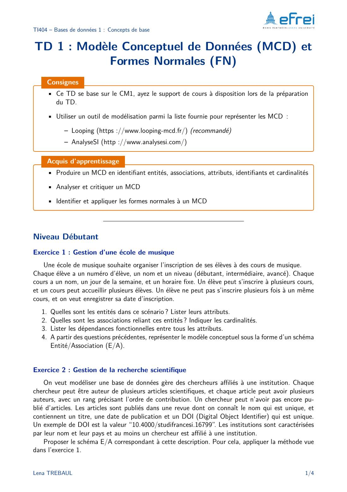
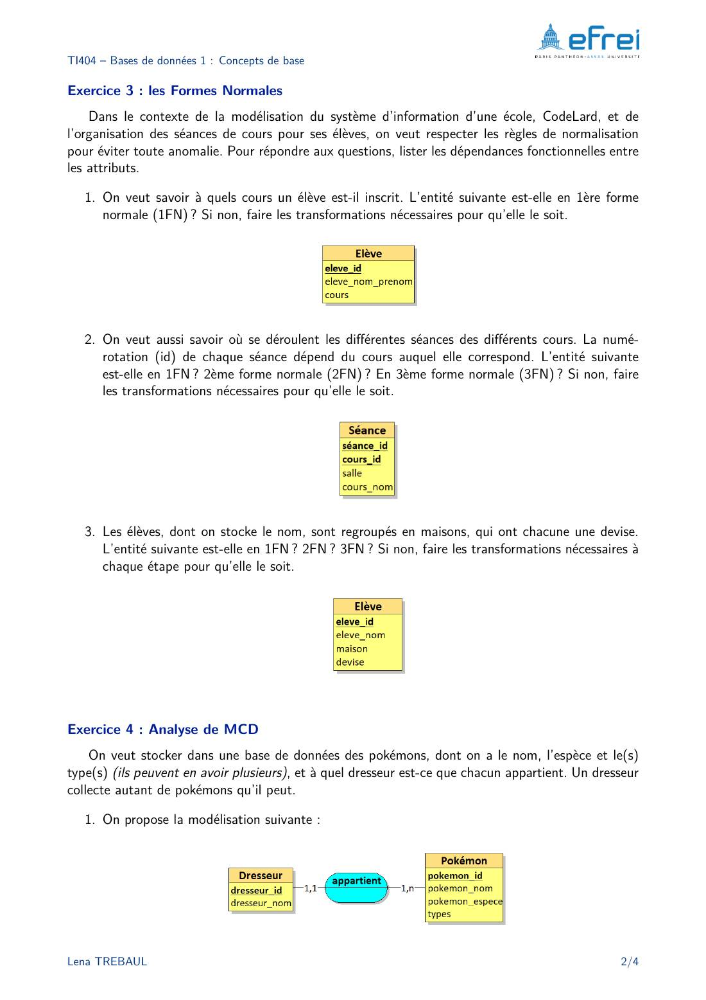
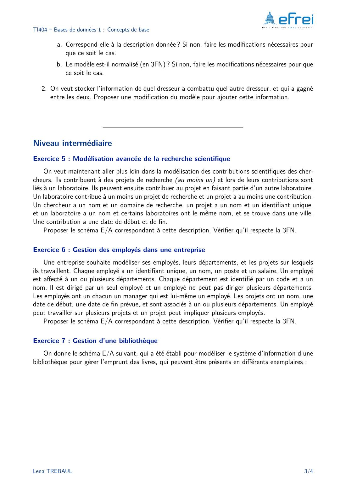
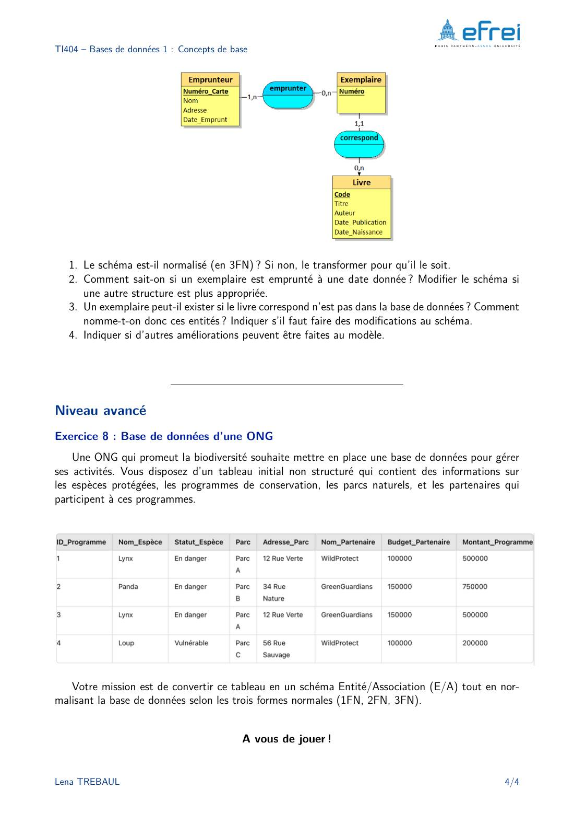

# TD 1 — Modèle conceptuel de données et formes normales

=== "Version simplifiée"

    Rappels : [chapitre 1](../cours/chapitre-1-mcd.md). Les schémas proposés par
    l'énoncé (exercices 3, 4, 7) sont dans l'onglet **Version papier**. Les MCD
    ci-dessous sont écrits en texte : `Entité (identifiant, attributs)` et
    `Entité1 (min,max) — association [attributs] — (min,max) Entité2`.

    ## Exercice 1 — École de musique

    - **Entités** : `Élève (num_élève, nom, niveau)` et `Cours (id_cours, nom, jour, horaire)`
      (on ajoute un identifiant au cours : le nom seul ne suffit pas forcément).
    - **Association** : Élève `(0,n)` — *s'inscrire* [date_inscription] — `(0,n)` Cours.
    - **DF** : num_élève → nom, niveau ; id_cours → nom, jour, horaire ;
      (num_élève, id_cours) → date_inscription.
    - « Pas deux inscriptions au même cours » est garanti par l'identifiant
      (num_élève, id_cours) de l'association.

    ## Exercice 2 — Recherche scientifique

    - `Chercheur (id_chercheur, nom)` `(0,n)` — *écrire* [rang] — `(1,n)` `Article (DOI, titre, date_publication)`
      (un chercheur peut ne pas avoir publié ; un article a au moins un auteur).
    - `Article` `(1,1)` — *publié dans* — `(0,n)` `Revue (nom_revue)`.
    - `Chercheur` `(1,1)` — *affilié à* — `(1,n)` `Institution (id_institution, nom, pays)`.
    - Le **rang** dépend du couple (chercheur, article) : il est sur l'association.

    ## Exercice 3 — Formes normales (CodeLard)

    !!! methode "Démarche pour chaque table"
        1. Lister les DF.
        2. 1FN : un attribut contient-il une liste ? → une ligne par valeur ou une nouvelle entité.
        3. 2FN : avec une clé composée, un attribut dépend-il d'une partie seulement ? → le sortir.
        4. 3FN : un attribut non clé dépend-il d'un autre non clé ? → nouvelle entité.

    - Élève avec une liste de cours → pas 1FN : association Élève — *suivre* — Cours.
    - Séance (id_cours, id_séance, salle, intitulé du cours…) : l'intitulé dépend
      de id_cours seul → pas 2FN ; Séance devient une **entité faible** de Cours.
    - Élève (id, nom, maison, devise) : maison → devise est transitive → pas 3FN :
      entité `Maison (nom_maison, devise)` reliée par Élève `(1,1)` — `(1,n)` Maison.

    ## Exercice 4 — Pokémons

    - Un pokémon peut avoir **plusieurs types** : entité `Type` et association
      Pokémon `(1,n)` — *avoir* — `(0,n)` Type (pas d'attribut multivalué).
    - L'espèce détermine les types et caractéristiques communes : entité `Espèce`
      pour respecter la 3FN, Pokémon `(1,1)` — *être de* — `(0,n)` Espèce.
    - Pokémon `(1,1)` — *appartenir* — `(0,n)` Dresseur.
    - Combats : association **réflexive** Dresseur `(0,n)` — *combattre* [date, gagnant] — `(0,n)` Dresseur,
      avec les rôles *dresseur 1* / *dresseur 2*.

    ## Exercice 5 — Contributions de recherche

    Association **ternaire** Chercheur `(1,n)` — *contribuer* [date_début, date_fin] — `(1,n)` Projet,
    avec Laboratoire `(1,n)` : la contribution dépend du trio (chercheur, projet,
    laboratoire). Les laboratoires peuvent avoir le même nom : identifiant artificiel
    `id_labo`, avec `nom` et `ville`.

    ## Exercice 6 — Entreprise

    - `Employé (id, nom, poste, salaire)` `(1,n)` — *affecté à* — `(1,n)` `Département (code, nom)`.
    - *Diriger* : Employé `(0,1)` — `(1,1)` Département (un dirigeant par département, un département au plus par employé).
    - *Manager* : association **réflexive** Employé `(1,1)` *est managé par* — `(0,n)` *manage*.
    - `Projet (id_projet, nom, date_début, date_fin_prévue)` `(1,n)` — *associé à* — `(0,n)` Département,
      et Employé `(0,n)` — *travailler sur* — `(1,n)` Projet.

    ## Exercice 7 — Bibliothèque

    - **Exemplaire** est une **entité faible** de Livre (n° d'exemplaire relatif au livre) : il n'existe pas sans son livre.
    - L'emprunt doit être une association avec dates (date_emprunt, date_retour)
      entre Exemplaire et Adhérent, pour savoir si un exemplaire est emprunté à une date donnée.
    - Les informations qui dépendent du livre (titre, auteur) ne doivent pas être
      répétées dans Exemplaire (3FN).

    ## Exercice 8 — ONG

    Même démarche sur le tableau brut : entités `Espèce`, `Programme`, `Parc`,
    `Partenaire`, et associations n,n (un programme protège plusieurs espèces,
    a plusieurs partenaires, se déroule dans un ou plusieurs parcs). Vérifier
    chaque forme normale à chaque étape.

=== "Version papier"

    Énoncé du TD 1 tel qu'il est distribué (avec les schémas à analyser).

    <!-- papier: pdf/TI404P/td1.pdf | TD 1 — énoncé | td1 | page -->

    [{ loading=lazy .papier }](papier/td1/p01.jpg)
    
TI404 – Bases de données 1 : Concepts de base · TD 1 — énoncé, page 1

    [{ loading=lazy .papier }](papier/td1/p02.jpg)
    
TI404 – Bases de données 1 : Concepts de base · TD 1 — énoncé, page 2

    [{ loading=lazy .papier }](papier/td1/p03.jpg)
    
TI404 – Bases de données 1 : Concepts de base · TD 1 — énoncé, page 3

    [{ loading=lazy .papier }](papier/td1/p04.jpg)
    
TI404 – Bases de données 1 : Concepts de base · TD 1 — énoncé, page 4

    <!-- /papier -->
