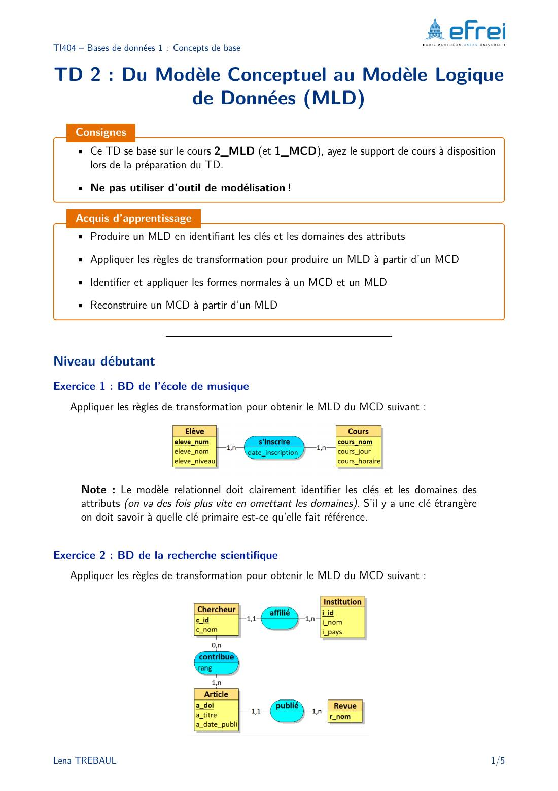
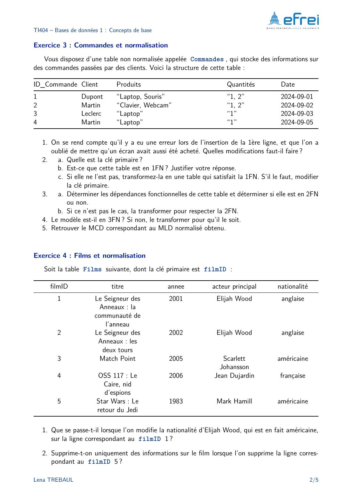
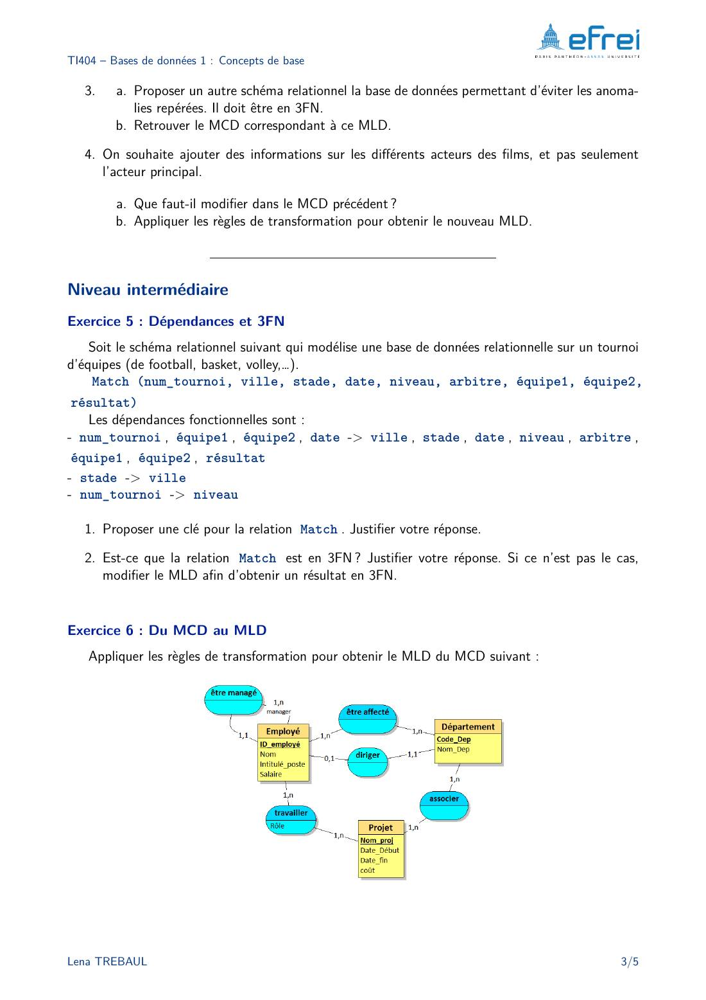
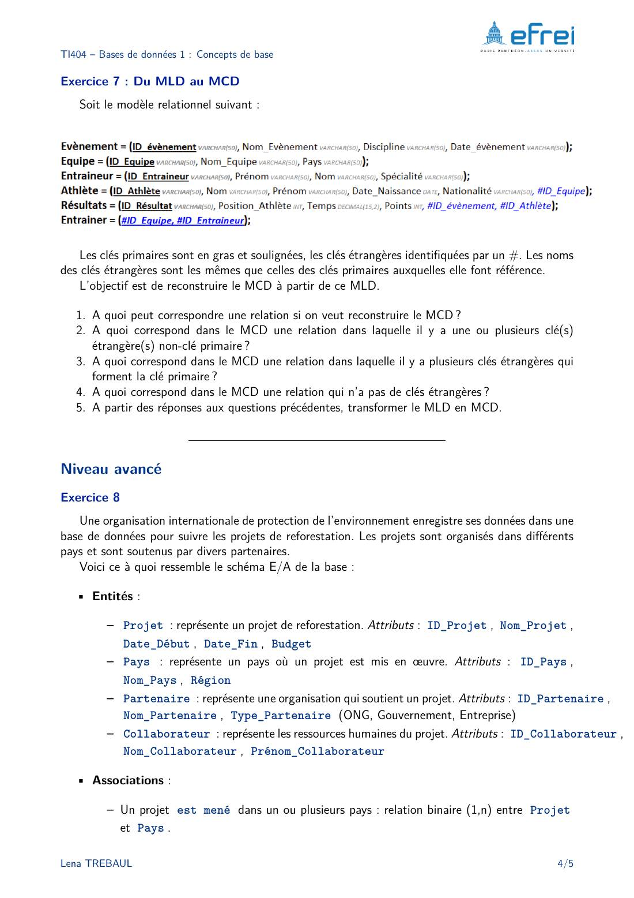
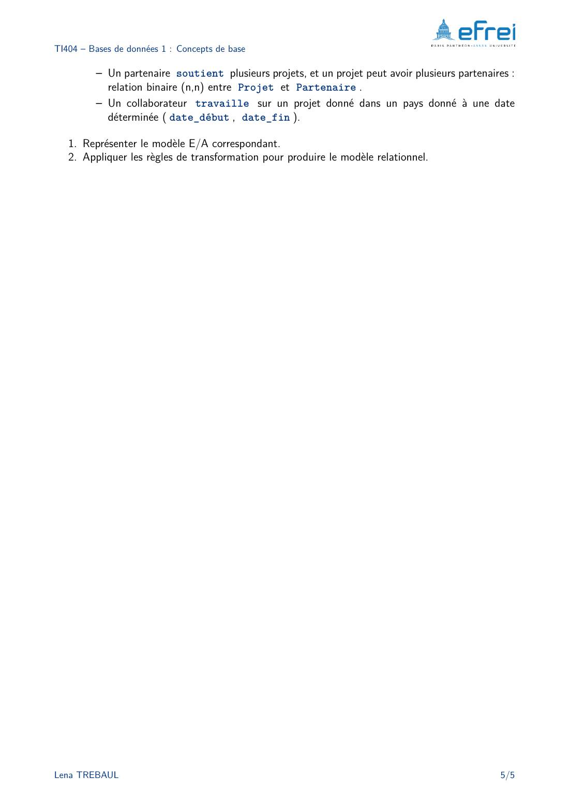

# TD 2 — Du modèle conceptuel au modèle logique

=== "Version simplifiée"

    Rappels : [chapitre 2](../cours/chapitre-2-mld.md). Clés primaires
    **soulignées** (ici en gras), clés étrangères précédées de `#`.

    ## Exercice 1 — École de musique

    - Eleve = (**num_eleve** INT, nom VARCHAR(50), niveau VARCHAR(15))
    - Cours = (**id_cours** INT, nom VARCHAR(50), jour VARCHAR(10), horaire TIME)
    - Inscription = (**#num_eleve**, **#id_cours**, date_inscription DATE) — règle (n,n)

    ## Exercice 2 — Recherche scientifique

    - Institution = (**id_institution**, nom, pays)
    - Chercheur = (**id_chercheur**, nom, #id_institution) — règle (1,1)-(1,n)
    - Revue = (**nom_revue**)
    - Article = (**DOI**, titre, date_publication, #nom_revue)
    - Ecrire = (**#id_chercheur**, **#DOI**, rang)

    ## Exercice 3 — Commandes

    1. Ajouter « Écran » oblige à modifier **deux** listes (`Produits` et
       `Quantités`) en gardant leur ordre : source d'erreurs.
    2. Clé : ID_Commande. **Pas en 1FN** (listes). En 1FN : une ligne par produit,
       clé (ID_Commande, Produit).
    3. DF : ID_Commande → Client, Date ; (ID_Commande, Produit) → Quantité.
       Client et Date ne dépendent que d'une partie de la clé → **pas 2FN** :
       Commande = (**id_commande**, client, date) ; Ligne = (**#id_commande**, **produit**, quantite).
    4. En 3FN si on sort aussi les clients et les produits dans leurs tables :
       Client = (**id_client**, nom) ; Produit = (**id_produit**, nom) ;
       Commande = (**id_commande**, date, #id_client) ; Ligne = (**#id_commande**, **#id_produit**, quantite).
    5. MCD : Client `(0,n)` — *passer* — `(1,1)` Commande `(1,n)` — *contenir* [quantité] — `(0,n)` Produit.

    ## Exercice 4 — Films

    1. **Anomalie de mise à jour** : il faudrait modifier la nationalité sur toutes
       les lignes d'Elijah Wood, sinon la base devient incohérente.
    2. **Anomalie de suppression** : supprimer le film 5 fait aussi perdre la seule
       information sur Mark Hamill.
    3. Acteur = (**id_acteur**, nom, nationalite) ; Film = (**filmID**, titre, annee, #id_acteur_principal).
       MCD : Film `(1,1)` — *a pour acteur principal* — `(0,n)` Acteur.
    4. Plusieurs acteurs par film : association (n,n) *jouer* [rôle], d'où
       Jouer = (**#filmID**, **#id_acteur**, role).

    ## Exercice 5 — Tournoi

    1. Clé : (num_tournoi, équipe1, équipe2, date), qui détermine tous les attributs.
    2. **Pas 3FN** : stade → ville (transitive) et num_tournoi → niveau (dépend
       d'une partie de la clé, donc pas même 2FN). Décomposition :
       Stade = (**stade**, ville) ; Tournoi = (**num_tournoi**, niveau) ;
       Match = (**#num_tournoi**, **equipe1**, **equipe2**, **date**, #stade, arbitre, resultat).

    ## Exercice 7 — Du MLD au MCD

    1. Une relation peut être une **entité** ou une **association**.
    2. Clé(s) étrangère(s) hors clé primaire → entité reliée par une association `(X,1)-(X,n)`.
    3. Clé primaire formée de clés étrangères → association `(X,n)-(X,n)` (ou n-aire).
    4. Pas de clé étrangère → entité « indépendante ».

    ## Exercice 8 — Reforestation

    - Projet = (**id_projet**, nom, date_debut, date_fin, budget)
    - Pays = (**id_pays**, nom, region)
    - Partenaire = (**id_partenaire**, nom, type) avec `type IN ('ONG', 'Gouvernement', 'Entreprise')`
    - Collaborateur = (**id_collaborateur**, nom, prenom)
    - Mener = (**#id_projet**, **#id_pays**) ; Soutenir = (**#id_projet**, **#id_partenaire**)
    - Travailler = (**#id_collaborateur**, **#id_projet**, **#id_pays**, date_debut, date_fin) — association ternaire

=== "Version papier"

    Énoncé du TD 2 tel qu'il est distribué (avec les MCD à transformer).

    <!-- papier: pdf/TI404P/td2.pdf | TD 2 — énoncé | td2 | page -->

    [{ loading=lazy .papier }](papier/td2/p01.jpg)
    
TI404 – Bases de données 1 : Concepts de base · TD 2 — énoncé, page 1

    [{ loading=lazy .papier }](papier/td2/p02.jpg)
    
TI404 – Bases de données 1 : Concepts de base · TD 2 — énoncé, page 2

    [{ loading=lazy .papier }](papier/td2/p03.jpg)
    
TI404 – Bases de données 1 : Concepts de base · TD 2 — énoncé, page 3

    [{ loading=lazy .papier }](papier/td2/p04.jpg)
    
TI404 – Bases de données 1 : Concepts de base · TD 2 — énoncé, page 4

    [{ loading=lazy .papier }](papier/td2/p05.jpg)
    
TI404 – Bases de données 1 : Concepts de base · TD 2 — énoncé, page 5

    <!-- /papier -->
