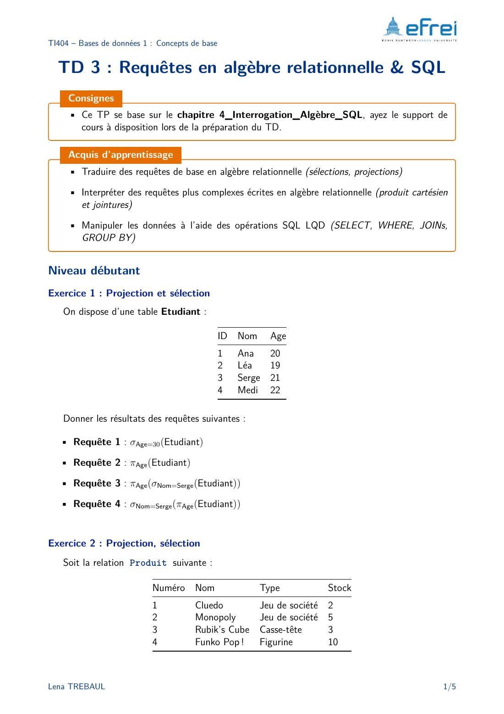
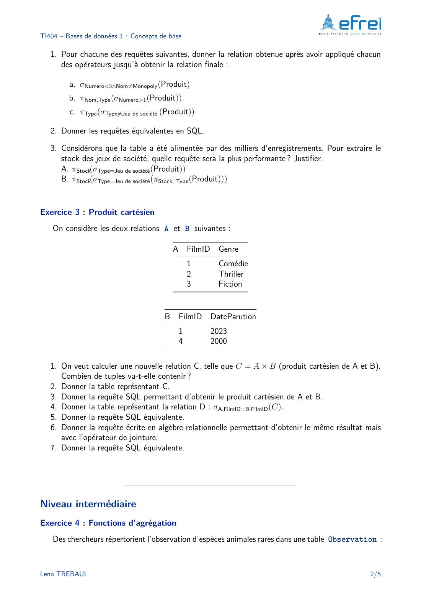
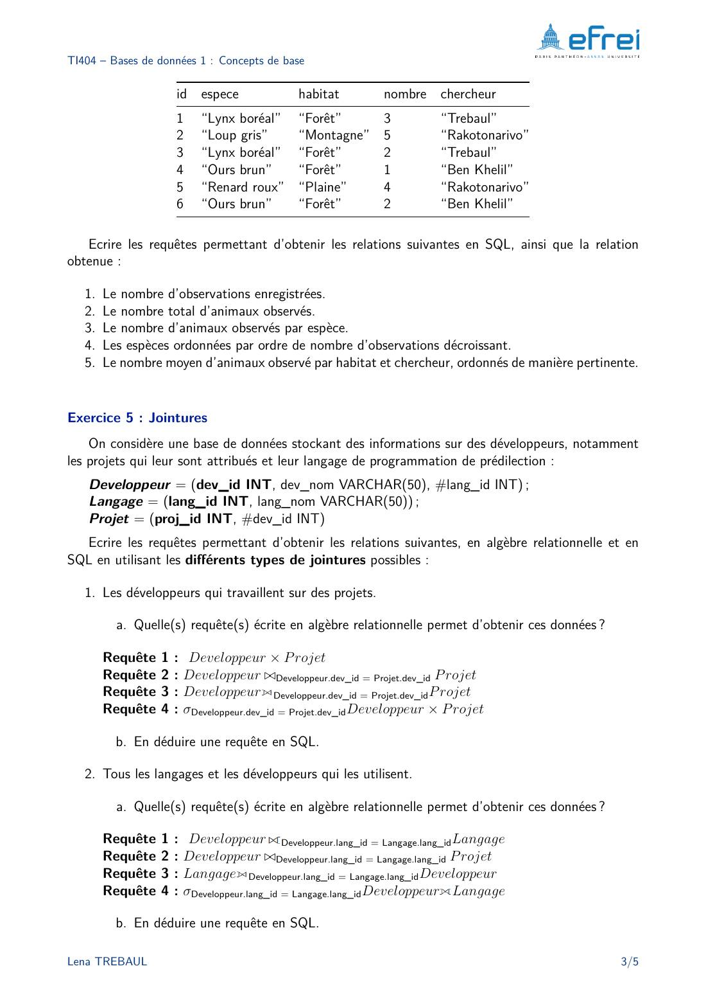
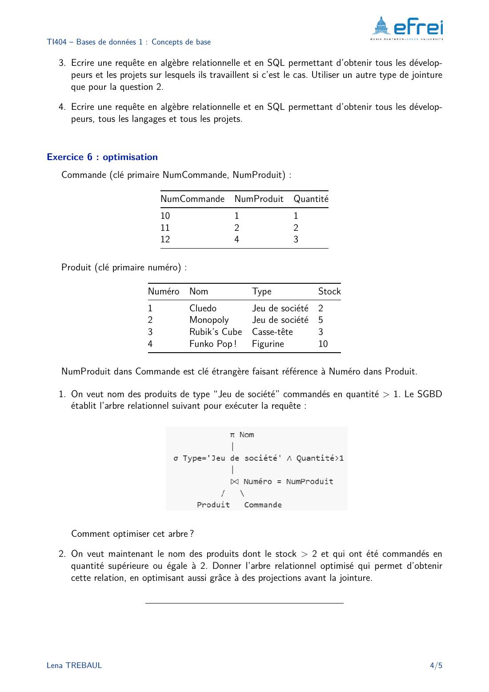
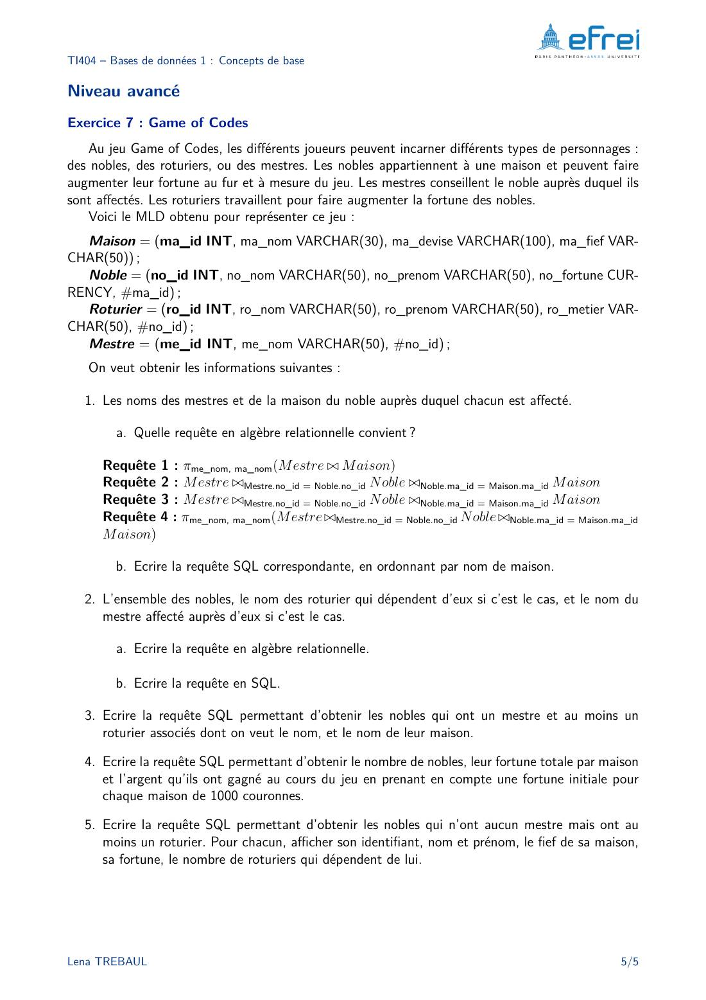

# TD 3 — Requêtes en algèbre relationnelle et en SQL

=== "Version simplifiée"

    Rappels : [chapitre 4](../cours/chapitre-4-algebre-sql.md).

    ## Exercice 1 — Projection et sélection

    1. $\sigma_{Age=30}$ : relation **vide** (avec les colonnes ID, Nom, Age).
    2. $\pi_{Age}$ : {20, 19, 21, 22}.
    3. $\pi_{Age}(\sigma_{Nom=Serge})$ : {21}.
    4. $\sigma_{Nom=Serge}(\pi_{Age})$ : **invalide**, la colonne Nom n'existe plus après la projection.

    ## Exercice 2 — Produits

    ```sql
    -- a. σ Numero<3 ∧ Nom≠Monopoly  → (1, Cluedo, Jeu de société, 2)
    SELECT * FROM Produit WHERE Numero < 3 AND Nom <> 'Monopoly';
    -- b. π Nom,Type (σ Numero>1)     → Monopoly, Rubik's Cube, Funko Pop !
    SELECT Nom, Type FROM Produit WHERE Numero > 1;
    -- c. π Type (σ Type≠Jeu de société) → Casse-tête, Figurine
    SELECT DISTINCT Type FROM Produit WHERE Type <> 'Jeu de société';
    ```

    3. **A** est meilleure : la sélection filtre d'abord, puis on projette ; B
       ajoute une projection inutile sur toute la table.

    ## Exercice 3 — Produit cartésien

    1. $|C| = 3 \times 2 = 6$ tuples.
    2. Chaque ligne de A est associée à chaque ligne de B.
    3. `SELECT * FROM A, B;` (ou `A CROSS JOIN B`).
    4. $D = \sigma_{A.FilmID = B.FilmID}(C)$ : une seule ligne (1, Comédie, 1, 2023).
    5. `SELECT * FROM A, B WHERE A.FilmID = B.FilmID;`
    6. $A \bowtie_{A.FilmID = B.FilmID} B$
    7. `SELECT * FROM A JOIN B ON A.FilmID = B.FilmID;`

    ## Exercice 4 — Observations d'espèces

    ```sql
    SELECT COUNT(*) FROM Observation;                       -- 6
    SELECT SUM(nombre) FROM Observation;                    -- 17
    SELECT espece, SUM(nombre) FROM Observation GROUP BY espece;
    -- Loup gris 5, Lynx boréal 5, Ours brun 3, Renard roux 4
    SELECT espece, COUNT(*) AS nb FROM Observation GROUP BY espece ORDER BY nb DESC;
    -- Lynx boréal 2, Ours brun 2, puis Loup gris 1, Renard roux 1
    SELECT habitat, chercheur, AVG(nombre) AS moyenne
    FROM Observation GROUP BY habitat, chercheur ORDER BY habitat, chercheur;
    -- Forêt/Ben Khelil 1,5 ; Forêt/Trebaul 2,5 ; Montagne/Rakotonarivo 5 ; Plaine/Rakotonarivo 4
    ```

    ## Exercice 5 — Développeurs, langages, projets

    1. Requêtes **2, 3 et 4** (la 1 est un produit cartésien sans condition) :
       ```sql
       SELECT * FROM Developpeur d JOIN Projet p ON d.dev_id = p.dev_id;
       ```
    2. Tous les langages, même sans développeur : jointure **externe** côté Langage :
       ```sql
       SELECT * FROM Langage l LEFT JOIN Developpeur d ON d.lang_id = l.lang_id;
       ```
    3. Tous les développeurs, même sans projet :
       ```sql
       SELECT * FROM Developpeur d LEFT JOIN Projet p ON d.dev_id = p.dev_id;
       ```
    4. Tout garder des trois côtés : jointures externes complètes (en MySQL,
       `LEFT JOIN … UNION … RIGHT JOIN`).

    ## Exercice 6 — Optimiser l'arbre

    Descendre les restrictions sous la jointure : $\sigma_{Type = \text{Jeu de société}}$
    sur Produit et $\sigma_{Quantité > 1}$ sur Commande **avant** de joindre, puis
    projeter (Numéro, Nom) et (NumProduit) avant la jointure pour ne garder que les
    colonnes utiles ; projection finale sur Nom.

    ## Exercice 7 — Game of Codes

    ```sql
    -- 1. Requête 4 (projection après les deux jointures)
    SELECT me_nom, ma_nom FROM Mestre m
    JOIN Noble n ON m.no_id = n.no_id
    JOIN Maison ma ON n.ma_id = ma.ma_id
    ORDER BY ma_nom;

    -- 2. Tous les nobles, avec roturiers et mestre s'ils existent
    SELECT n.no_nom, r.ro_nom, m.me_nom FROM Noble n
    LEFT JOIN Roturier r ON r.no_id = n.no_id
    LEFT JOIN Mestre m ON m.no_id = n.no_id;

    -- 4. Nombre de nobles, fortune totale et gain par maison
    SELECT ma.ma_nom, COUNT(*) AS nb_nobles, SUM(n.no_fortune) AS fortune,
           SUM(n.no_fortune) - 1000 AS gain
    FROM Maison ma JOIN Noble n ON n.ma_id = ma.ma_id GROUP BY ma.ma_id, ma.ma_nom;

    -- 5. Nobles sans mestre mais avec au moins un roturier
    SELECT n.no_id, n.no_nom, n.no_prenom, ma.ma_fief, n.no_fortune, COUNT(r.ro_id) AS nb_roturiers
    FROM Noble n JOIN Maison ma ON n.ma_id = ma.ma_id
    JOIN Roturier r ON r.no_id = n.no_id
    WHERE n.no_id NOT IN (SELECT no_id FROM Mestre)
    GROUP BY n.no_id, n.no_nom, n.no_prenom, ma.ma_fief, n.no_fortune;
    ```

=== "Version papier"

    Énoncé du TD 3 tel qu'il est distribué.

    <!-- papier: pdf/TI404P/td3.pdf | TD 3 — énoncé | td3 | page -->

    [{ loading=lazy .papier }](papier/td3/p01.jpg)
    <p class="papier-legende">TI404 – Bases de données 1 : Concepts de base · TD 3 — énoncé, page 1</p>

    [{ loading=lazy .papier }](papier/td3/p02.jpg)
    <p class="papier-legende">TI404 – Bases de données 1 : Concepts de base · TD 3 — énoncé, page 2</p>

    [{ loading=lazy .papier }](papier/td3/p03.jpg)
    <p class="papier-legende">TI404 – Bases de données 1 : Concepts de base · TD 3 — énoncé, page 3</p>

    [{ loading=lazy .papier }](papier/td3/p04.jpg)
    <p class="papier-legende">TI404 – Bases de données 1 : Concepts de base · TD 3 — énoncé, page 4</p>

    [{ loading=lazy .papier }](papier/td3/p05.jpg)
    <p class="papier-legende">TI404 – Bases de données 1 : Concepts de base · TD 3 — énoncé, page 5</p>

    <!-- /papier -->
