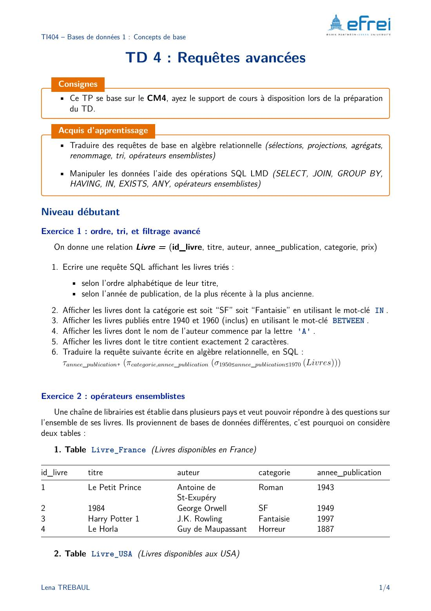
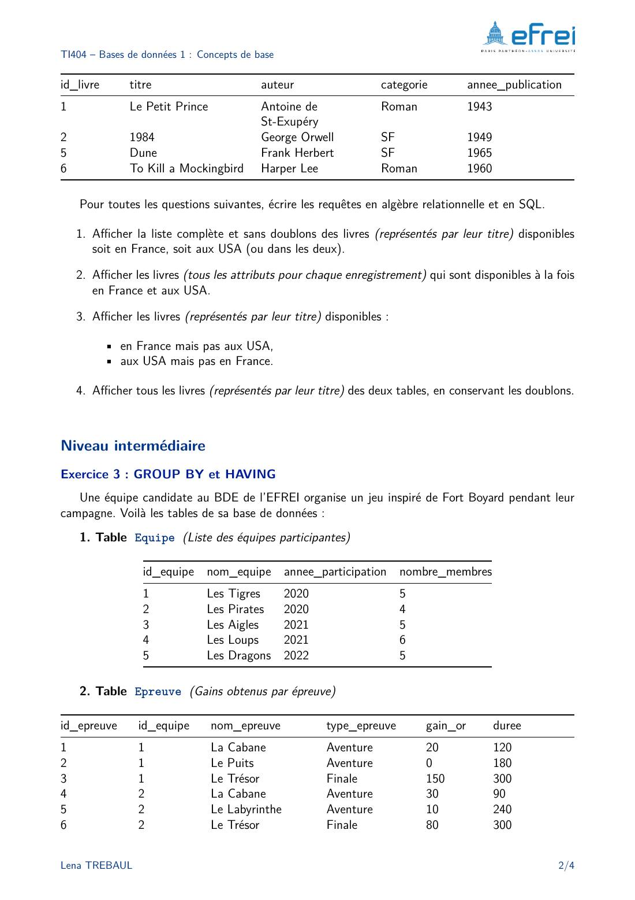
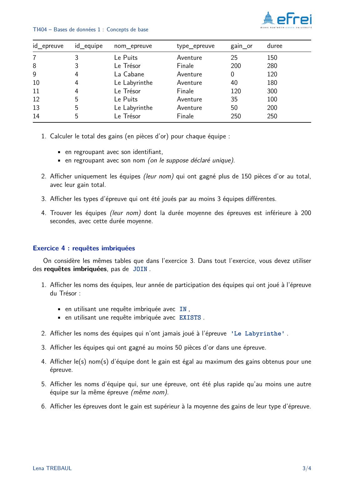
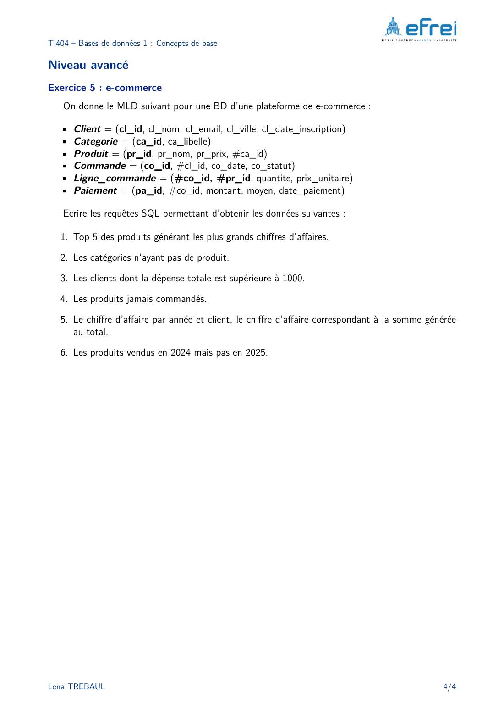

# TD 4 — Requêtes avancées

=== "Version simplifiée"

    Rappels : [chapitre 4](../cours/chapitre-4-algebre-sql.md). Résultats vérifiés
    sur une base contenant les données de l'énoncé.

    ## Exercice 1 — Tri et filtres

    ```sql
    SELECT * FROM Livre ORDER BY titre;
    SELECT * FROM Livre ORDER BY annee_publication DESC;
    SELECT * FROM Livre WHERE categorie IN ('SF', 'Fantaisie');
    SELECT * FROM Livre WHERE annee_publication BETWEEN 1940 AND 1960;
    SELECT * FROM Livre WHERE auteur LIKE 'A%';
    SELECT * FROM Livre WHERE titre LIKE '__';            -- exactement 2 caractères
    SELECT DISTINCT categorie, annee_publication FROM Livre
    WHERE annee_publication BETWEEN 1950 AND 1970 ORDER BY annee_publication;
    ```

    ## Exercice 2 — Opérateurs ensemblistes (France / USA)

    ```sql
    SELECT titre FROM Livre_France UNION SELECT titre FROM Livre_USA;          -- ∪
    SELECT * FROM Livre_France INTERSECT SELECT * FROM Livre_USA;              -- ∩ : Le Petit Prince, 1984
    SELECT titre FROM Livre_France EXCEPT SELECT titre FROM Livre_USA;         -- Harry Potter 1, Le Horla
    SELECT titre FROM Livre_USA EXCEPT SELECT titre FROM Livre_France;         -- Dune, To Kill a Mockingbird
    SELECT titre FROM Livre_France UNION ALL SELECT titre FROM Livre_USA;      -- 8 lignes, doublons gardés
    ```

    Sur les anciennes versions de MySQL, sans `INTERSECT`/`EXCEPT`, on écrit
    `WHERE titre IN (…)` ou `NOT IN (…)`.

    ## Exercice 3 — GROUP BY et HAVING (Fort Boyard)

    ```sql
    SELECT id_equipe, SUM(gain_or) FROM Epreuve GROUP BY id_equipe;
    SELECT e.nom_equipe, SUM(p.gain_or) AS total
    FROM Equipe e JOIN Epreuve p ON p.id_equipe = e.id_equipe GROUP BY e.nom_equipe;
    -- Tigres 170, Pirates 120, Aigles 225, Loups 160, Dragons 335

    -- 2. … HAVING SUM(p.gain_or) > 150   → Tigres, Aigles, Loups, Dragons
    -- 3.
    SELECT type_epreuve FROM Epreuve GROUP BY type_epreuve
    HAVING COUNT(DISTINCT id_equipe) >= 3;                 -- Aventure et Finale
    -- 4.
    SELECT e.nom_equipe, AVG(p.duree) AS moyenne
    FROM Equipe e JOIN Epreuve p ON p.id_equipe = e.id_equipe
    GROUP BY e.nom_equipe HAVING AVG(p.duree) < 200;       -- Les Dragons (183 s)
    ```

    ## Exercice 4 — Requêtes imbriquées (sans JOIN)

    ```sql
    -- 1. Équipes ayant joué au Trésor
    SELECT nom_equipe, annee_participation FROM Equipe
    WHERE id_equipe IN (SELECT id_equipe FROM Epreuve WHERE nom_epreuve = 'Le Trésor');
    SELECT nom_equipe, annee_participation FROM Equipe e
    WHERE EXISTS (SELECT * FROM Epreuve p WHERE p.id_equipe = e.id_equipe AND p.nom_epreuve = 'Le Trésor');
    -- 2. Jamais joué au Labyrinthe → Les Tigres, Les Aigles
    SELECT nom_equipe FROM Equipe
    WHERE id_equipe NOT IN (SELECT id_equipe FROM Epreuve WHERE nom_epreuve = 'Le Labyrinthe');
    -- 3. Au moins 50 pièces dans une épreuve → les 5 équipes
    SELECT nom_equipe FROM Equipe WHERE id_equipe IN (SELECT id_equipe FROM Epreuve WHERE gain_or >= 50);
    -- 4. Gain maximal → Les Dragons (250)
    SELECT nom_equipe FROM Equipe WHERE id_equipe IN
      (SELECT id_equipe FROM Epreuve WHERE gain_or = (SELECT MAX(gain_or) FROM Epreuve));
    -- 5. Plus rapide qu'au moins une autre équipe sur la même épreuve
    SELECT nom_equipe FROM Equipe e WHERE EXISTS (
      SELECT * FROM Epreuve p1 WHERE p1.id_equipe = e.id_equipe
      AND p1.duree < ANY (SELECT p2.duree FROM Epreuve p2
                          WHERE p2.nom_epreuve = p1.nom_epreuve AND p2.id_equipe <> p1.id_equipe));
    -- → Pirates, Aigles, Loups, Dragons
    -- 6. Gain supérieur à la moyenne de son type (sous-requête corrélée)
    SELECT * FROM Epreuve p
    WHERE gain_or > (SELECT AVG(gain_or) FROM Epreuve q WHERE q.type_epreuve = p.type_epreuve);
    ```

    ## Exercice 5 — E-commerce

    ```sql
    -- 1. Top 5 du chiffre d'affaires par produit
    SELECT p.pr_nom, SUM(l.quantite * l.prix_unitaire) AS ca
    FROM Produit p JOIN Ligne_commande l ON l.pr_id = p.pr_id
    GROUP BY p.pr_id, p.pr_nom ORDER BY ca DESC LIMIT 5;
    -- 2. Catégories sans produit
    SELECT * FROM Categorie c WHERE NOT EXISTS (SELECT * FROM Produit p WHERE p.ca_id = c.ca_id);
    -- 3. Clients ayant dépensé plus de 1000
    SELECT c.cl_nom, SUM(l.quantite * l.prix_unitaire) AS depense
    FROM Client c JOIN Commande co ON co.cl_id = c.cl_id
    JOIN Ligne_commande l ON l.co_id = co.co_id
    GROUP BY c.cl_id, c.cl_nom HAVING depense > 1000;
    -- 4. Produits jamais commandés
    SELECT * FROM Produit WHERE pr_id NOT IN (SELECT pr_id FROM Ligne_commande);
    -- 5. CA par année et client
    SELECT YEAR(co.co_date) AS annee, co.cl_id, SUM(l.quantite * l.prix_unitaire) AS ca
    FROM Commande co JOIN Ligne_commande l ON l.co_id = co.co_id
    GROUP BY YEAR(co.co_date), co.cl_id;
    -- 6. Vendus en 2024 mais pas en 2025
    SELECT DISTINCT l.pr_id FROM Ligne_commande l JOIN Commande co ON co.co_id = l.co_id
    WHERE YEAR(co.co_date) = 2024 AND l.pr_id NOT IN (
      SELECT l2.pr_id FROM Ligne_commande l2 JOIN Commande c2 ON c2.co_id = l2.co_id
      WHERE YEAR(c2.co_date) = 2025);
    ```

=== "Version papier"

    Énoncé du TD 4 tel qu'il est distribué.

    <!-- papier: pdf/TI404P/td4.pdf | TD 4 — énoncé | td4 | page -->

    [{ loading=lazy .papier }](papier/td4/p01.jpg)
    <p class="papier-legende">TI404 – Bases de données 1 : Concepts de base · TD 4 — énoncé, page 1</p>

    [{ loading=lazy .papier }](papier/td4/p02.jpg)
    <p class="papier-legende">TI404 – Bases de données 1 : Concepts de base · TD 4 — énoncé, page 2</p>

    [{ loading=lazy .papier }](papier/td4/p03.jpg)
    <p class="papier-legende">TI404 – Bases de données 1 : Concepts de base · TD 4 — énoncé, page 3</p>

    [{ loading=lazy .papier }](papier/td4/p04.jpg)
    <p class="papier-legende">TI404 – Bases de données 1 : Concepts de base · TD 4 — énoncé, page 4</p>

    <!-- /papier -->
