# Mini-projet : concevoir et développer une base de données

=== "Version simplifiée"

    En **binôme**, sur un domaine de votre choix, toutes les étapes de Merise.
    Rendu sur un **dépôt GitHub** partagé avec l'enseignant de TP (rien à envoyer).

    | Partie | Étapes | Calendrier 2025-2026 |
    |---|---|---|
    | 1 | 1. Analyse des besoins (avec l'IA générative) · 2. MCD normalisé avec éléments avancés | du 13/02 au 27/02 |
    | 2 | 3. MLD et MPD (`1_creation.sql`, `2_contraintes.sql`) · 4. Insertion (`3_insertion.sql` + prompt) · 5. Scénario et requêtes (`4_interrogation.sql`) · 6. Vidéo de présentation | du 27/02 au 16/03 |

    !!! methode "Ce qui est attendu"
        - Un `README.md` qui documente chaque étape (règles métier, MCD, MLD, choix).
        - Un MCD **normalisé** avec des éléments avancés (association n-aire,
          réflexive, entité faible…).
        - Des clés étrangères avec `ON DELETE` / `ON UPDATE` pour que les
          suppressions et modifications ne déclenchent pas d'erreur.
        - Assez de contraintes `CHECK` pour couvrir les cas vus en cours.
        - Des requêtes qui couvrent jointures, sous-requêtes, `GROUP BY`/`HAVING`,
          dans un scénario cohérent (qui utilise la base et pour quoi faire).

=== "Version papier"

    Sujets des deux parties, puis la fiche d'aide Git Bash.

    <!-- papier: pdf/TI404P/mini-projet-1.pdf | Mini-projet — partie 1 | partie1 | page -->

    [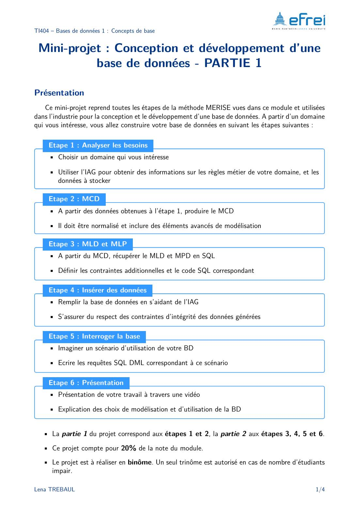{ loading=lazy .papier }](papier/partie1/p01.jpg)
    
TI404 – Bases de données 1 : Concepts de base · Mini-projet — partie 1, page 1

    [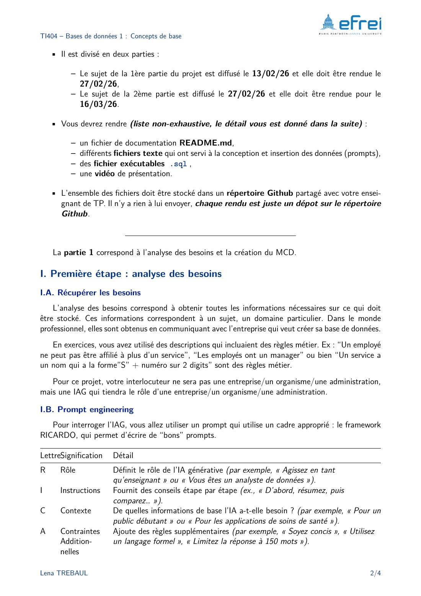{ loading=lazy .papier }](papier/partie1/p02.jpg)
    
TI404 – Bases de données 1 : Concepts de base · Mini-projet — partie 1, page 2

    [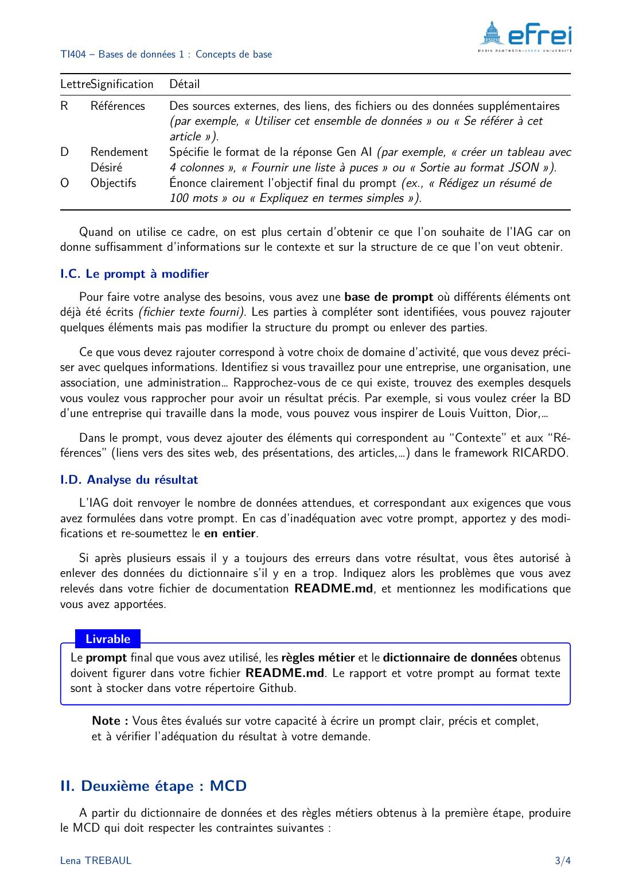{ loading=lazy .papier }](papier/partie1/p03.jpg)
    
TI404 – Bases de données 1 : Concepts de base · Mini-projet — partie 1, page 3

    [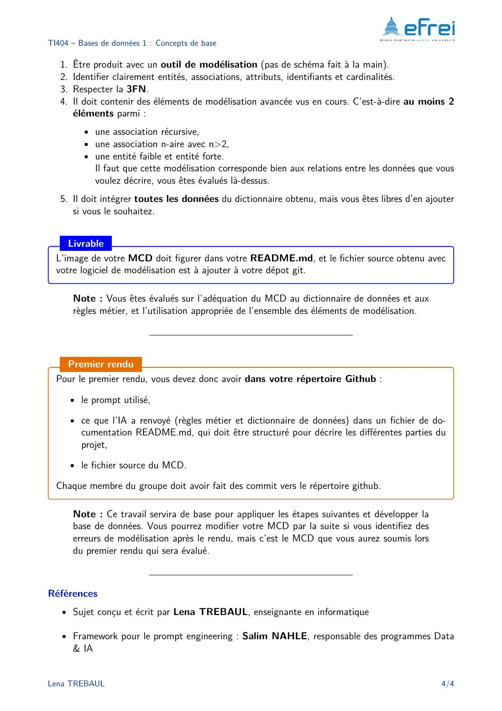{ loading=lazy .papier }](papier/partie1/p04.jpg)
    
TI404 – Bases de données 1 : Concepts de base · Mini-projet — partie 1, page 4

    <!-- /papier -->

    <!-- papier: pdf/TI404P/mini-projet-2.pdf | Mini-projet — partie 2 | partie2 | page -->

    [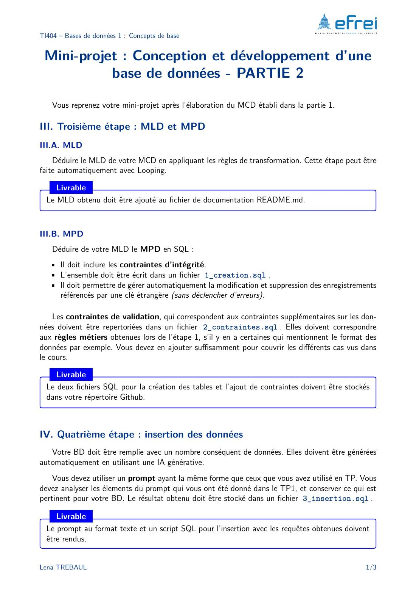{ loading=lazy .papier }](papier/partie2/p01.jpg)
    
TI404 – Bases de données 1 : Concepts de base · Mini-projet — partie 2, page 1

    [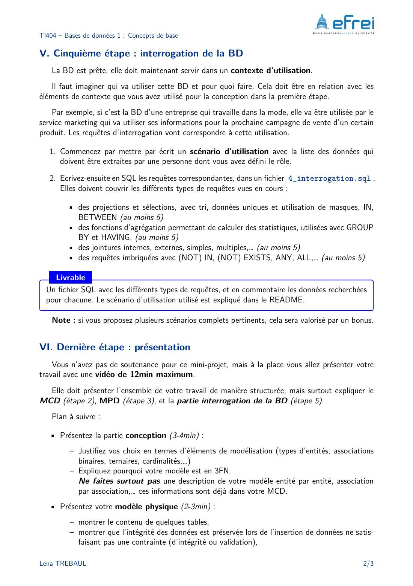{ loading=lazy .papier }](papier/partie2/p02.jpg)
    
TI404 – Bases de données 1 : Concepts de base · Mini-projet — partie 2, page 2

    [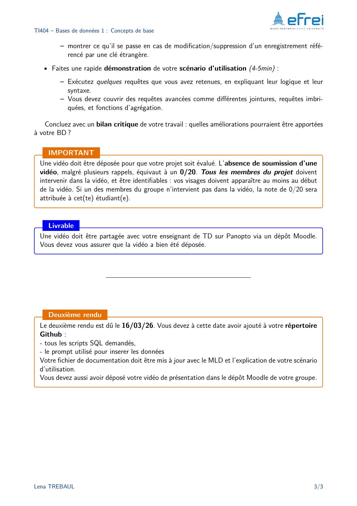{ loading=lazy .papier }](papier/partie2/p03.jpg)
    
TI404 – Bases de données 1 : Concepts de base · Mini-projet — partie 2, page 3

    <!-- /papier -->

    <!-- papier: pdf/TI404P/utilisation-git-bash.pdf | Utilisation de Git Bash | git | page -->

    [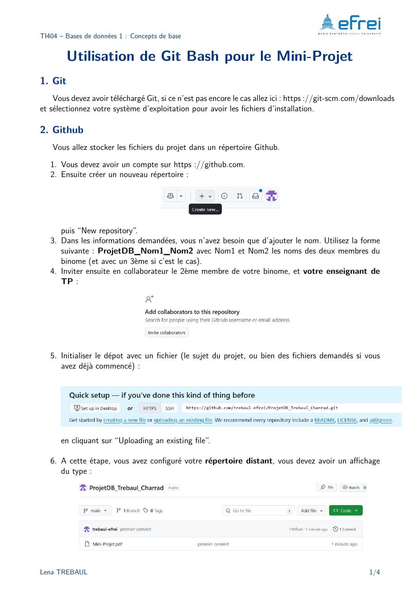{ loading=lazy .papier }](papier/git/p01.jpg)
    
TI404 – Bases de données 1 : Concepts de base · Utilisation de Git Bash, page 1

    [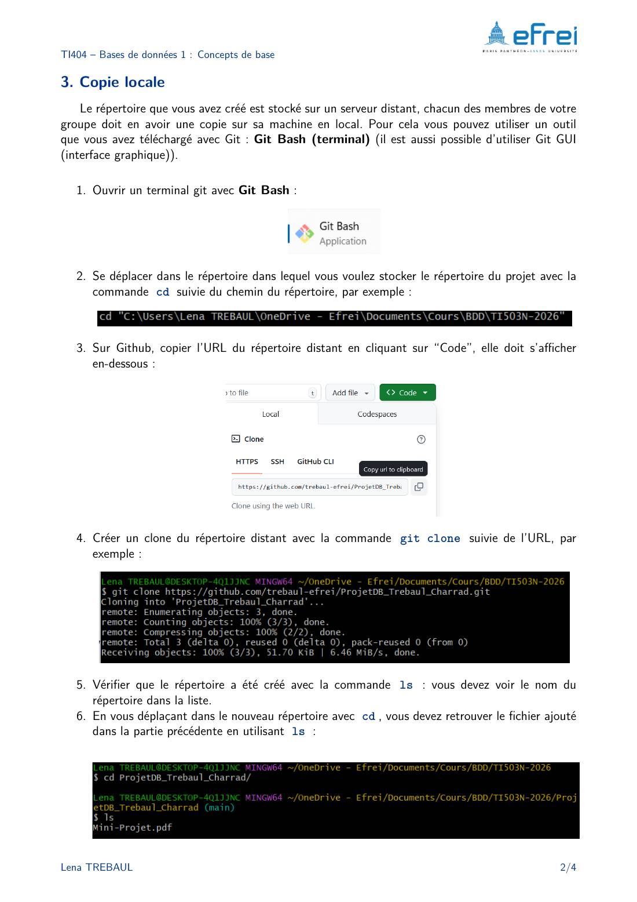{ loading=lazy .papier }](papier/git/p02.jpg)
    
TI404 – Bases de données 1 : Concepts de base · Utilisation de Git Bash, page 2

    [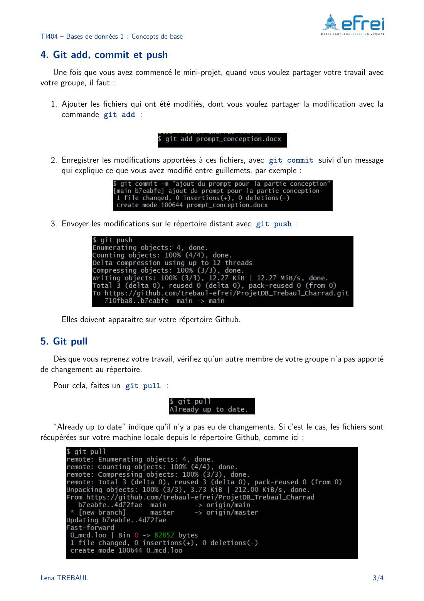{ loading=lazy .papier }](papier/git/p03.jpg)
    
TI404 – Bases de données 1 : Concepts de base · Utilisation de Git Bash, page 3

    [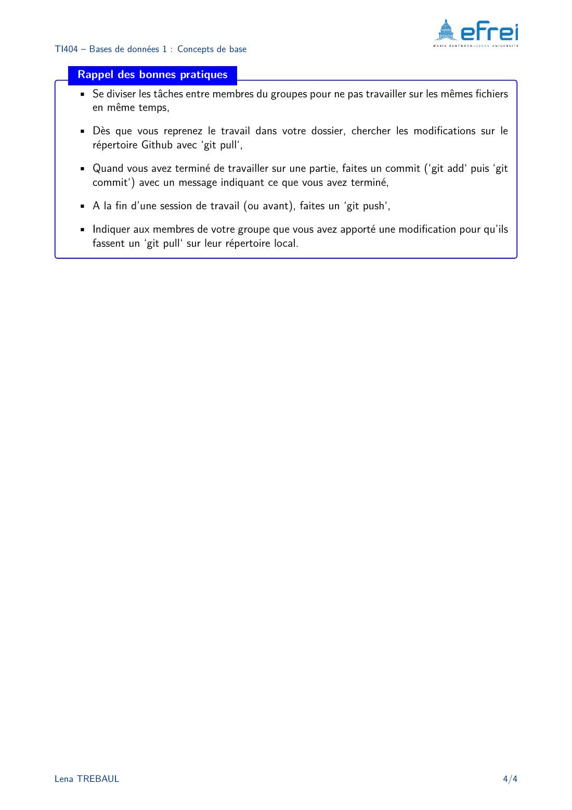{ loading=lazy .papier }](papier/git/p04.jpg)
    
TI404 – Bases de données 1 : Concepts de base · Utilisation de Git Bash, page 4

    <!-- /papier -->
