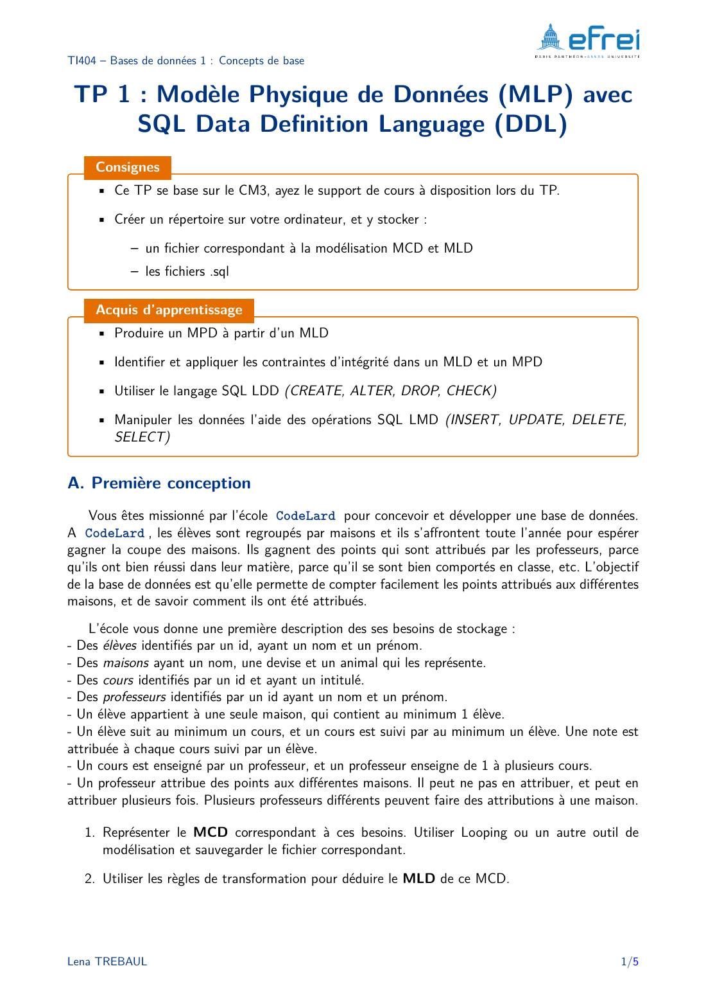
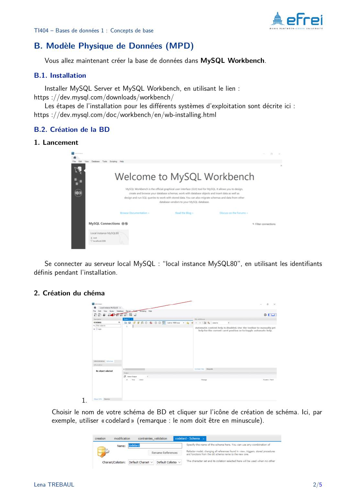
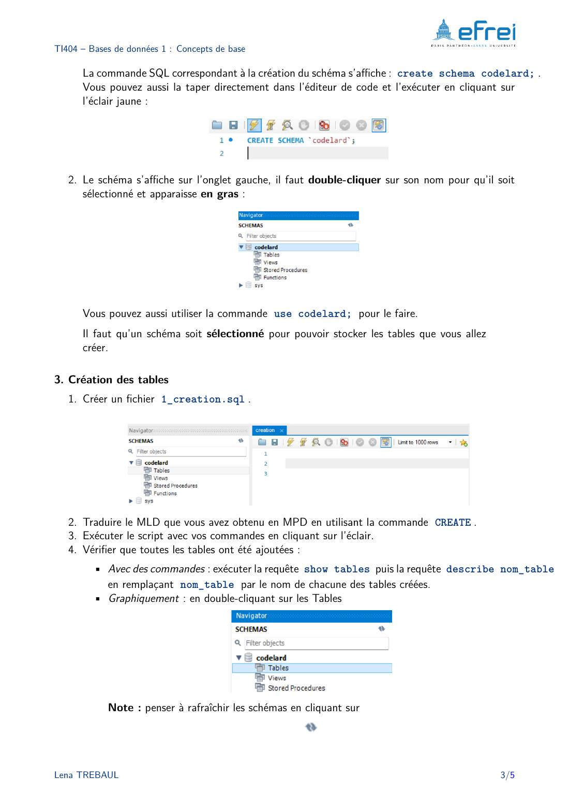
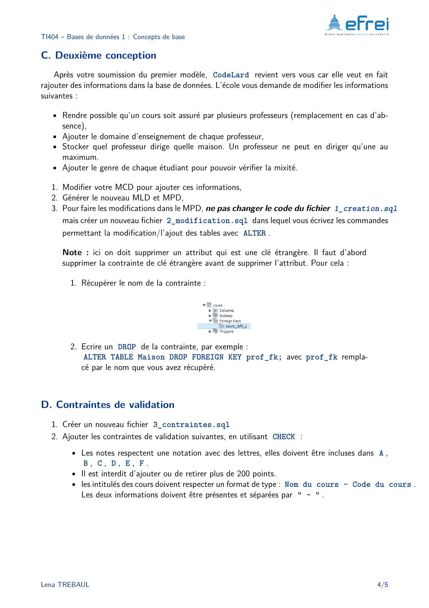
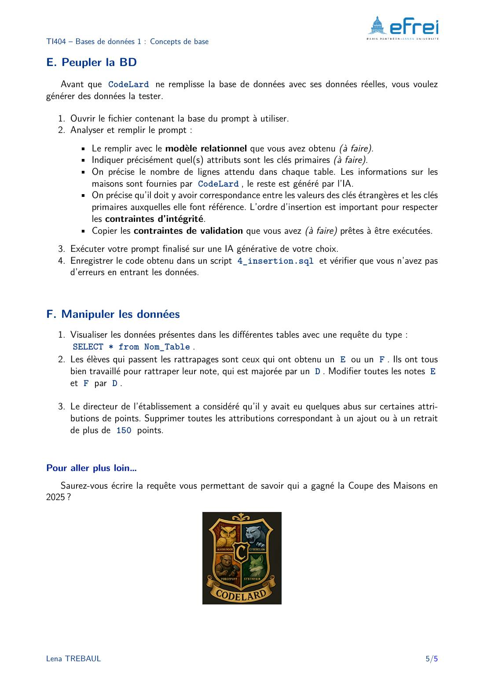

# TP 1 — Du MCD au MPD avec SQL LDD (école CodeLard)

=== "Version simplifiée"

    **Outils** : Looping pour le MCD/MLD, **MySQL Server + MySQL Workbench** pour la base.

    !!! methode "Étapes du TP"
        1. MCD des besoins de CodeLard : Élève, Maison, Cours, Professeur ;
           *appartenir* (1,1)-(1,n), *suivre* (1,n)-(1,n) avec une note,
           *enseigner* (1,1)-(1,n), *attribuer des points* (0,n)-(0,n) entre
           Professeur et Maison (attributs : points, date, motif).
        2. MLD par les règles de transformation ([chapitre 2](../cours/chapitre-2-mld.md)).
        3. MPD : un script `CREATE TABLE` avec clés primaires et étrangères, puis
           les contraintes `CHECK` ([chapitre 3](../cours/chapitre-3-sql-ldd-lmd.md)).
        4. Insertion des données avec un prompt d'IA générative (modèle fourni) :
           vérifier que les données respectent **toutes** les contraintes.

    !!! piege "Attribution de points répétée"
        Un professeur peut attribuer des points **plusieurs fois** à la même maison :
        la clé (#id_prof, #id_maison) ne suffit pas, il faut ajouter la date (ou
        un identifiant d'attribution) dans la clé.

=== "Version papier"

    Sujet du TP 1 tel qu'il est distribué.

    <!-- papier: pdf/TI404P/tp1.pdf | TP 1 — sujet | tp1 | page -->

    [{ loading=lazy .papier }](papier/tp1/p01.jpg)
    
TI404 – Bases de données 1 : Concepts de base · TP 1 — sujet, page 1

    [{ loading=lazy .papier }](papier/tp1/p02.jpg)
    
TI404 – Bases de données 1 : Concepts de base · TP 1 — sujet, page 2

    [{ loading=lazy .papier }](papier/tp1/p03.jpg)
    
TI404 – Bases de données 1 : Concepts de base · TP 1 — sujet, page 3

    [{ loading=lazy .papier }](papier/tp1/p04.jpg)
    
TI404 – Bases de données 1 : Concepts de base · TP 1 — sujet, page 4

    [{ loading=lazy .papier }](papier/tp1/p05.jpg)
    
TI404 – Bases de données 1 : Concepts de base · TP 1 — sujet, page 5

    <!-- /papier -->
