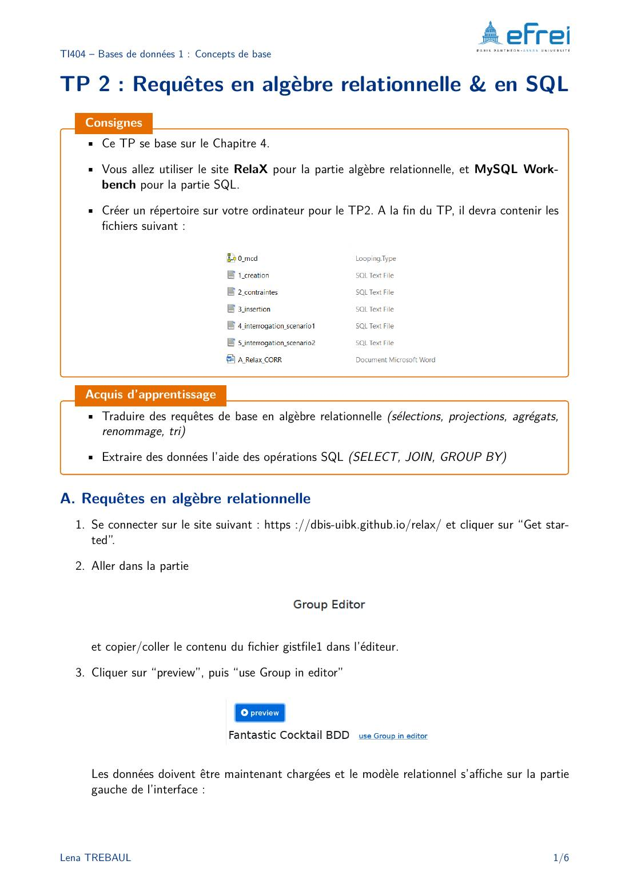
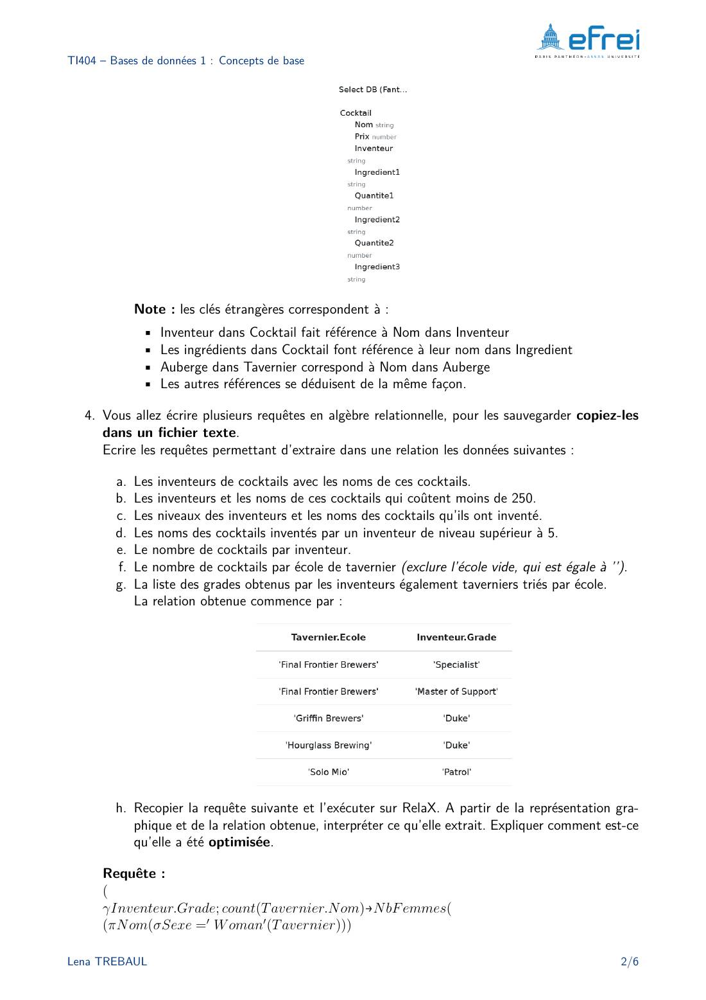
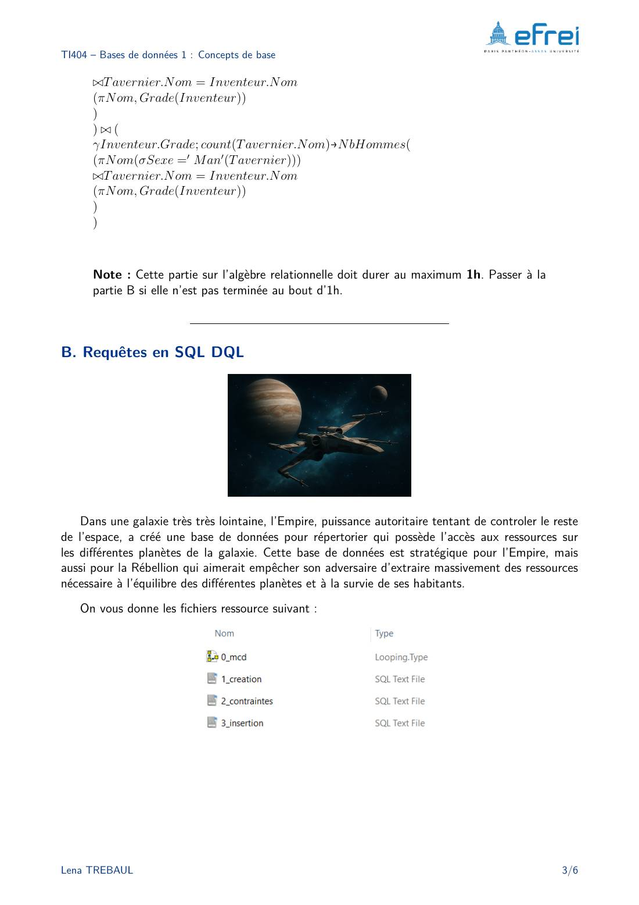
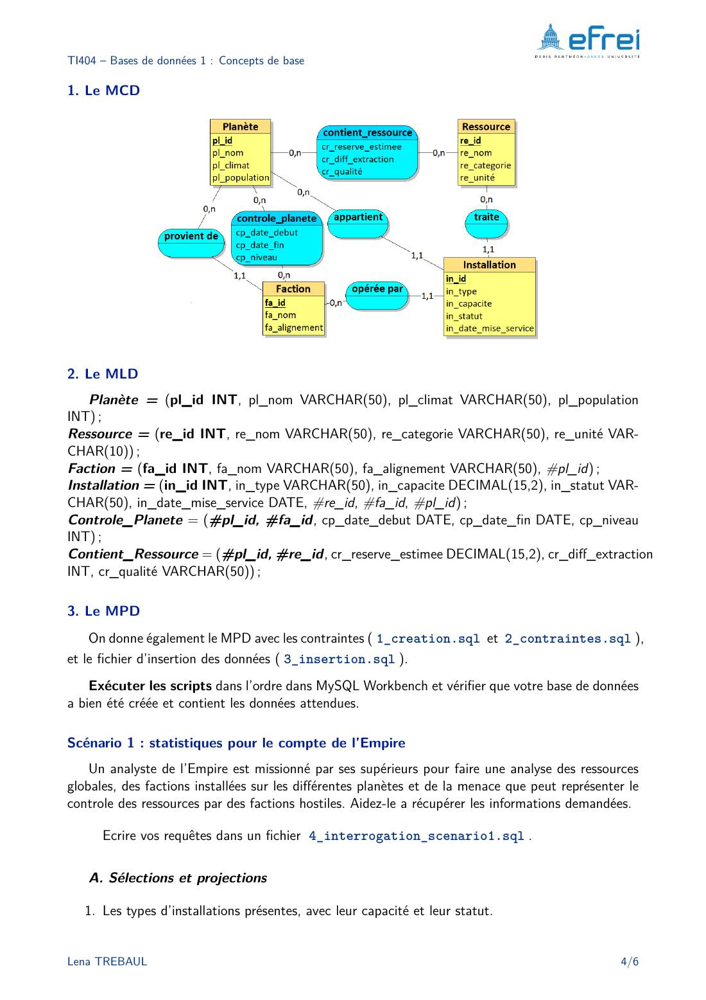
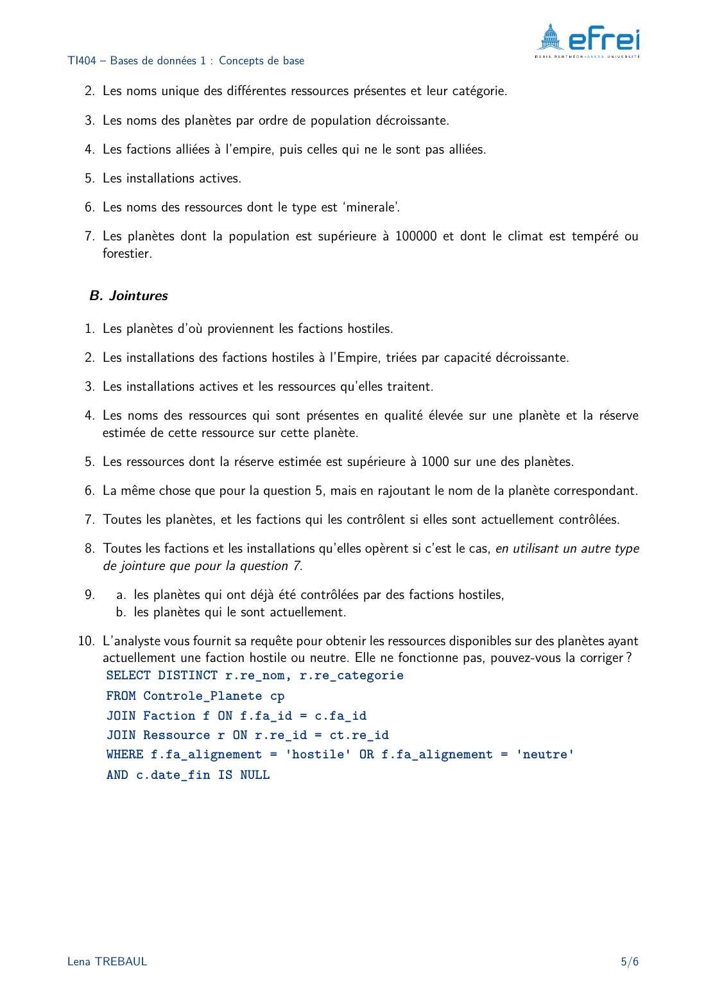
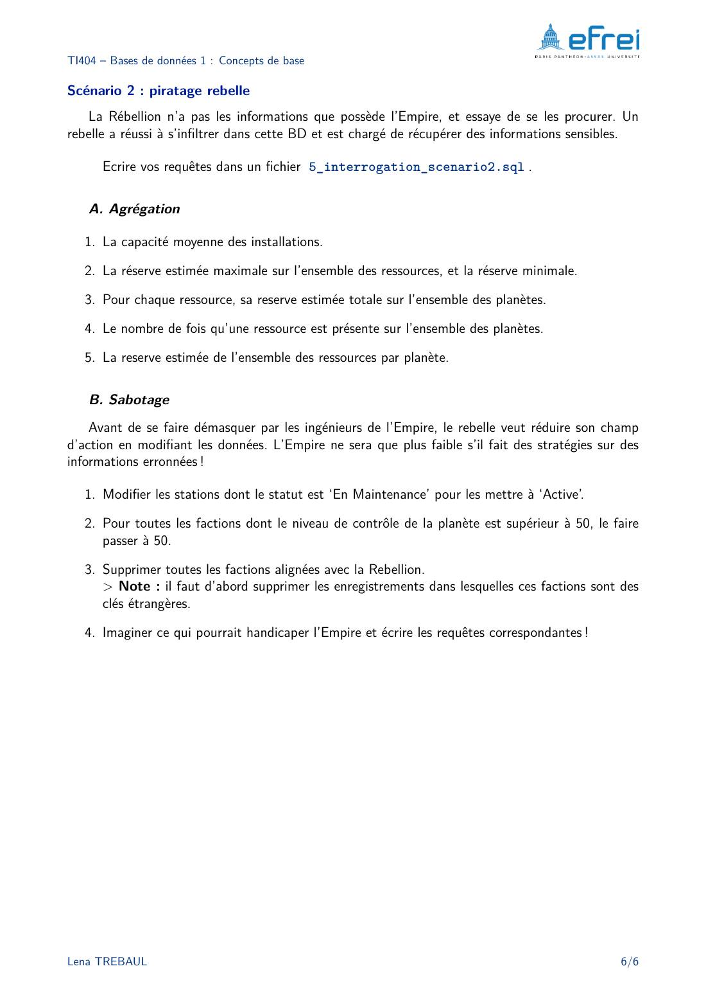

# TP 2 — Requêtes en algèbre relationnelle (RelaX) et en SQL

=== "Version simplifiée"

    - **Partie A** (1 h maximum) : requêtes en algèbre relationnelle sur le site
      [RelaX](https://dbis-uibk.github.io/relax/), base « Cocktails / Inventeurs /
      Taverniers » chargée depuis le fichier fourni. RelaX affiche l'**arbre**
      de chaque requête : bon moyen de vérifier l'ordre des opérateurs.
    - **Partie B** : les mêmes questions et d'autres en SQL dans MySQL Workbench
      (scripts de création, de contraintes et d'insertion fournis).

    !!! tip "Syntaxe RelaX"
        `π`, `σ`, `⨝`, `γ` (agrégation : `γ Inventeur; count(Nom)→NbCocktails (…)`),
        `τ` (tri). Les noms de colonnes ambigus se préfixent par la table.

=== "Version papier"

    Sujet du TP 2 tel qu'il est distribué.

    <!-- papier: pdf/TI404P/tp2.pdf | TP 2 — sujet | tp2 | page -->

    [{ loading=lazy .papier }](papier/tp2/p01.jpg)
    
TP 2 : Requêtes en algèbre relationnelle &amp; en SQL · TP 2 — sujet, page 1

    [{ loading=lazy .papier }](papier/tp2/p02.jpg)
    
Note : les clés étrangères correspondent à : · TP 2 — sujet, page 2

    [{ loading=lazy .papier }](papier/tp2/p03.jpg)
    
▷◁T avernier.N om = Inventeur.N om · TP 2 — sujet, page 3

    [{ loading=lazy .papier }](papier/tp2/p04.jpg)
    
1. Le MCD · TP 2 — sujet, page 4

    [{ loading=lazy .papier }](papier/tp2/p05.jpg)
    
2. Les noms unique des différentes ressources présentes et leur catégorie. · TP 2 — sujet, page 5

    [{ loading=lazy .papier }](papier/tp2/p06.jpg)
    
Scénario 2 : piratage rebelle · TP 2 — sujet, page 6

    <!-- /papier -->
