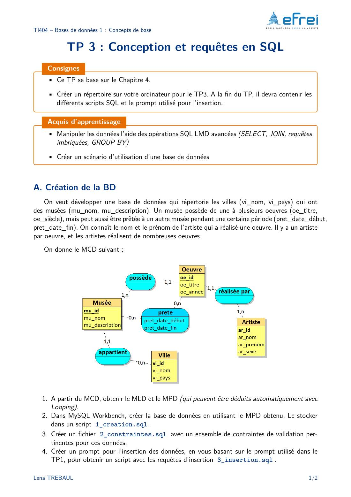
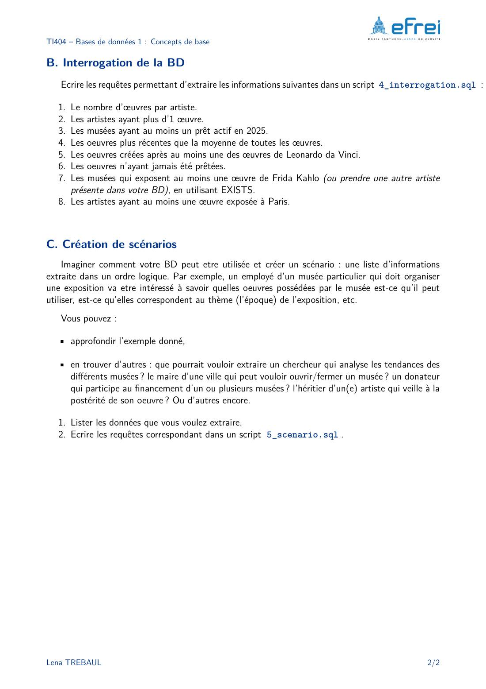

# TP 3 — Conception et requêtes en SQL (musées)

=== "Version simplifiée"

    Base : villes, musées, œuvres, artistes, et **prêts** d'œuvres entre musées
    (avec dates de début et de fin).

    !!! methode "Les livrables"
        `1_creation.sql` (MPD), `2_contraintes.sql` (CHECK pertinents : dates de prêt
        cohérentes, siècle plausible…), `3_insertion.sql` (généré par IA à partir
        d'un prompt), `4_interrogation.sql`, puis un **scénario d'utilisation**.

    Pistes pour les requêtes :

    ```sql
    -- Œuvres jamais prêtées
    SELECT oe_titre FROM Oeuvre WHERE oe_id NOT IN (SELECT oe_id FROM Pret);
    -- Œuvres plus récentes que la moyenne
    SELECT oe_titre FROM Oeuvre WHERE oe_siecle > (SELECT AVG(oe_siecle) FROM Oeuvre);
    -- Après au moins une œuvre de Léonard de Vinci
    SELECT oe_titre FROM Oeuvre WHERE oe_siecle > ANY (
      SELECT o.oe_siecle FROM Oeuvre o JOIN Artiste a ON o.ar_id = a.ar_id
      WHERE a.ar_nom = 'da Vinci');
    -- Prêt actif en 2025 : il chevauche l'année
    SELECT DISTINCT mu_nom FROM Musee m JOIN Pret p ON p.mu_id = m.mu_id
    WHERE p.pret_date_debut <= '2025-12-31' AND p.pret_date_fin >= '2025-01-01';
    ```

    (Les noms de colonnes dépendent de votre MPD.)

=== "Version papier"

    Sujet du TP 3 tel qu'il est distribué.

    <!-- papier: pdf/TI404P/tp3.pdf | TP 3 — sujet | tp3 | page -->

    [{ loading=lazy .papier }](papier/tp3/p01.jpg)
    <p class="papier-legende">TI404 – Bases de données 1 : Concepts de base · TP 3 — sujet, page 1</p>

    [{ loading=lazy .papier }](papier/tp3/p02.jpg)
    <p class="papier-legende">TI404 – Bases de données 1 : Concepts de base · TP 3 — sujet, page 2</p>

    <!-- /papier -->
