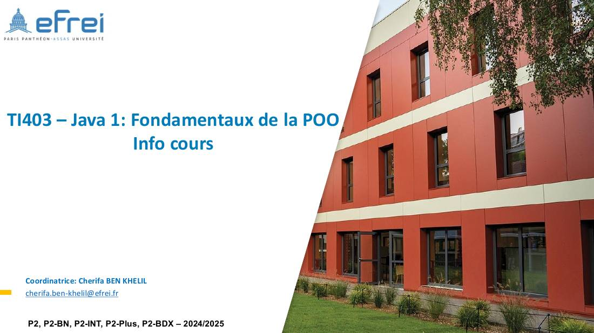
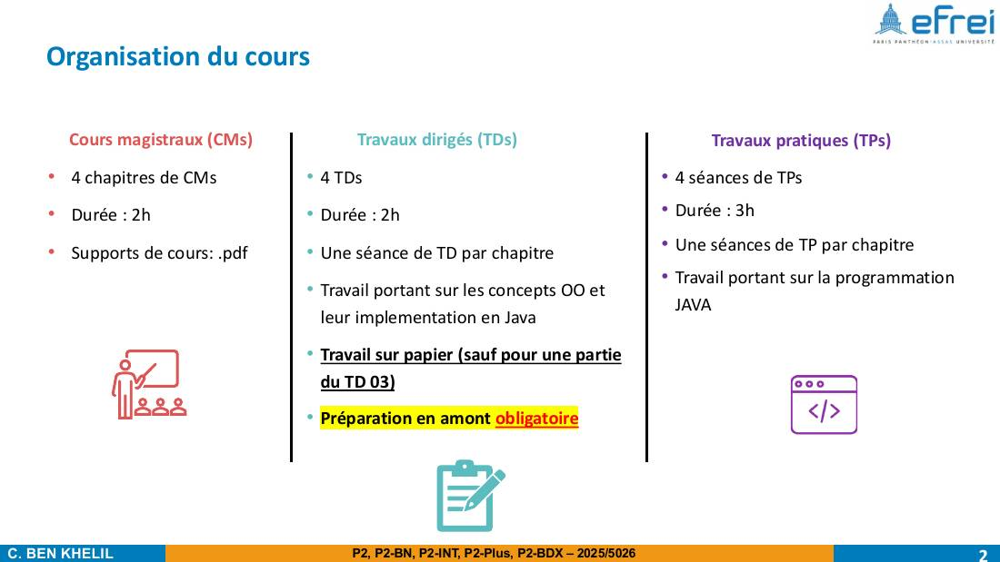
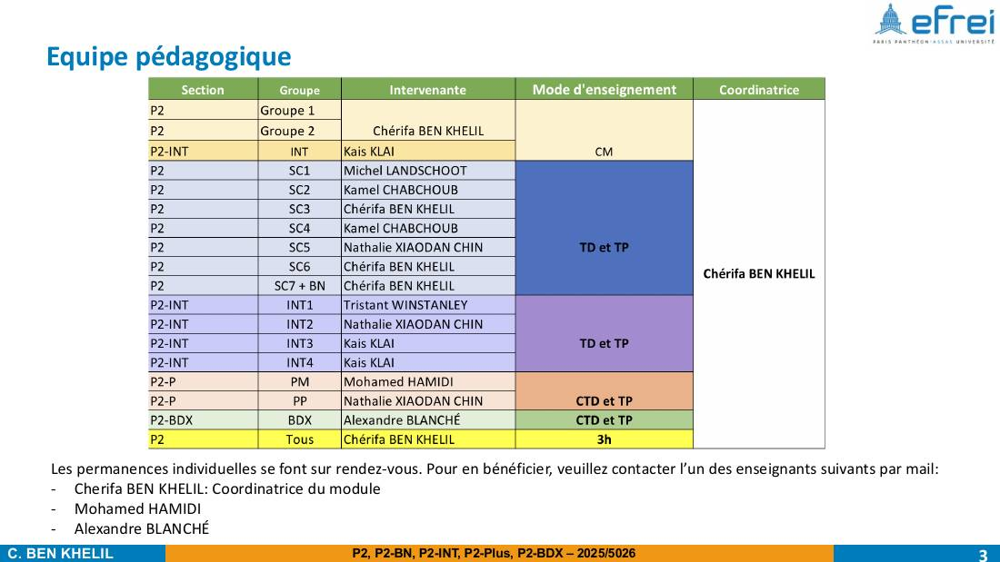
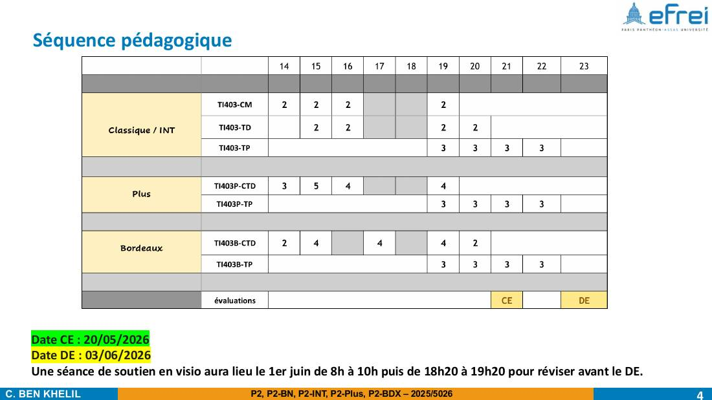
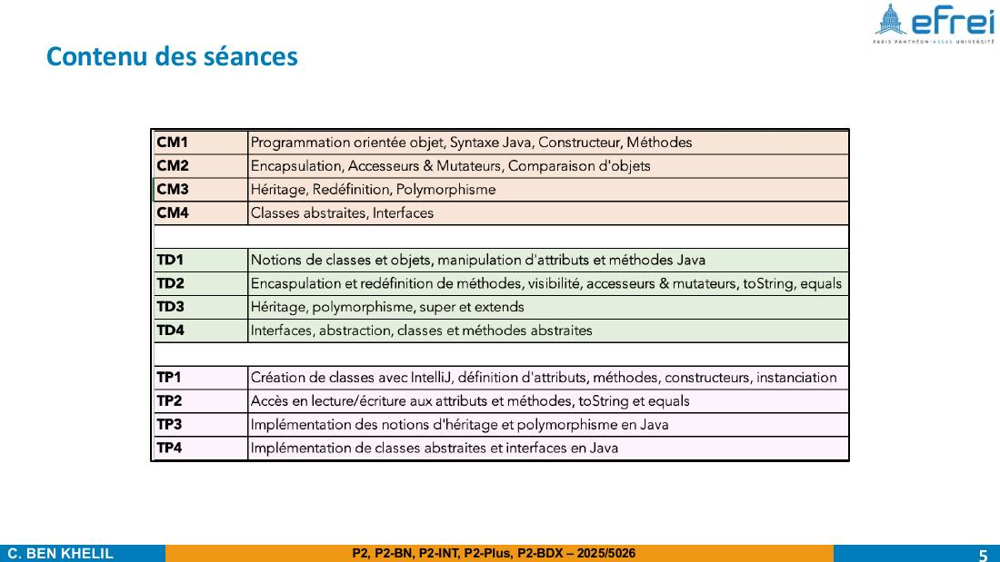
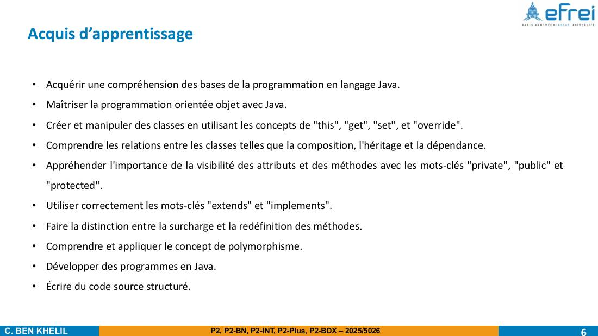
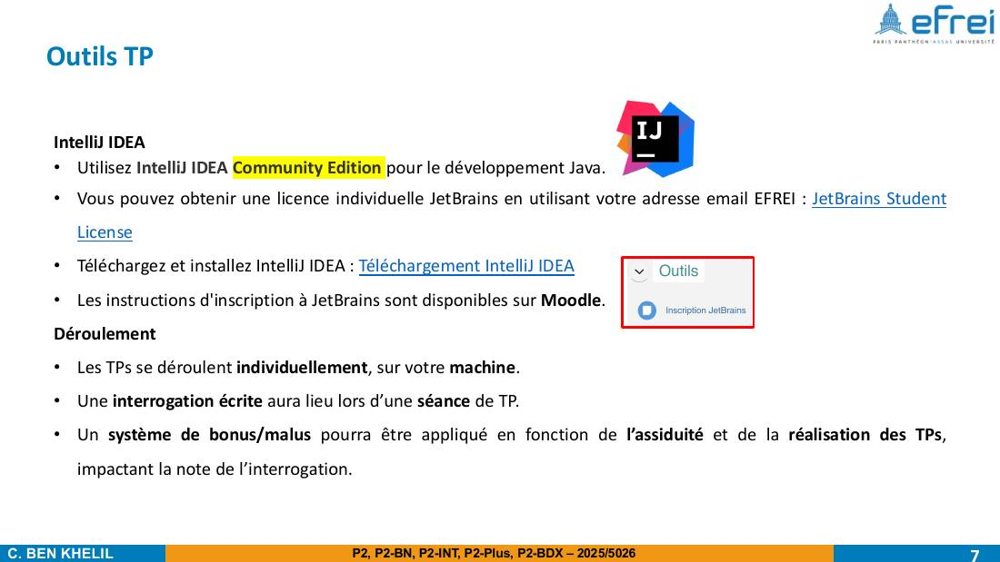
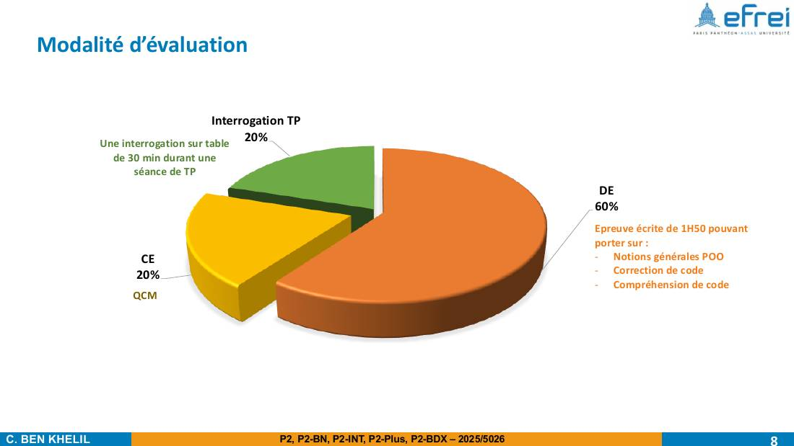
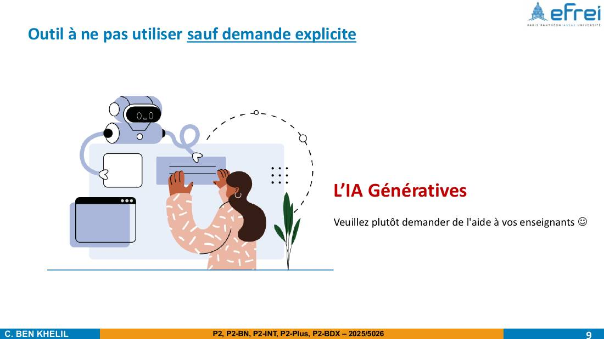
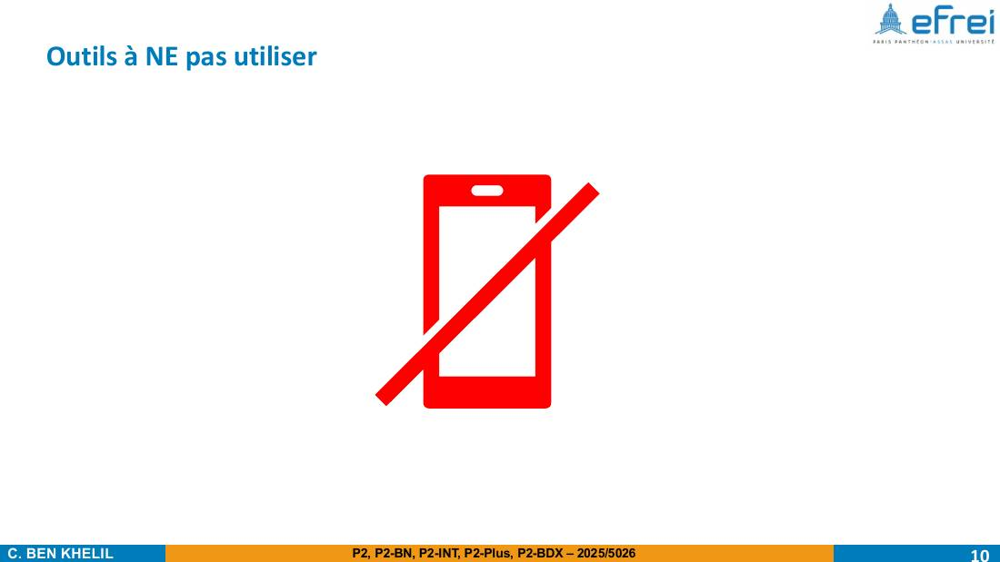

# Chapitre 0 — Les bases du langage Java

=== "Version simplifiée"

    Java est un langage **compilé** en bytecode (`javac`) puis exécuté par la
    **JVM** (`java`) : le même `.class` tourne sur tous les systèmes. Tout code
    est dans une **classe** ; le programme démarre dans `main`.

    ```java
    public class Main {
        public static void main(String[] args) {
            System.out.println("Bonjour !");
        }
    }
    ```

    ## Types et variables

    | Type primitif | Exemple |
    |---|---|
    | `int`, `long` | `int n = 42;` |
    | `double`, `float` | `double x = 3.14;` |
    | `boolean` | `boolean ok = true;` |
    | `char` | `char c = 'A';` |

    `String` n'est **pas** un type primitif : c'est une classe (`"texte"`).
    Opérateurs : `+ - * / %`, `== != < <= > >=`, `&& || !`, `++ --`.

    !!! piege "Division entière"
        `7 / 2` vaut `3` (deux `int`) ; `7 / 2.0` vaut `3.5`.

    ## Conditions et boucles

    ```java
    if (note >= 10) { … } else if (note >= 8) { … } else { … }

    switch (jour) { case 1: …; break; default: …; }

    for (int i = 0; i < n; i++) { … }
    while (condition) { … }
    do { … } while (condition);
    for (String nom : noms) { … }      // for-each sur un tableau
    ```

    ## Entrées / sorties

    ```java
    import java.util.Scanner;

    Scanner sc = new Scanner(System.in);
    int age = sc.nextInt();
    double taille = sc.nextDouble();
    sc.nextLine();                      // vider le retour à la ligne restant
    String nom = sc.nextLine();
    System.out.println("Nom : " + nom);
    System.out.printf("%.2f%n", taille);
    ```

    ## Tableaux statiques

    ```java
    int[] t = new int[5];              // 5 cases à 0
    int[] u = {3, 1, 4};
    t.length;                          // taille (attribut, sans parenthèses)
    Arrays.toString(u);                // "[3, 1, 4]" (import java.util.Arrays)
    Arrays.sort(u);
    ```

    !!! piege "Indices"
        De `0` à `t.length - 1` : `t[t.length]` lève une `ArrayIndexOutOfBoundsException`.

    Classes utilitaires : `Math.sqrt`, `Math.pow`, `Math.abs`, `Math.max` ;
    `String` : `length()`, `charAt(i)`, `equals(…)`, `toUpperCase()`, `substring(a, b)`.

=== "Version papier"

    La présentation du module (organisation, évaluation, outils).

    <!-- papier: pdf/TI403P/pre-sentation-cours-ti403.pdf | Présentation du cours TI403 | presentation | diapo -->

    [{ loading=lazy .papier }](papier/presentation/p01.jpg)
    <p class="papier-legende">TI403 – Java 1: Fondamentaux de la POO · Présentation du cours TI403, diapo 1</p>

    [{ loading=lazy .papier }](papier/presentation/p02.jpg)
    <p class="papier-legende">Organisation du cours · Présentation du cours TI403, diapo 2</p>

    [{ loading=lazy .papier }](papier/presentation/p03.jpg)
    <p class="papier-legende">Equipe pédagogique · Présentation du cours TI403, diapo 3</p>

    [{ loading=lazy .papier }](papier/presentation/p04.jpg)
    <p class="papier-legende">Séquence pédagogique · Présentation du cours TI403, diapo 4</p>

    [{ loading=lazy .papier }](papier/presentation/p05.jpg)
    <p class="papier-legende">Contenu des séances · Présentation du cours TI403, diapo 5</p>

    [{ loading=lazy .papier }](papier/presentation/p06.jpg)
    <p class="papier-legende">Acquis d’apprentissage · Présentation du cours TI403, diapo 6</p>

    [{ loading=lazy .papier }](papier/presentation/p07.jpg)
    <p class="papier-legende">Outils TP · Présentation du cours TI403, diapo 7</p>

    [{ loading=lazy .papier }](papier/presentation/p08.jpg)
    <p class="papier-legende">Modalité d’évaluation · Présentation du cours TI403, diapo 8</p>

    [{ loading=lazy .papier }](papier/presentation/p09.jpg)
    <p class="papier-legende">Outil à ne pas utiliser sauf demande explicite · Présentation du cours TI403, diapo 9</p>

    [{ loading=lazy .papier }](papier/presentation/p10.jpg)
    <p class="papier-legende">Outils à NE pas utiliser · Présentation du cours TI403, diapo 10</p>

    <!-- /papier -->
