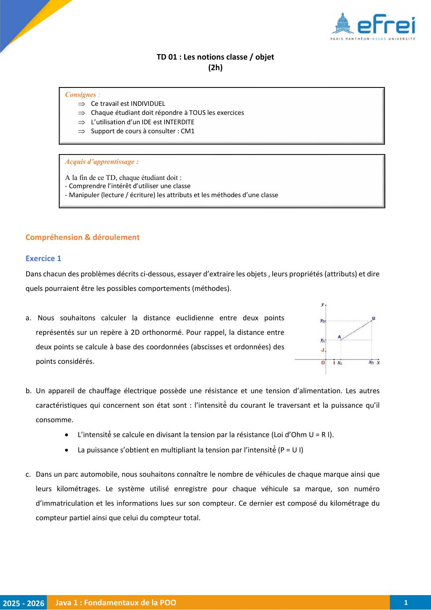
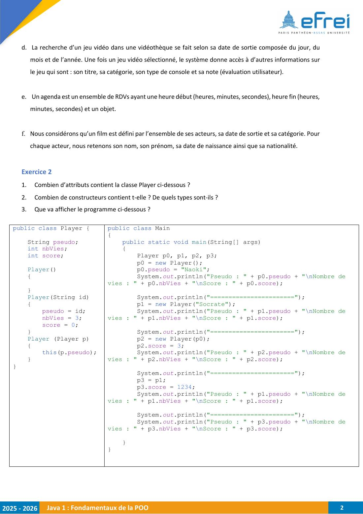
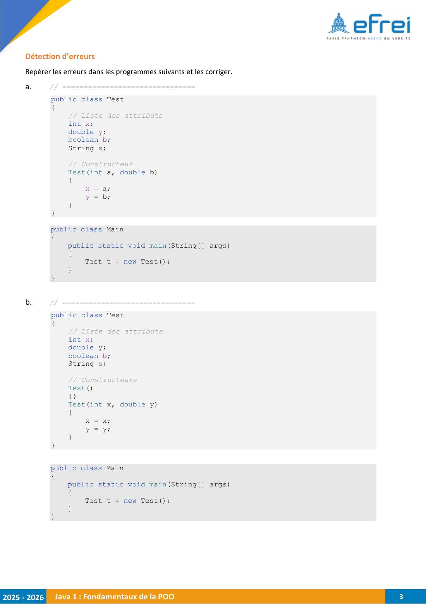
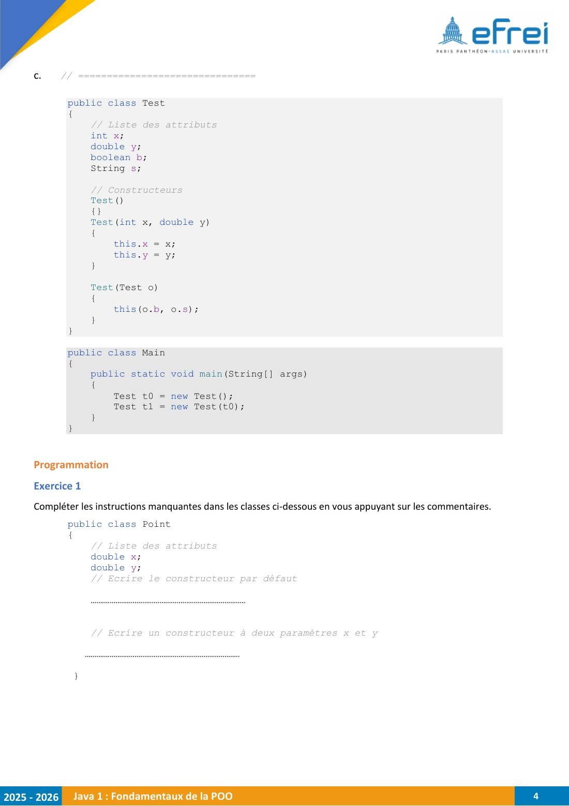
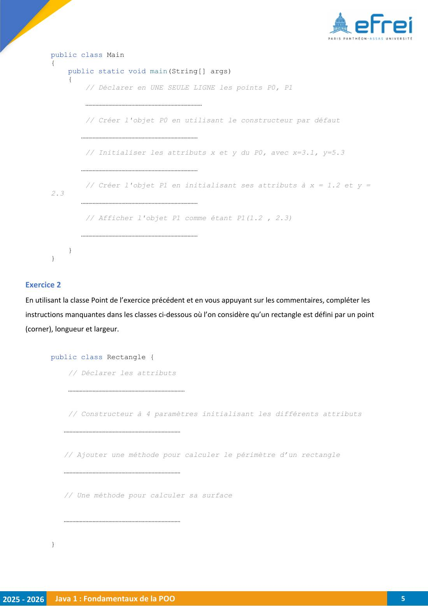

# TD 1 — Les notions de classe et d'objet

=== "Version simplifiée"

    Rappels : [chapitre 1](../cours/chapitre-1-classes-objets.md). Sur papier,
    sans IDE. Les sorties ci-dessous ont été vérifiées en exécutant le code.

    ## Compréhension — Exercice 1 : identifier classes, attributs, méthodes

    | Problème | Classe(s) et attributs | Méthodes possibles |
    |---|---|---|
    | a. Distance | `Point` (x, y) | `distance(Point p)` |
    | b. Chauffage | `Chauffage` (résistance, tension) | `intensite()` = U/R, `puissance()` = U·I |
    | c. Parc auto | `Vehicule` (marque, immatriculation, `Compteur`) ; `Compteur` (partiel, total) | `rouler(km)`, `remiseAZeroPartiel()`, compter par marque |
    | d. Vidéothèque | `JeuVideo` (titre, catégorie, console, note, `Date`) ; `Date` (jour, mois, année) | rechercher par date, `toString()` |
    | e. Agenda | `Agenda` (liste de `RDV`) ; `RDV` (début, fin : `Heure`, objet) ; `Heure` (h, min, s) | ajouter/supprimer un RDV, durée |
    | f. Film | `Film` (acteurs, date, catégorie) ; `Acteur` (nom, prénom, date de naissance, nationalité) | ajouter un acteur |

    ## Exercice 2 — La classe Player

    1. **3 attributs** (pseudo, nbVies, score). 2. **3 constructeurs** : par défaut,
    d'initialisation (`String`), de copie (`Player`).

    3. Affichage :
    ```text
    Pseudo : Naoki         | Nombre de vies : 0 | Score : 0      (p0 : constructeur vide, valeurs par défaut)
    Pseudo : Socrate       | Nombre de vies : 3 | Score : 0
    Pseudo : Naoki         | Nombre de vies : 3 | Score : 3      (copie : this(p.pseudo) remet 3 vies)
    Pseudo : Socrate       | Nombre de vies : 3 | Score : 1234   (p3 = p1 : même objet)
    Pseudo : Socrate       | Nombre de vies : 3 | Score : 1234
    ```

    ## Détection d'erreurs

    - **a.** `new Test()` : il n'y a plus de constructeur par défaut (un constructeur
      à deux paramètres a été écrit) → ajouter `Test() {}` ou appeler `new Test(1, 2.0)`.
    - **b.** Compile, mais `x = x; y = y;` ne modifie pas les attributs → `this.x = x; this.y = y;`.
    - **c.** `this(o.b, o.s)` appelle un constructeur `(boolean, String)` qui n'existe pas →
      `this(o.x, o.y);`.

    ## Programmation

    ```java
    public class Point {
        double x, y;
        Point() { }
        Point(double x, double y) { this.x = x; this.y = y; }
    }
    // main
    Point p0, p1;
    p0 = new Point();
    p0.x = 3.1; p0.y = 5.3;
    p1 = new Point(1.2, 2.3);
    System.out.println("P1(" + p1.x + " , " + p1.y + ")");

    public class Rectangle {
        Point corner; double longueur, largeur;
        Rectangle(double x, double y, double longueur, double largeur) {
            corner = new Point(x, y); this.longueur = longueur; this.largeur = largeur;
        }
        double perimetre() { return 2 * (longueur + largeur); }
        double surface()   { return longueur * largeur; }
    }
    // main
    Scanner sc = new Scanner(System.in);
    double L = sc.nextDouble(), l = sc.nextDouble();
    Rectangle r = new Rectangle(0, 0, L, l);
    System.out.println("Périmètre : " + r.perimetre());
    System.out.println("Surface : " + r.surface());
    ```

=== "Version papier"

    Énoncé du TD 1 tel qu'il est distribué.

    <!-- papier: pdf/TI403P/td1.pdf | TD 1 — énoncé | td1 | page -->

    [{ loading=lazy .papier }](papier/td1/p01.jpg)
    <p class="papier-legende">TD 01 : Les notions classe / objet · TD 1 — énoncé, page 1</p>

    [{ loading=lazy .papier }](papier/td1/p02.jpg)
    <p class="papier-legende">d. La recherche d’un jeu vidéo dans une vidéothèque se fait selon sa date de sortie compos… · TD 1 — énoncé, page 2</p>

    [{ loading=lazy .papier }](papier/td1/p03.jpg)
    <p class="papier-legende">Détection d’erreurs · TD 1 — énoncé, page 3</p>

    [{ loading=lazy .papier }](papier/td1/p04.jpg)
    <p class="papier-legende">public class Test · TD 1 — énoncé, page 4</p>

    [{ loading=lazy .papier }](papier/td1/p05.jpg)
    <p class="papier-legende">// Déclarer en UNE SEULE LIGNE les points P0, P1 · TD 1 — énoncé, page 5</p>

    [{ loading=lazy .papier }](papier/td1/p06.jpg)
    <p class="papier-legende">// Demander à l&#x27;utilisateur de saisir la longueur , la largeur · TD 1 — énoncé, page 6</p>

    <!-- /papier -->
