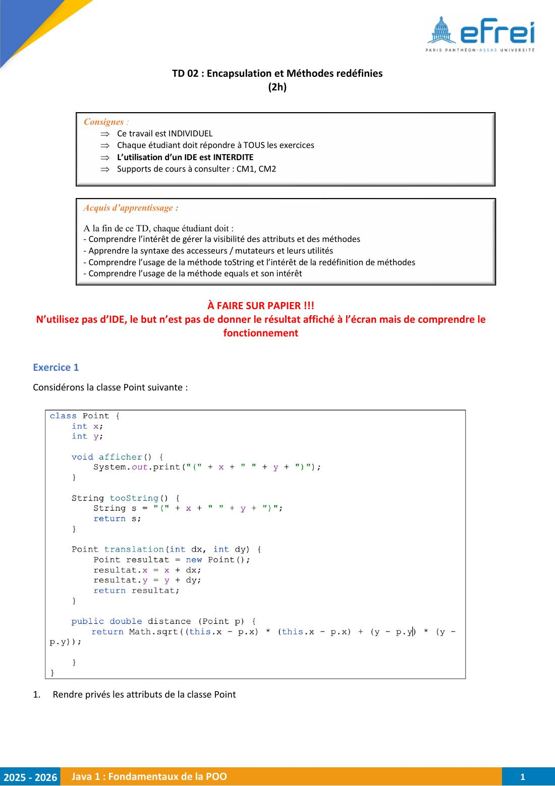
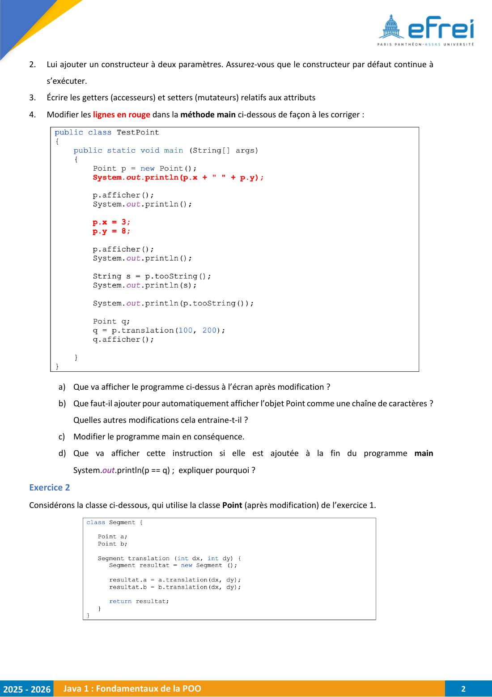
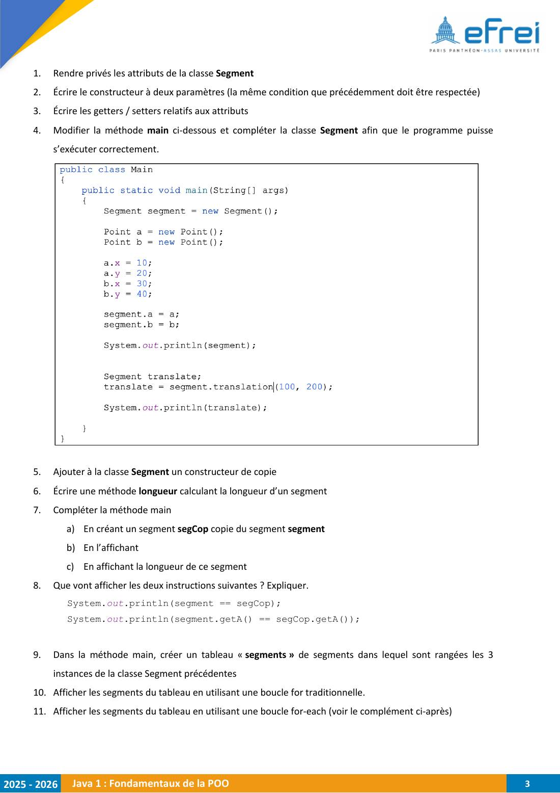
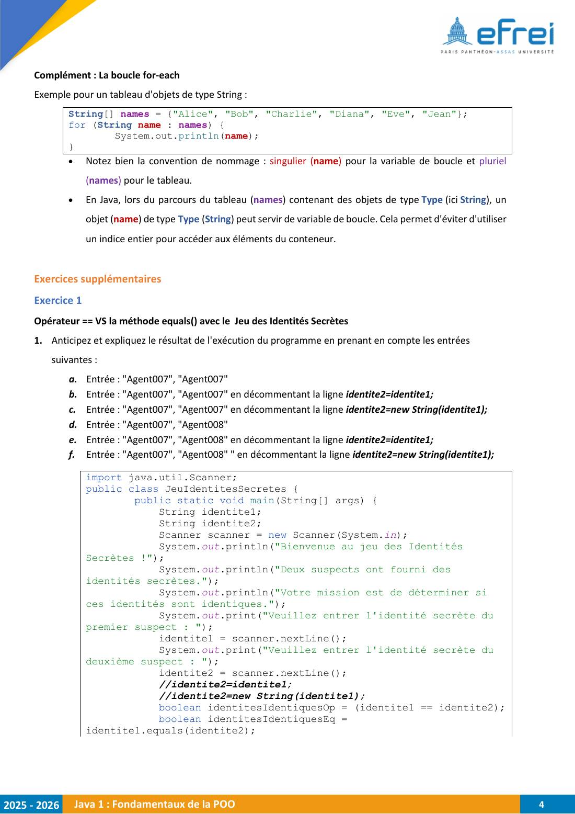
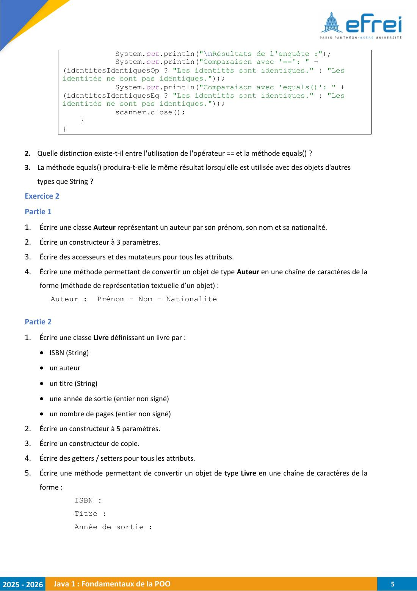
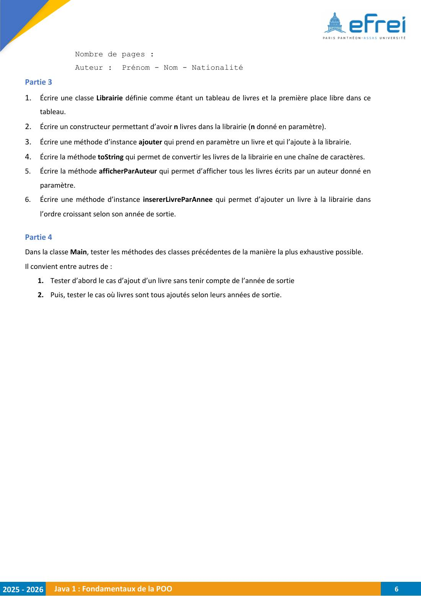

# TD 2 — Encapsulation et méthodes redéfinies

=== "Version simplifiée"

    Rappels : [chapitre 2](../cours/chapitre-2-encapsulation.md).

    ## Exercice 1 — Point encapsulé

    ```java
    public class Point {
        private double x, y;
        public Point() { }                                  // garder le constructeur par défaut
        public Point(double x, double y) { this.x = x; this.y = y; }
        public double getX() { return x; }
        public double getY() { return y; }
        public void setX(double x) { this.x = x; }
        public void setY(double y) { this.y = y; }
        @Override
        public String toString() { return "(" + x + ", " + y + ")"; }
    }
    ```

    - Dans `main`, les accès `p.x` deviennent `p.getX()` / `p.setX(…)`.
    - Pour afficher directement l'objet : **redéfinir `toString()`**, puis
      `System.out.println(p)` suffit (on peut supprimer les affichages champ par champ).
    - `p == q` affiche `false` pour deux objets distincts, même de coordonnées
      égales : `==` compare les **références**. Pour comparer le contenu, redéfinir `equals`.

    ## Exercice 2 — Segment

    ```java
    public class Segment {
        private Point a, b;
        public Segment() { }
        public Segment(Point a, Point b) { this.a = a; this.b = b; }
        public Segment(Segment s) { this(new Point(s.a.getX(), s.a.getY()),
                                         new Point(s.b.getX(), s.b.getY())); }  // copie profonde
        public Point getA() { return a; }   // … getB, setA, setB
        public double longueur() {
            return Math.sqrt(Math.pow(b.getX() - a.getX(), 2) + Math.pow(b.getY() - a.getY(), 2));
        }
        @Override public String toString() { return "[" + a + " ; " + b + "]"; }
    }
    ```

    - `segment == segCop` → `false` (deux objets).
    - `segment.getA() == segCop.getA()` → `false` avec la copie **profonde** ci-dessus ;
      `true` si le constructeur de copie recopie seulement les références (`this(s.a, s.b)`,
      copie **superficielle**) : les deux segments partagent alors les mêmes points.

    ```java
    Segment[] segments = { s1, s2, segCop };
    for (int i = 0; i < segments.length; i++) System.out.println(segments[i]);
    for (Segment s : segments) System.out.println(s);
    ```

=== "Version papier"

    Énoncé du TD 2 tel qu'il est distribué.

    <!-- papier: pdf/TI403P/td2.pdf | TD 2 — énoncé | td2 | page -->

    [{ loading=lazy .papier }](papier/td2/p01.jpg)
    <p class="papier-legende">TD 02 : Encapsulation et Méthodes redéfinies · TD 2 — énoncé, page 1</p>

    [{ loading=lazy .papier }](papier/td2/p02.jpg)
    <p class="papier-legende">Lui ajouter un constructeur à deux paramètres. Assurez-vous que le constructeur par défaut… · TD 2 — énoncé, page 2</p>

    [{ loading=lazy .papier }](papier/td2/p03.jpg)
    <p class="papier-legende">Rendre privés les attributs de la classe Segment · TD 2 — énoncé, page 3</p>

    [{ loading=lazy .papier }](papier/td2/p04.jpg)
    <p class="papier-legende">Complément : La boucle for-each · TD 2 — énoncé, page 4</p>

    [{ loading=lazy .papier }](papier/td2/p05.jpg)
    <p class="papier-legende">System.out.println(&quot;\nRésultats de l&#x27;enquête :&quot;); · TD 2 — énoncé, page 5</p>

    [{ loading=lazy .papier }](papier/td2/p06.jpg)
    <p class="papier-legende">Nombre de pages : · TD 2 — énoncé, page 6</p>

    <!-- /papier -->
