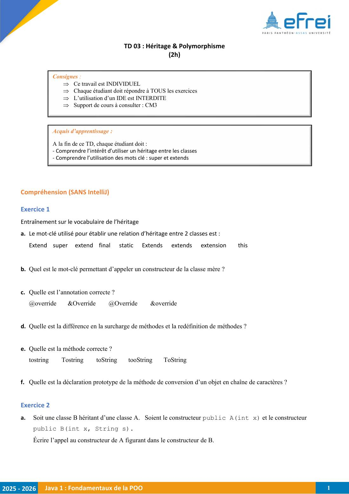
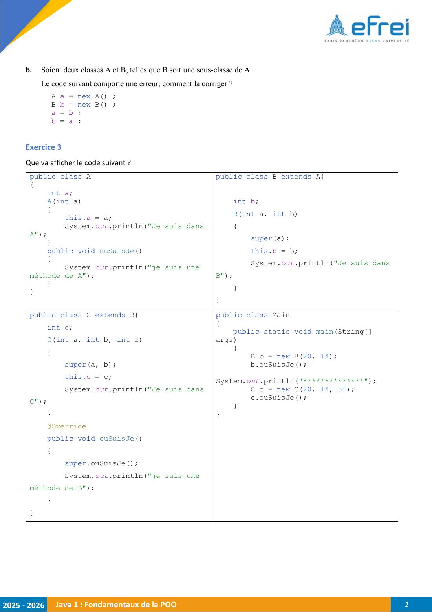
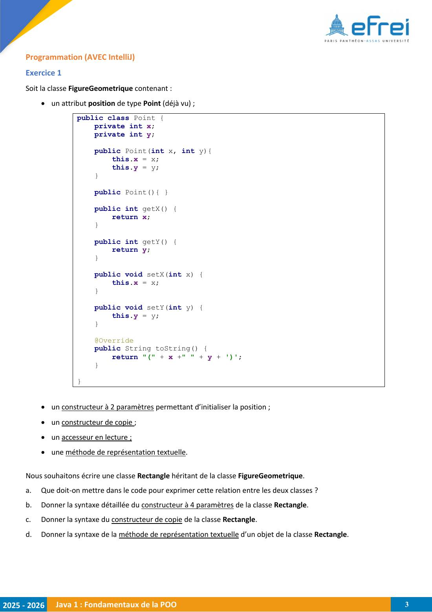
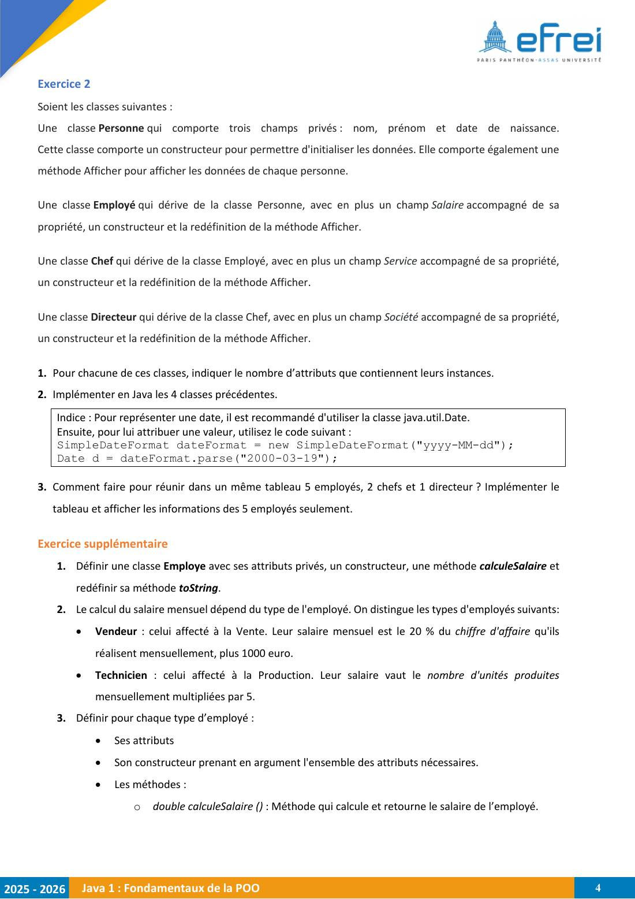
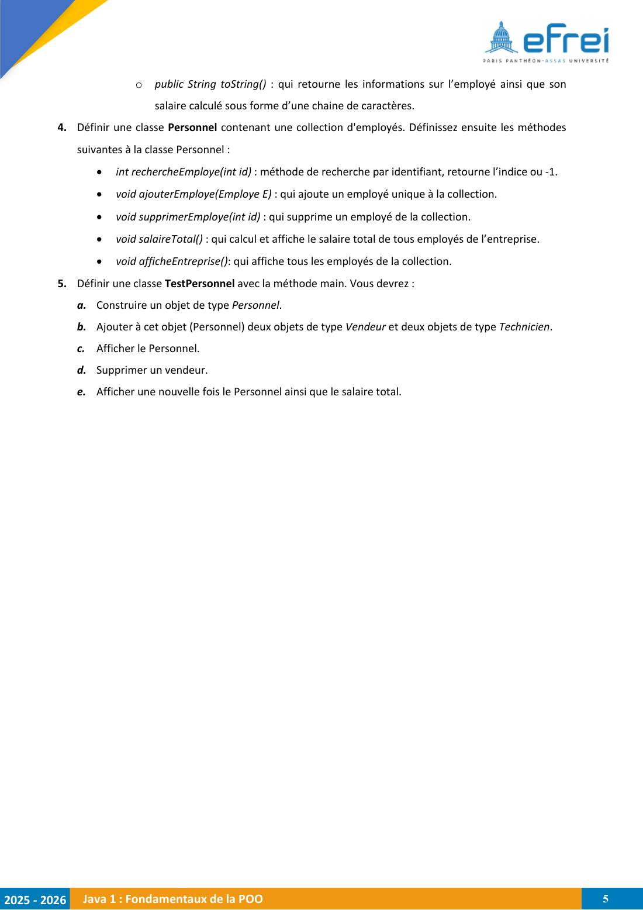

# TD 3 — Héritage et polymorphisme

=== "Version simplifiée"

    Rappels : [chapitre 3](../cours/chapitre-3-heritage.md). Sorties vérifiées en exécutant le code.

    ## Exercice 1 — Vocabulaire

    a. `extends` · b. `super` · c. `@Override` · d. surcharge = même nom, paramètres
    différents ; redéfinition = même signature dans une classe fille · e. `toString`
    · f. `public String toString()`.

    ## Exercice 2

    a. Dans `public B(int x, String s)` : `super(x);` en **première** instruction.

    b. `b = a;` ne compile pas (une `A` n'est pas forcément une `B`). Downcast :
    `b = (B) a;` (fonctionne ici car `a` référence en réalité une `B`).

    ## Exercice 3 — Que va afficher le code ?

    ```text
    Je suis dans A
    Je suis dans B
    je suis une méthode de A
    **************
    Je suis dans A
    Je suis dans B
    Je suis dans C
    je suis une méthode de A
    je suis une méthode de B
    ```

    Les constructeurs s'enchaînent de la mère vers la fille ; `C` redéfinit
    `ouSuisJe()` et appelle d'abord `super.ouSuisJe()`.

    ## Programmation — Exercice 1 : Rectangle extends FigureGeometrique

    ```java
    public class Rectangle extends FigureGeometrique {
        private int longueur, largeur;
        public Rectangle(int x, int y, int longueur, int largeur) {
            super(x, y);                                   // initialise la position
            this.longueur = longueur; this.largeur = largeur;
        }
        public Rectangle(Rectangle r) {
            super(r);                                      // constructeur de copie de la mère
            this.longueur = r.longueur; this.largeur = r.largeur;
        }
        @Override
        public String toString() {
            return "Rectangle " + super.toString() + " " + longueur + "x" + largeur;
        }
    }
    ```

    ## Exercice 2 — Personne, Employé, Chef, Directeur

    1. Attributs par instance : Personne **3**, Employé **4**, Chef **5**, Directeur **6**
       (les attributs hérités comptent, même `private`).
    2. Chaque constructeur appelle `super(…)` puis initialise son champ ; chaque
       `afficher()` appelle `super.afficher()` puis affiche son champ.
    3. Un tableau du type commun : `Employe[] equipe = new Employe[8];` (upcast) ;
       pour n'afficher que les simples employés :
       ```java
       for (Employe e : equipe)
           if (!(e instanceof Chef)) e.afficher();
       ```

=== "Version papier"

    Énoncé du TD 3 tel qu'il est distribué.

    <!-- papier: pdf/TI403P/td3.pdf | TD 3 — énoncé | td3 | page -->

    [{ loading=lazy .papier }](papier/td3/p01.jpg)
    <p class="papier-legende">TD 03 : Héritage &amp; Polymorphisme · TD 3 — énoncé, page 1</p>

    [{ loading=lazy .papier }](papier/td3/p02.jpg)
    <p class="papier-legende">Soient deux classes A et B, telles que B soit une sous-classe de A. · TD 3 — énoncé, page 2</p>

    [{ loading=lazy .papier }](papier/td3/p03.jpg)
    <p class="papier-legende">Programmation (AVEC IntelliJ) · TD 3 — énoncé, page 3</p>

    [{ loading=lazy .papier }](papier/td3/p04.jpg)
    <p class="papier-legende">Exercice 2 · TD 3 — énoncé, page 4</p>

    [{ loading=lazy .papier }](papier/td3/p05.jpg)
    <p class="papier-legende">public String toString() : qui retourne les informations sur l’employé ainsi que son · TD 3 — énoncé, page 5</p>

    <!-- /papier -->
