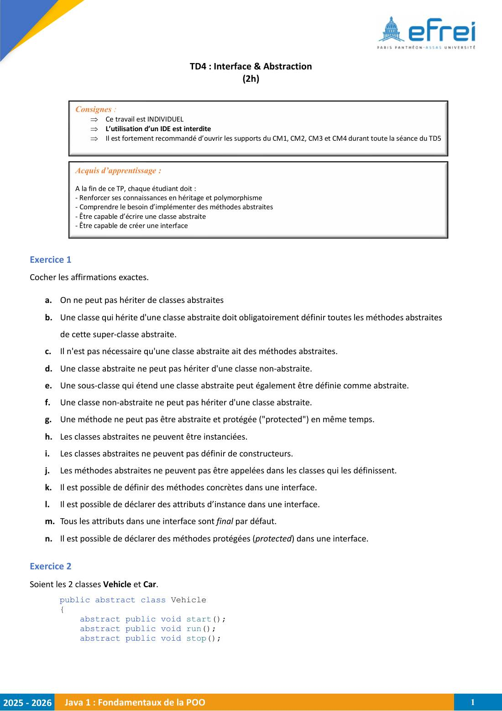
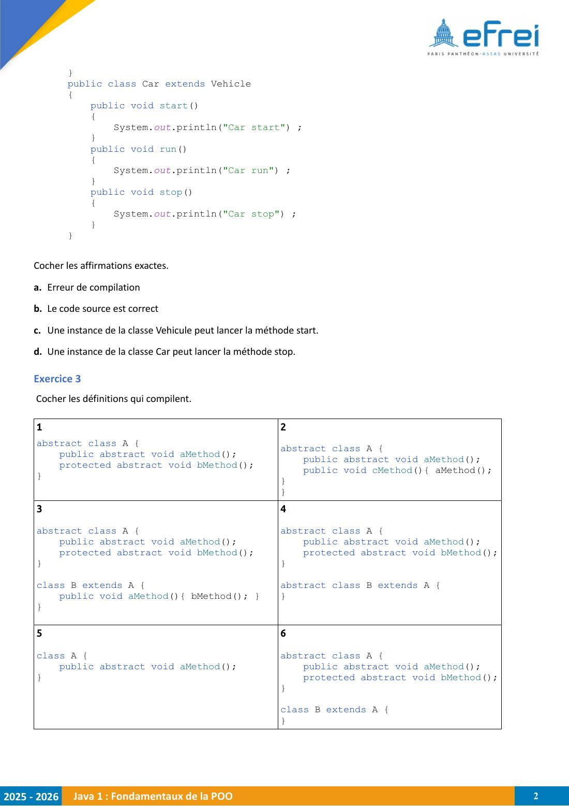
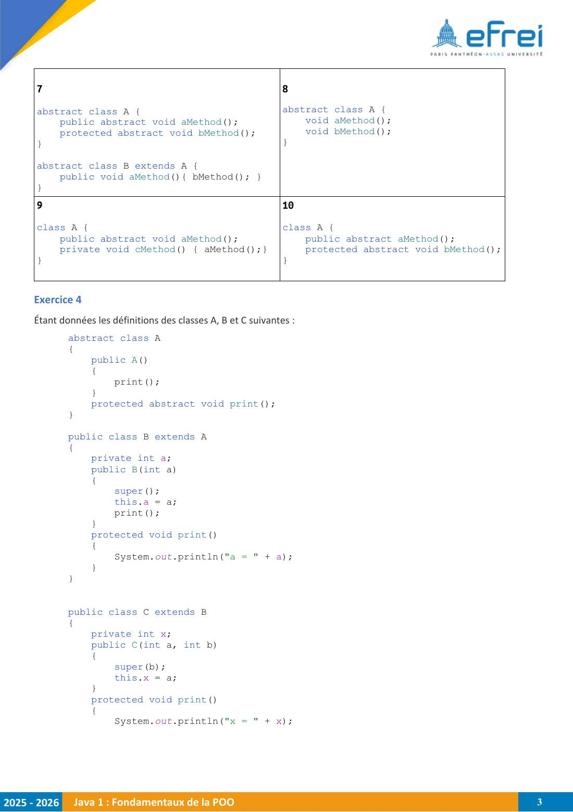
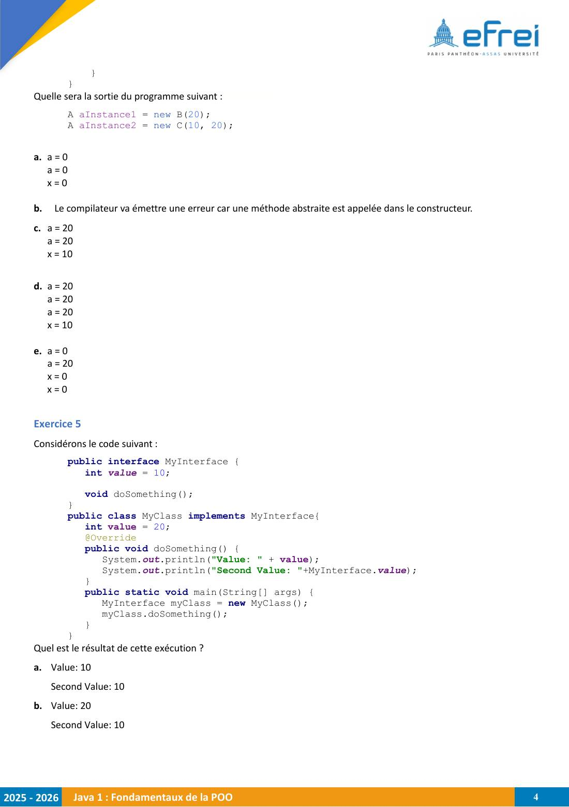
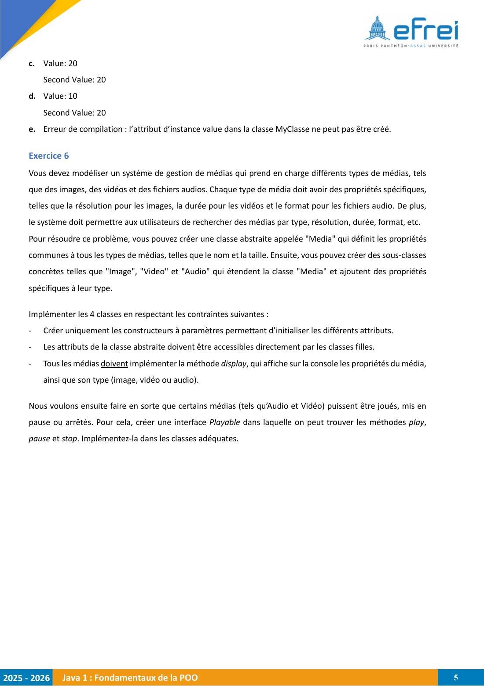

# TD 4 — Interfaces et abstraction

=== "Version simplifiée"

    Rappels : [chapitre 4](../cours/chapitre-4-abstraites-interfaces.md). Les
    réponses des exercices 3 à 5 ont été vérifiées en compilant et exécutant le code.

    ## Exercice 1 — Vrai ou faux

    | | Réponse | |
    |---|:-:|---|
    | a. On ne peut pas hériter d'une classe abstraite | Faux | c'est même leur but |
    | b. La fille doit définir toutes les méthodes abstraites | Faux* | *sauf si elle est elle-même abstraite (cf. e) |
    | c. Une classe abstraite peut n'avoir aucune méthode abstraite | **Vrai** | |
    | d. Une classe abstraite ne peut pas hériter d'une classe concrète | Faux | elle hérite au moins d'`Object` |
    | e. Une sous-classe d'une classe abstraite peut être abstraite | **Vrai** | |
    | f. Une classe concrète ne peut pas hériter d'une abstraite | Faux | |
    | g. Pas de méthode `abstract protected` | Faux | c'est autorisé |
    | h. Une classe abstraite ne peut pas être instanciée | **Vrai** | |
    | i. Une classe abstraite ne peut pas avoir de constructeur | Faux | appelé via `super(…)` |
    | j. Une méthode abstraite ne peut pas être appelée dans sa classe | Faux | liaison dynamique |
    | k. Méthodes concrètes dans une interface | **Vrai** | `default` / `static` depuis Java 8 |
    | l. Attributs d'instance dans une interface | Faux | |
    | m. Attributs d'interface `final` par défaut | **Vrai** | `public static final` |
    | n. Méthodes `protected` dans une interface | Faux | |

    ## Exercice 2 — Vehicle / Car

    **b** (le code est correct) et **d** (une `Car` peut appeler `stop`). On ne peut
    pas créer d'instance de `Vehicle` (classe abstraite), donc c est faux.

    ## Exercice 3 — Quelles définitions compilent ?

    Compilent : **1, 2, 4, 7**.

    - 3 : `B` est concrète mais ne définit pas `bMethod()`.
    - 5, 9, 10 : méthode abstraite dans une classe non abstraite (10 n'a en plus pas de type de retour).
    - 6 : `B` concrète sans définir les méthodes abstraites.
    - 8 : méthodes sans corps ni `abstract` dans une classe.

    ## Exercice 4 — Constructeur qui appelle une méthode abstraite

    Réponse **e** :
    ```text
    a = 0      ← constructeur de A : print() de B, a pas encore initialisé
    a = 20     ← fin du constructeur de B
    x = 0      ← new C : A() appelle print() de C, x pas encore initialisé
    x = 0      ← B() appelle print() (version de C), x toujours à 0
    ```

    ## Exercice 5 — Interface et attribut de même nom

    Réponse **b** : `Value: 20` (attribut de `MyClass`) puis `Second Value: 10`
    (constante de l'interface).

=== "Version papier"

    Énoncé du TD 4 tel qu'il est distribué.

    <!-- papier: pdf/TI403P/td4.pdf | TD 4 — énoncé | td4 | page -->

    [{ loading=lazy .papier }](papier/td4/p01.jpg)
    <p class="papier-legende">TD4 : Interface &amp; Abstraction · TD 4 — énoncé, page 1</p>

    [{ loading=lazy .papier }](papier/td4/p02.jpg)
    <p class="papier-legende">public class Car extends Vehicle · TD 4 — énoncé, page 2</p>

    [{ loading=lazy .papier }](papier/td4/p03.jpg)
    <p class="papier-legende">abstract class A { · TD 4 — énoncé, page 3</p>

    [{ loading=lazy .papier }](papier/td4/p04.jpg)
    <p class="papier-legende">Quelle sera la sortie du programme suivant : · TD 4 — énoncé, page 4</p>

    [{ loading=lazy .papier }](papier/td4/p05.jpg)
    <p class="papier-legende">c. Value: 20 · TD 4 — énoncé, page 5</p>

    <!-- /papier -->
