# TP 3 — Héritage et polymorphisme (parc informatique)

=== "Version simplifiée"

    Projet **modulaire** de gestion d'un parc informatique, organisé en packages :

    ```text
    src/
    ├── equipements/base/          Equipement, Ordinateur, Serveur, StationDeTravail
    ├── equipements/reseau/        Switch, Routeur
    ├── equipements/peripheriques/ Ecran, Clavier, Souris
    ├── gestion/                   ParcInformatique
    └── test/                      scénarios de validation
    ```

    Notions travaillées : hiérarchie de classes et `super`, règles de
    redéfinition, **packages et visibilité** (`protected` vs *package*),
    collection hétérogène traitée par **polymorphisme** (`ArrayList<Equipement>`),
    et **composition** (un poste de travail *a des* périphériques).

    !!! methode "Héritage ou composition ?"
        « **est un** » → héritage (`Serveur extends Ordinateur`) ;
        « **a un** » → composition (un attribut `Ecran` dans `StationDeTravail`).

=== "Version papier"

    Sujet du TP 3 tel qu'il est distribué.

    <!-- papier: pdf/TI403P/tp3-ti403.pdf | TP 3 — sujet | tp3 | page -->

    [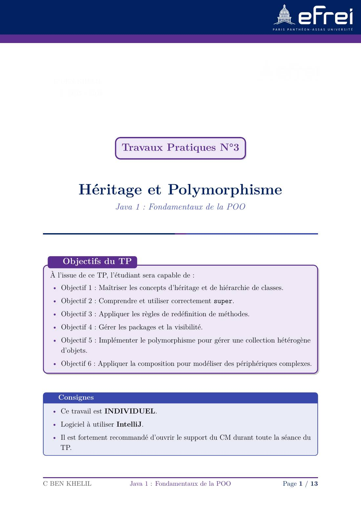{ loading=lazy .papier }](papier/tp3/p01.jpg)
    <p class="papier-legende">Travaux Pratiques N°3 · TP 3 — sujet, page 1</p>

    [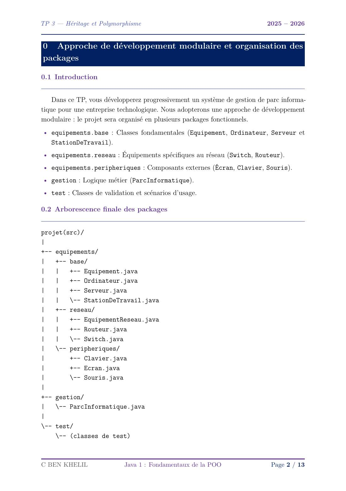{ loading=lazy .papier }](papier/tp3/p02.jpg)
    <p class="papier-legende">0 Approche de développement modulaire et organisation des · TP 3 — sujet, page 2</p>

    [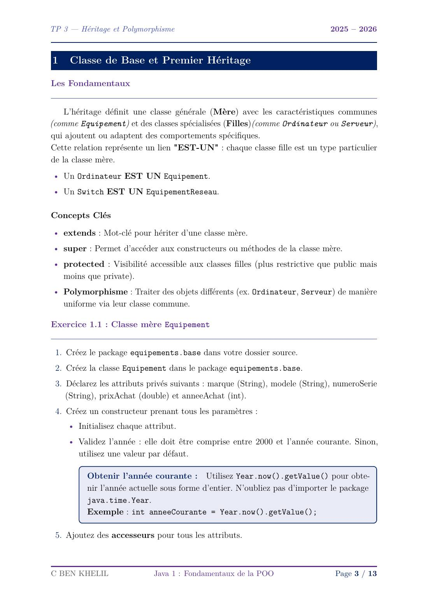{ loading=lazy .papier }](papier/tp3/p03.jpg)
    <p class="papier-legende">Classe de Base et Premier Héritage · TP 3 — sujet, page 3</p>

    [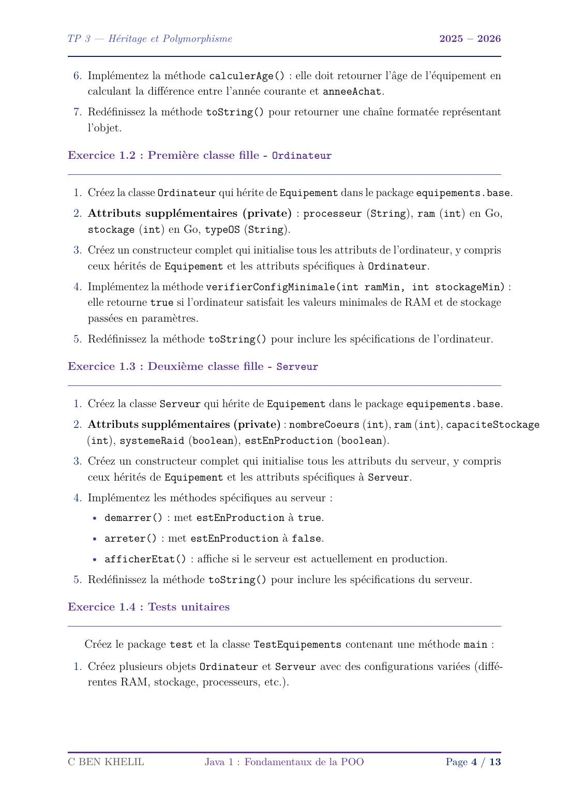{ loading=lazy .papier }](papier/tp3/p04.jpg)
    <p class="papier-legende">6. Implémentez la méthode calculerAge() : elle doit retourner l’âge de l’équipement en · TP 3 — sujet, page 4</p>

    [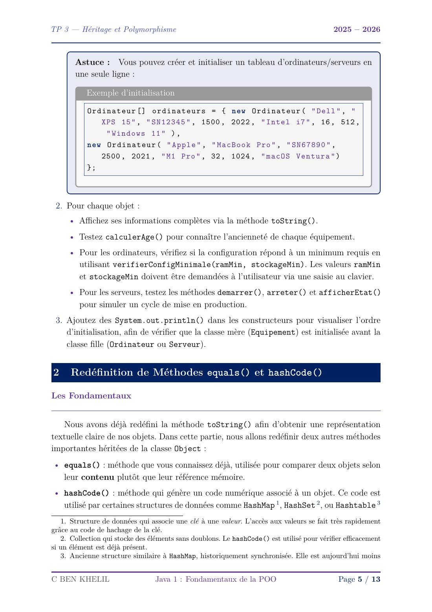{ loading=lazy .papier }](papier/tp3/p05.jpg)
    <p class="papier-legende">Astuce : Vous pouvez créer et initialiser un tableau d’ordinateurs/serveurs en · TP 3 — sujet, page 5</p>

    [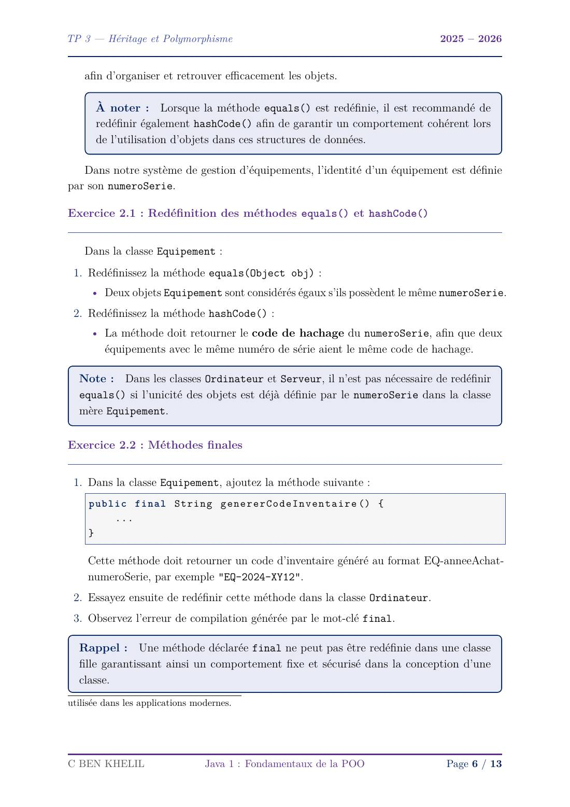{ loading=lazy .papier }](papier/tp3/p06.jpg)
    <p class="papier-legende">afin d’organiser et retrouver efficacement les objets. · TP 3 — sujet, page 6</p>

    [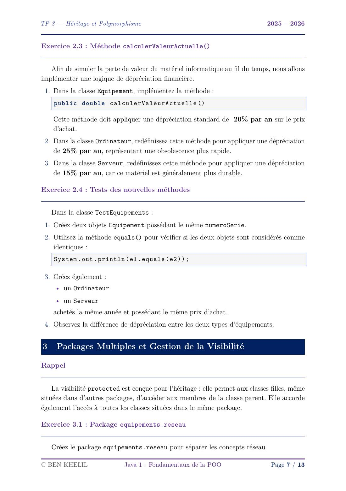{ loading=lazy .papier }](papier/tp3/p07.jpg)
    <p class="papier-legende">Exercice 2.3 : Méthode calculerValeurActuelle() · TP 3 — sujet, page 7</p>

    [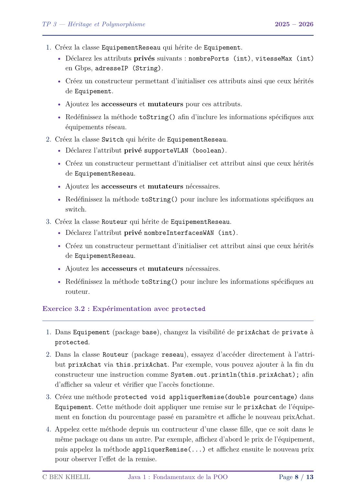{ loading=lazy .papier }](papier/tp3/p08.jpg)
    <p class="papier-legende">1. Créez la classe EquipementReseau qui hérite de Equipement. · TP 3 — sujet, page 8</p>

    [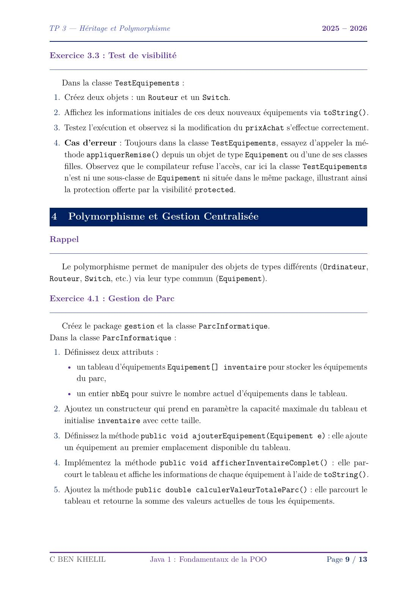{ loading=lazy .papier }](papier/tp3/p09.jpg)
    <p class="papier-legende">Exercice 3.3 : Test de visibilité · TP 3 — sujet, page 9</p>

    [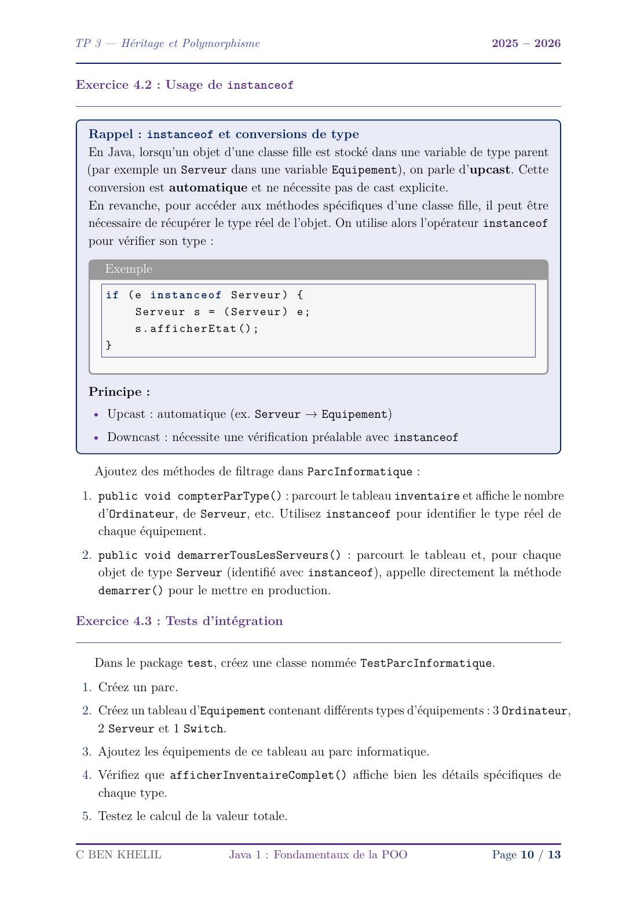{ loading=lazy .papier }](papier/tp3/p10.jpg)
    <p class="papier-legende">Exercice 4.2 : Usage de instanceof · TP 3 — sujet, page 10</p>

    [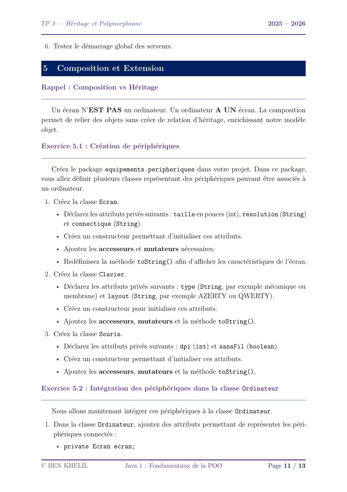{ loading=lazy .papier }](papier/tp3/p11.jpg)
    <p class="papier-legende">6. Testez le démarrage global des serveurs. · TP 3 — sujet, page 11</p>

    [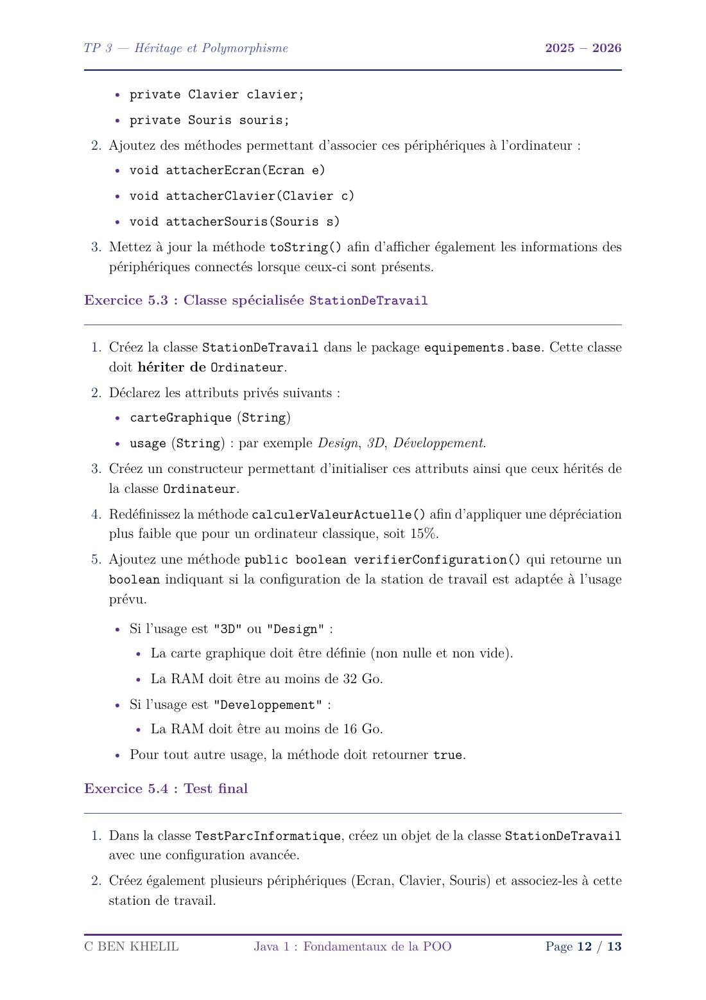{ loading=lazy .papier }](papier/tp3/p12.jpg)
    <p class="papier-legende">private Clavier clavier; · TP 3 — sujet, page 12</p>

    [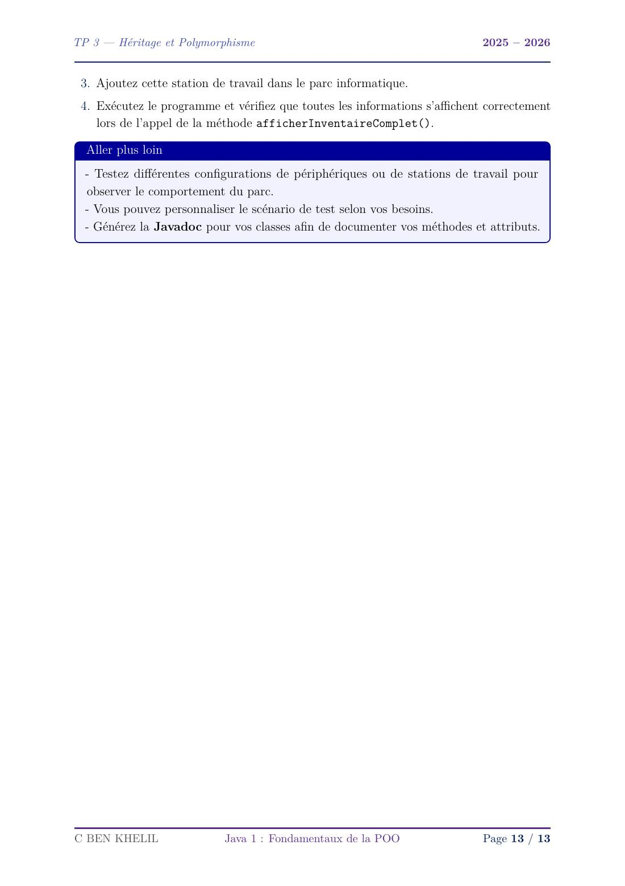{ loading=lazy .papier }](papier/tp3/p13.jpg)
    <p class="papier-legende">3. Ajoutez cette station de travail dans le parc informatique. · TP 3 — sujet, page 13</p>

    <!-- /papier -->
