# Annales

=== "Version simplifiée"

    - La **correction d'une interrogation (CE)** de TI402 ;
    - un **sujet de DE** de l'ancien module équivalent (TI504N, 2023).

    Le DE dure 1 h 50 et compte pour 60 %.

    !!! methode "Ce qui revient"
        - Écrire ou compléter une page HTML (formulaire, tableau, balises sémantiques).
        - Écrire des règles CSS : sélecteurs, spécificité (quelle règle s'applique ?),
          flexbox, media queries.
        - Lire et écrire du JavaScript : événements, manipulation du DOM, tableaux
          d'objets, JSON.

    ## Correction officielle du DE 2023 (extraits)

    Le sujet fait réaliser une petite page « Ma collection de jeux vidéo ». Voici
    l'essentiel de la correction fournie sur Moodle (barème en commentaires).

    ```html
    <head>
        <meta charset="UTF-8">
        <title>Ma collection de jeux vidéo</title>           <!-- 0,5 -->
        <link rel="stylesheet" href="styles.css">             <!-- 0,5 (0,25 avec un mauvais chemin) -->
        <script src="../js/script.js" defer></script>         <!-- 0,5 -->
    </head>
    …
    <div class="game">
        <h2>Jeu Vidéo 1</h2>
        
        <button onclick="details_jeu1()">Détails</button>
    </div>
    …
    <form>
        <label for="email">Ajoutez votre adresse mail pour recevoir les newsletters :</label>
        <input type="email" id="email" name="email" required>
        <button type="submit" onclick="remerciement()">Envoyer</button>
    </form>
    ```

    ```js
    function details_jeu1() {
        const divJeu1 = document.querySelector('.game:nth-of-type(1)');
        const paragraphe = document.createElement('p');
        paragraphe.textContent = 'Jeu 1 - Description';
        divJeu1.appendChild(paragraphe);
    }

    function remerciement() {
        const emailField = document.getElementById('email');
        const email = emailField.value;
        if (!confirm('Voulez-vous ajouter cette adresse mail : ' + email + ' ?')) {
            emailField.value = '';                       // « Annuler » : on vide le champ
        } else {
            emailField.disabled = true;                  // « OK » : on bloque le champ
            alert('L’adresse mail « ' + email + ' » est ajoutée à l’annuaire.');
        }
    }
    ```

    !!! piege "Points perdus classiques"
        Chemins relatifs faux (`../css/…` alors que le fichier est à côté),
        `alt` oublié, `defer` oublié (le script s'exécute avant que le HTML existe),
        sélecteur CSS trop large ou pas assez spécifique.

=== "Version papier"

    La correction du CE, puis le sujet de DE 2023.

    <!-- papier: pdf/TI402P/ce-ti402b-ti402-ti402p-d2914-correction-2.pdf | CE TI402 — correction | ce-correction | page -->

    [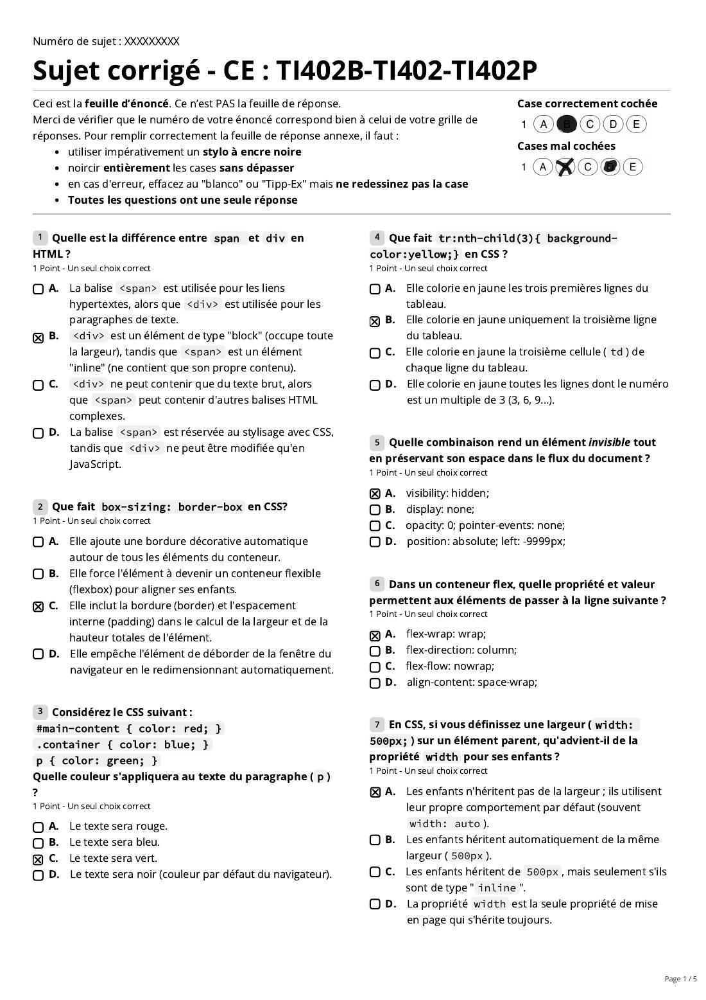{ loading=lazy .papier }](papier/ce-correction/p01.jpg)
    <p class="papier-legende">Numéro de sujet : XXXXXXXXX · CE TI402 — correction, page 1</p>

    [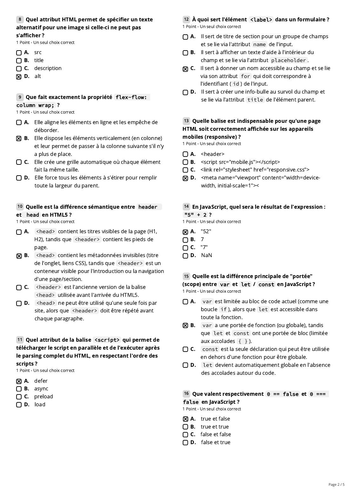{ loading=lazy .papier }](papier/ce-correction/p02.jpg)
    <p class="papier-legende">Quel attribut HTML permet de spécifier un texte · CE TI402 — correction, page 2</p>

    [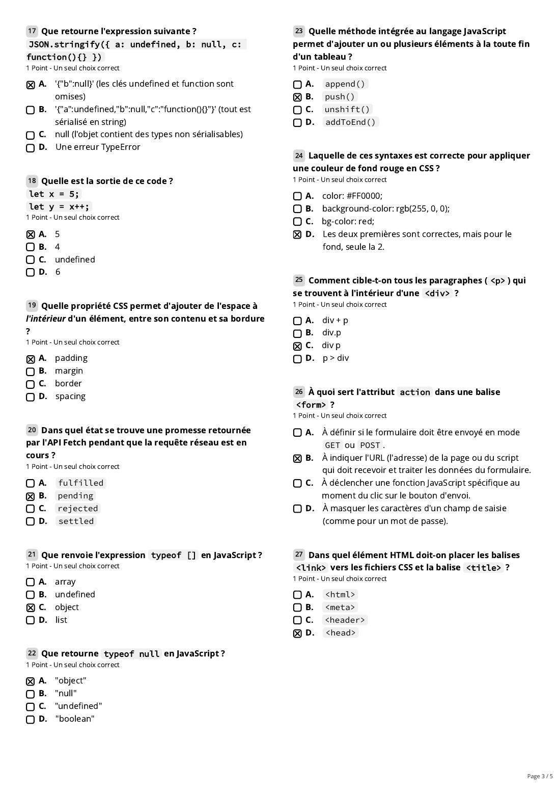{ loading=lazy .papier }](papier/ce-correction/p03.jpg)
    <p class="papier-legende">17 Que retourne l&#x27;expression suivante ? · CE TI402 — correction, page 3</p>

    [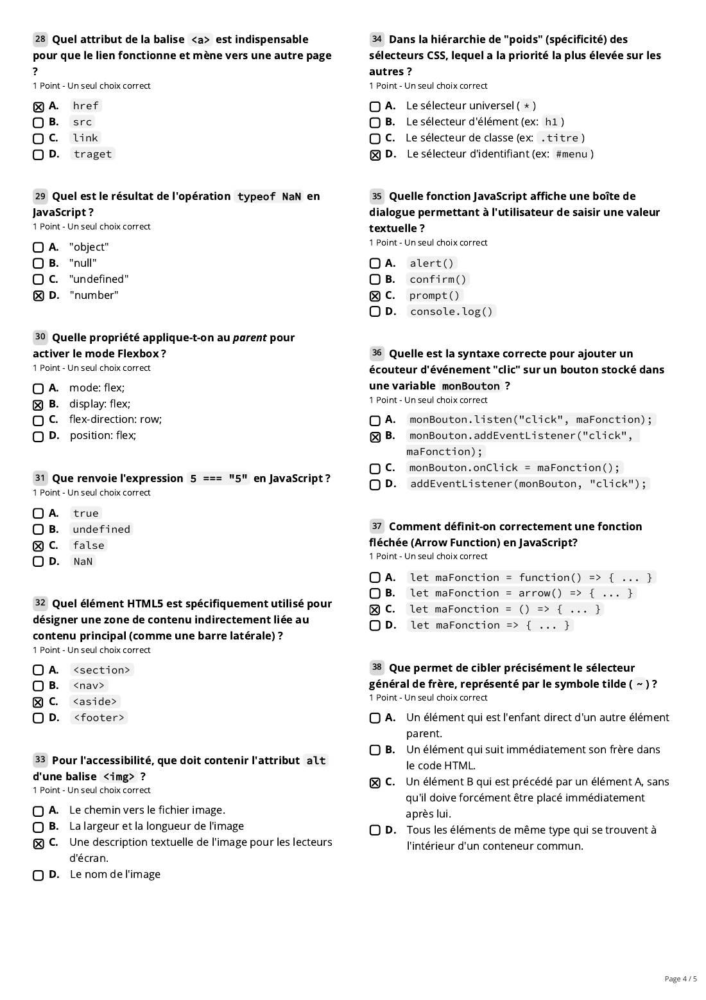{ loading=lazy .papier }](papier/ce-correction/p04.jpg)
    <p class="papier-legende">28 Quel attribut de la balise &lt;a&gt; est indispensable · CE TI402 — correction, page 4</p>

    [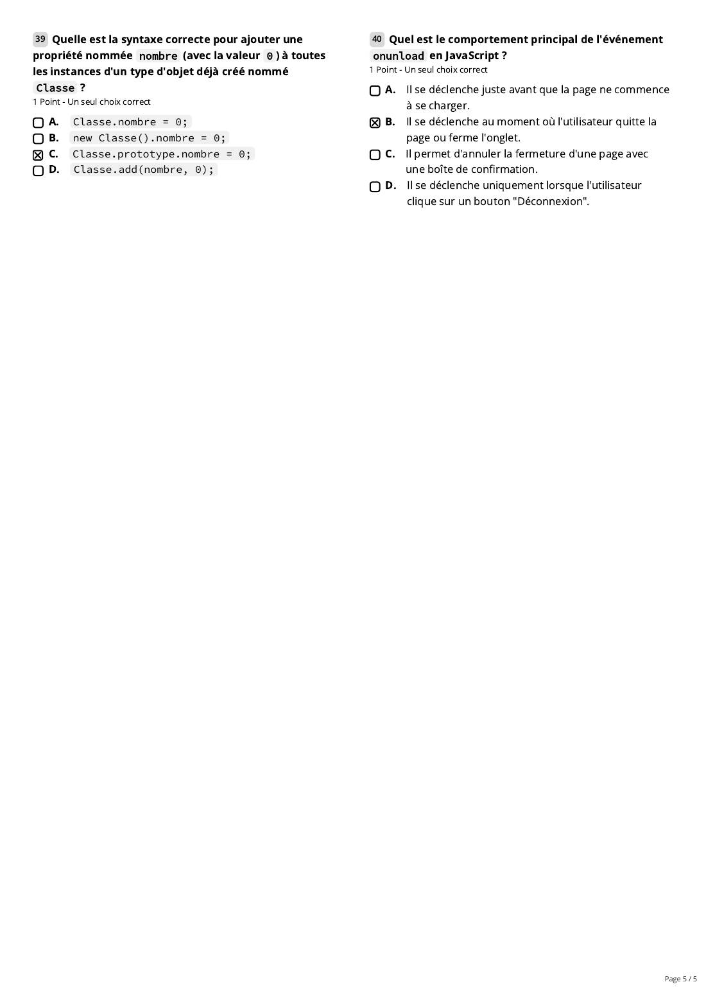{ loading=lazy .papier }](papier/ce-correction/p05.jpg)
    <p class="papier-legende">39 Quelle est la syntaxe correcte pour ajouter une · CE TI402 — correction, page 5</p>

    <!-- /papier -->

    <!-- papier: pdf/TI402P/2023-ti504n-de.pdf | DE 2023 (TI504N) — sujet | de2023 | page -->

    [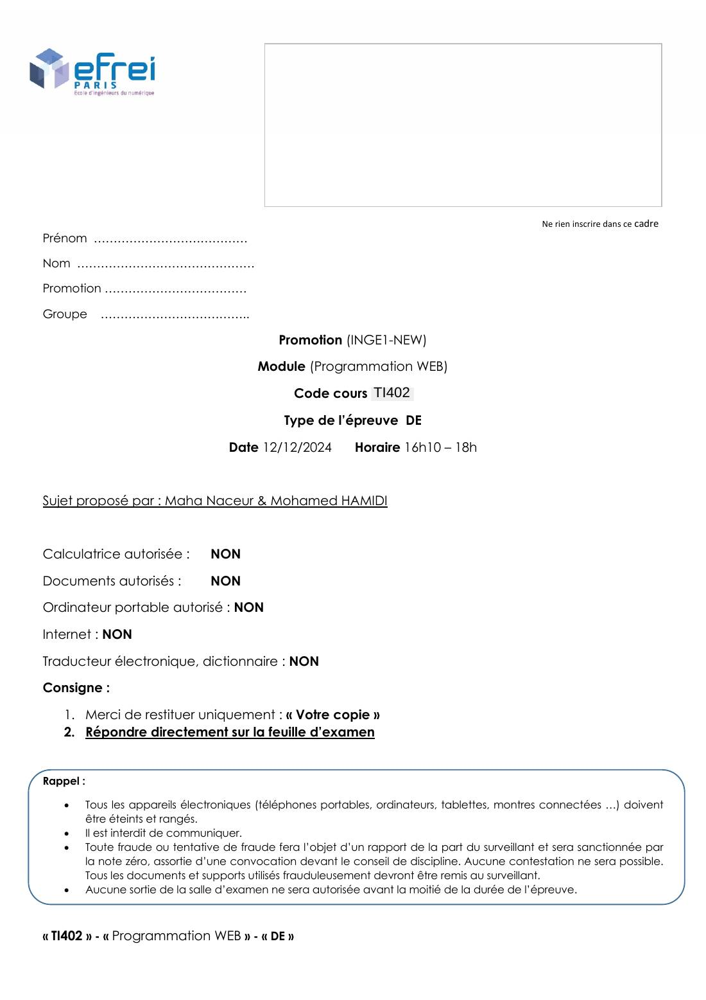{ loading=lazy .papier }](papier/de2023/p01.jpg)
    <p class="papier-legende">Ne rien inscrire dans ce cadre · DE 2023 (TI504N) — sujet, page 1</p>

    [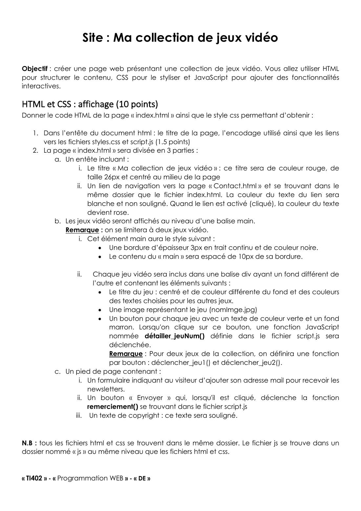{ loading=lazy .papier }](papier/de2023/p02.jpg)
    <p class="papier-legende">Site : Ma collection de jeux vidéo · DE 2023 (TI504N) — sujet, page 2</p>

    [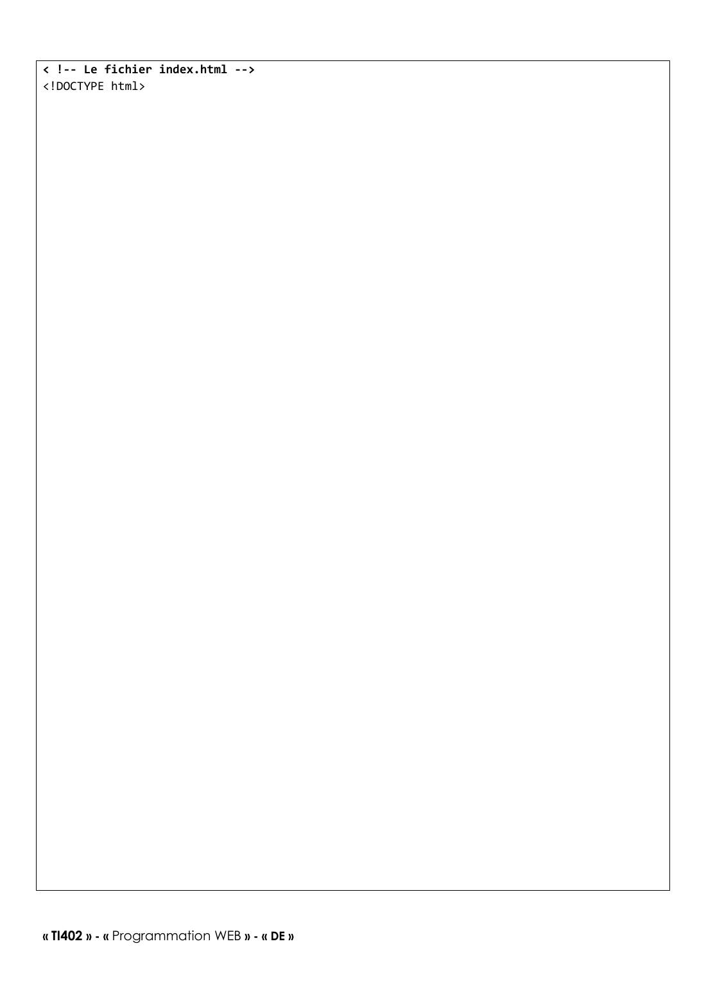{ loading=lazy .papier }](papier/de2023/p03.jpg)
    <p class="papier-legende">&lt; !-- Le fichier index.html --&gt; · DE 2023 (TI504N) — sujet, page 3</p>

    [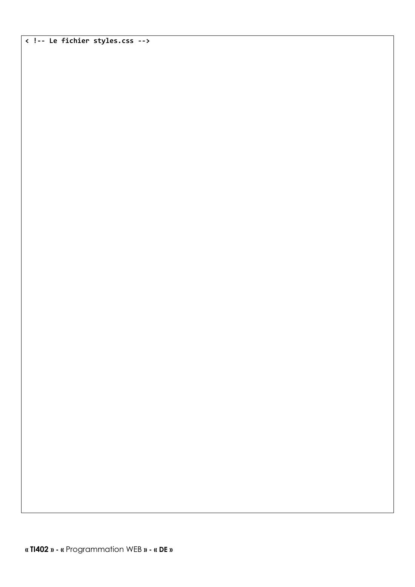{ loading=lazy .papier }](papier/de2023/p04.jpg)
    <p class="papier-legende">&lt; !-- Le fichier styles.css --&gt; · DE 2023 (TI504N) — sujet, page 4</p>

    [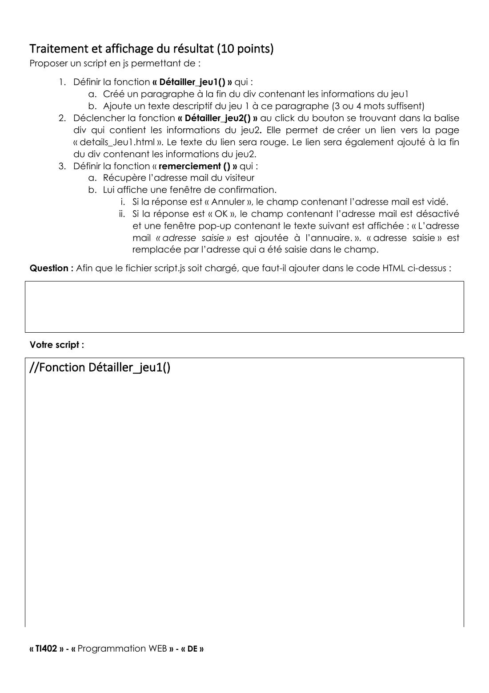{ loading=lazy .papier }](papier/de2023/p05.jpg)
    <p class="papier-legende">Traitement et affichage du résultat (10 points) · DE 2023 (TI504N) — sujet, page 5</p>

    [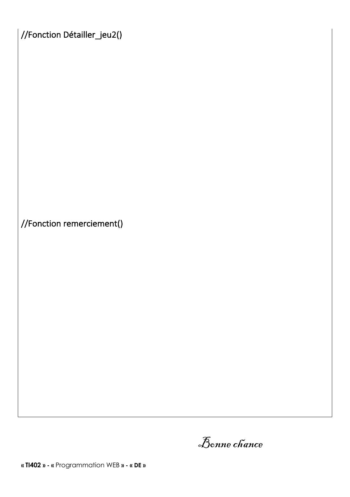{ loading=lazy .papier }](papier/de2023/p06.jpg)
    <p class="papier-legende">//Fonction Détailler_jeu2() · DE 2023 (TI504N) — sujet, page 6</p>

    [{ loading=lazy .papier }](papier/de2023/p07.jpg)
    <p class="papier-legende">DE 2023 (TI504N) — sujet, page 7</p>

    <!-- /papier -->
