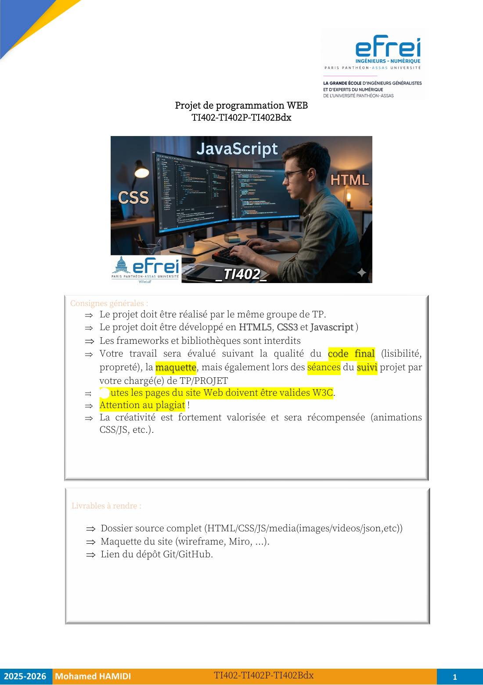
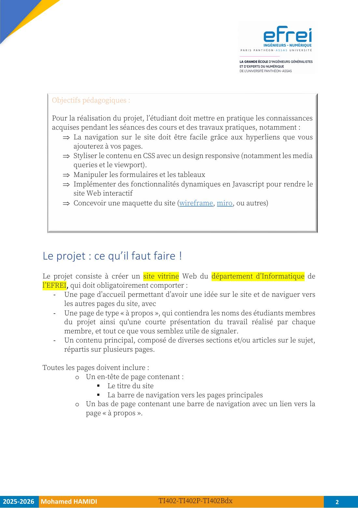
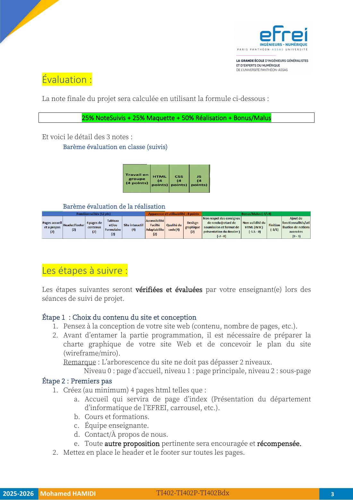
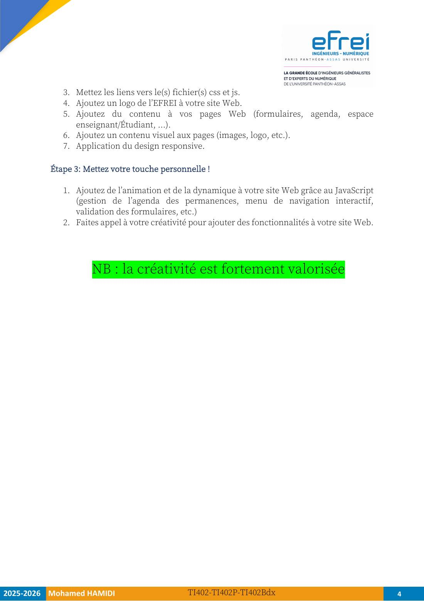
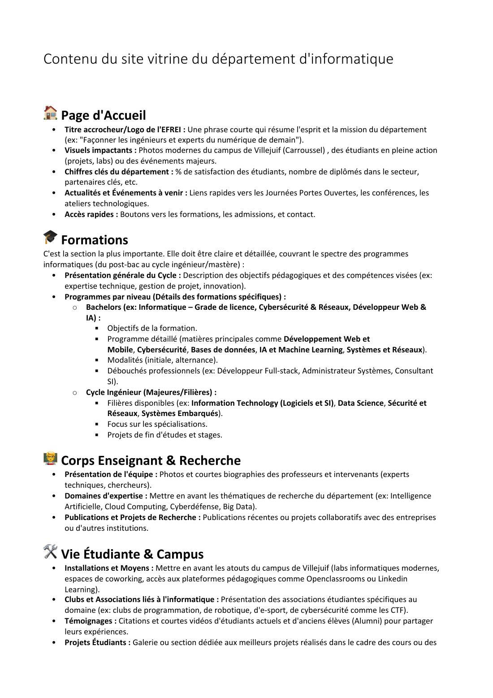
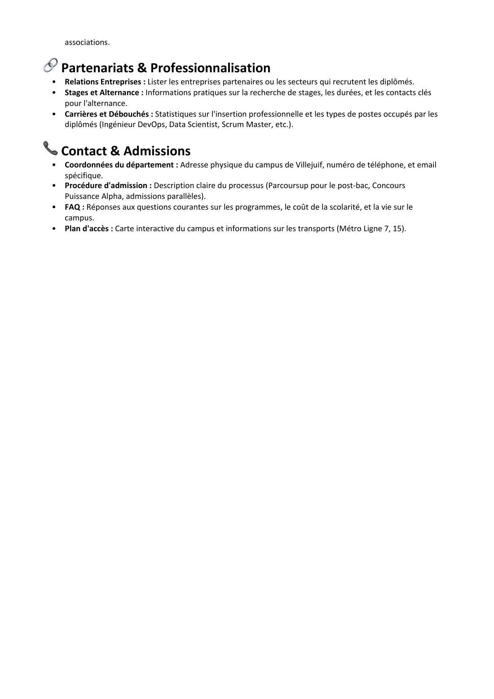
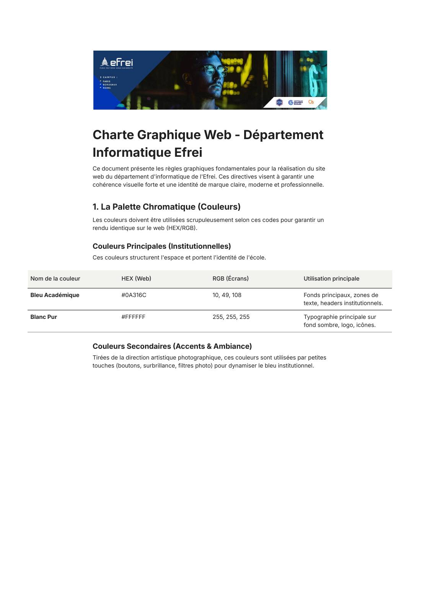
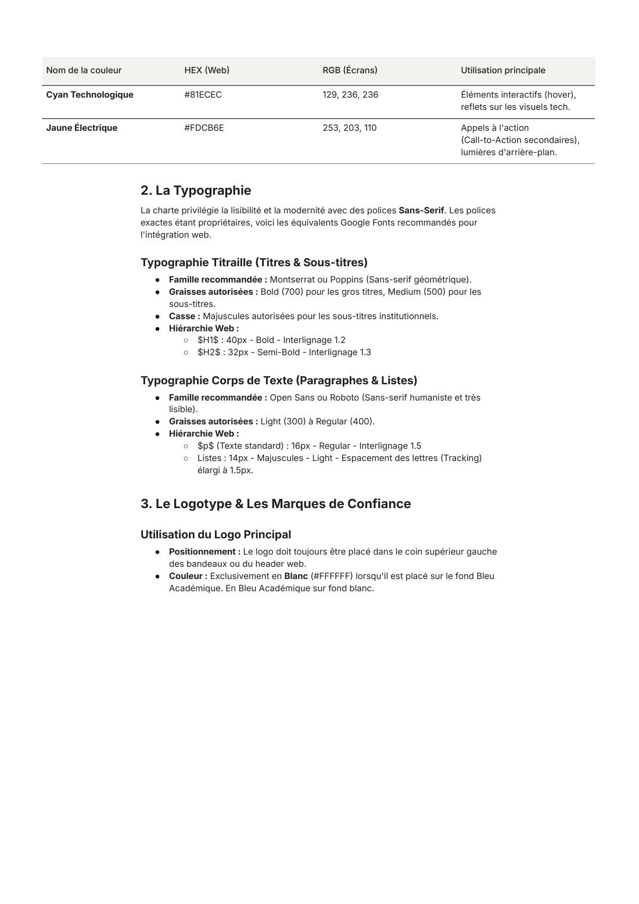
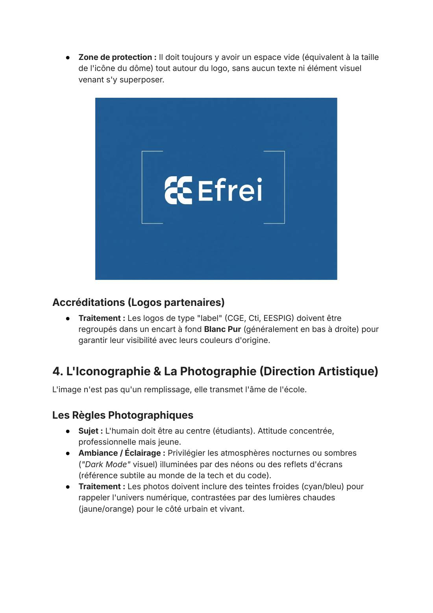
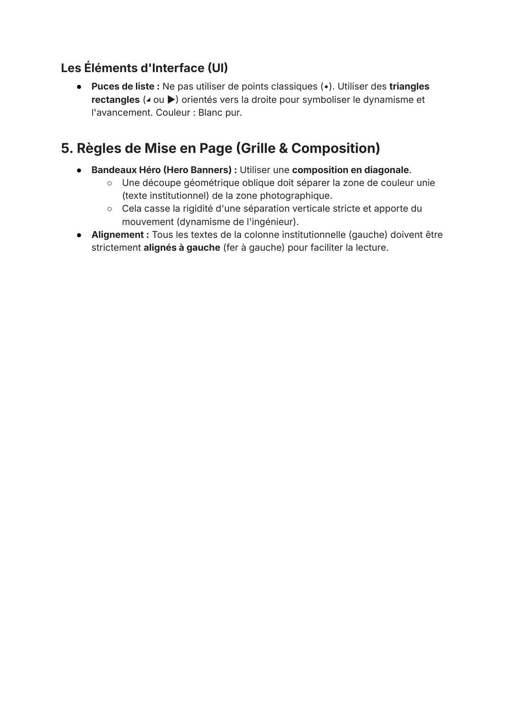

# Projet : site vitrine du département informatique

=== "Version simplifiée"

    Réalisé par le **groupe de TP**, en **HTML5, CSS3 et JavaScript pur** :
    frameworks et bibliothèques **interdits**. Compte pour 20 % (suivi + maquette).

    !!! methode "Obligatoire"
        - Une **page d'accueil** qui présente le site et mène aux autres pages.
        - Une page **« À propos »** : membres du groupe et travail de chacun.
        - Un **contenu principal** en plusieurs pages (sections, articles), à partir
          du document « Contenu du site » fourni.
        - Sur chaque page : un **en-tête** (titre du site + navigation) et un
          **pied de page** (navigation + lien vers « À propos »).
        - Design **responsive** (viewport, media queries), formulaires et tableaux,
          fonctionnalités dynamiques en JavaScript.
        - Respect de la **charte graphique** du département.
        - Toutes les pages **valides W3C**.

    **Livrables** : dossier source complet (HTML, CSS, JS, médias), **maquette**
    (wireframe, Miro…), lien du **dépôt GitHub**. La créativité (animations
    CSS/JS) est valorisée ; attention au plagiat.

=== "Version papier"

    L'énoncé du projet, puis le contenu à intégrer et la charte graphique.

    <!-- papier: pdf/TI402P/projet-enonce-web-ti402.pdf | Projet — énoncé | enonce | page -->

    [{ loading=lazy .papier }](papier/enonce/p01.jpg)
    
Projet de programmation WEB · Projet — énoncé, page 1

    [{ loading=lazy .papier }](papier/enonce/p02.jpg)
    
Objectifs pédagogiques : · Projet — énoncé, page 2

    [{ loading=lazy .papier }](papier/enonce/p03.jpg)
    
Évaluation : · Projet — énoncé, page 3

    [{ loading=lazy .papier }](papier/enonce/p04.jpg)
    
3. Mettez les liens vers le(s) fichier(s) css et js. · Projet — énoncé, page 4

    <!-- /papier -->

    <!-- papier: pdf/TI402P/contenu-site-d-partement-informatique.pdf | Contenu du site | contenu | page -->

    [{ loading=lazy .papier }](papier/contenu/p01.jpg)
    
Contenu du site vitrine du département d&#x27;informatique · Contenu du site, page 1

    [{ loading=lazy .papier }](papier/contenu/p02.jpg)
    
domaine (ex: clubs de programmation, de robotique, d&#x27;e-sport, de cybersécurité comme les C… · Contenu du site, page 2

    <!-- /papier -->

    <!-- papier: pdf/TI402P/charte-graphique-web-de-partement-informatique-efrei.pdf | Charte graphique | charte | page -->

    [{ loading=lazy .papier }](papier/charte/p01.jpg)
    
Charte Graphique Web - Département · Charte graphique, page 1

    [{ loading=lazy .papier }](papier/charte/p02.jpg)
    
Nom de la couleur · Charte graphique, page 2

    [{ loading=lazy .papier }](papier/charte/p03.jpg)
    
​ Zone de protection : Il doit toujours y avoir un espace vide (équivalent à la taille · Charte graphique, page 3

    [{ loading=lazy .papier }](papier/charte/p04.jpg)
    
Les Éléments d&#x27;Interface (UI) · Charte graphique, page 4

    <!-- /papier -->
