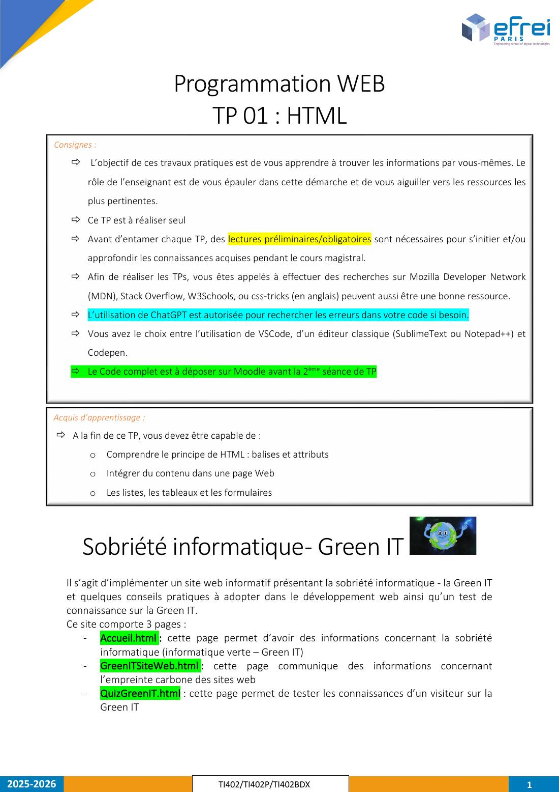
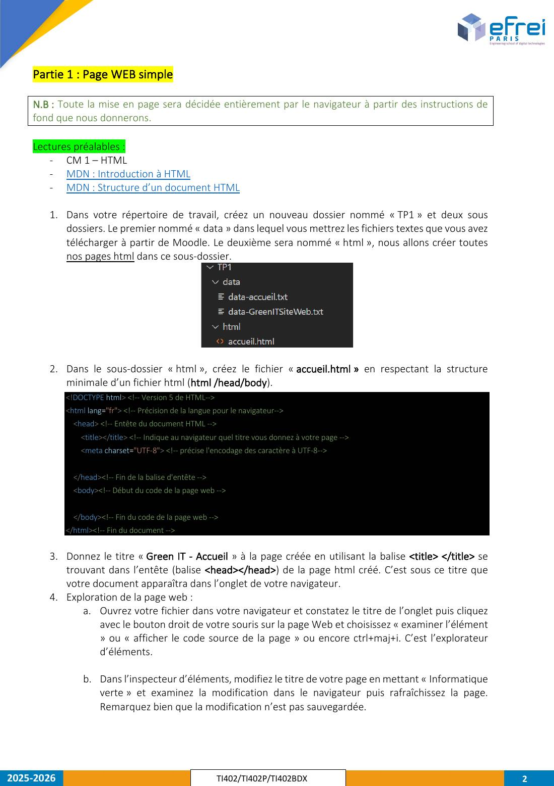
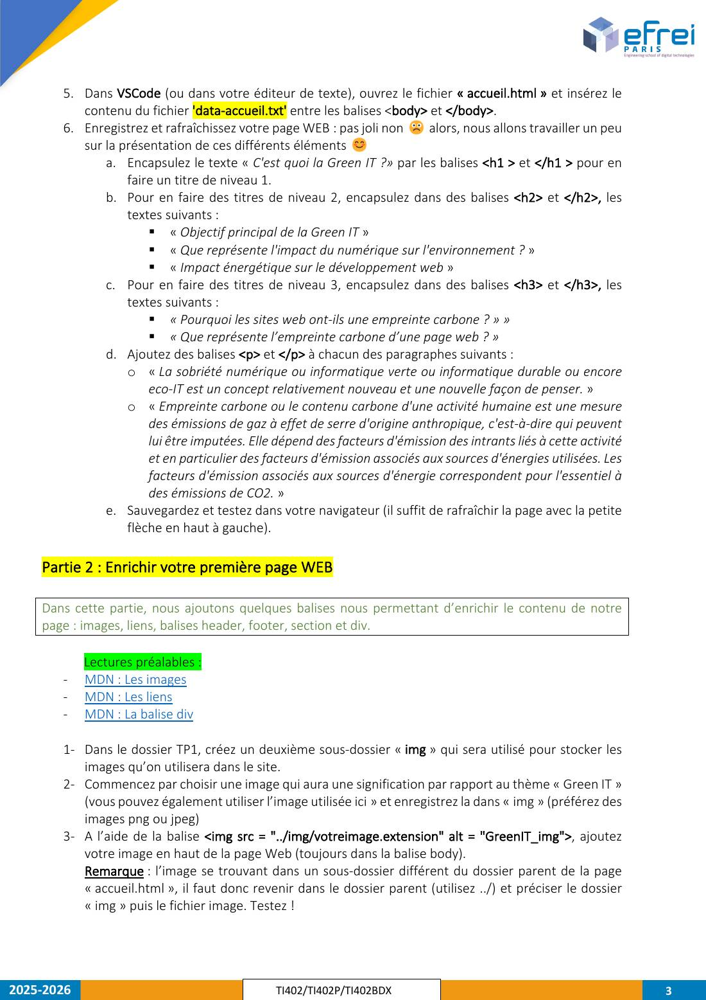
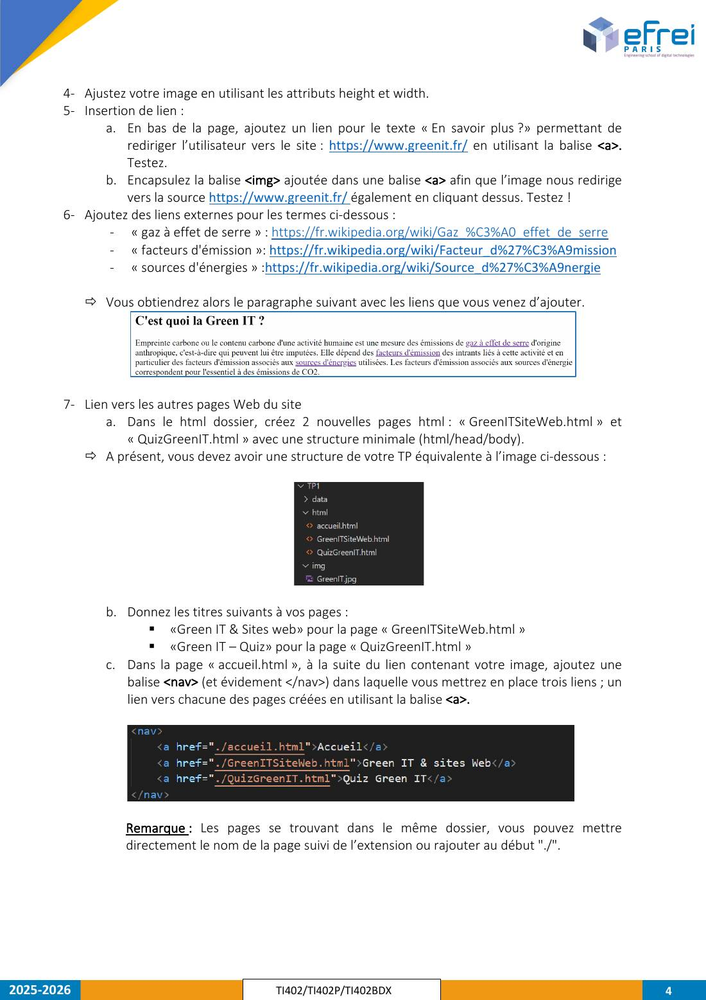
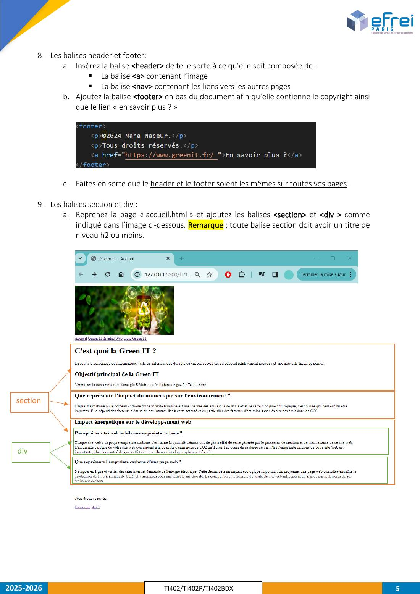
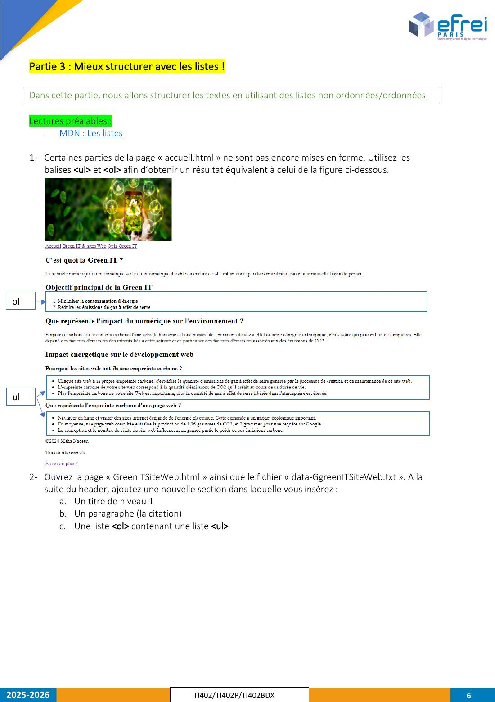
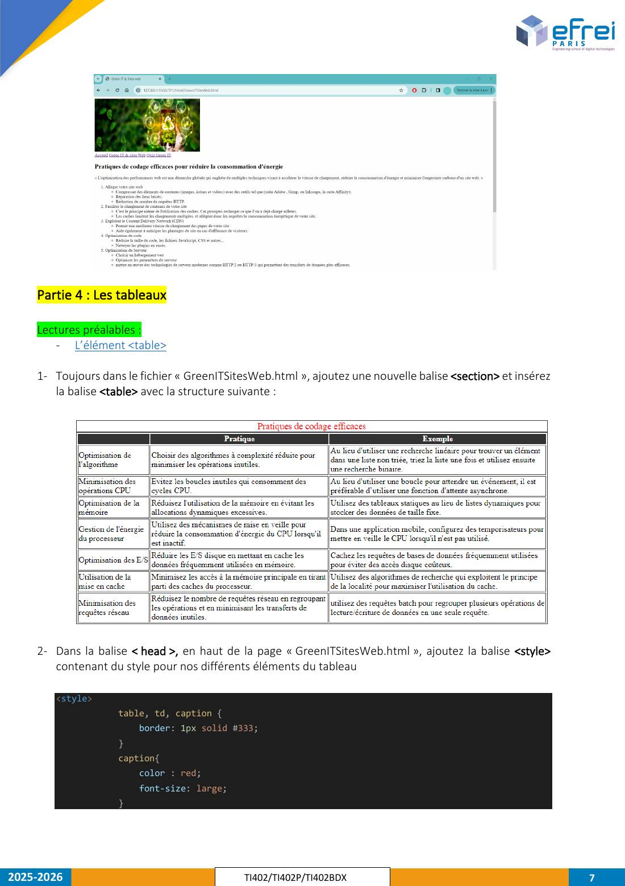
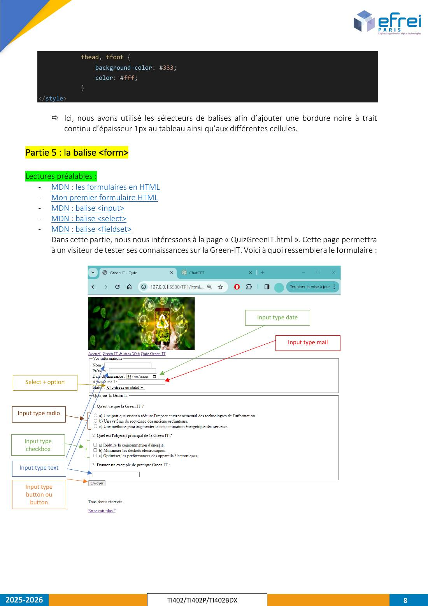
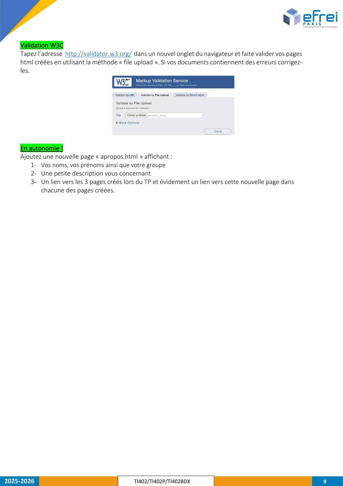

# TP 1 — HTML : le site Green IT

=== "Version simplifiée"

    Fil rouge des 4 TP : un site d'information sur la **sobriété numérique (Green IT)**
    en trois pages : `accueil.html`, `GreenITSiteWeb.html` (empreinte carbone des
    sites web) et `QuizGreenIT.html` (quiz).

    !!! methode "Ce qu'on construit"
        - Arborescence `TP1/data` (textes fournis) et `TP1/html` (pages).
        - Structure HTML5 complète (`doctype`, `head`, `body`, balises sémantiques).
        - Titres, paragraphes, listes, liens entre les pages, images, **tableau**
          (données d'empreinte carbone) et **formulaire** (quiz : boutons radio,
          cases à cocher, listes déroulantes).
        - Toute la mise en page est laissée au navigateur : pas de CSS dans ce TP.

    Rappels : [chapitre 2](../cours/chapitre-2-html.md). Ressources conseillées : MDN, W3Schools.

=== "Version papier"

    Sujet du TP 1 tel qu'il est distribué.

    <!-- papier: pdf/TI402P/tp-01-fr.pdf | TP 1 — sujet | tp1 | page -->

    [{ loading=lazy .papier }](papier/tp1/p01.jpg)
    
Programmation WEB · TP 1 — sujet, page 1

    [{ loading=lazy .papier }](papier/tp1/p02.jpg)
    
Partie 1 : Page WEB simple · TP 1 — sujet, page 2

    [{ loading=lazy .papier }](papier/tp1/p03.jpg)
    
5. Dans VSCode (ou dans votre éditeur de texte), ouvrez le fichier « accueil.html » et ins… · TP 1 — sujet, page 3

    [{ loading=lazy .papier }](papier/tp1/p04.jpg)
    
4- Ajustez votre image en utilisant les attributs height et width. · TP 1 — sujet, page 4

    [{ loading=lazy .papier }](papier/tp1/p05.jpg)
    
8- Les balises header et footer: · TP 1 — sujet, page 5

    [{ loading=lazy .papier }](papier/tp1/p06.jpg)
    
Partie 3 : Mieux structurer avec les listes ! · TP 1 — sujet, page 6

    [{ loading=lazy .papier }](papier/tp1/p07.jpg)
    
Partie 4 : Les tableaux · TP 1 — sujet, page 7

    [{ loading=lazy .papier }](papier/tp1/p08.jpg)
    
thead, tfoot { · TP 1 — sujet, page 8

    [{ loading=lazy .papier }](papier/tp1/p09.jpg)
    
Validation W3C · TP 1 — sujet, page 9

    <!-- /papier -->
