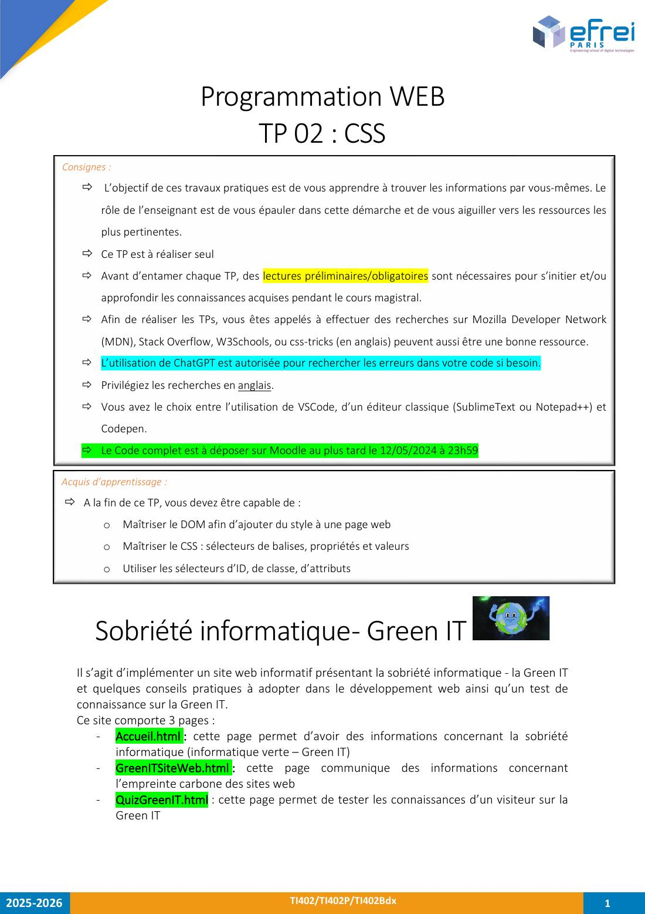
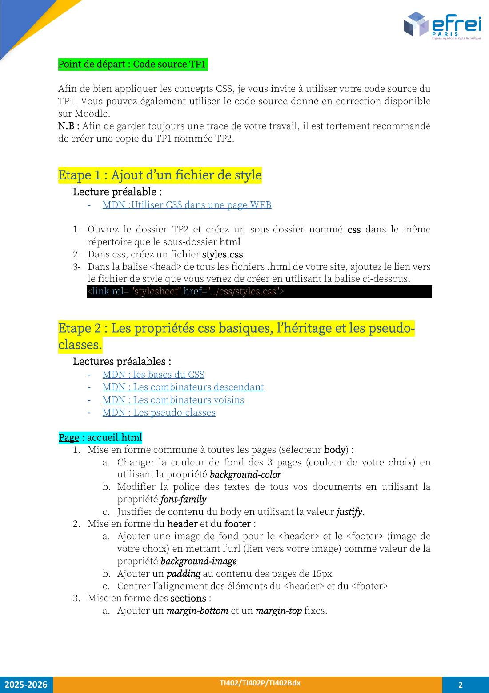
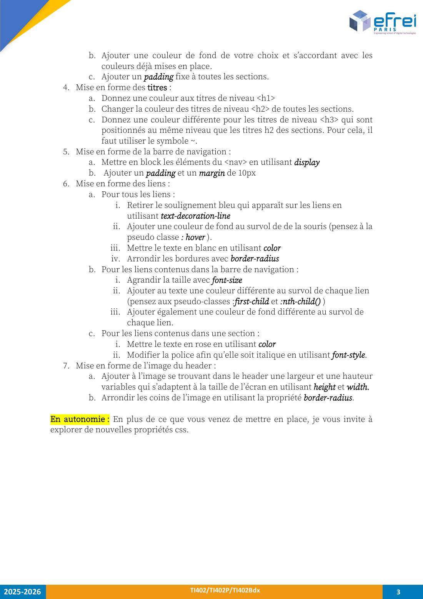
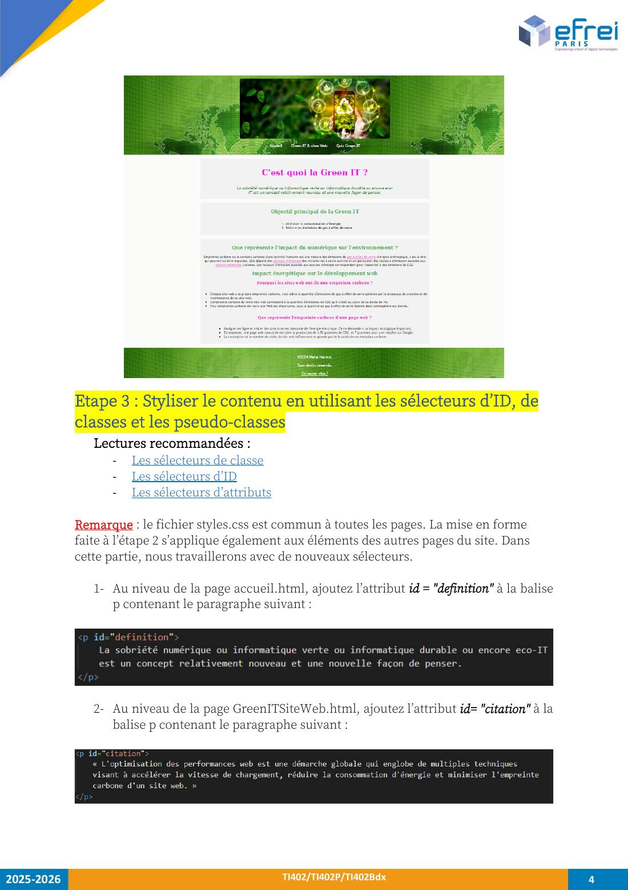
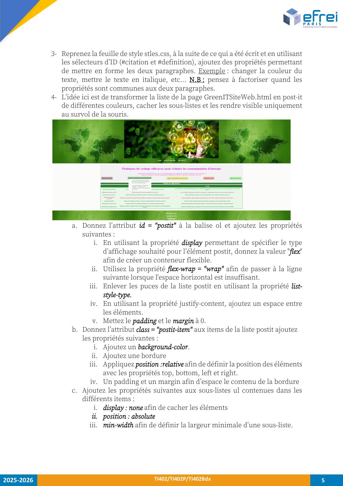
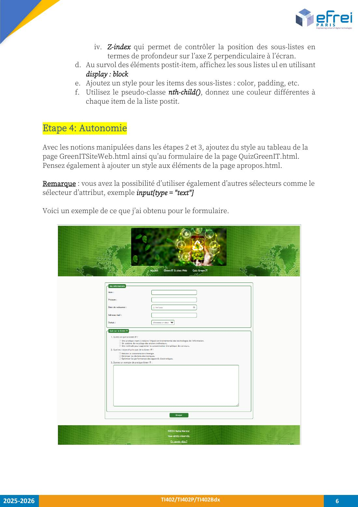
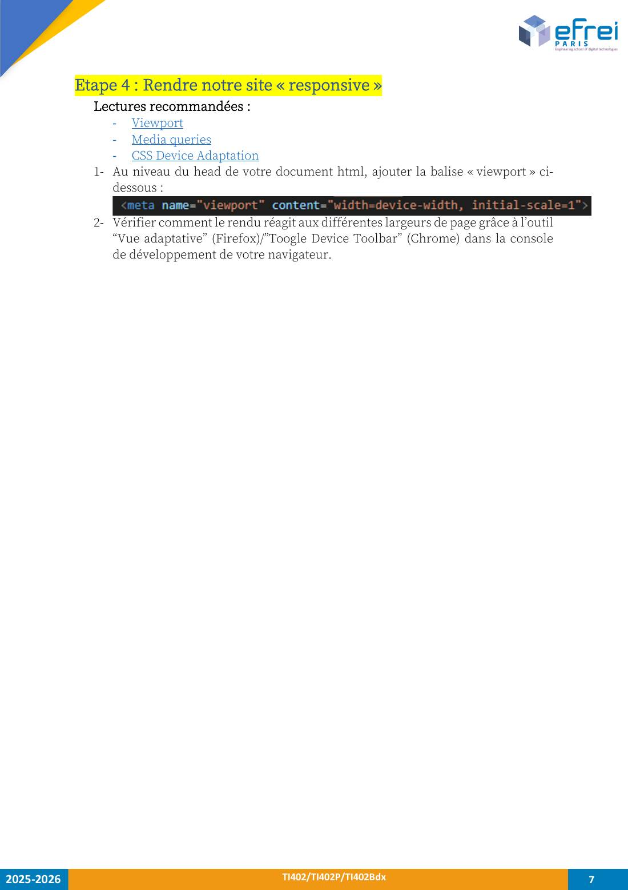

# TP 2 — CSS : styliser le site Green IT

=== "Version simplifiée"

    On repart du TP 1 (copie dans un dossier `TP2`), on ajoute `css/styles.css`
    relié à chaque page.

    !!! methode "Étapes"
        - Sélecteurs de balise, de classe, d'id et d'attribut.
        - Boîtes (`margin`, `padding`, `border`), couleurs, polices, fond.
        - Mise en forme du tableau et du formulaire du quiz.
        - Barre de navigation et mise en page avec **flexbox**.
        - **Responsive** : viewport et media queries.

    Rappels : [chapitre 3](../cours/chapitre-3-css.md).

=== "Version papier"

    Sujet du TP 2 tel qu'il est distribué.

    <!-- papier: pdf/TI402P/tp-02-fr.pdf | TP 2 — sujet | tp2 | page -->

    [{ loading=lazy .papier }](papier/tp2/p01.jpg)
    
Programmation WEB · TP 2 — sujet, page 1

    [{ loading=lazy .papier }](papier/tp2/p02.jpg)
    
Point de départ : Code source TP1 · TP 2 — sujet, page 2

    [{ loading=lazy .papier }](papier/tp2/p03.jpg)
    
b. Ajouter une couleur de fond de votre choix et s’accordant avec les · TP 2 — sujet, page 3

    [{ loading=lazy .papier }](papier/tp2/p04.jpg)
    
Etape 3 : Styliser le contenu en utilisant les sélecteurs d’ID, de · TP 2 — sujet, page 4

    [{ loading=lazy .papier }](papier/tp2/p05.jpg)
    
3- Reprenez la feuille de style stles.css, à la suite de ce qui a été écrit et en utilisan… · TP 2 — sujet, page 5

    [{ loading=lazy .papier }](papier/tp2/p06.jpg)
    
iv. Z-index qui permet de contrôler la position des sous-listes en · TP 2 — sujet, page 6

    [{ loading=lazy .papier }](papier/tp2/p07.jpg)
    
Etape 4 : Rendre notre site « responsive » · TP 2 — sujet, page 7

    <!-- /papier -->
