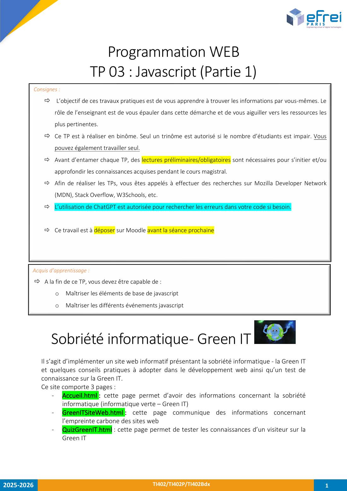
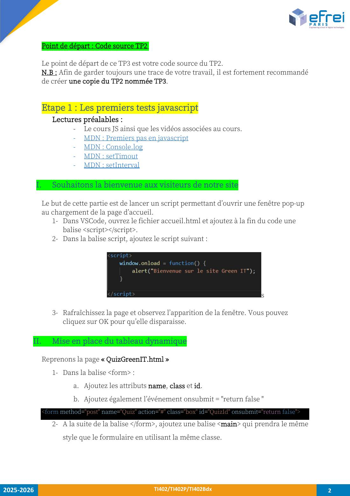
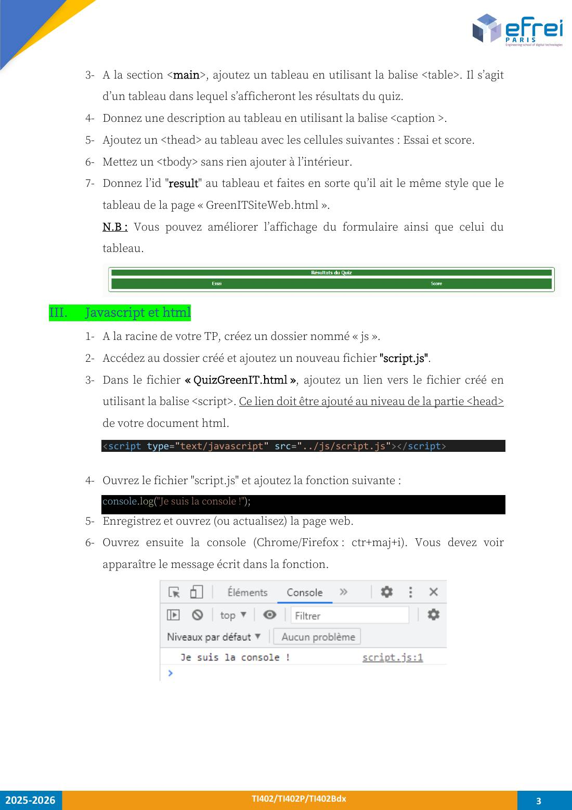
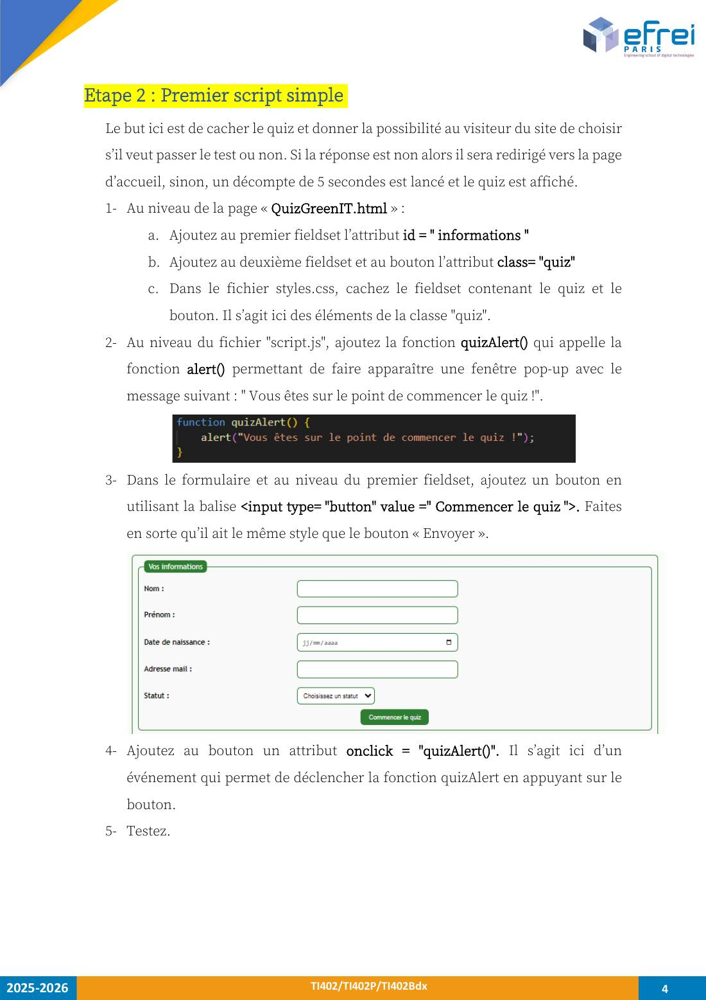
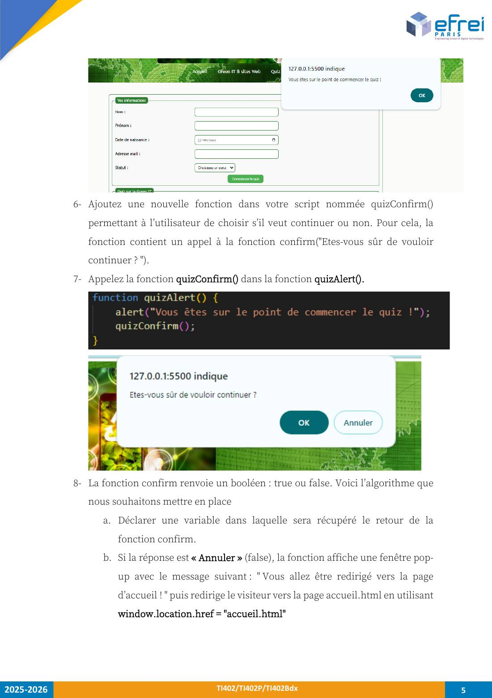
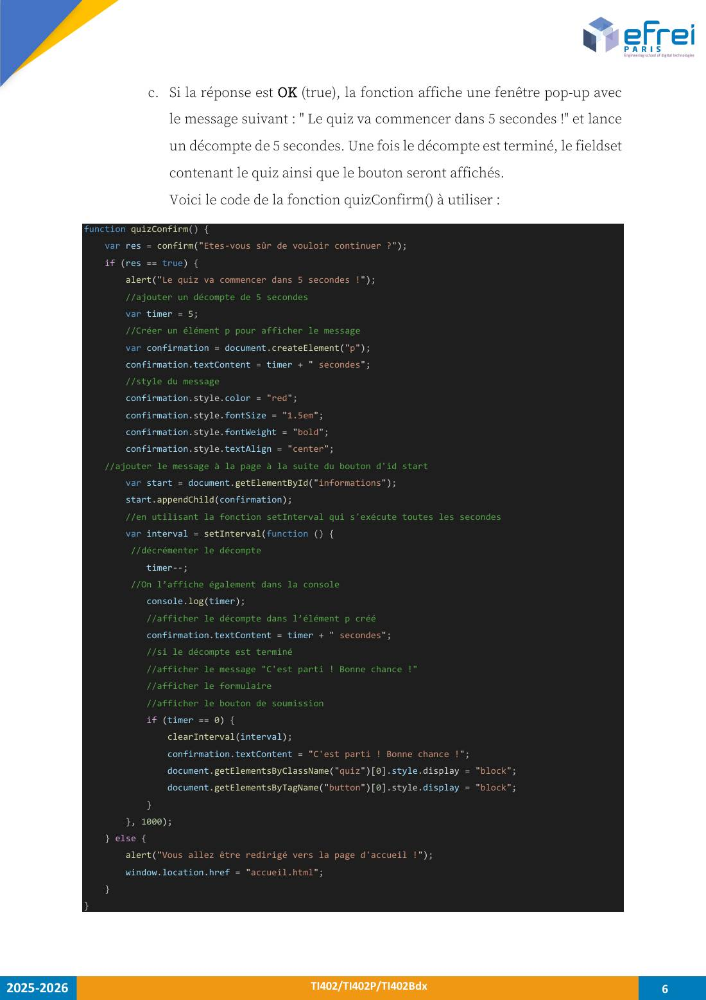
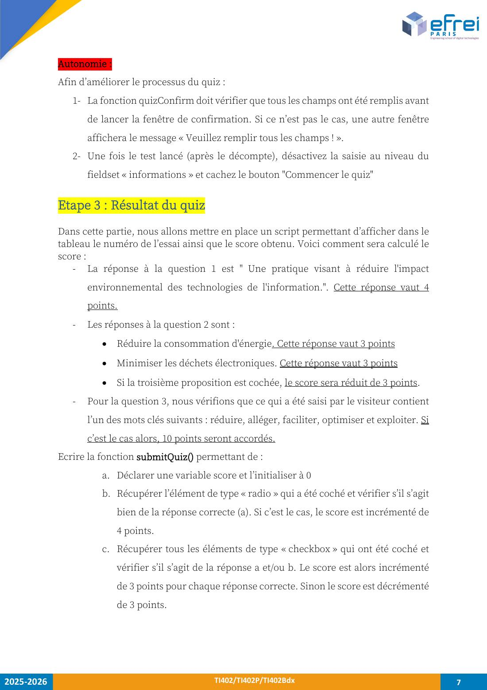
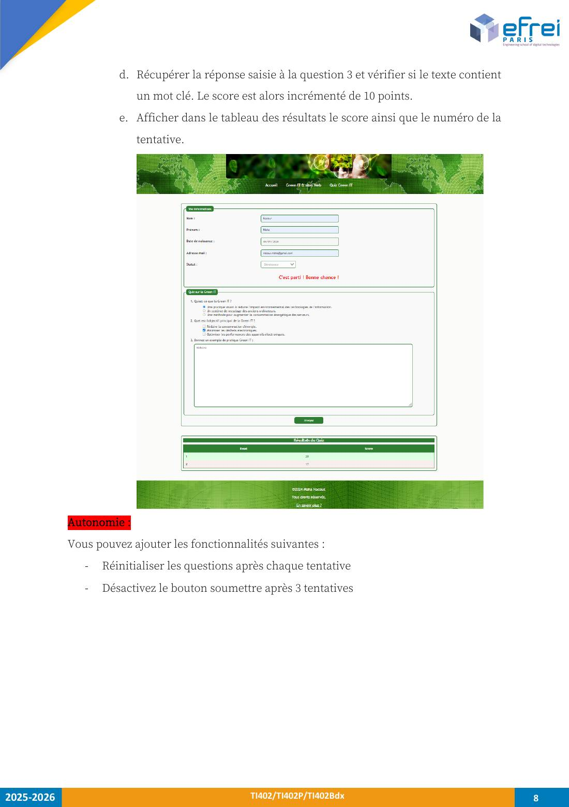

# TP 3 — JavaScript, partie 1

=== "Version simplifiée"

    En binôme, à partir du TP 2.

    !!! methode "Étapes"
        - Premiers scripts : pop-up de bienvenue au chargement, `console.log`,
          `setTimeout` / `setInterval`.
        - Événements (`click`, `mouseover`, `submit`…) et modification du DOM.
        - **Correction automatique du quiz** : lire les réponses du formulaire,
          calculer le score, l'afficher dans la page (sans recharger : `preventDefault`).

    Rappels : [chapitre 4](../cours/chapitre-4-javascript-bases.md).

=== "Version papier"

    Sujet du TP 3 tel qu'il est distribué.

    <!-- papier: pdf/TI402P/tp-03-fr.pdf | TP 3 — sujet | tp3 | page -->

    [{ loading=lazy .papier }](papier/tp3/p01.jpg)
    
Programmation WEB · TP 3 — sujet, page 1

    [{ loading=lazy .papier }](papier/tp3/p02.jpg)
    
Point de départ : Code source TP2 · TP 3 — sujet, page 2

    [{ loading=lazy .papier }](papier/tp3/p03.jpg)
    
3- A la section &lt;main&gt;, ajoutez un tableau en utilisant la balise &lt;table&gt;. Il s’agit · TP 3 — sujet, page 3

    [{ loading=lazy .papier }](papier/tp3/p04.jpg)
    
Etape 2 : Premier script simple · TP 3 — sujet, page 4

    [{ loading=lazy .papier }](papier/tp3/p05.jpg)
    
6- Ajoutez une nouvelle fonction dans votre script nommée quizConfirm() · TP 3 — sujet, page 5

    [{ loading=lazy .papier }](papier/tp3/p06.jpg)
    
c. Si la réponse est OK (true), la fonction affiche une fenêtre pop-up avec · TP 3 — sujet, page 6

    [{ loading=lazy .papier }](papier/tp3/p07.jpg)
    
Autonomie : · TP 3 — sujet, page 7

    [{ loading=lazy .papier }](papier/tp3/p08.jpg)
    
d. Récupérer la réponse saisie à la question 3 et vérifier si le texte contient · TP 3 — sujet, page 8

    <!-- /papier -->
