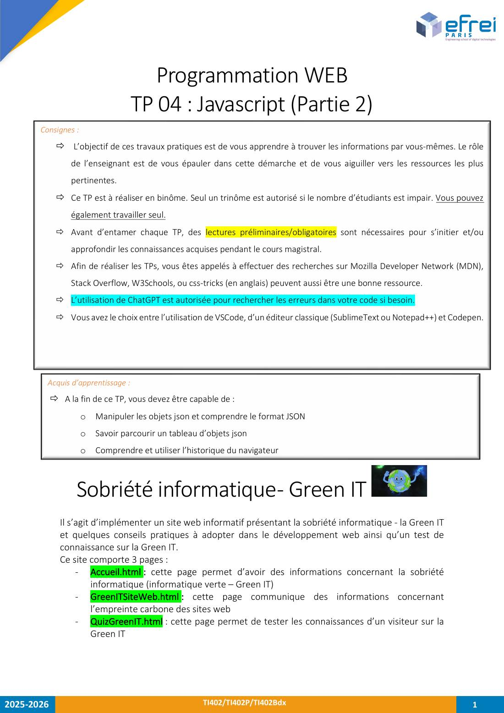
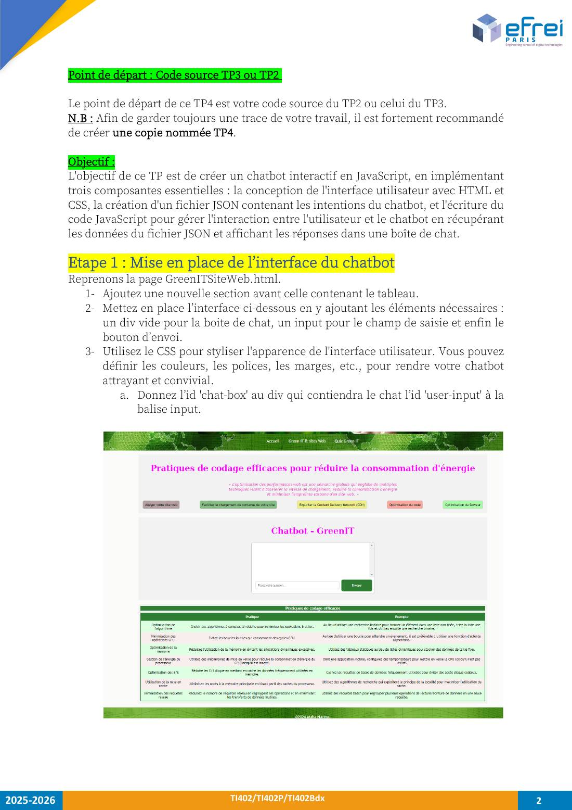
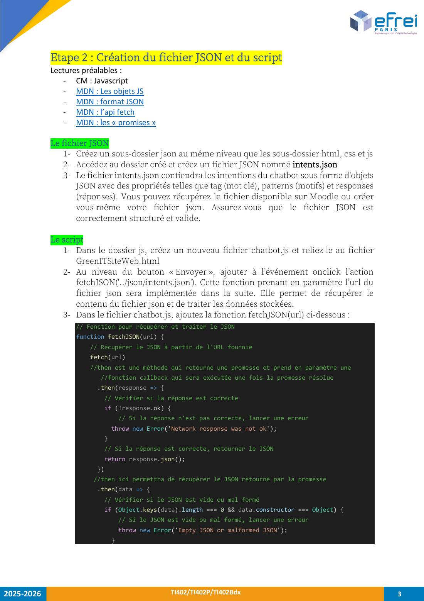
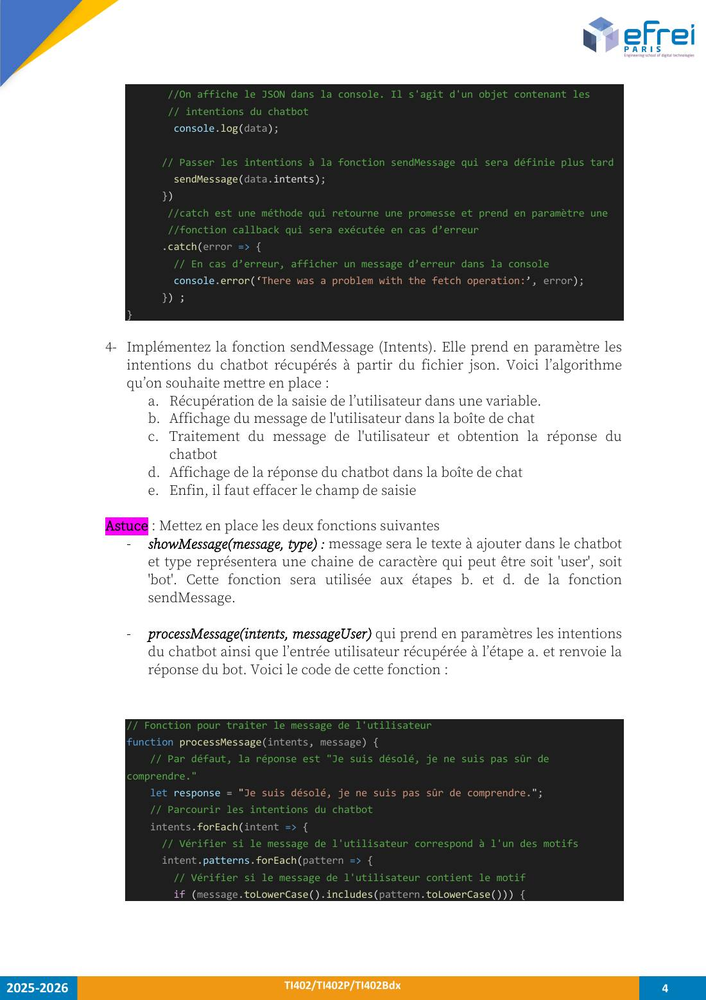
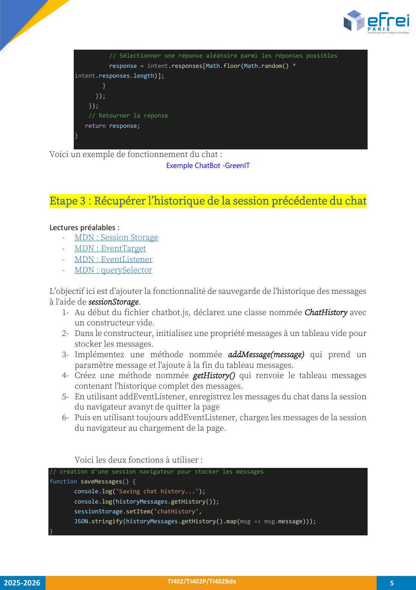
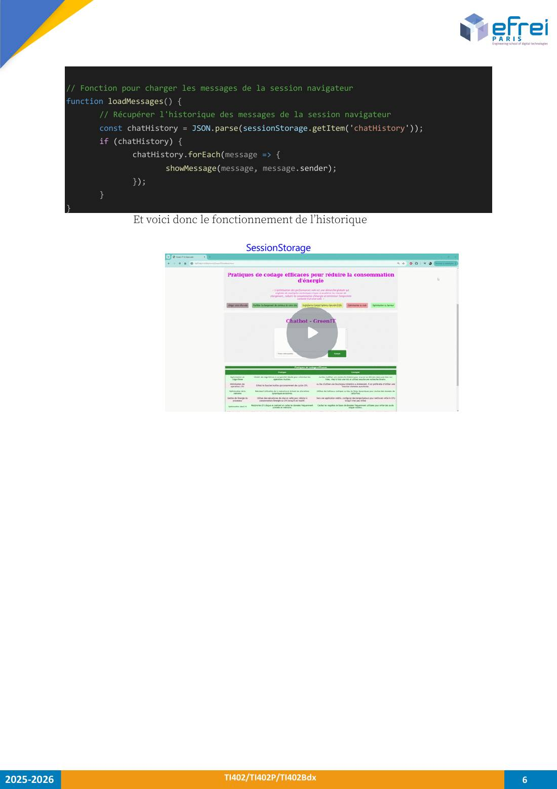

# TP 4 — JavaScript, partie 2 : un chatbot en JSON

=== "Version simplifiée"

    Ajouter un **chatbot** sur la page `GreenITSiteWeb.html`.

    !!! methode "Les trois briques"
        1. **Interface** HTML/CSS : zone de messages, champ de saisie, bouton.
        2. Fichier **`intents.json`** : un tableau d'intentions, chacune avec des
           mots-clés (*patterns*) et des réponses.
        3. **JavaScript** : charger le JSON avec `fetch`, chercher l'intention dont
           un mot-clé apparaît dans le message, afficher une réponse dans la boîte de chat.

    ```js
    fetch("../data/intents.json")
      .then((r) => r.json())
      .then((data) => { intents = data.intents; });

    function repondre(message) {
      const texte = message.toLowerCase();
      const intent = intents.find((i) => i.patterns.some((p) => texte.includes(p.toLowerCase())));
      return intent ? intent.responses[Math.floor(Math.random() * intent.responses.length)]
                    : "Je n'ai pas compris.";
    }
    ```

    Rappels : [chapitre 5](../cours/chapitre-5-javascript-avance.md). Lancer la page avec un serveur local (Live Server) pour que `fetch` fonctionne.

=== "Version papier"

    Sujet du TP 4 tel qu'il est distribué.

    <!-- papier: pdf/TI402P/tp-04-fr.pdf | TP 4 — sujet | tp4 | page -->

    [{ loading=lazy .papier }](papier/tp4/p01.jpg)
    <p class="papier-legende">Programmation WEB · TP 4 — sujet, page 1</p>

    [{ loading=lazy .papier }](papier/tp4/p02.jpg)
    <p class="papier-legende">Point de départ : Code source TP3 ou TP2 · TP 4 — sujet, page 2</p>

    [{ loading=lazy .papier }](papier/tp4/p03.jpg)
    <p class="papier-legende">Etape 2 : Création du fichier JSON et du script · TP 4 — sujet, page 3</p>

    [{ loading=lazy .papier }](papier/tp4/p04.jpg)
    <p class="papier-legende">//On affiche le JSON dans la console. Il s&#x27;agit d&#x27;un objet contenant les · TP 4 — sujet, page 4</p>

    [{ loading=lazy .papier }](papier/tp4/p05.jpg)
    <p class="papier-legende">// Sélectionner une réponse aléatoire parmi les réponses possibles · TP 4 — sujet, page 5</p>

    [{ loading=lazy .papier }](papier/tp4/p06.jpg)
    <p class="papier-legende">// Fonction pour charger les messages de la session navigateur · TP 4 — sujet, page 6</p>

    <!-- /papier -->
