# Chapitre 2 — Adressage IP et subnetting

=== "Version simplifiée"

    Le CM le plus calculatoire du module, et celui qui pèse le plus au DE et au TP 3.
    Tout tient en une idée : **une adresse ne veut rien dire sans son préfixe**, et **tout se
    déduit du nombre de bits d'hôte**.

    ## 1. L'adresse IPv4

    Quatre **octets** (valeurs 0 à 255) séparés par des points : `172.16.254.1`.
    4 octets = **32 bits** → $2^{32} \approx 4{,}3$ milliards d'adresses. Ce chiffre trop petit
    justifie à la fois les **adresses privées** (et le NAT) et **IPv6**.

    Chaque adresse a deux parties :

    - la **partie réseau** : identifie le réseau, sert à acheminer le paquet jusqu'au bon réseau ;
    - la **partie hôte** : identifie la machine dans ce réseau.

    Rien dans `172.16.254.1` n'indique où passe la coupure : c'est le **masque** (ou la
    longueur du préfixe) qui le dit. On écrit donc toujours `192.168.1.10/24`.

    ### Le masque de sous-réseau

    Nombre de 32 bits écrit comme une adresse. **Bits à 1 = partie réseau, bits à 0 = partie
    hôte.**

    !!! theoreme "Loi de contiguïté"
        Tous les 1 à gauche, tous les 0 à droite, jamais mélangés.

        | Masque | Binaire | Valide ? |
        |--------|---------|:--------:|
        | 255.255.255.0 | `11111111.11111111.11111111.00000000` | oui |
        | 255.255.240.0 | `11111111.11111111.11110000.00000000` | oui |
        | 255.255.0.255 | `11111111.11111111.00000000.11111111` | **non** |

        Conséquences : seulement **33 masques** possibles (/0 à /32), et un octet de masque ne
        peut valoir que **0, 128, 192, 224, 240, 248, 252, 254 ou 255**.

    ### Trouver le réseau : le ET logique

    **Adresse ET masque = adresse réseau.** Règle du ET : 1 ET 1 = 1, tout le reste = 0 ; un
    bit de masque à 1 **garde** le bit de l'adresse, un bit à 0 l'**efface**.

    ```text
    Adresse  192.168.1.10   11000000.10101000.00000001.00001010
    Masque   255.255.255.0  11111111.11111111.11111111.00000000
    -------------------------------------------------------------
    Réseau   192.168.1.0    11000000.10101000.00000001.00000000
    ```

    Toutes les machines d'un même réseau donnent le même résultat (`192.168.1.10` et
    `192.168.1.200` → `192.168.1.0`). C'est exactement la question « sommes-nous sur le
    même réseau ? », qui décide au chapitre 3 entre routage direct et indirect.

    ### Le raccourci : calculer sans binaire

    - Octet du masque à **255** → on **recopie** l'octet de l'adresse.
    - Octet du masque à **0** → on met **0**.
    - Seul l'**octet coupé** (ni 0 ni 255) demande un calcul :

    !!! methode "Méthode du pas"
        $$
        \text{pas} = 256 - \text{octet du masque}
        \qquad
        \text{octet réseau} = \text{octet} - (\text{octet} \bmod \text{pas})
        $$

        - **Diffusion** : dans l'octet coupé, réseau + pas − 1, puis **255** dans tous les octets suivants.
        - **Plage utilisable** : réseau + 1 → diffusion − 1.

        C'est de l'arithmétique modulaire : le ET logique, écrit en décimal.

    !!! example "Exemple complet : 172.16.132.70 / 255.255.240.0"
        - Octet coupé = le 3e (240). En binaire : 132 = `1000 0100`, 240 = `1111 0000`, ET = `1000 0000` = **128**.
        - Avec le pas : $256 - 240 = 16$ ; $132 - (132 \bmod 16) = 132 - 4 = 128$. Même résultat.

        | | |
        |---|---|
        | Préfixe | /20 |
        | Adresse réseau | **172.16.128.0** |
        | Diffusion | 172.16.(128+16−1).255 = **172.16.143.255** |
        | Plage utilisable | 172.16.128.1 → 172.16.143.254 |
        | Hôtes | $2^{12} - 2 = 4\,094$ |

    ### Notation CIDR

    Les 1 étant contigus, il suffit de dire **combien** il y en a : `/n`. CIDR = *Classless
    Inter-Domain Routing* (le mot *classless* : c'est ce qui a remplacé les classes).
    `10.80.96.11/22` → 22 bits de réseau, 10 bits d'hôte.

    | Préfixe | Masque | Octet coupé |
    |---------|--------|:-----------:|
    | /8 | 255.0.0.0 | — |
    | /16 | 255.255.0.0 | — |
    | /22 | 255.255.252.0 | 3e |
    | /24 | 255.255.255.0 | — |
    | /26 | 255.255.255.192 | 4e |
    | /30 | 255.255.255.252 | 4e |

    ### Combien d'adresses, combien d'hôtes ?

    Avec $h = 32 - n$ bits d'hôte :

    $$
    \boxed{\text{adresses} = 2^{h}} \qquad \boxed{\text{hôtes utilisables} = 2^{h} - 2}
    $$

    `10.80.96.11/22` : $h = 10$ → 1 024 adresses, **1 022 hôtes**.

    Le « − 2 » : la **première** adresse désigne **le réseau lui-même**, la **dernière** est
    l'adresse de **diffusion**. Aucune des deux n'est attribuable à une machine.

    !!! piege "/31 et /30"
        Un /31 n'a **aucune** adresse utilisable avec la règle du −2. Les liens point-à-point
        (routeur ↔ routeur) prennent donc un **/30** : 4 adresses, **2 hôtes**.

    ## 2. Les plages et les cas particuliers

    ### Les classes : un héritage

    | Classe | Plage | Usage |
    |:------:|-------|-------|
    | A | 0.0.0.0 – 127.255.255.255 | grands réseaux, peu nombreux |
    | B | 128.0.0.0 – 191.255.255.255 | réseaux moyens |
    | C | 192.0.0.0 – 223.255.255.255 | petits réseaux |
    | D | 224.0.0.0 – 239.255.255.255 | multicast |
    | E | 240.0.0.0 – 255.255.255.255 | réservée |

    Système **abandonné** car il gaspillait (300 machines → une classe B de 65 536 adresses).
    CIDR l'a remplacé ; les classes n'expliquent plus que la forme des plages privées.

    ### Publiques et privées

    - **Publique** : unique au monde, attribuée par l'IANA, joignable depuis Internet (ex. `8.8.8.8`).
    - **Privée** : **non routable sur Internet**, réutilisable librement dans chaque réseau local.

    | Plage privée (RFC 1918) | Préfixe | Issue de | Adresses |
    |-------------------------|:-------:|----------|---------:|
    | 10.0.0.0 – 10.255.255.255 | /8 | 1 réseau de classe A | 16 777 216 |
    | 172.16.0.0 – 172.31.255.255 | /12 | 16 réseaux de classe B | 1 048 576 |
    | 192.168.0.0 – 192.168.255.255 | /16 | 256 réseaux de classe C | 65 536 |

    Pour sortir sur Internet, une adresse privée doit être **traduite** : le NAT
    ([chapitre 3](chapitre-3-routage.md#5-sortir-du-reseau-le-nat)).

    ### Adresses spéciales

    | Adresse | Rôle |
    |---------|------|
    | 127.0.0.1 (127.0.0.0/8) | **bouclage** (*loopback*) : la machine elle-même |
    | 255.255.255.255 | diffusion limitée au réseau local |
    | 169.254.0.0/16 | **APIPA** : auto-attribuée quand **aucun serveur DHCP ne répond** (symptôme d'un DHCP injoignable, jamais une config valide) |
    | 224.0.0.0/4 | multicast (ancienne classe D) |
    | 0.0.0.0 | « aucune adresse », ou dans une table de routage « toutes les destinations » |

    ## 3. Découper un réseau (*subnetting*)

    Pourquoi découper : **optimiser** (ne pas donner 65 536 adresses à 40 machines) et
    **segmenter** le trafic et la sécurité. Chaque sous-réseau est un **domaine de diffusion
    distinct** : découper un réseau, c'est découper la portée des broadcasts.

    === "Par nombre de sous-réseaux"

        !!! methode "Formule"
            Plus petit $n$ tel que $\boxed{S \le 2^n}$, avec $S$ = nombre de sous-réseaux voulus
            et $n$ = nombre de bits **empruntés** à la partie hôte. Nouveau préfixe = ancien + $n$.

        **Exemple : 192.168.1.0/24 en 6 sous-réseaux.** $2^2 = 4 < 6 \le 8 = 2^3$ → $n = 3$ :
        /24 devient **/27** (255.255.255.224), pas de **32**.

        | SR | Réseau | Plage utilisable | Diffusion |
        |----|--------|------------------|-----------|
        | 1 | 192.168.1.0/27 | .1 – .30 | .31 |
        | 2 | 192.168.1.32/27 | .33 – .62 | .63 |
        | 3 | 192.168.1.64/27 | .65 – .94 | .95 |
        | 4 | 192.168.1.96/27 | .97 – .126 | .127 |
        | 5 | 192.168.1.128/27 | .129 – .158 | .159 |
        | 6 | 192.168.1.160/27 | .161 – .190 | .191 |

        $2^3 = 8$ sous-réseaux possibles : les deux derniers (.192 et .224) restent libres.

    === "Par nombre d'hôtes"

        !!! methode "Formule"
            Plus petit $n$ tel que $\boxed{S \le 2^n - 2}$, avec $S$ = nombre d'hôtes voulus et
            $n$ = nombre de bits **laissés** à la partie hôte. Nouveau préfixe = $32 - n$.

        **Exemple : 192.168.1.0/24 en sous-réseaux de 50 hôtes.** $2^5 - 2 = 30 < 50 \le 62 = 2^6 - 2$
        → $n = 6$ : **/26** (255.255.255.192), pas de **64**, $2^2 = 4$ sous-réseaux de 62 hôtes.

        | SR | Réseau | Plage utilisable | Diffusion |
        |----|--------|------------------|-----------|
        | 1 | 192.168.1.0/26 | .1 – .62 | .63 |
        | 2 | 192.168.1.64/26 | .65 – .126 | .127 |
        | 3 | 192.168.1.128/26 | .129 – .190 | .191 |
        | 4 | 192.168.1.192/26 | .193 – .254 | .255 |

    !!! piege "Ne pas oublier la passerelle"
        Dans les TP, « 50 postes **et une passerelle** » = **51** adresses à caser.

    ## 4. Besoins de tailles différentes : le VLSM

    **Le problème.** Une PME a un seul /24 et quatre besoins : Production 100, Commercial 50,
    Direction 20, lien vers le routeur 2. Total 172 pour 256 adresses, ça devrait tenir… mais :

    - en /26 : 4 sous-réseaux de 62 → Production (100) n'entre pas ;
    - en /25 : 126 hôtes, mais seulement 2 sous-réseaux.

    **Aucun masque unique ne convient** : il faut des masques différents selon les besoins.

    !!! methode "VLSM (*Variable Length Subnet Mask*) en 4 temps"
        1. **Lister** les besoins et les **trier par ordre décroissant**.
        2. Pour $S$ hôtes : plus petit $n$ tel que $2^n - 2 \ge S$, soit $n = \lceil \log_2(S+2) \rceil$.
           Bloc de $2^n$ adresses, masque **/(32 − n)**.
        3. **Placer** le bloc à la première adresse disponible.
        4. **Avancer de $2^n$** et recommencer.

        Exemple : $S = 100$ → $\log_2(102) \approx 6{,}67$ → $n = 7$ → bloc de 128, /25.

    !!! theoreme "Règle d'alignement"
        **Un bloc de $2^n$ adresses commence obligatoirement à une adresse multiple de $2^n$.**

        | Masque | Taille | Débuts autorisés (dernier octet) |
        |--------|:------:|----------------------------------|
        | /25 | 128 | .0 · .128 |
        | /26 | 64 | .0 · .64 · .128 · .192 |
        | /27 | 32 | .0 · .32 · .64 · … |
        | /28 | 16 | .0 · .16 · .32 · … |

        **Pourquoi** : l'adresse réseau est celle dont tous les bits d'hôte valent 0. Un bloc
        qui ne commence pas à un multiple de sa taille n'est délimité par **aucun préfixe** :
        ce n'est pas un sous-réseau. **Conséquence** : on place **du plus grand au plus petit**
        (commencer par les petits laisse des trous qu'aucun grand bloc ne peut occuper).

    **Le plan complet de la PME** sur `192.168.10.0/24` (besoins triés : 100, 50, 20, 2) :

    | Service | Besoin | $n$ | Bloc | Sous-réseau | Plage utilisable | Alignement |
    |---------|:------:|:---:|:----:|-------------|------------------|------------|
    | Production | 100 | 7 | 128 | 192.168.10.0/25 | .1 – .126 | 0 multiple de 128 ✓ |
    | Commercial | 50 | 6 | 64 | 192.168.10.128/26 | .129 – .190 | 128 multiple de 64 ✓ |
    | Direction | 20 | 5 | 32 | 192.168.10.192/27 | .193 – .222 | 192 multiple de 32 ✓ |
    | Lien | 2 | 2 | 4 | 192.168.10.224/30 | .225 – .226 | 224 multiple de 4 ✓ |

    Total : 128 + 64 + 32 + 4 = **228** adresses sur 256 ; .228 à .255 restent libres (28 adresses).

    ??? question "Vérifions : le piège du /25"
        Une IA propose : Commercial → .0/26, Direction → .64/27, **Production → .96/25**.

        **Erreur** : un /25 fait 128 adresses, il ne peut commencer qu'à .0 ou .128. Or 96 n'est
        pas multiple de 128 : ce n'est pas un sous-réseau. **Règle violée** : *un bloc de $2^n$
        adresses commence à un multiple de $2^n$.*

        Réparable : .128 → .255 est libre, donc Production en `192.168.10.128/25` passe sans rien
        déplacer. Le tri décroissant évite justement de chercher une place au gros bloc en
        dernier. *Ce qui est noté, ce n'est pas d'avoir vu l'erreur, c'est d'avoir écrit la règle
        qui la rend fausse.*

    !!! methode "Vérifier un plan (le tien ou celui d'une IA) : les 5 contrôles"
        1. **Alignement** : chaque adresse de sous-réseau est-elle multiple de la taille de son bloc ?
        2. **Capacité** : $2^n - 2 \ge$ besoin, sans surdimensionner ?
        3. **Chevauchement** : la dernière adresse d'un bloc est-elle avant la première du suivant ?
        4. **Appartenance** : tout tient-il avant la diffusion du réseau de départ ?
        5. **Liens point-à-point** : chaque liaison routeur–routeur a-t-elle son propre /30 ?

        *Un plan rendu sans ces cinq contrôles écrits vaut zéro.*

    ## 5. Ce qui voyage dans le paquet : l'en-tête IP

    | Champ | Rôle |
    |-------|------|
    | Version | 4 ou 6 |
    | Longueur totale | taille du paquet |
    | Identifiant, drapeaux | fragmentation |
    | **TTL** | durée de vie restante |
    | Protocole | ce que contient la charge utile (ICMP, TCP, UDP…) |
    | Somme de contrôle | intégrité **de l'en-tête** |
    | IP source / destination | les deux adresses |

    !!! definition "TTL (*Time To Live*)"
        Un **compteur de sauts**, pas une durée. Chaque routeur le **décrémente de 1** ; à 0 le
        paquet est détruit et un message **ICMP** est renvoyé à l'émetteur. Il empêche un paquet
        de tourner indéfiniment si des tables de routage se contredisent.

    ## 6. IPv6

    IPv6 porte les adresses à **128 bits** (≈ $3{,}4\times10^{38}$ adresses) : **8 groupes de
    4 chiffres hexadécimaux** séparés par `:`.

    `2001:0db8:85a3:0000:0000:8a2e:0370:7334` s'abrège en `2001:db8:85a3::8a2e:370:7334` :

    1. les **zéros de tête** d'un groupe tombent ;
    2. **une seule** suite de groupes nuls se remplace par `::` (deux `::` rendraient
       l'adresse ambiguë).

    | Type | Destinataires |
    |------|---------------|
    | Unicast | un appareil |
    | Multicast | un groupe |
    | **Anycast** | plusieurs appareils partagent l'adresse ; le paquet va **au plus proche** |

    **Le broadcast n'existe plus en IPv6** : ce qui l'utilisait (la résolution d'adresse, ARP)
    passe par du **multicast ciblé**. Coexistence avec IPv4 : double pile, tunnels, traduction.
    (Les défis IPv6 sont corrigés dans le [TP 2](../td/tp-2-packet-tracer.md#partie-4-pour-les-cracks)
    et le [TP 3.2](../td/tp-3-2-construire-plan.md#defi-3-le-meme-plan-en-ipv6).)

    ## Fiche technique : adressage IP et masques { #fiche-technique-adressage-et-masques }

    | Préfixe | Masque | Adresses | Hôtes |
    |:-------:|--------|---------:|------:|
    | /8 | 255.0.0.0 | 16 777 216 | 16 777 214 |
    | /12 | 255.240.0.0 | 1 048 576 | 1 048 574 |
    | /16 | 255.255.0.0 | 65 536 | 65 534 |
    | /17 | 255.255.128.0 | 32 768 | 32 766 |
    | /18 | 255.255.192.0 | 16 384 | 16 382 |
    | /19 | 255.255.224.0 | 8 192 | 8 190 |
    | /20 | 255.255.240.0 | 4 096 | 4 094 |
    | /21 | 255.255.248.0 | 2 048 | 2 046 |
    | /22 | 255.255.252.0 | 1 024 | 1 022 |
    | /23 | 255.255.254.0 | 512 | 510 |
    | /24 | 255.255.255.0 | 256 | 254 |
    | /25 | 255.255.255.128 | 128 | 126 |
    | /26 | 255.255.255.192 | 64 | 62 |
    | /27 | 255.255.255.224 | 32 | 30 |
    | /28 | 255.255.255.240 | 16 | 14 |
    | /29 | 255.255.255.248 | 8 | 6 |
    | /30 | 255.255.255.252 | 4 | 2 |

    Hors tableau : **/31** (2 adresses, 0 hôte, hors programme), **/32** (un hôte unique, pas un
    réseau), **/0** (tout l'espace : la **route par défaut**). La table complète /8 → /30 est
    dans la version papier.

    | $n$ | 0 | 1 | 2 | 3 | 4 | 5 | 6 | 7 | 8 | 9 | 10 |
    |-----|---|---|---|---|---|---|---|---|---|---|----|
    | $2^n$ | 1 | 2 | 4 | 8 | 16 | 32 | 64 | 128 | 256 | 512 | 1024 |

    Pour t'entraîner sur des adresses tirées au hasard : [entraînement au calcul d'adresses](../entrainement/index.md).

=== "Version papier"

    Support du CM 2 2026-2027 (Y. Soglo), puis la fiche technique *Adressage IP et masques*.

    [{ loading=lazy .papier }](papier/cm2/p01.jpg)
    <p class="papier-legende">Adressage IP et Subnetting · CM 2 — Adressage IP et subnetting, diapo 1</p>

    [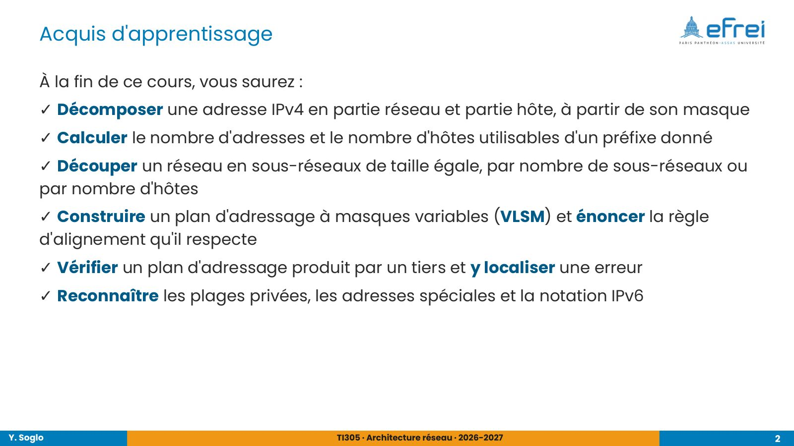{ loading=lazy .papier }](papier/cm2/p02.jpg)
    <p class="papier-legende">Acquis d'apprentissage · CM 2 — Adressage IP et subnetting, diapo 2</p>

    [{ loading=lazy .papier }](papier/cm2/p03.jpg)
    <p class="papier-legende">Partie 1 : L'adresse IPv4 · CM 2 — Adressage IP et subnetting, diapo 3</p>

    [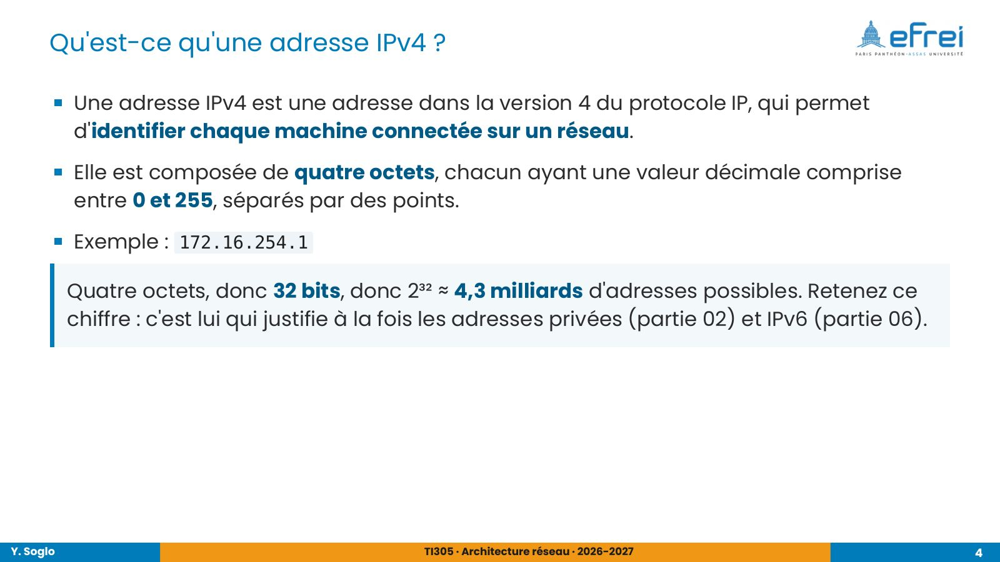{ loading=lazy .papier }](papier/cm2/p04.jpg)
    <p class="papier-legende">Qu'est-ce qu'une adresse IPv4 ? · CM 2 — Adressage IP et subnetting, diapo 4</p>

    [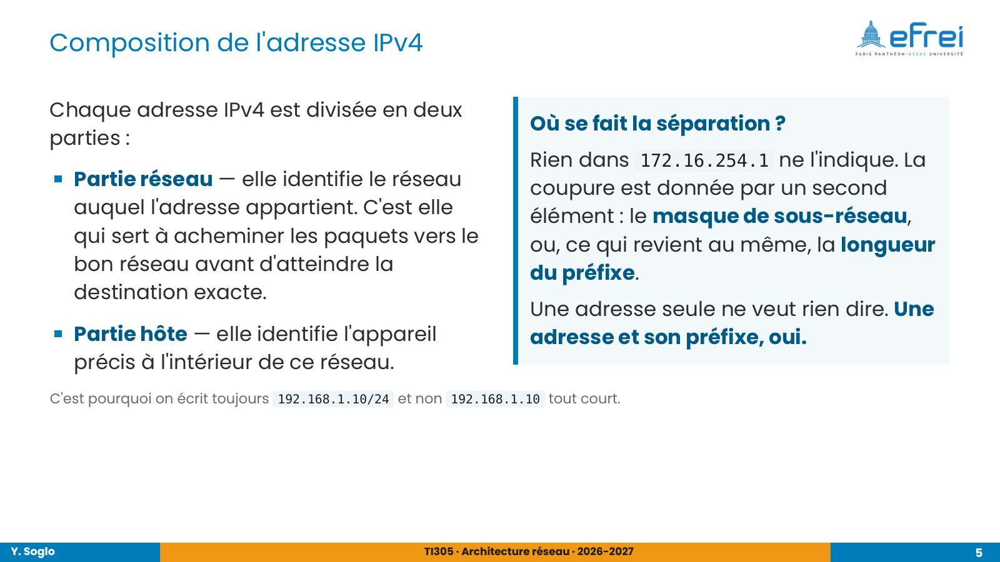{ loading=lazy .papier }](papier/cm2/p05.jpg)
    <p class="papier-legende">Composition de l'adresse IPv4 · CM 2 — Adressage IP et subnetting, diapo 5</p>

    [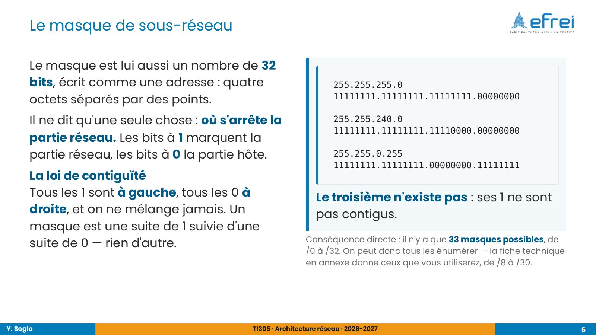{ loading=lazy .papier }](papier/cm2/p06.jpg)
    <p class="papier-legende">Le masque de sous-réseau · CM 2 — Adressage IP et subnetting, diapo 6</p>

    [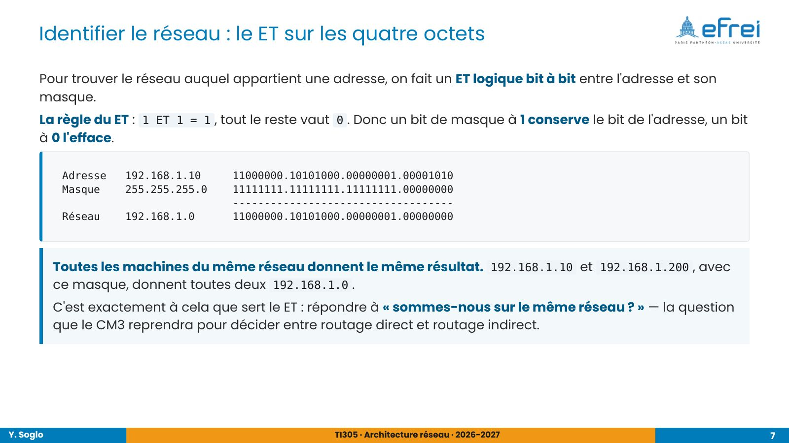{ loading=lazy .papier }](papier/cm2/p07.jpg)
    <p class="papier-legende">Identifier le réseau : le ET sur les quatre octets · CM 2 — Adressage IP et subnetting, diapo 7</p>

    [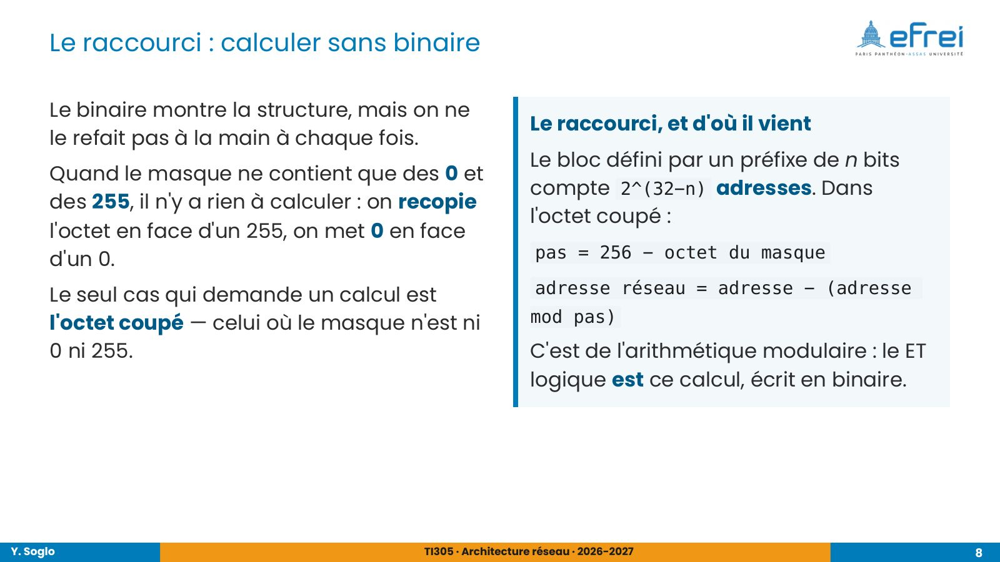{ loading=lazy .papier }](papier/cm2/p08.jpg)
    <p class="papier-legende">Le raccourci : calculer sans binaire · CM 2 — Adressage IP et subnetting, diapo 8</p>

    [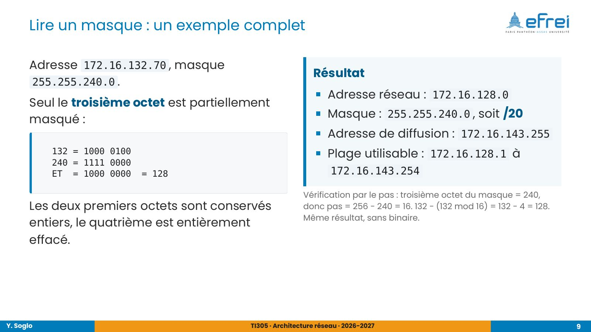{ loading=lazy .papier }](papier/cm2/p09.jpg)
    <p class="papier-legende">Lire un masque : un exemple complet · CM 2 — Adressage IP et subnetting, diapo 9</p>

    [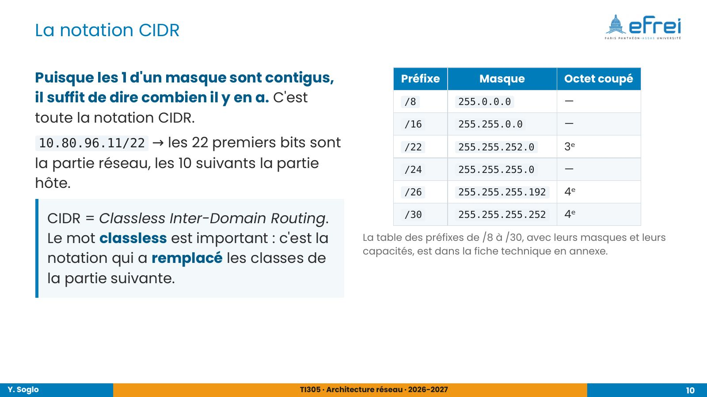{ loading=lazy .papier }](papier/cm2/p10.jpg)
    <p class="papier-legende">La notation CIDR · CM 2 — Adressage IP et subnetting, diapo 10</p>

    [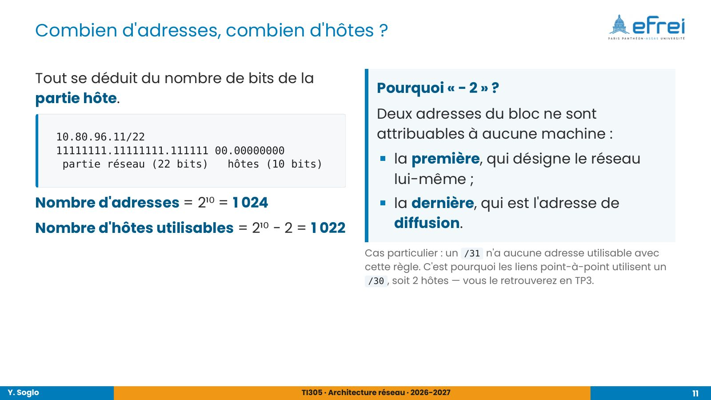{ loading=lazy .papier }](papier/cm2/p11.jpg)
    <p class="papier-legende">Combien d'adresses, combien d'hôtes ? · CM 2 — Adressage IP et subnetting, diapo 11</p>

    [{ loading=lazy .papier }](papier/cm2/p12.jpg)
    <p class="papier-legende">Partie 2 : Les plages et les cas particuliers · CM 2 — Adressage IP et subnetting, diapo 12</p>

    [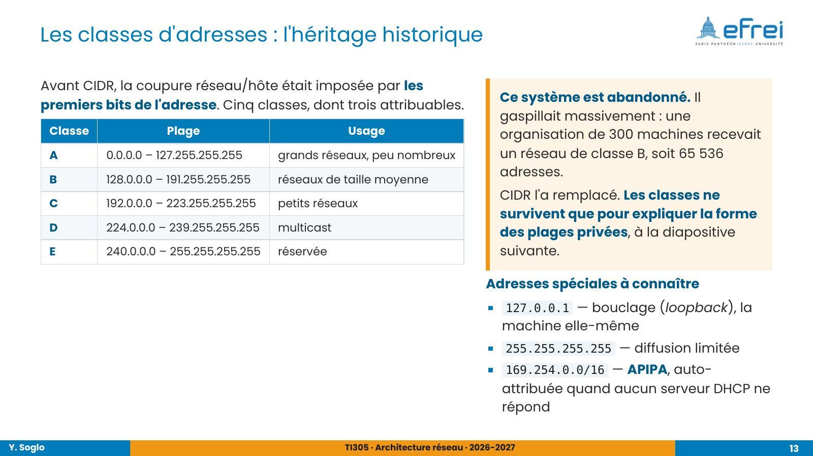{ loading=lazy .papier }](papier/cm2/p13.jpg)
    <p class="papier-legende">Les classes d'adresses : l'héritage historique · CM 2 — Adressage IP et subnetting, diapo 13</p>

    [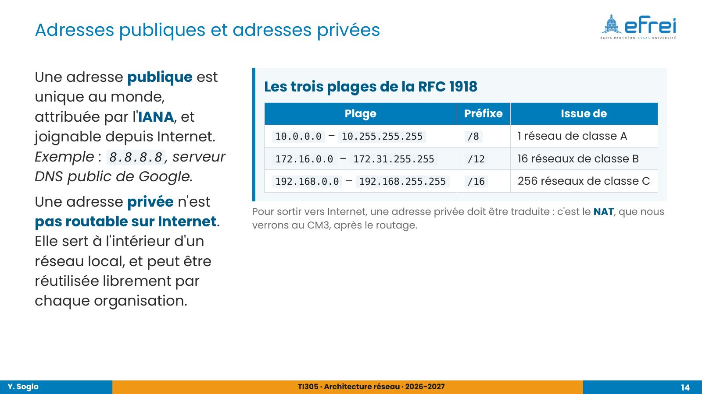{ loading=lazy .papier }](papier/cm2/p14.jpg)
    <p class="papier-legende">Adresses publiques et adresses privées · CM 2 — Adressage IP et subnetting, diapo 14</p>

    [{ loading=lazy .papier }](papier/cm2/p15.jpg)
    <p class="papier-legende">Partie 3 : Découper un réseau · CM 2 — Adressage IP et subnetting, diapo 15</p>

    [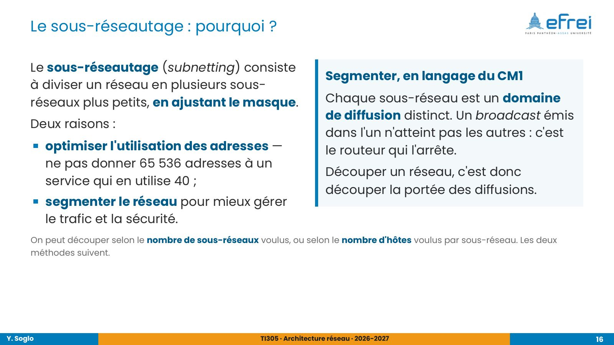{ loading=lazy .papier }](papier/cm2/p16.jpg)
    <p class="papier-legende">Le sous-réseautage : pourquoi ? · CM 2 — Adressage IP et subnetting, diapo 16</p>

    [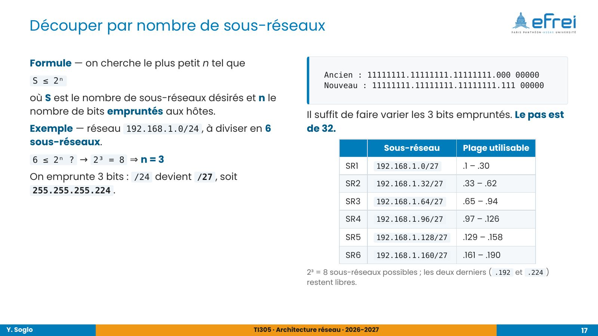{ loading=lazy .papier }](papier/cm2/p17.jpg)
    <p class="papier-legende">Découper par nombre de sous-réseaux · CM 2 — Adressage IP et subnetting, diapo 17</p>

    [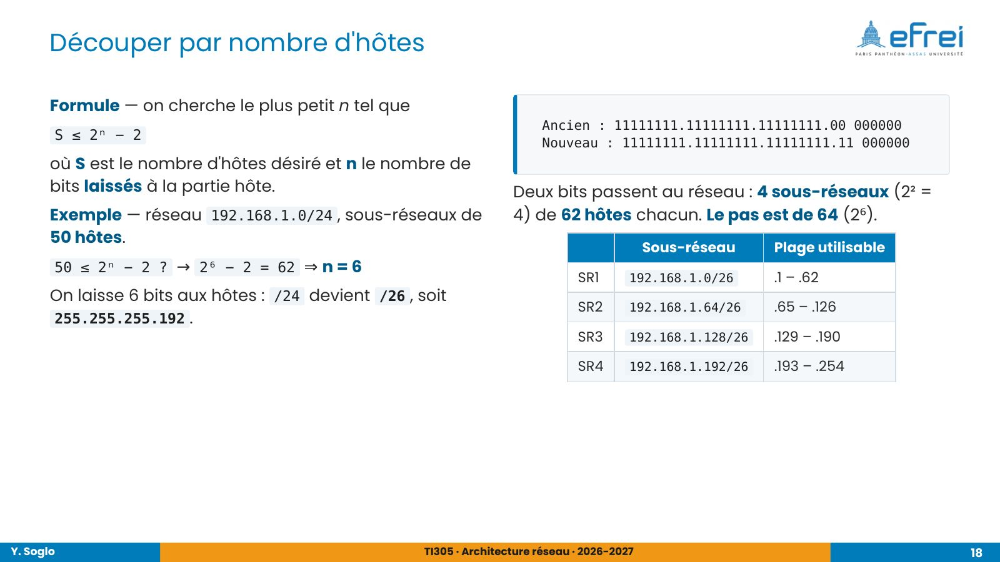{ loading=lazy .papier }](papier/cm2/p18.jpg)
    <p class="papier-legende">Découper par nombre d'hôtes · CM 2 — Adressage IP et subnetting, diapo 18</p>

    [{ loading=lazy .papier }](papier/cm2/p19.jpg)
    <p class="papier-legende">Partie 4 : Quand les besoins n'ont pas tous la même taille · CM 2 — Adressage IP et subnetting, diapo 19</p>

    [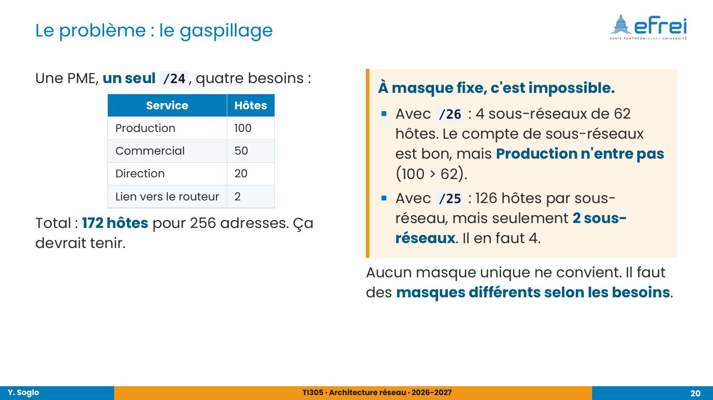{ loading=lazy .papier }](papier/cm2/p20.jpg)
    <p class="papier-legende">Le problème : le gaspillage · CM 2 — Adressage IP et subnetting, diapo 20</p>

    [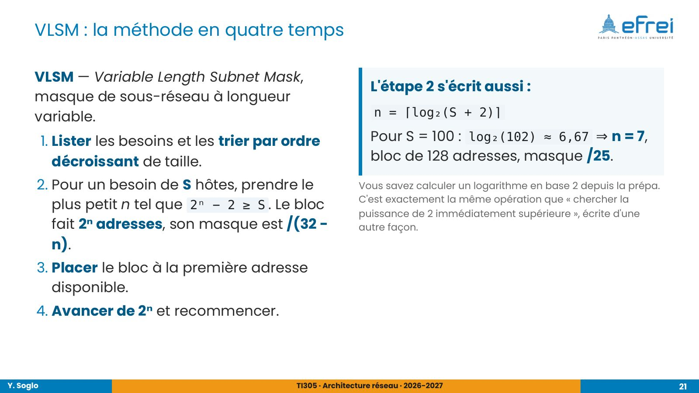{ loading=lazy .papier }](papier/cm2/p21.jpg)
    <p class="papier-legende">VLSM : la méthode en quatre temps · CM 2 — Adressage IP et subnetting, diapo 21</p>

    [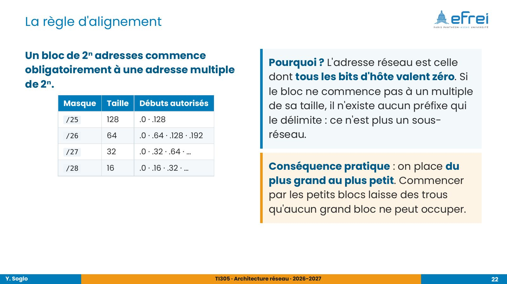{ loading=lazy .papier }](papier/cm2/p22.jpg)
    <p class="papier-legende">La règle d'alignement · CM 2 — Adressage IP et subnetting, diapo 22</p>

    [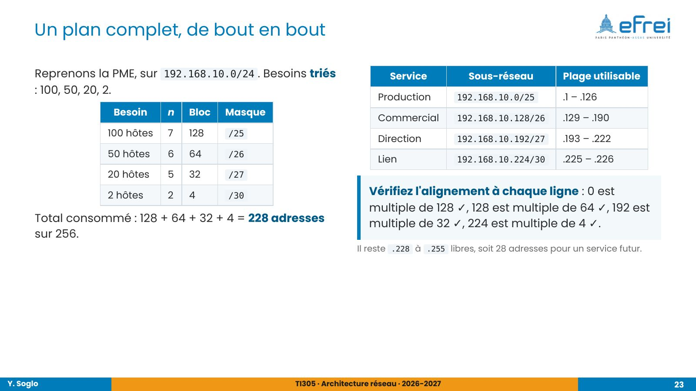{ loading=lazy .papier }](papier/cm2/p23.jpg)
    <p class="papier-legende">Un plan complet, de bout en bout · CM 2 — Adressage IP et subnetting, diapo 23</p>

    [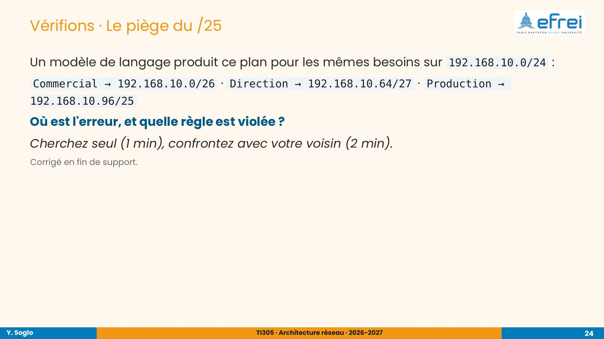{ loading=lazy .papier }](papier/cm2/p24.jpg)
    <p class="papier-legende">Vérifions : Le piège du /25 · CM 2 — Adressage IP et subnetting, diapo 24</p>

    [{ loading=lazy .papier }](papier/cm2/p25.jpg)
    <p class="papier-legende">Partie 5 : Ce qui voyage dans le paquet · CM 2 — Adressage IP et subnetting, diapo 25</p>

    [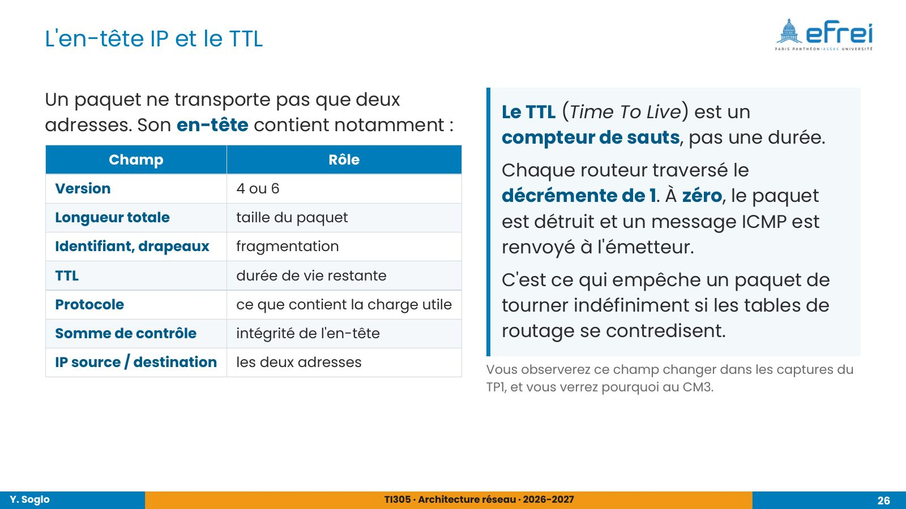{ loading=lazy .papier }](papier/cm2/p26.jpg)
    <p class="papier-legende">L'en-tête IP et le TTL · CM 2 — Adressage IP et subnetting, diapo 26</p>

    [{ loading=lazy .papier }](papier/cm2/p27.jpg)
    <p class="papier-legende">Partie 6 : L'adresse IPv6 · CM 2 — Adressage IP et subnetting, diapo 27</p>

    [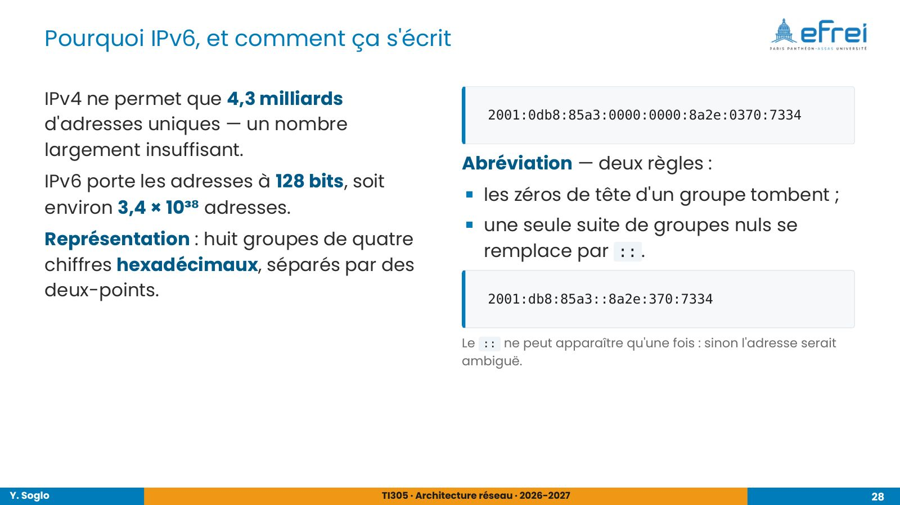{ loading=lazy .papier }](papier/cm2/p28.jpg)
    <p class="papier-legende">Pourquoi IPv6, et comment ça s'écrit · CM 2 — Adressage IP et subnetting, diapo 28</p>

    [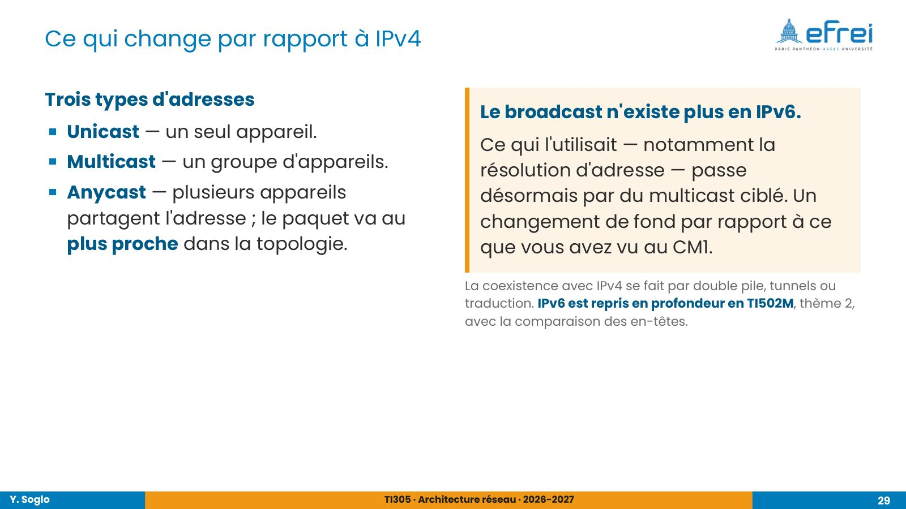{ loading=lazy .papier }](papier/cm2/p29.jpg)
    <p class="papier-legende">Ce qui change par rapport à IPv4 · CM 2 — Adressage IP et subnetting, diapo 29</p>

    [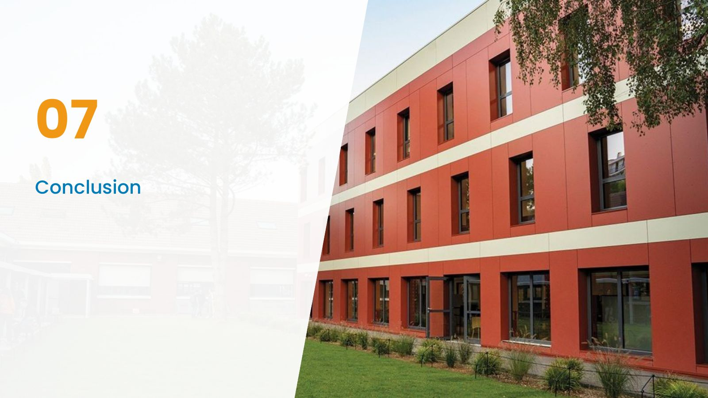{ loading=lazy .papier }](papier/cm2/p30.jpg)
    <p class="papier-legende">Partie 7 : Conclusion · CM 2 — Adressage IP et subnetting, diapo 30</p>

    [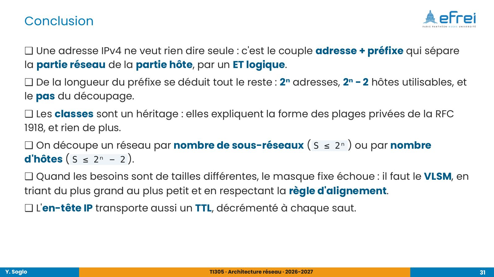{ loading=lazy .papier }](papier/cm2/p31.jpg)
    <p class="papier-legende">Conclusion · CM 2 — Adressage IP et subnetting, diapo 31</p>

    [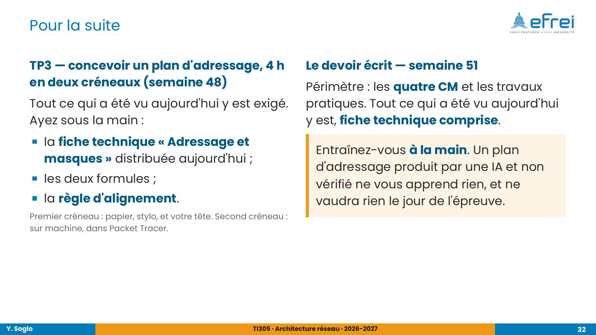{ loading=lazy .papier }](papier/cm2/p32.jpg)
    <p class="papier-legende">Pour la suite · CM 2 — Adressage IP et subnetting, diapo 32</p>

    [{ loading=lazy .papier }](papier/cm2/p33.jpg)
    <p class="papier-legende">Merci de votre attention · CM 2 — Adressage IP et subnetting, diapo 33</p>

    [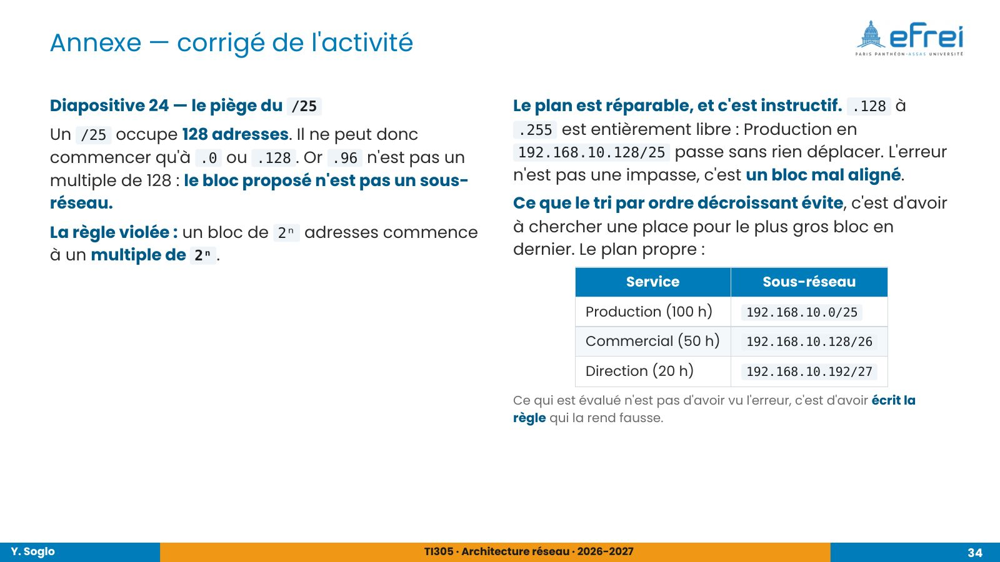{ loading=lazy .papier }](papier/cm2/p34.jpg)
    <p class="papier-legende">Annexe — corrigé de l'activité · CM 2 — Adressage IP et subnetting, diapo 34</p>

    [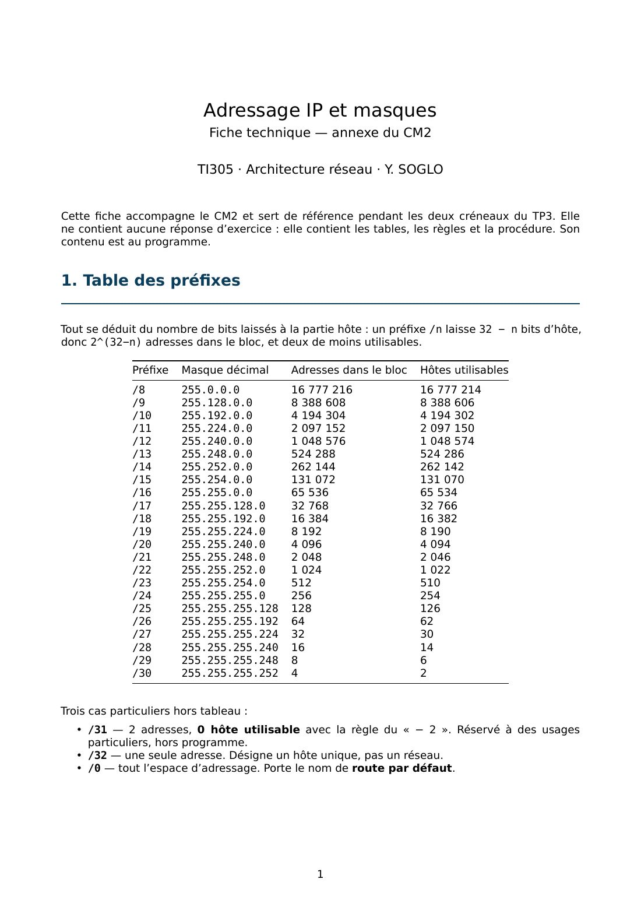{ loading=lazy .papier }](papier/ft2/p01.jpg)
    <p class="papier-legende">Adressage IP et masques · Fiche technique Adressage IP et masques, p. 1</p>

    [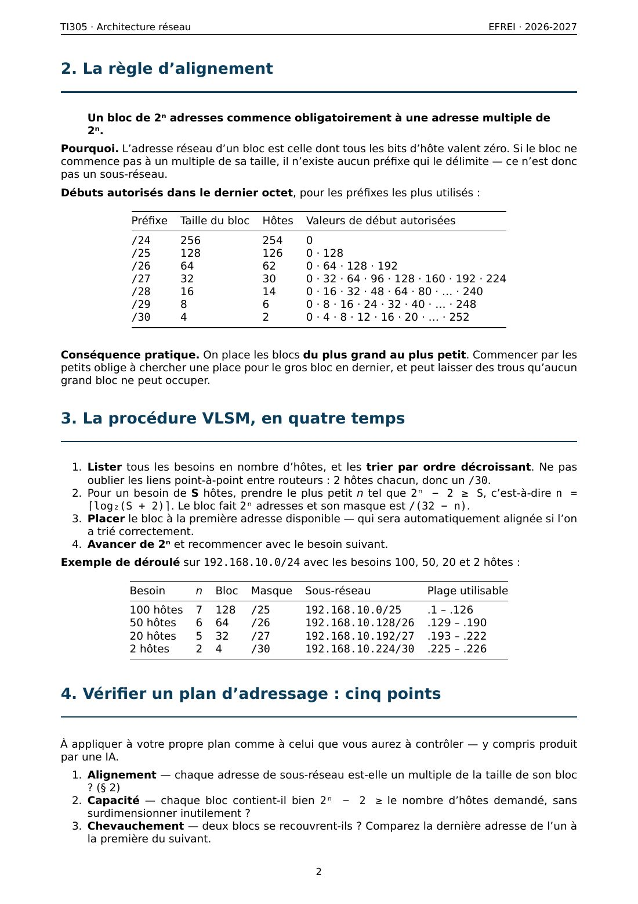{ loading=lazy .papier }](papier/ft2/p02.jpg)
    <p class="papier-legende">Fiche technique Adressage IP et masques, p. 2</p>

    [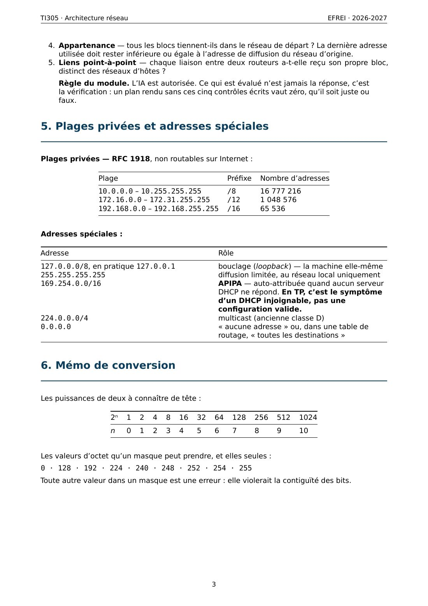{ loading=lazy .papier }](papier/ft2/p03.jpg)
    <p class="papier-legende">Fiche technique Adressage IP et masques, p. 3</p>
