# Chapitre 3 — Le routage

=== "Version simplifiée"

    Comment un paquet sort de son réseau : la passerelle, la table de routage et sa règle de
    choix (*longest prefix match*), les routes statiques en CLI Cisco, ce qui change à chaque
    saut, le routage dynamique, et le NAT.

    ## 1. Le routage

    !!! definition "Routage"
        Détermination du **chemin** qu'un paquet emprunte de sa source à sa destination.
        Fait par les **routeurs**, à l'aide de **tables de routage** (adresse IP de
        destination, masque, métrique).

    | Routage **direct** | Routage **indirect** |
    |--------------------|----------------------|
    | les deux hôtes sont **sur le même réseau** | les hôtes sont sur des **réseaux différents** |
    | pas de routeur : on livre directement (ARP sur la cible) | on passe par un ou plusieurs routeurs |

    **C'est la machine émettrice qui tranche**, en comparant (ET logique avec **son** masque,
    [chapitre 2](chapitre-2-adressage-ip.md#trouver-le-reseau-le-et-logique)) l'adresse de
    destination à son propre réseau.

    Le routage sert à faire communiquer des sous-réseaux, des **VLAN** (plusieurs réseaux
    logiques sur un même commutateur) et des WAN jusqu'à Internet ; à optimiser les chemins ;
    à tolérer les pannes (protocoles dynamiques). Rappel : chaque sous-réseau est un domaine
    de diffusion ; **le routeur les sépare, et c'est le seul qui permet de passer de l'un à
    l'autre.**

    ### La passerelle par défaut

    Adresse IP du **routeur** qu'une machine utilise pour joindre tout ce qui est **hors de son
    réseau local** : destination hors réseau → paquet envoyé à la passerelle, qui le fait suivre.

    | Hôte | Configuration IP | Passerelle |
    |------|------------------|------------|
    | PC0 | 192.168.30.1/24 | 192.168.30.254 |
    | PC1 | 192.168.10.1/24 | 192.168.10.254 |
    | PC2 | 192.168.20.1/24 | 192.168.20.254 |

    !!! piege "Panne n° 1 en TP"
        La passerelle **appartient toujours au réseau local de la machine**. Une passerelle hors
        du sous-réseau est injoignable (la machine ne peut même pas faire d'ARP dessus).

    ## 2. La table de routage

    Ce n'est pas un tableau à remplir : c'est une **structure sur laquelle le routeur fait une
    recherche** à chaque paquet reçu. Chaque entrée :

    | Champ | Sens |
    |-------|------|
    | Destination | adresse du réseau visé |
    | Masque | portion réseau de cette adresse |
    | Prochain saut (*next hop*) | IP du prochain routeur à traverser |
    | Interface | par où **sortir** |
    | Métrique | « coût » de l'itinéraire |

    En une phrase : *« pour aller là, sors par ici, en passant par celui-là »*.

    ### Choisir une route : le *longest prefix match*

    !!! theoreme "Règle, sans exception"
        1. Parmi les entrées qui correspondent, on retient celle dont le **préfixe est le plus
           long** (la plus précise).
        2. La **métrique** ne départage **qu'ensuite**, entre routes de même longueur.

    | Route (paquet pour 10.1.2.50) | Correspond ? | Longueur | Retenue ? |
    |-------------------------------|:------------:|:--------:|:---------:|
    | 0.0.0.0/0 | oui | 0 | non |
    | 10.0.0.0/8 | oui | 8 | non |
    | 10.1.0.0/16 | oui | 16 | non |
    | 10.1.2.0/24 | oui | 24 | **oui** |

    !!! methode "Vérifier qu'une route correspond, à la main"
        Applique le **masque de la route** à l'adresse de destination (ET logique) et compare au
        réseau de la route : égal → la route correspond.

    !!! tip "Conséquence pour les plans d'adressage"
        Si deux sous-réseaux se recouvrent, c'est toujours le plus précis qui gagnera : le plan
        doit être conçu en conséquence.

    ### La route par défaut `0.0.0.0/0`

    Un préfixe de longueur 0 correspond à **toutes** les destinations, donc c'est **toujours la
    correspondance la plus courte** : elle n'est retenue que si **rien d'autre** ne correspond.
    Ce n'est pas un cas spécial, c'est le mécanisme général appliqué au préfixe le plus court.
    C'est exactement la passerelle par défaut d'un PC : « tout ce que je ne sais pas joindre,
    je l'envoie là ». Cisco : `ip route 0.0.0.0 0.0.0.0 <passerelle>`.

    ### Exemple résolu

    ```text
     PC1 ── SW1 ── G0/0 .254 ┐                         ┌ G0/0 .254 ── SW3 ── PC0
      192.168.10.0/24     [Routeur0] S0/0/0 ─── S0/0/0 [Routeur1]   192.168.30.0/24
                             │      10.0.0.1  /30  10.0.0.2
      192.168.20.0/24  G0/1 .254
     PC2 ── SW2 ────────────┘                   (lien 10.0.0.0/30)
    ```

    === "Table de Routeur0"

        | Destination | Masque | Prochain saut | Interface | Métrique |
        |-------------|--------|---------------|-----------|:--------:|
        | 192.168.10.0 | 255.255.255.0 | connecté | G0/0 | 0 |
        | 192.168.20.0 | 255.255.255.0 | connecté | G0/1 | 0 |
        | 10.0.0.0 | 255.255.255.252 | connecté | S0/0/0 | 0 |
        | 192.168.30.0 | 255.255.255.0 | 10.0.0.2 | S0/0/0 | 1 |

        Trois réseaux directement connectés (les deux LAN **et le lien**), le quatrième
        atteint **à travers Routeur1** : prochain saut = l'adresse de Routeur1 sur le lien.

    === "Table de Routeur1 (l'entraînement)"

        | Destination | Masque | Prochain saut | Interface | Métrique |
        |-------------|--------|---------------|-----------|:--------:|
        | 192.168.30.0 | 255.255.255.0 | connecté | G0/0 | 0 |
        | 10.0.0.0 | 255.255.255.252 | connecté | S0/0/0 | 0 |
        | 192.168.10.0 | 255.255.255.0 | 10.0.0.1 | S0/0/0 | 1 |
        | 192.168.20.0 | 255.255.255.0 | 10.0.0.1 | S0/0/0 | 1 |

        Version compacte, également juste (Routeur1 n'a qu'une sortie) :

        | Destination | Masque | Prochain saut | Interface | Métrique |
        |-------------|--------|---------------|-----------|:--------:|
        | 192.168.30.0 | 255.255.255.0 | connecté | G0/0 | 0 |
        | 10.0.0.0 | 255.255.255.252 | connecté | S0/0/0 | 0 |
        | 0.0.0.0 | 0.0.0.0 | 10.0.0.1 | S0/0/0 | 1 |

    !!! piege "Les 3 erreurs classiques"
        1. **Oublier le lien /30** : c'est un réseau à part entière, il a sa ligne « connecté ».
        2. Mettre **10.0.0.2** en prochain saut de Routeur1 : c'est **sa propre adresse**. Un
           routeur ne se désigne jamais comme prochain saut.
        3. Écrire l'interface **d'en face** : la colonne Interface est toujours l'interface
           **locale** par laquelle le paquet **sort**.

    !!! methode "Format de table attendu dans tout le module"
        Cinq colonnes dans cet ordre : **Destination, Masque, Prochain saut, Interface,
        Métrique**. D'abord les **connectés** (« connecté », métrique 0), puis les routes
        apprises/configurées (IP du prochain saut, métrique ≥ 1), et la **route par défaut en
        dernier** (`0.0.0.0 / 0.0.0.0`). Une table sans ses routes connectées est incomplète.

    ## 3. Le routage statique

    Routes écrites **à la main** par l'administrateur ; elles ne changent que s'il les modifie.

    | Avantages | Inconvénients |
    |-----------|---------------|
    | simple sur un petit réseau stable | maintenance pénible sur un grand réseau, source d'erreurs |
    | contrôle total des chemins | aucune mise à jour si la topologie change |
    | **aucun débit consommé** (rien n'est échangé entre routeurs) | si un lien tombe, rien ne s'adapte |

    C'est ce qu'on configure dans tout le module (et ce qui tourne dans beaucoup de petites
    entreprises).

    ### Écrire une route : `ip route`

    ```text
    ip route <réseau> <masque> <prochain saut>
    ```

    La 4e ligne de la table de Routeur0 est créée par :

    ```text
    Router(config)# ip route 192.168.30.0 255.255.255.0 10.0.0.2
    ```

    !!! piege "Le mode compte, et l'invite le dit"
        | Invite | Mode | On y fait |
        |--------|------|-----------|
        | `Router>` | utilisateur | consultation limitée |
        | `Router#` | **privilégié** (`enable`) | toutes les commandes **`show`**, `ping`, `traceroute` |
        | `Router(config)#` | **configuration** (`configure terminal`) | **`ip route`**, `hostname`, `interface` |
        | `Router(config-if)#` | configuration d'interface | `ip address`, `no shutdown` |

        `exit` remonte d'un niveau ; `end` (ou Ctrl+Z) revient direct à `Router#`.
        Un `show ip route` tapé en `(config)#` est **refusé** : `end` d'abord.

    ```text
    Router> enable
    Router# configure terminal
    Router(config)# interface g0/0
    Router(config-if)# ip address 192.168.10.254 255.255.255.0
    Router(config-if)# no shutdown        ! une interface Cisco est éteinte par défaut
    Router(config-if)# exit
    Router(config)# ip route 192.168.40.0 255.255.255.0 10.0.0.2
    Router(config)# ip route 0.0.0.0 0.0.0.0 10.0.0.2        ! route par défaut
    Router(config)# no ip route 192.168.40.0 255.255.255.0 10.0.0.2   ! supprimer
    Router(config)# end
    Router# copy running-config startup-config   ! sinon tout est perdu au redémarrage
    ```

    ### Ce qui change à chaque saut

    | Élément | À chaque routeur traversé |
    |---------|---------------------------|
    | IP source et destination | **inchangées** |
    | MAC source et destination | **réécrites** |
    | TTL | **décrémenté de 1** |
    | Somme de contrôle de l'en-tête IP | **recalculée** (parce que le TTL a changé) |

    L'adresse MAC n'a de sens que **sur un lien** : à chaque saut, le routeur demande par
    **ARP** la MAC du prochain équipement et réécrit la trame. *L'IP vise la destination
    finale, la MAC ne vise que le prochain équipement* : c'est ce qu'on observe sur les
    captures du [TP 1](../td/tp-1-capture-trames.md#partie-3-lenquete).

    ## 4. Le routage dynamique

    Les routeurs **s'échangent des informations de routage** via des protocoles pour apprendre
    les routes et s'adapter aux changements.

    | Avantages | Inconvénients |
    |-----------|---------------|
    | adaptation automatique aux changements de topologie | consomme du débit et du CPU |
    | maintenance simplifiée sur les grands réseaux | configuration complexe |
    | résilience : détection des pannes, réajustement | **boucles de routage** possibles en cas d'erreur |

    | Aspect | Statique | Dynamique |
    |--------|----------|-----------|
    | Configuration | manuelle | automatique, via des protocoles |
    | Adaptabilité | aucune | ajuste les routes en temps réel |
    | Ressources | faibles (petits réseaux) | plus élevées (CPU, débit) |
    | Sécurité | plus sûr : rien ne change sans intervention | plus exposé aux mauvaises configurations |

    **Statique** : petits réseaux stables (tous ceux du module). **Dynamique** : dès que le
    réseau grandit ou change.

    | Famille | Périmètre | Exemples |
    |---------|-----------|----------|
    | **IGP** (*Interior Gateway Protocol*) | à l'intérieur d'un **système autonome** (une administration) | RIP, OSPF, EIGRP |
    | **EGP** (*Exterior Gateway Protocol*) | **entre** systèmes autonomes (Internet) | BGP |

    | Principe de calcul | Idée | Protocole | Algorithme |
    |--------------------|------|-----------|------------|
    | **Vecteur de distance** | chaque routeur annonce ce qu'il sait à ses voisins | RIP | Bellman-Ford |
    | **État de lien** | chaque routeur construit la carte complète, puis calcule les plus courts chemins | OSPF | **SPF = Dijkstra** |

    Pour OSPF : le réseau est le graphe, les liens sont les arêtes, la métrique est le poids.

    ## 5. Sortir du réseau : le NAT

    Les adresses privées (RFC 1918) ne sont **pas routables** sur Internet : `192.168.1.10`
    existe dans des millions de réseaux à la fois. Pour sortir, l'adresse privée doit être
    **traduite** en adresse publique : c'est le **NAT** (*Network Address Translation*), fait
    par le **routeur de sortie** (une patte privée, une patte publique). D'où le fait que, vu de
    l'extérieur, toute une maison semble n'avoir qu'une seule IP.

    | Forme | Principe | Usage |
    |-------|----------|-------|
    | **NAT statique** | 1 privée ↔ 1 publique, fixe | rendre un **serveur interne** joignable de l'extérieur |
    | **NAT dynamique** | une publique prise dans un **réservoir**, à la demande | |
    | **PAT** (NAT surchargé) | **plusieurs privées partagent une seule publique**, distinguées par les **ports** | ta box, tous les jours |

    !!! example "Le PAT ligne par ligne (box d'adresse publique 203.0.113.7)"
        | Machine interne | Port source | Traduit en | Vers |
        |-----------------|:-----------:|------------|------|
        | 192.168.1.10 | 51720 | 203.0.113.7:51720 | 93.184.216.34:443 |
        | 192.168.1.11 | 51720 | 203.0.113.7:**61001** | 93.184.216.34:443 |
        | 192.168.1.10 | 49305 | 203.0.113.7:49305 | 142.250.75.238:443 |
        | 192.168.1.12 | 52110 | 203.0.113.7:52110 | 93.184.216.34:80 |

        Ligne 2 : deux machines ont choisi le même port source. La box ne peut pas traduire les
        deux en `:51720` (elle ne saurait plus à qui rendre la réponse) : elle **réécrit le
        port**. Au retour, un paquet pour `203.0.113.7:61001` est renvoyé à `192.168.1.11:51720`.
        **L'adresse publique est partagée, le port est la clé.**

        C'est aussi pourquoi un serveur derrière une box n'est pas joignable de l'extérieur sans
        configuration : aucune ligne ne lui correspond tant que personne à l'intérieur n'a
        ouvert la conversation.

    ## 6. Vérifier et dépanner

    | Commande (en `Router#`) | Affiche | Quand |
    |-------------------------|---------|-------|
    | `show ip route` | la table complète, avec l'origine de chaque route | après chaque route écrite |
    | `show ip interface brief` | état et adresse de chaque interface, une ligne chacune | **en premier**, devant toute panne |
    | `show running-config` | la configuration en cours | pour relire ce qu'on a tapé |
    | `ping <adresse>` | la joignabilité | pour tester |
    | `traceroute <adresse>` | le chemin réellement emprunté | pour localiser où ça s'arrête |

    Lettres de `show ip route` : **C** connecté · **L** adresse locale de l'interface (/32) ·
    **S** statique · **S\*** route par défaut statique.

    !!! piege "Route absente de `show ip route`"
        Ce n'est pas qu'elle a été mal tapée : son **prochain saut est injoignable** (en général
        l'interface de sortie est éteinte). Une route inutilisable n'est pas installée.

    !!! methode "Un ping échoue : du bas vers le haut"
        1. **Lien monté ?** `show ip interface brief` : les deux colonnes `up` (sinon câble, type de câble, `no shutdown`).
        2. **Adresses bonnes ?** Même sous-réseau des deux côtés d'un lien, pas de doublon.
        3. **Passerelle de l'hôte dans son sous-réseau ?** (`ipconfig` sur le PC)
        4. **La route existe ?** `show ip route` sur **chaque** routeur du chemin.
        5. **Et la route de retour ?** Un ping qui part et ne revient pas = presque toujours une
           route de retour manquante. *Le routage n'est pas symétrique par magie.*

        Cas particulier : PC en **169.254.x.x** = APIPA, aucun DHCP n'a répondu → chercher du
        côté du DHCP ou du lien, pas du routage.

    ??? question "Vérifions : 10.0.0.0/8 → A (métrique 1), 10.1.0.0/16 → B (5), 10.1.2.0/24 → C (10). Paquet pour 10.1.2.50 ?"
        **C**, par 10.1.2.0/24. Les trois entrées correspondent ; c'est la **longueur du
        préfixe** qui décide, et /24 est la plus longue. Sa métrique de 10 n'y change rien.
        Pièges : A (« la métrique décide ») et D (« l'ordre de la table décide »).

=== "Version papier"

    Support du CM 3 2026-2027 (Y. Soglo), puis la fiche technique *Table de routage et routes
    statiques*.

    [{ loading=lazy .papier }](papier/cm3/p01.jpg)
    <p class="papier-legende">Le routage · CM 3 — Le routage, diapo 1</p>

    [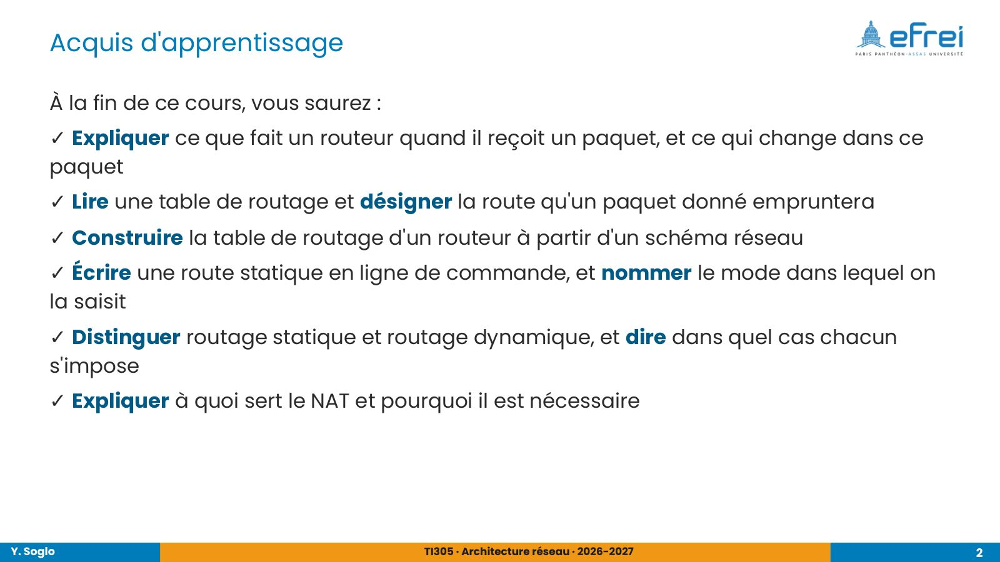{ loading=lazy .papier }](papier/cm3/p02.jpg)
    <p class="papier-legende">Acquis d'apprentissage · CM 3 — Le routage, diapo 2</p>

    [{ loading=lazy .papier }](papier/cm3/p03.jpg)
    <p class="papier-legende">Partie 1 : Le routage · CM 3 — Le routage, diapo 3</p>

    [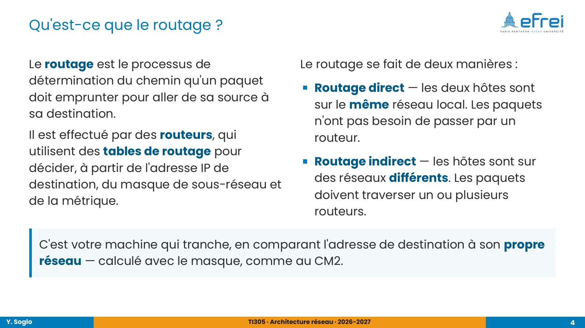{ loading=lazy .papier }](papier/cm3/p04.jpg)
    <p class="papier-legende">Qu'est-ce que le routage ? · CM 3 — Le routage, diapo 4</p>

    [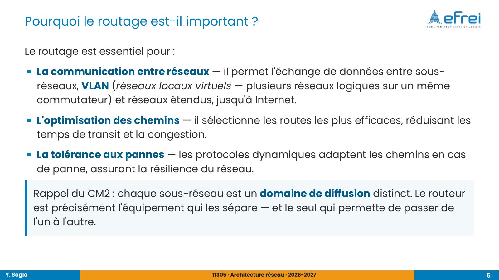{ loading=lazy .papier }](papier/cm3/p05.jpg)
    <p class="papier-legende">Pourquoi le routage est-il important ? · CM 3 — Le routage, diapo 5</p>

    [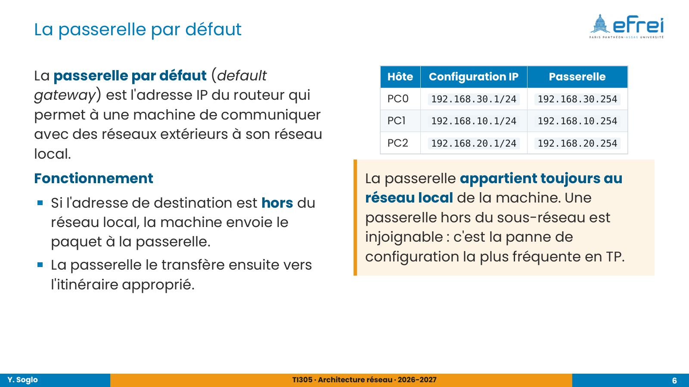{ loading=lazy .papier }](papier/cm3/p06.jpg)
    <p class="papier-legende">La passerelle par défaut · CM 3 — Le routage, diapo 6</p>

    [{ loading=lazy .papier }](papier/cm3/p07.jpg)
    <p class="papier-legende">Partie 2 : La table de routage · CM 3 — Le routage, diapo 7</p>

    [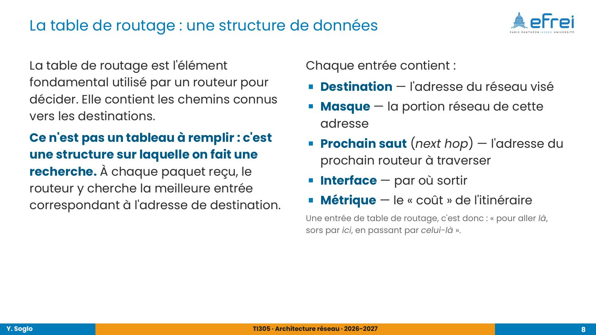{ loading=lazy .papier }](papier/cm3/p08.jpg)
    <p class="papier-legende">La table de routage : une structure de données · CM 3 — Le routage, diapo 8</p>

    [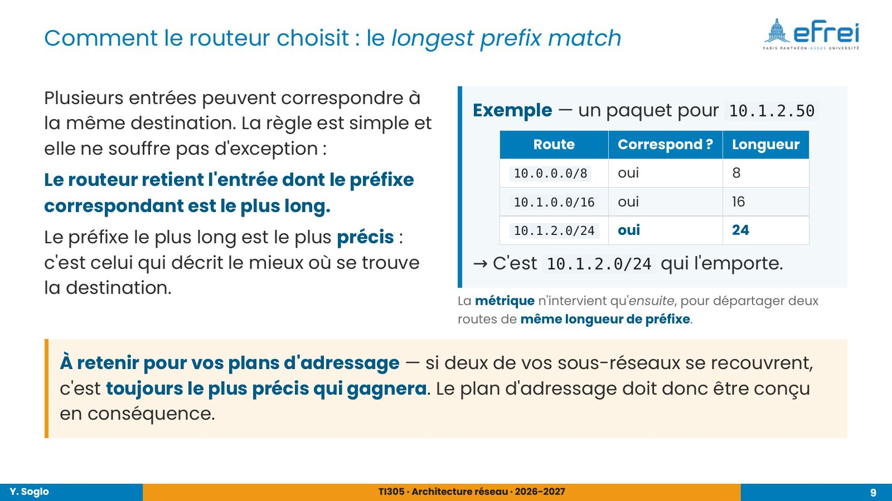{ loading=lazy .papier }](papier/cm3/p09.jpg)
    <p class="papier-legende">Comment le routeur choisit : le longest prefix match · CM 3 — Le routage, diapo 9</p>

    [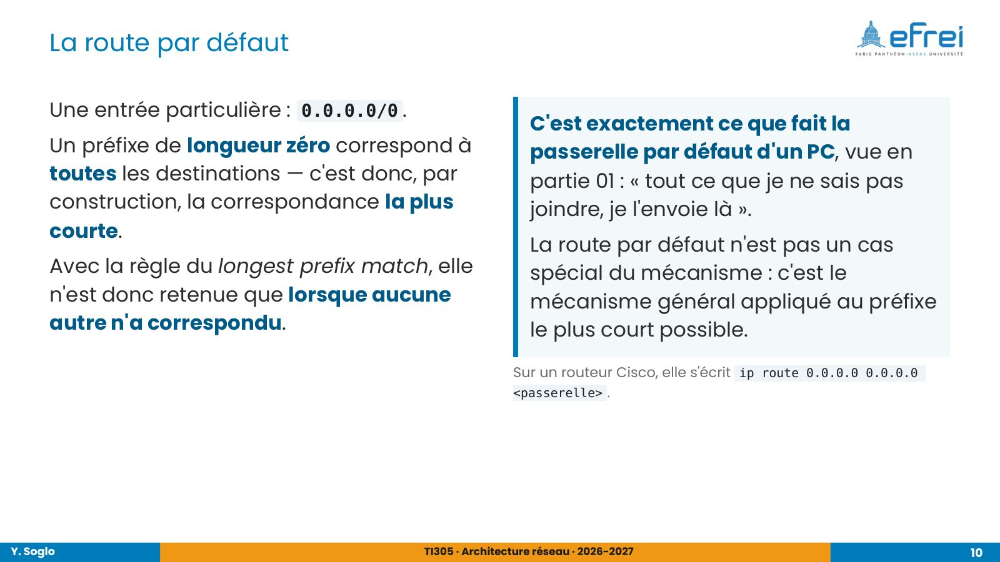{ loading=lazy .papier }](papier/cm3/p10.jpg)
    <p class="papier-legende">La route par défaut · CM 3 — Le routage, diapo 10</p>

    [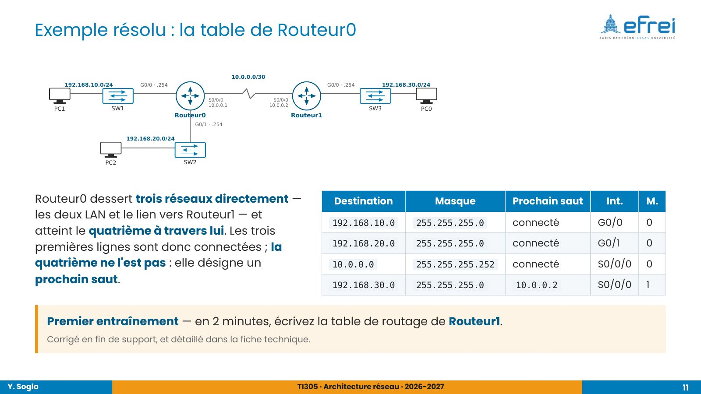{ loading=lazy .papier }](papier/cm3/p11.jpg)
    <p class="papier-legende">Exemple résolu : la table de Routeur0 · CM 3 — Le routage, diapo 11</p>

    [{ loading=lazy .papier }](papier/cm3/p12.jpg)
    <p class="papier-legende">Partie 3 : Le routage statique · CM 3 — Le routage, diapo 12</p>

    [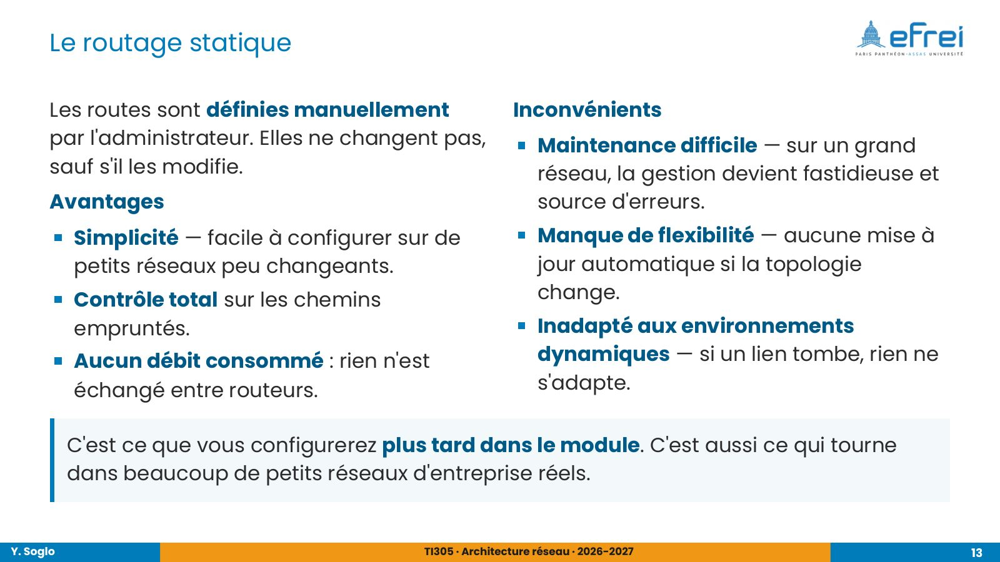{ loading=lazy .papier }](papier/cm3/p13.jpg)
    <p class="papier-legende">Le routage statique · CM 3 — Le routage, diapo 13</p>

    [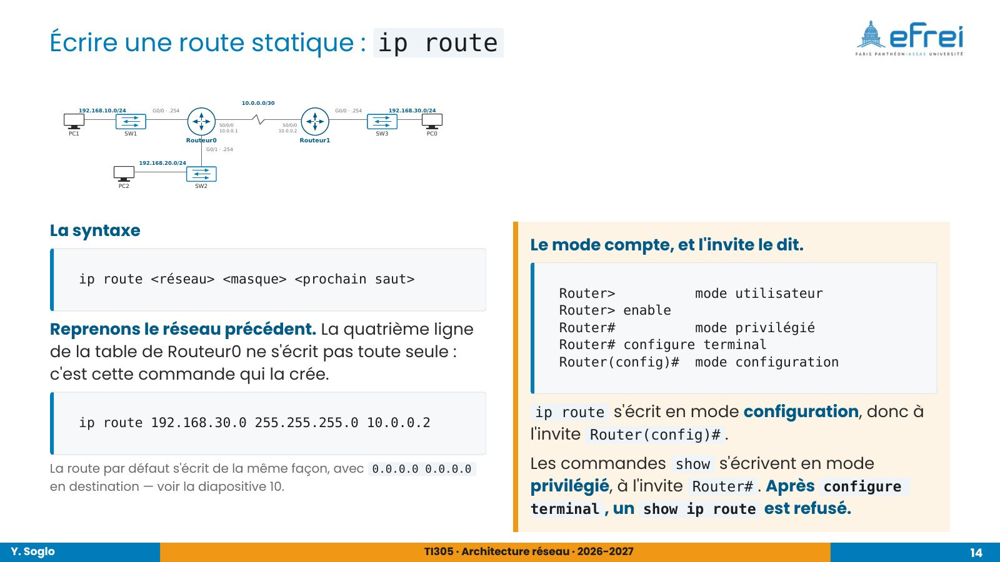{ loading=lazy .papier }](papier/cm3/p14.jpg)
    <p class="papier-legende">Écrire une route statique : ip route · CM 3 — Le routage, diapo 14</p>

    [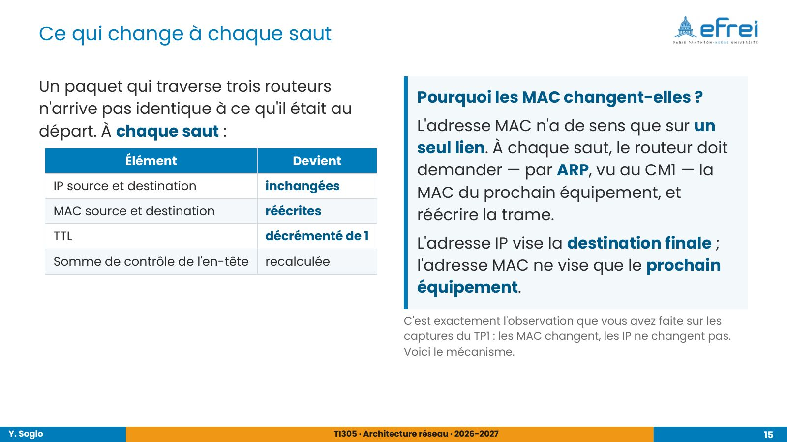{ loading=lazy .papier }](papier/cm3/p15.jpg)
    <p class="papier-legende">Ce qui change à chaque saut · CM 3 — Le routage, diapo 15</p>

    [{ loading=lazy .papier }](papier/cm3/p16.jpg)
    <p class="papier-legende">Partie 4 : Le routage dynamique · CM 3 — Le routage, diapo 16</p>

    [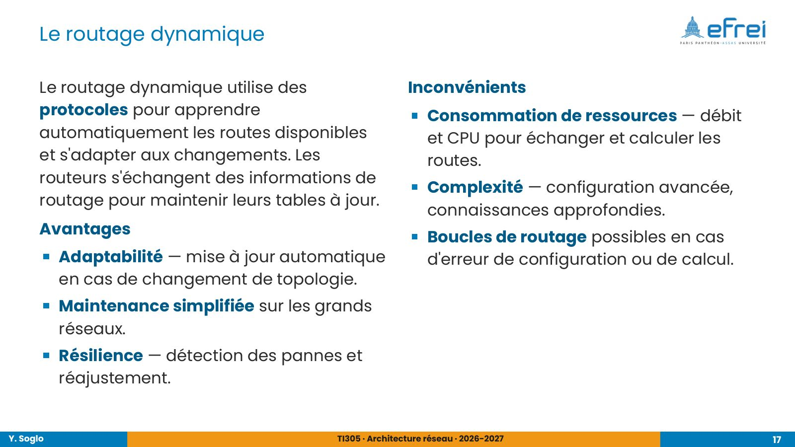{ loading=lazy .papier }](papier/cm3/p17.jpg)
    <p class="papier-legende">Le routage dynamique · CM 3 — Le routage, diapo 17</p>

    [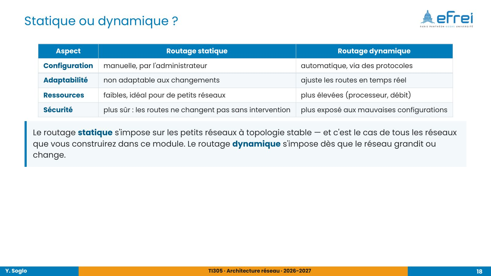{ loading=lazy .papier }](papier/cm3/p18.jpg)
    <p class="papier-legende">Statique ou dynamique ? · CM 3 — Le routage, diapo 18</p>

    [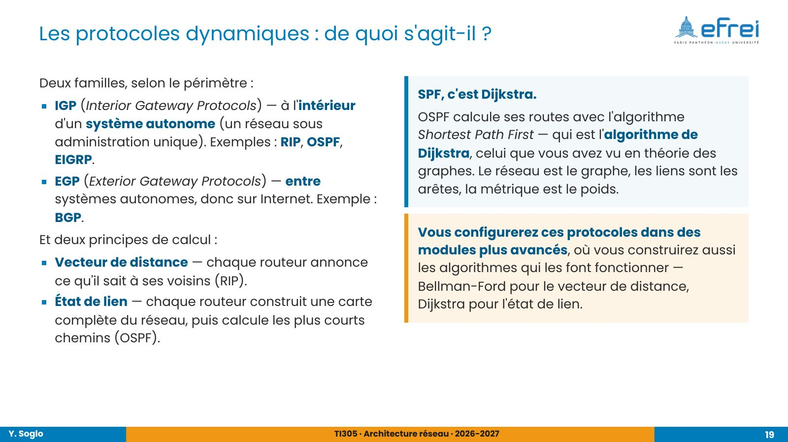{ loading=lazy .papier }](papier/cm3/p19.jpg)
    <p class="papier-legende">Les protocoles dynamiques : de quoi s'agit-il ? · CM 3 — Le routage, diapo 19</p>

    [{ loading=lazy .papier }](papier/cm3/p20.jpg)
    <p class="papier-legende">Partie 5 : Sortir du réseau : le NAT · CM 3 — Le routage, diapo 20</p>

    [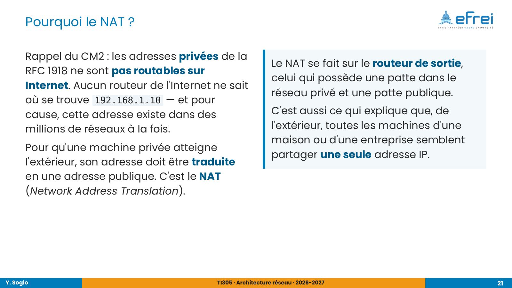{ loading=lazy .papier }](papier/cm3/p21.jpg)
    <p class="papier-legende">Pourquoi le NAT ? · CM 3 — Le routage, diapo 21</p>

    [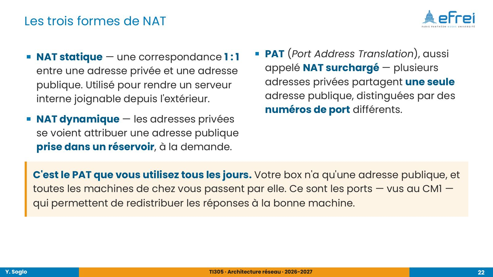{ loading=lazy .papier }](papier/cm3/p22.jpg)
    <p class="papier-legende">Les trois formes de NAT · CM 3 — Le routage, diapo 22</p>

    [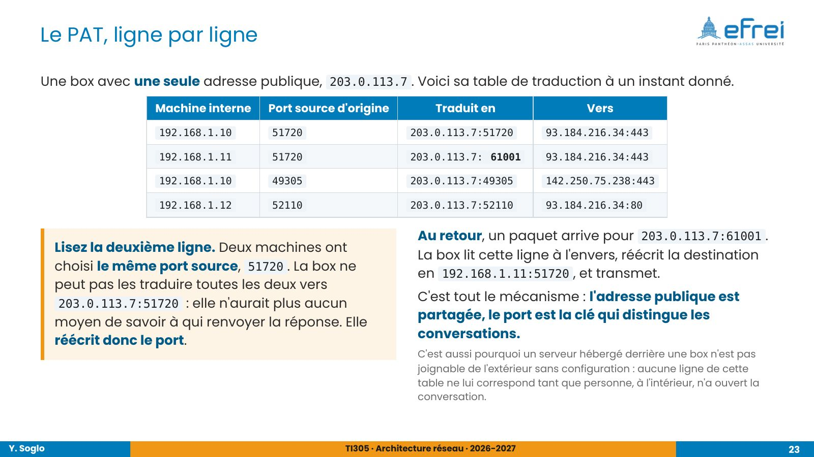{ loading=lazy .papier }](papier/cm3/p23.jpg)
    <p class="papier-legende">Le PAT, ligne par ligne · CM 3 — Le routage, diapo 23</p>

    [{ loading=lazy .papier }](papier/cm3/p24.jpg)
    <p class="papier-legende">Partie 6 : Vérifier et dépanner · CM 3 — Le routage, diapo 24</p>

    [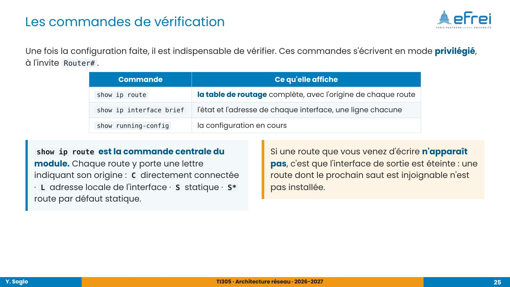{ loading=lazy .papier }](papier/cm3/p25.jpg)
    <p class="papier-legende">Les commandes de vérification · CM 3 — Le routage, diapo 25</p>

    [{ loading=lazy .papier }](papier/cm3/p26.jpg)
    <p class="papier-legende">Dépanner : la méthode, dans l'ordre · CM 3 — Le routage, diapo 26</p>

    [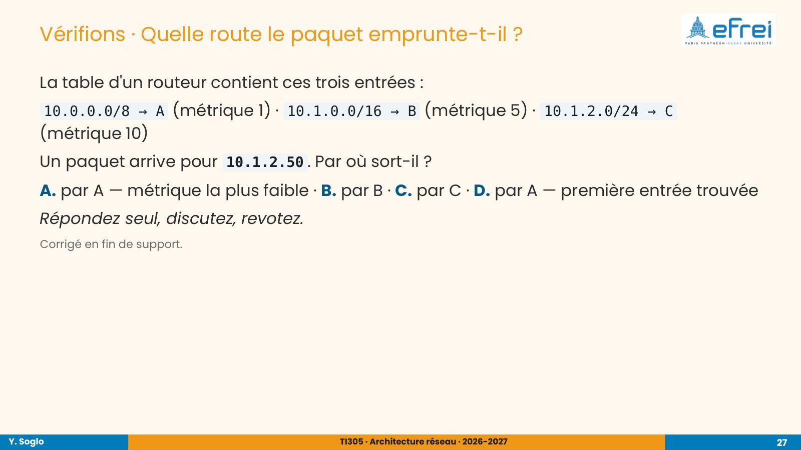{ loading=lazy .papier }](papier/cm3/p27.jpg)
    <p class="papier-legende">Vérifions : Quelle route le paquet emprunte-t-il ? · CM 3 — Le routage, diapo 27</p>

    [{ loading=lazy .papier }](papier/cm3/p28.jpg)
    <p class="papier-legende">Partie 7 : Conclusion · CM 3 — Le routage, diapo 28</p>

    [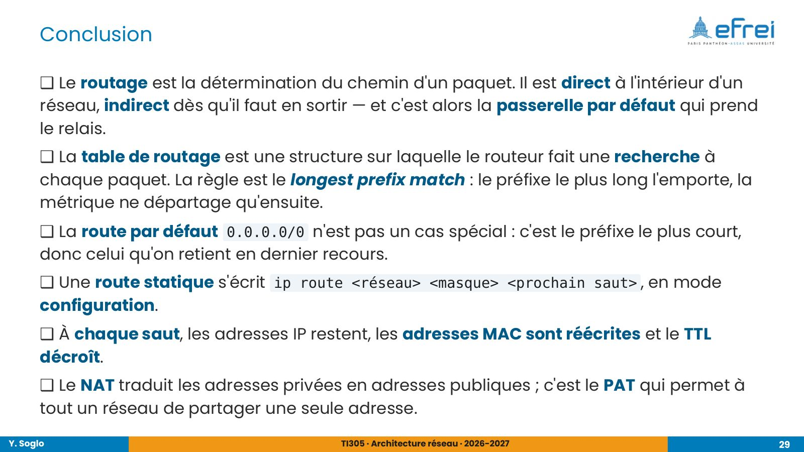{ loading=lazy .papier }](papier/cm3/p29.jpg)
    <p class="papier-legende">Conclusion · CM 3 — Le routage, diapo 29</p>

    [{ loading=lazy .papier }](papier/cm3/p30.jpg)
    <p class="papier-legende">Merci de votre attention · CM 3 — Le routage, diapo 30</p>

    [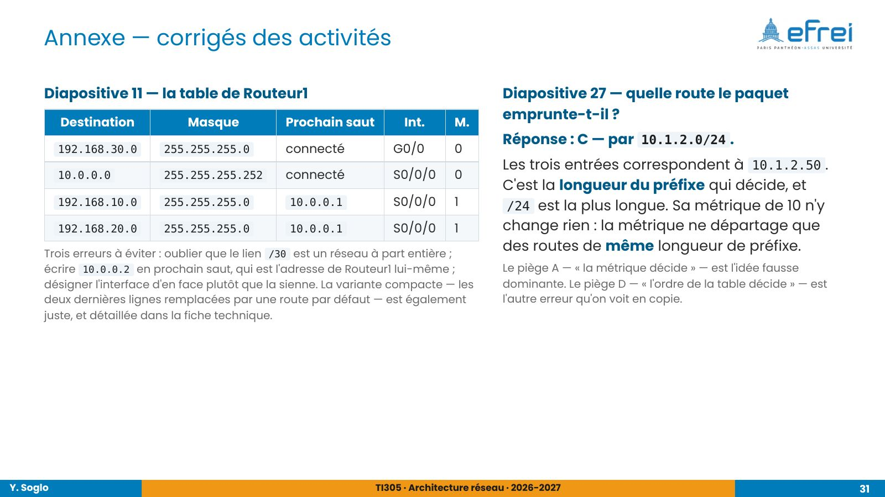{ loading=lazy .papier }](papier/cm3/p31.jpg)
    <p class="papier-legende">Annexe — corrigés des activités · CM 3 — Le routage, diapo 31</p>

    [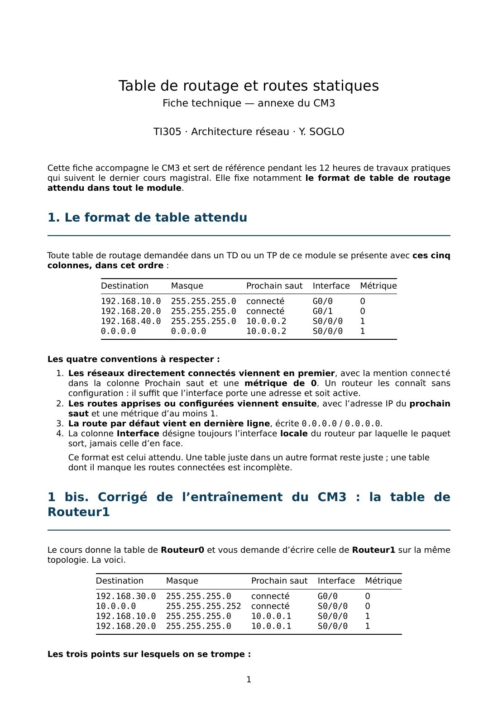{ loading=lazy .papier }](papier/ft3/p01.jpg)
    <p class="papier-legende">Table de routage et routes statiques · Fiche technique Table de routage et routes statiques, p. 1</p>

    [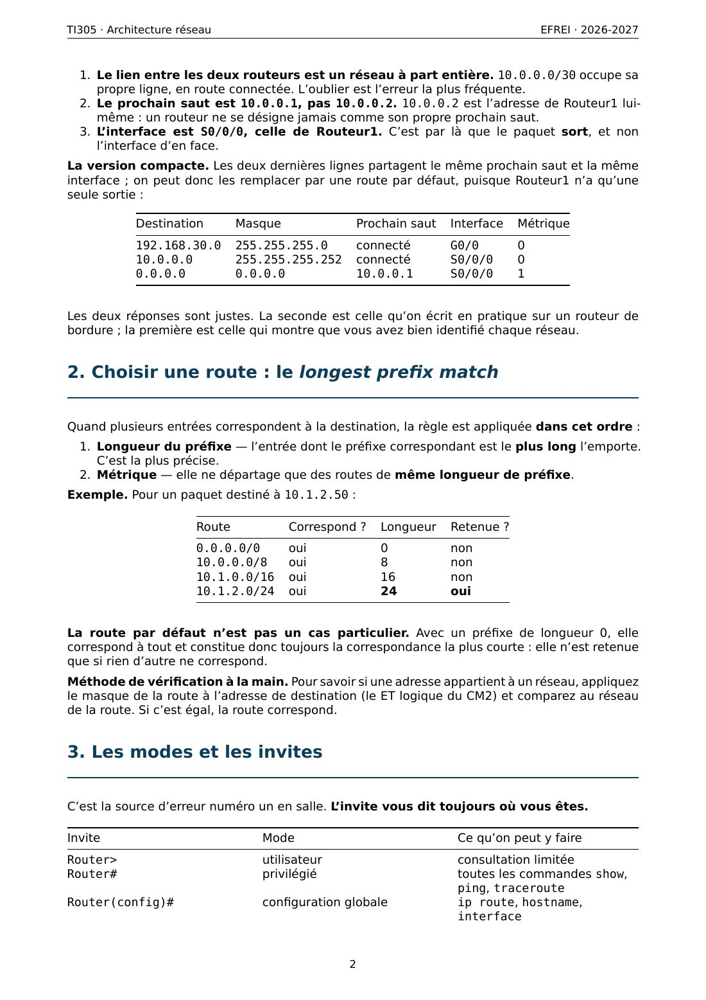{ loading=lazy .papier }](papier/ft3/p02.jpg)
    <p class="papier-legende">Fiche technique Table de routage et routes statiques, p. 2</p>

    [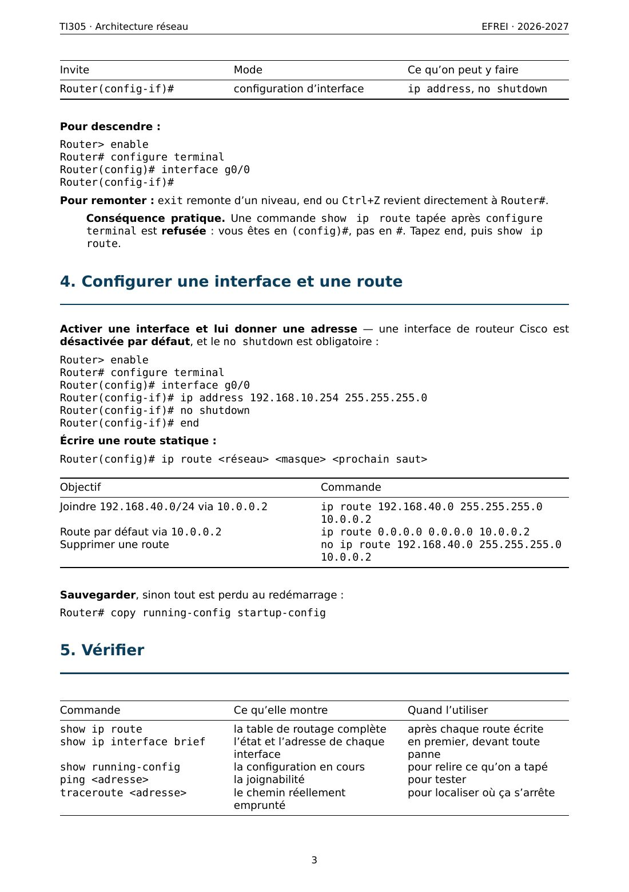{ loading=lazy .papier }](papier/ft3/p03.jpg)
    <p class="papier-legende">Fiche technique Table de routage et routes statiques, p. 3</p>

    [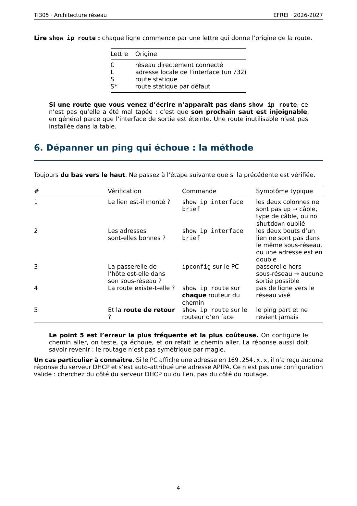{ loading=lazy .papier }](papier/ft3/p04.jpg)
    <p class="papier-legende">Fiche technique Table de routage et routes statiques, p. 4</p>
