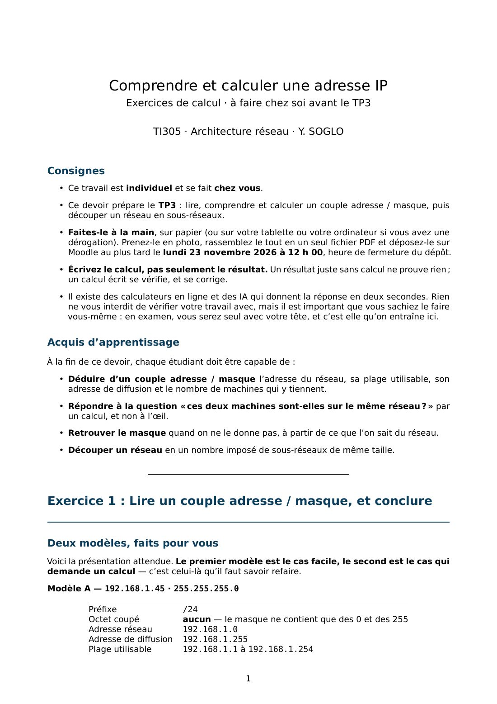
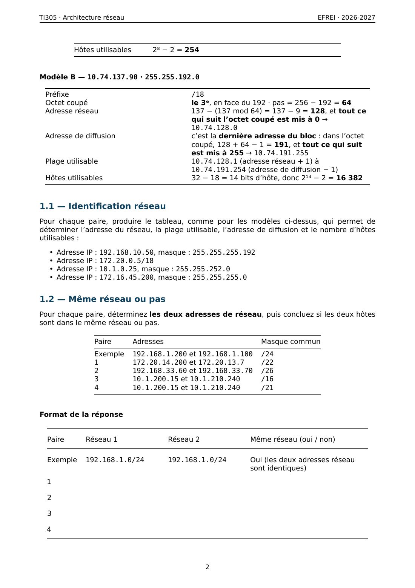
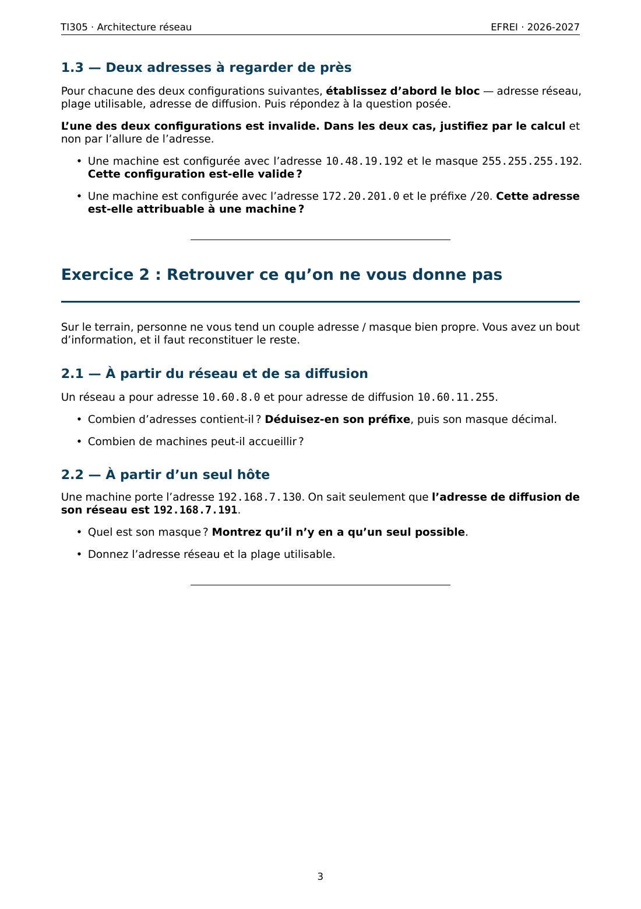
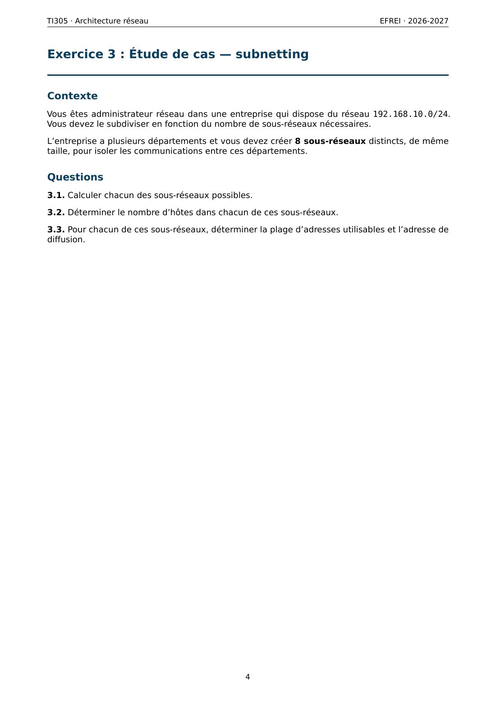

# Devoir maison — Comprendre et calculer une adresse IP

=== "Version simplifiée"

    Énoncé dans l'onglet **Version papier** (à déposer sur Moodle avant le **lundi 23 novembre
    2026, 12 h**). Rappels : [chapitre 2](../cours/chapitre-2-adressage-ip.md), méthode du pas.
    Le prof veut **le calcul écrit**, pas seulement le résultat.

    !!! methode "La méthode, à chaque fois"
        1. Repérer l'**octet coupé** (ni 0 ni 255) et calculer le **pas** = 256 − octet du masque.
        2. **Réseau** : octet − (octet mod pas) ; octets suivants à 0.
        3. **Diffusion** : réseau + pas − 1 dans l'octet coupé ; octets suivants à 255.
        4. **Plage** : réseau + 1 → diffusion − 1. **Hôtes** : $2^{32-n} - 2$.

    ## Exercice 1 — Lire un couple adresse / masque

    ### 1.1 Identification réseau

    === "192.168.10.50 / 255.255.255.192"

        | | |
        |---|---|
        | Préfixe | 255.255.255.192 → 8 + 8 + 8 + 2 = **/26** |
        | Octet coupé | le 4e, en face du 192 · pas = 256 − 192 = **64** |
        | Adresse réseau | 50 − (50 mod 64) = 50 − 50 = 0 → **192.168.10.0** |
        | Adresse de diffusion | 0 + 64 − 1 = 63 → **192.168.10.63** |
        | Plage utilisable | **192.168.10.1 à 192.168.10.62** |
        | Hôtes utilisables | 32 − 26 = 6 bits d'hôte → $2^6 - 2 =$ **62** |

    === "172.20.0.5 / 18"

        | | |
        |---|---|
        | Masque | /18 = 8 + 8 + 2 → **255.255.192.0** |
        | Octet coupé | le 3e, en face du 192 · pas = **64** |
        | Adresse réseau | 0 − (0 mod 64) = 0, 4e octet à 0 → **172.20.0.0** |
        | Adresse de diffusion | 0 + 64 − 1 = 63, 4e octet à 255 → **172.20.63.255** |
        | Plage utilisable | **172.20.0.1 à 172.20.63.254** |
        | Hôtes utilisables | 32 − 18 = 14 bits → $2^{14} - 2 =$ **16 382** |

    === "10.1.0.25 / 255.255.252.0"

        | | |
        |---|---|
        | Préfixe | 8 + 8 + 6 = **/22** (252 = `11111100`) |
        | Octet coupé | le 3e, en face du 252 · pas = 256 − 252 = **4** |
        | Adresse réseau | 0 − (0 mod 4) = 0, 4e octet à 0 → **10.1.0.0** |
        | Adresse de diffusion | 0 + 4 − 1 = 3, 4e octet à 255 → **10.1.3.255** |
        | Plage utilisable | **10.1.0.1 à 10.1.3.254** |
        | Hôtes utilisables | 10 bits → $2^{10} - 2 =$ **1 022** |

    === "172.16.45.200 / 255.255.255.0"

        | | |
        |---|---|
        | Préfixe | **/24** |
        | Octet coupé | **aucun** : le masque ne contient que des 0 et des 255 |
        | Adresse réseau | **172.16.45.0** |
        | Adresse de diffusion | **172.16.45.255** |
        | Plage utilisable | **172.16.45.1 à 172.16.45.254** |
        | Hôtes utilisables | $2^8 - 2 =$ **254** |

    ### 1.2 Même réseau ou pas

    | Paire | Calcul | Réseau 1 | Réseau 2 | Même réseau ? |
    |:-----:|--------|----------|----------|:-------------:|
    | 1 | /22 → 3e octet, pas 4 : 14 − (14 mod 4) = 12 ; 13 − (13 mod 4) = 12 | 172.20.12.0/22 | 172.20.12.0/22 | **Oui** |
    | 2 | /26 → 4e octet, pas 64 : 60 − 60 = 0 ; 70 − 6 = 64 | 192.168.33.0/26 | 192.168.33.64/26 | **Non** |
    | 3 | /16 → on garde les 2 premiers octets | 10.1.0.0/16 | 10.1.0.0/16 | **Oui** |
    | 4 | /21 → 3e octet, pas 8 : 200 − (200 mod 8) = 200 ; 210 − 2 = 208 | 10.1.200.0/21 | 10.1.208.0/21 | **Non** |

    !!! piege "Paires 3 et 4 : mêmes adresses, conclusions opposées"
        10.1.200.15 et 10.1.210.240 sont sur le même réseau en /16 mais pas en /21. C'est
        exactement « une adresse seule ne veut rien dire » : la réponse dépend du masque.
        (Et 172.20.14.200 / 172.20.13.7 sont sur le même réseau alors que le 3e octet diffère.)

    ### 1.3 Deux adresses à regarder de près

    **10.48.19.192 / 255.255.255.192 (/26)** : 4e octet coupé, pas 64 ; 192 − (192 mod 64) =
    192 − 0 = **192**. Réseau **10.48.19.192**, diffusion 192 + 63 = **10.48.19.255**, plage
    10.48.19.193 à 10.48.19.254.
    → **Configuration invalide** : 10.48.19.192 est **l'adresse du réseau lui-même**, elle n'est
    attribuable à aucune machine. (Le piège : « .192 » a l'air d'une adresse normale.)

    **172.20.201.0 / 20** : masque 255.255.240.0, 3e octet coupé, pas 16 ;
    201 − (201 mod 16) = 201 − 9 = **192**. Réseau **172.20.192.0**, diffusion 192 + 15 = 207 →
    **172.20.207.255**, plage 172.20.192.1 à 172.20.207.254.
    → **Adresse valide, attribuable** : elle est strictement entre l'adresse réseau et la
    diffusion. Finir par « .0 » ne rend pas une adresse invalide : seule compte sa position
    dans **son** bloc.

    ## Exercice 2 — Retrouver ce qu'on ne vous donne pas

    ### 2.1 À partir du réseau et de sa diffusion

    Réseau 10.60.8.0, diffusion 10.60.11.255 : le bloc couvre les 3es octets 8, 9, 10, 11, soit
    **4 × 256 = 1 024 adresses** $= 2^{10}$.

    - 10 bits d'hôte → préfixe **/22** → masque **255.255.252.0** (pas 4 dans le 3e octet).
    - Vérification d'alignement : 8 est bien multiple de 4 ✓.
    - Machines : $2^{10} - 2 =$ **1 022**.

    ### 2.2 À partir d'un seul hôte

    Hôte 192.168.7.130, diffusion 192.168.7.191. Le bloc se termine en .191, donc il commence en
    $191 + 1 - \text{taille}$, doit être **aligné** (multiple de sa taille) et doit contenir .130 :

    | Taille | Début = 192 − taille | Aligné ? | Contient .130 ? |
    |:------:|:--------------------:|:--------:|:---------------:|
    | 32 | 160 | oui | **non** (130 < 160) |
    | **64** | **128** | **oui** (128 = 2 × 64) | **oui** |
    | 128 | 64 | **non** (64 n'est pas multiple de 128) | — |
    | 256 | −64 | impossible | — |

    → **Un seul masque possible : /26 = 255.255.255.192**. Réseau **192.168.7.128**, plage
    **192.168.7.129 à 192.168.7.190**.

    ## Exercice 3 — Étude de cas : 8 sous-réseaux dans 192.168.10.0/24

    **3.1** $S = 8 \le 2^n$ → $n = 3$ bits empruntés : /24 → **/27** (255.255.255.224), pas de
    $2^5 = 32$.

    **3.2** $32 - 27 = 5$ bits d'hôte → $2^5 - 2 =$ **30 hôtes** par sous-réseau.

    **3.3**

    | SR | Réseau | Plage utilisable | Diffusion |
    |:--:|--------|------------------|-----------|
    | 1 | 192.168.10.0/27 | .1 – .30 | 192.168.10.31 |
    | 2 | 192.168.10.32/27 | .33 – .62 | 192.168.10.63 |
    | 3 | 192.168.10.64/27 | .65 – .94 | 192.168.10.95 |
    | 4 | 192.168.10.96/27 | .97 – .126 | 192.168.10.127 |
    | 5 | 192.168.10.128/27 | .129 – .158 | 192.168.10.159 |
    | 6 | 192.168.10.160/27 | .161 – .190 | 192.168.10.191 |
    | 7 | 192.168.10.192/27 | .193 – .222 | 192.168.10.223 |
    | 8 | 192.168.10.224/27 | .225 – .254 | 192.168.10.255 |

    Vérification : 8 × 32 = 256, le dernier bloc se termine bien sur la diffusion du /24 ✓.

=== "Version papier"

    Énoncé du devoir « Comprendre et calculer une adresse IP » (à faire avant le TP 3).

    [{ loading=lazy .papier }](papier/dm/p01.jpg)
    
Comprendre et calculer une adresse IP · Devoir maison — Comprendre et calculer une adresse IP, p. 1

    [{ loading=lazy .papier }](papier/dm/p02.jpg)
    
Devoir maison — Comprendre et calculer une adresse IP, p. 2

    [{ loading=lazy .papier }](papier/dm/p03.jpg)
    
Devoir maison — Comprendre et calculer une adresse IP, p. 3

    [{ loading=lazy .papier }](papier/dm/p04.jpg)
    
Devoir maison — Comprendre et calculer une adresse IP, p. 4

