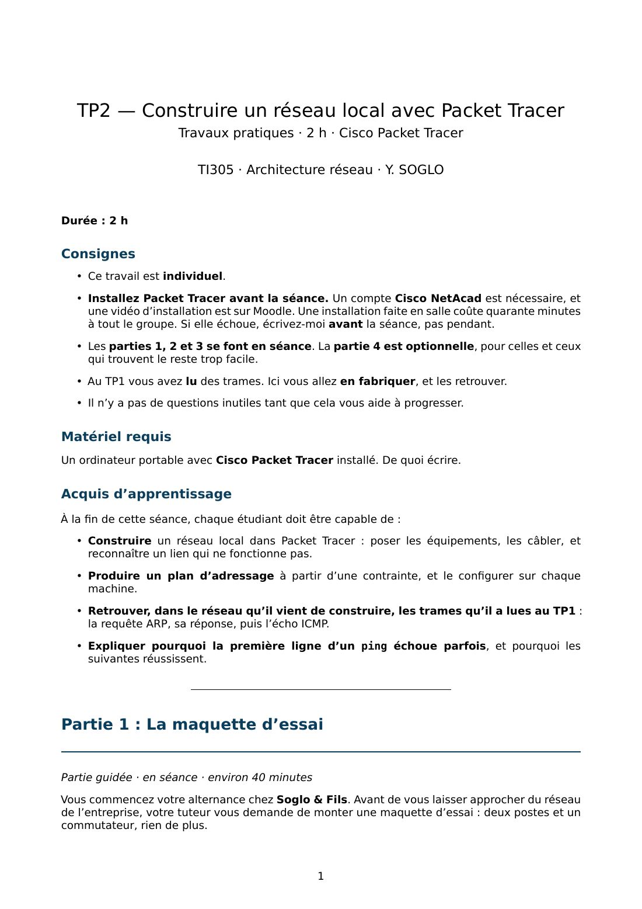
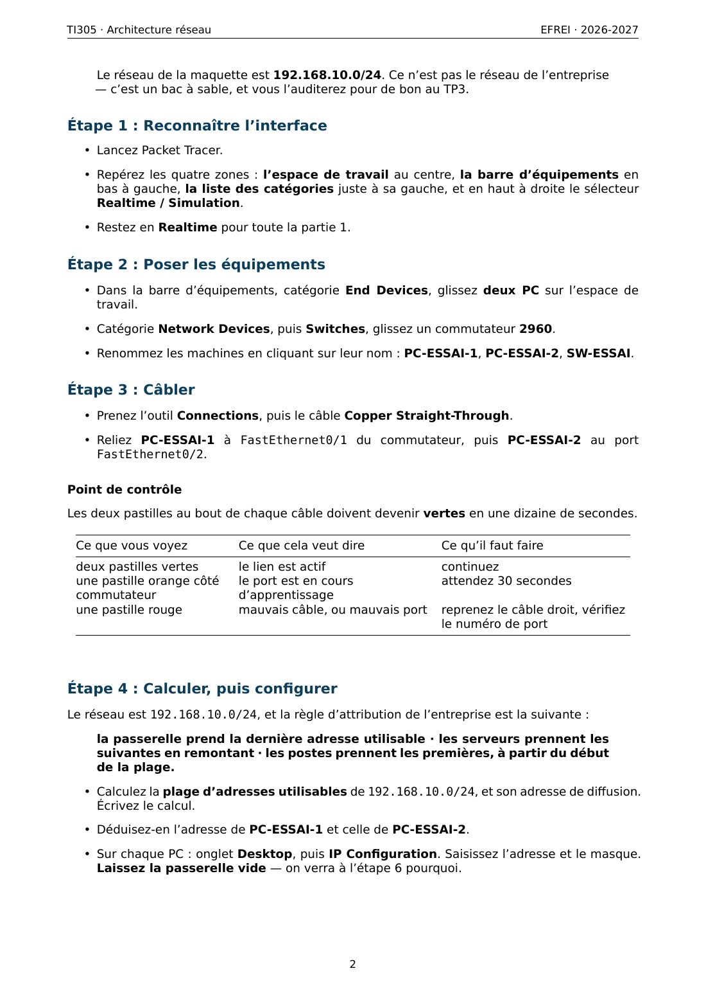
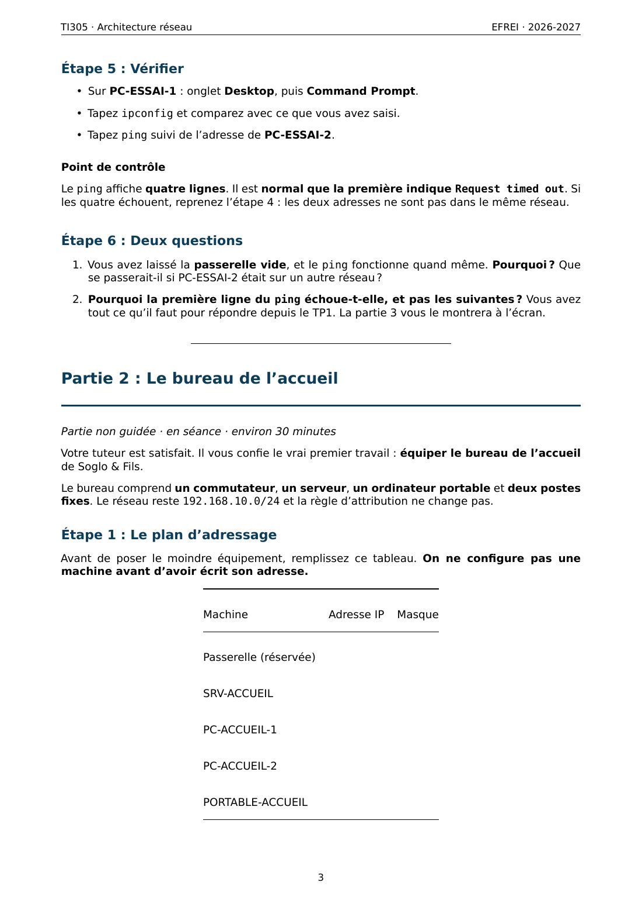
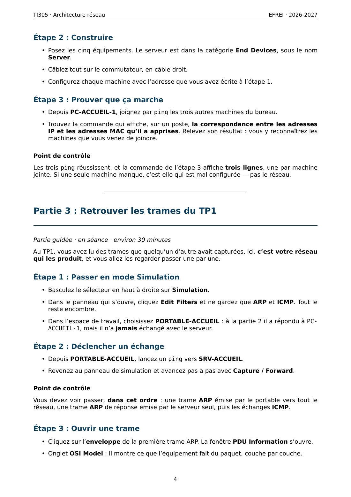
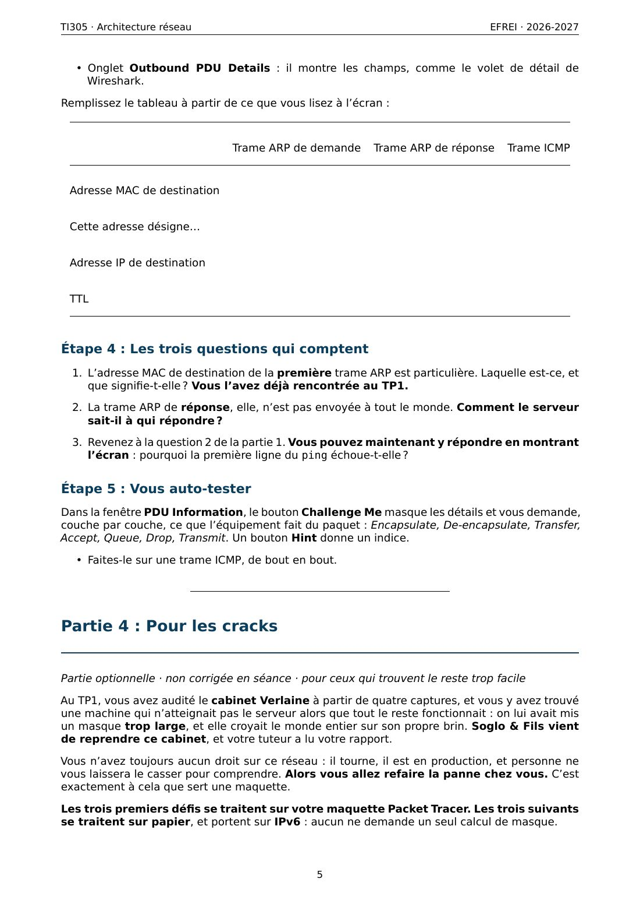
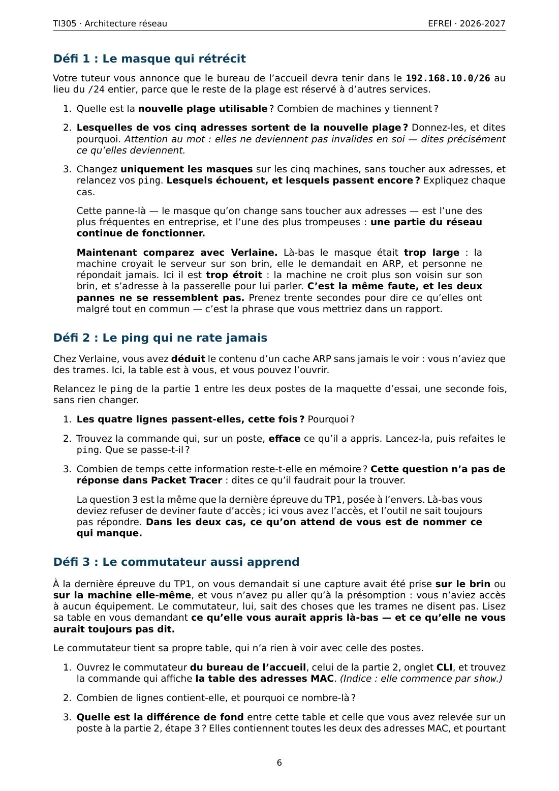
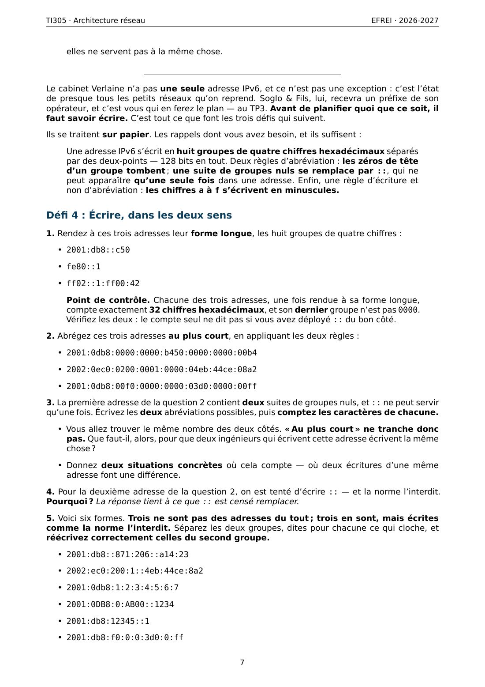
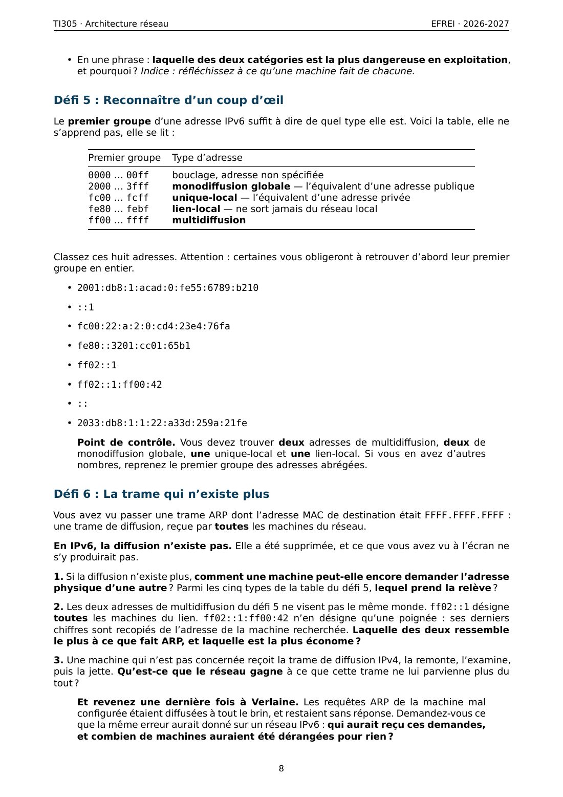

# TP 2 — Construire un réseau local avec Packet Tracer

=== "Version simplifiée"

    Énoncé dans l'onglet **Version papier**. Au TP 1 on lisait des trames ; ici on les fabrique.
    Rappels : [chapitre 1](../cours/chapitre-1-fondamentaux-modeles.md) (câbles, ARP, table MAC),
    [chapitre 2](../cours/chapitre-2-adressage-ip.md) (plage, masque, IPv6).

    !!! info "Convention d'attribution de Soglo & Fils (TP 2 et 3)"
        **Passerelle = dernière adresse utilisable** · serveurs (et imprimantes) = les suivantes
        **en remontant** · postes = les premières, à partir du début de la plage.

    ## Partie 1 — La maquette d'essai

    **Étapes 1 à 3.** Deux PC + un switch 2960, câble **Copper Straight-Through** (droit : PC et
    switch sont de nature différente) sur Fa0/1 et Fa0/2. Pastilles : vertes = lien actif ;
    orange côté switch = port en apprentissage (attendre ~30 s) ; rouge = mauvais câble ou port.

    **Étape 4.** `192.168.10.0/24` : masque 255.255.255.0, pas d'octet coupé.

    - Adresse réseau **192.168.10.0**, diffusion **192.168.10.255**.
    - Plage utilisable **192.168.10.1 → 192.168.10.254** ($2^8 - 2 = 254$ hôtes).
    - Postes à partir du début : **PC-ESSAI-1 = 192.168.10.1**, **PC-ESSAI-2 = 192.168.10.2**,
      masque 255.255.255.0 (la passerelle, réservée, serait .254).

    **Étape 5.** `ipconfig` puis `ping 192.168.10.2` : la 1re ligne peut afficher
    *Request timed out*, les suivantes répondent.

    **Étape 6 — Deux questions**

    1. **Sans passerelle, le ping marche** parce que PC-ESSAI-2 est **sur le même réseau** : le
       PC le vérifie (ET logique avec son masque), fait un **ARP direct** sur 192.168.10.2 et lui
       envoie la trame. C'est du **routage direct** ; la passerelle ne sert qu'aux destinations
       **hors** du réseau. Si PC-ESSAI-2 était sur un autre réseau, le PC n'aurait **personne à
       qui confier le paquet** : le ping échouerait (et même avec une passerelle, il faudrait un
       routeur pour relier les deux réseaux).
    2. **La 1re ligne échoue** parce qu'au premier ping, PC-ESSAI-1 ne connaît pas encore la MAC
       de PC-ESSAI-2 : il doit d'abord faire un **échange ARP**. Pendant ce temps, le premier
       paquet ICMP attend et expire (Packet Tracer le jette). Les suivants partent directement
       grâce au **cache ARP**.

    ## Partie 2 — Le bureau de l'accueil

    **Étape 1. Plan d'adressage** (même réseau 192.168.10.0/24, même règle) :

    | Machine | Adresse IP | Masque |
    |---------|------------|--------|
    | Passerelle (réservée) | 192.168.10.254 | 255.255.255.0 |
    | SRV-ACCUEIL | 192.168.10.253 | 255.255.255.0 |
    | PC-ACCUEIL-1 | 192.168.10.1 | 255.255.255.0 |
    | PC-ACCUEIL-2 | 192.168.10.2 | 255.255.255.0 |
    | PORTABLE-ACCUEIL | 192.168.10.3 | 255.255.255.0 |

    **Étape 2.** Tout en câble droit sur le switch ; le serveur est *End Devices > Server*.

    **Étape 3.** Depuis PC-ACCUEIL-1 : `ping` vers .2, .3 et .253. La commande qui affiche la
    correspondance IP ↔ MAC apprise est **`arp -a`** : elle montre **trois lignes**, une par
    machine jointe (IP, MAC, type *dynamic*). Si une machine manque, c'est **elle** qui est mal
    configurée.

    ## Partie 3 — Retrouver les trames du TP 1

    Mode **Simulation**, filtres **ARP** et **ICMP**, ping de PORTABLE-ACCUEIL vers SRV-ACCUEIL
    (ils n'ont jamais échangé, donc pas de cache ARP). Ordre attendu : ARP émis par le portable
    vers tout le réseau → ARP de réponse du serveur seul → ICMP.

    | | Trame ARP de demande | Trame ARP de réponse | Trame ICMP (echo request) |
    |---|---|---|---|
    | MAC de destination | `FFFF.FFFF.FFFF` | MAC du portable | MAC du serveur |
    | Cette adresse désigne… | **tout le réseau local** (broadcast) | **le portable seul** (unicast) | le serveur seul |
    | IP de destination | (dans le message ARP : IP cible **192.168.10.253**) | (IP cible 192.168.10.3) | 192.168.10.253 |
    | TTL | **aucun** : ARP n'a pas d'en-tête IP | aucun | 128 (valeur de départ d'un PC Packet Tracer) |

    **Étape 4 — Les trois questions qui comptent**

    1. `FFFF.FFFF.FFFF` (écrite `ff:ff:ff:ff:ff:ff` dans Wireshark) : l'adresse de **diffusion**.
       La trame est reçue par **toutes** les machines du réseau local (le switch l'inonde sur
       tous ses ports). C'est la seule façon de joindre une machine dont on ignore la MAC.
    2. Le serveur répond **en unicast** parce que la requête contient la **MAC (et l'IP) de
       l'émetteur** : il lit « qui a 192.168.10.253 ? dit 192.168.10.3 (MAC …) » et répond
       directement à cette MAC. (Au passage, il mémorise le portable dans son propre cache ARP.)
    3. On le voit à l'écran : avant le premier ICMP, il faut **l'aller-retour ARP**. Le premier
       paquet ICMP attend cette résolution et expire ; une fois la MAC en cache, les suivants passent.

    **Étape 5.** *Challenge Me* sur une trame ICMP : côté émetteur **Encapsulate** puis
    **Transmit** ; le switch **Transfer** (il commute sur le bon port) ; côté serveur
    **De-encapsulate** puis **Accept** ; et l'inverse pour la réponse.

    ## Partie 4 — Pour les cracks

    ### Défi 1 — Le masque qui rétrécit (/26)

    1. `192.168.10.0/26` : pas 64 → plage **192.168.10.1 → .62**, diffusion .63, **62 machines**.
    2. Sortent de la plage : **192.168.10.253 (SRV-ACCUEIL)** et **192.168.10.254 (la
       passerelle)**. Elles ne deviennent pas invalides : elles deviennent des adresses **d'un
       autre sous-réseau**, `192.168.10.192/26` (.193 → .254). Les PC .1, .2, .3 restent dans .0/26.
    3. Masques changés, adresses inchangées :
        - **PC ↔ PC** (.1, .2, .3) : **passent** (même /26 de part et d'autre).
        - **PC → serveur** : **échouent**. Le PC calcule que .253 n'est pas dans son /26 et
          envoie le paquet à sa passerelle… qui n'est pas non plus dans son /26 (et aucun routeur
          n'existe) : rien ne part vers le serveur.
        - **Serveur → PC** : **échouent** pour la même raison, vu du serveur (son /26 est .192/26).

    !!! tip "Ce que Verlaine et ce défi ont en commun (la phrase du rapport)"
        Dans les deux cas, **un hôte décide seul, avec son propre masque, qui est sur son réseau
        local** : un masque faux lui fait prendre la mauvaise décision (ARP direct sur une
        machine distante quand il est trop large, passage par une passerelle quand il est trop
        étroit), et la panne ne touche que **certaines** destinations.

    ### Défi 2 — Le ping qui ne rate jamais

    1. Au second ping, **les quatre lignes passent** : la MAC du voisin est dans le **cache
       ARP**, aucun échange ARP n'est nécessaire.
    2. **`arp -d`** efface le cache ; le ping suivant perd de nouveau sa 1re ligne (le cycle ARP
       recommence).
    3. Durée de vie d'une entrée : Packet Tracer ne la donne pas. Il faudrait la **documentation
       ou la configuration du système** réel (paramètre de temporisation ARP de l'OS ; sur un
       routeur Cisco, `arp timeout` dans la config d'interface, 4 h par défaut), ou la mesurer en
       observant à quel moment l'entrée disparaît.

    ### Défi 3 — Le commutateur aussi apprend

    1. CLI du switch, mode privilégié : **`show mac address-table`**.
    2. Une ligne par MAC apprise, avec son port : autant de lignes que de machines **ayant
       émis** une trame depuis le démarrage (ici les 4 machines du bureau, soit **4 lignes**, s'ils
       ont tous parlé). La table se construit sur la **MAC source**.
    3. Différence de fond : la table du switch associe **MAC → port** (couche 2, elle sert à
       **commuter**) ; le cache ARP d'un poste associe **IP → MAC** (couche 3 → 2, il sert à
       **fabriquer la trame**). Pour Verlaine, la table MAC aurait dit **sur quel port** se trouve
       une machine ; elle n'aurait toujours pas dit **où la capture a été prise**.

    ### Défi 4 — IPv6 : écrire, dans les deux sens

    **1. Forme longue**

    | Abrégée | Forme longue |
    |---------|--------------|
    | `2001:db8::c50` | `2001:0db8:0000:0000:0000:0000:0000:0c50` |
    | `fe80::1` | `fe80:0000:0000:0000:0000:0000:0000:0001` |
    | `ff02::1:ff00:42` | `ff02:0000:0000:0000:0000:0001:ff00:0042` |

    Méthode : compter les groupes présents (2, 2, 4), le `::` remplace les manquants (6, 6, 4).

    **2. Au plus court**

    | Longue | Courte |
    |--------|--------|
    | `2001:0db8:0000:0000:b450:0000:0000:00b4` | `2001:db8::b450:0:0:b4` |
    | `2002:0ec0:0200:0001:0000:04eb:44ce:08a2` | `2002:ec0:200:1:0:4eb:44ce:8a2` |
    | `2001:0db8:00f0:0000:0000:03d0:0000:00ff` | `2001:db8:f0::3d0:0:ff` |

    **3.** Deux écritures pour la première : `2001:db8::b450:0:0:b4` et `2001:db8:0:0:b450::b4`,
    **21 caractères** chacune. Il faut une **forme canonique** commune : la RFC 5952 tranche
    (`::` sur la suite de zéros la **plus longue**, et à égalité **la première**), d'où
    `2001:db8::b450:0:0:b4`. Ça compte dès qu'on **compare des chaînes** : rechercher une adresse
    dans des journaux (`grep`), comparer deux fichiers de configuration ou des règles de pare-feu,
    des enregistrements DNS, des certificats, ou un script qui teste l'égalité de deux adresses.

    **4.** Pour la deuxième, il n'y a **qu'un seul** groupe nul : `::` sert à remplacer une
    **suite** de groupes nuls ; la norme (RFC 5952) interdit de l'employer pour un groupe seul,
    qui s'écrit simplement `0` (aucun gain : `0` fait 1 caractère, `::` en fait 2).

    **5.**

    | Forme | Catégorie | Problème | Correction |
    |-------|-----------|----------|------------|
    | `2001:db8::871:206::a14:23` | **pas une adresse** | deux `::` : ambigu | — |
    | `2002:ec0:200:1::4eb:44ce:8a2` | adresse mal écrite | `::` pour un seul groupe | `2002:ec0:200:1:0:4eb:44ce:8a2` |
    | `2001:0db8:1:2:3:4:5:6:7` | **pas une adresse** | 9 groupes (144 bits) | — |
    | `2001:0DB8:0:AB00::1234` | adresse mal écrite | majuscules, zéro de tête | `2001:db8:0:ab00::1234` |
    | `2001:db8:12345::1` | **pas une adresse** | groupe de 5 chiffres (> 16 bits) | — |
    | `2001:db8:f0:0:0:3d0:0:ff` | adresse mal écrite | pas abrégée au plus court | `2001:db8:f0::3d0:0:ff` |

    La catégorie la plus dangereuse est celle des **adresses valides mal écrites** : une machine
    les **accepte sans rien dire**, alors qu'une forme invalide est rejetée tout de suite. L'erreur
    se cache donc jusqu'au jour où une comparaison de chaînes (recherche, règle, script) échoue.

    ### Défi 5 — Reconnaître d'un coup d'œil

    | Adresse | 1er groupe | Type |
    |---------|:----------:|------|
    | `2001:db8:1:acad:0:fe55:6789:b210` | 2001 | monodiffusion globale |
    | `::1` | 0000 | bouclage |
    | `fc00:22:a:2:0:cd4:23e4:76fa` | fc00 | unique-local |
    | `fe80::3201:cc01:65b1` | fe80 | lien-local |
    | `ff02::1` | ff02 | multidiffusion |
    | `ff02::1:ff00:42` | ff02 | multidiffusion |
    | `::` | 0000 | adresse non spécifiée |
    | `2033:db8:1:1:22:a33d:259a:21fe` | 2033 | monodiffusion globale |

    Bilan conforme au point de contrôle : 2 multidiffusion, 2 globales, 1 unique-local, 1
    lien-local (plus le bouclage et la non spécifiée).

    ### Défi 6 — La trame qui n'existe plus

    1. C'est la **multidiffusion** qui prend la relève (protocole *Neighbor Discovery*, qui
       remplace ARP).
    2. `ff02::1` (toutes les machines du lien) **ressemble le plus à ARP** : c'est un broadcast
       déguisé. `ff02::1:ff00:42` (adresse multicast « sollicitée », dont les derniers chiffres
       sont recopiés de l'adresse cherchée) est **la plus économe** : seules les quelques machines
       dont l'adresse finit pareil la reçoivent.
    3. Les machines non concernées n'ont plus à **remonter, examiner puis jeter** la trame : leur
       carte réseau filtre le multicast qui ne les concerne pas, sans interrompre le processeur.
       Moins de charge CPU, moins de bruit sur le lien.

    Verlaine en IPv6 : les demandes du poste mal configuré seraient parties vers l'adresse
    sollicitée du serveur. Sur le brin des postes, **aucune machine** (ou presque) n'appartient
    à ce groupe : personne n'aurait été dérangé, au lieu de **tout le brin** en IPv4.

=== "Version papier"

    Énoncé du TP 2.

    [{ loading=lazy .papier }](papier/tp2/p01.jpg)
    
TP2 — Construire un réseau local avec Packet Tracer · TP 2 — Construire un réseau local avec Packet Tracer, p. 1

    [{ loading=lazy .papier }](papier/tp2/p02.jpg)
    
TP 2 — Construire un réseau local avec Packet Tracer, p. 2

    [{ loading=lazy .papier }](papier/tp2/p03.jpg)
    
TP 2 — Construire un réseau local avec Packet Tracer, p. 3

    [{ loading=lazy .papier }](papier/tp2/p04.jpg)
    
TP 2 — Construire un réseau local avec Packet Tracer, p. 4

    [{ loading=lazy .papier }](papier/tp2/p05.jpg)
    
TP 2 — Construire un réseau local avec Packet Tracer, p. 5

    [{ loading=lazy .papier }](papier/tp2/p06.jpg)
    
TP 2 — Construire un réseau local avec Packet Tracer, p. 6

    [{ loading=lazy .papier }](papier/tp2/p07.jpg)
    
TP 2 — Construire un réseau local avec Packet Tracer, p. 7

    [{ loading=lazy .papier }](papier/tp2/p08.jpg)
    
TP 2 — Construire un réseau local avec Packet Tracer, p. 8

