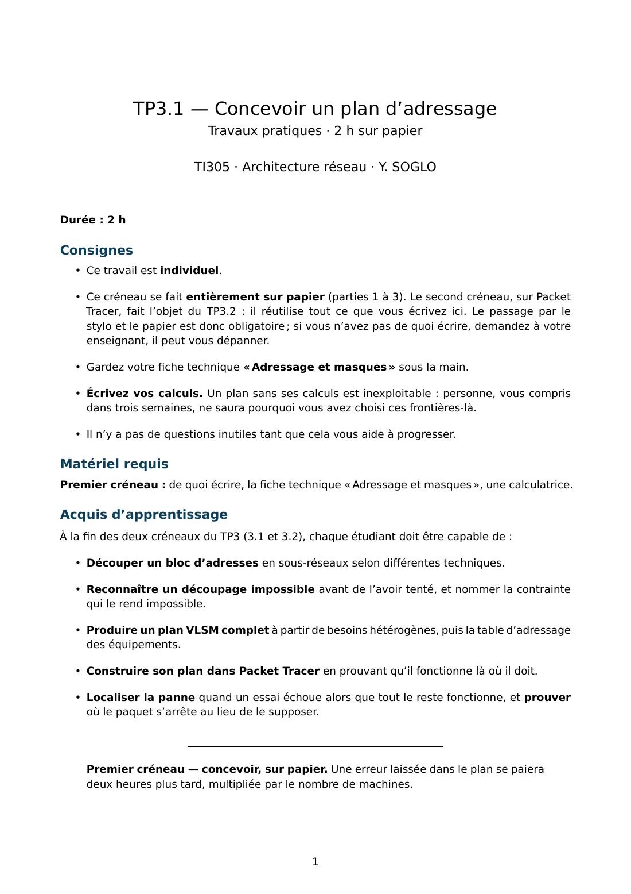
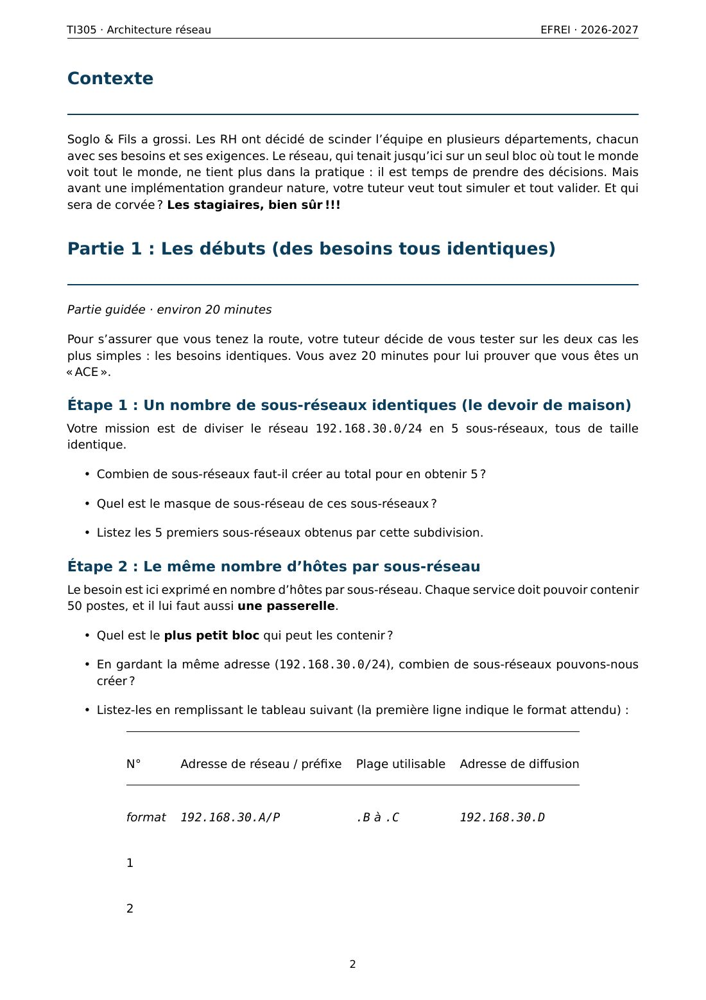
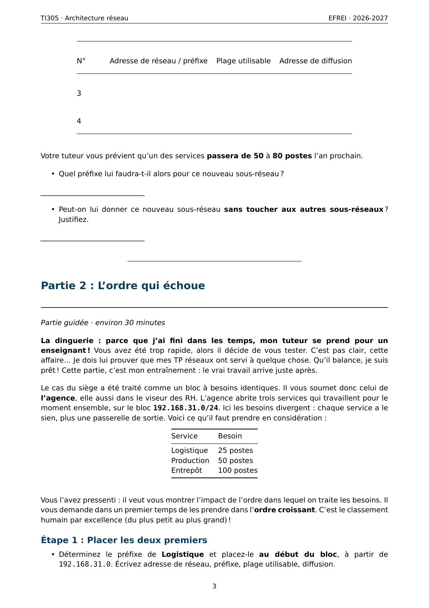
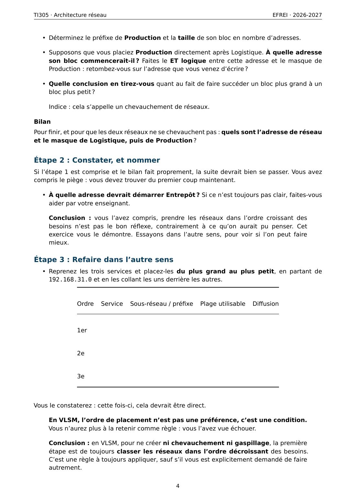
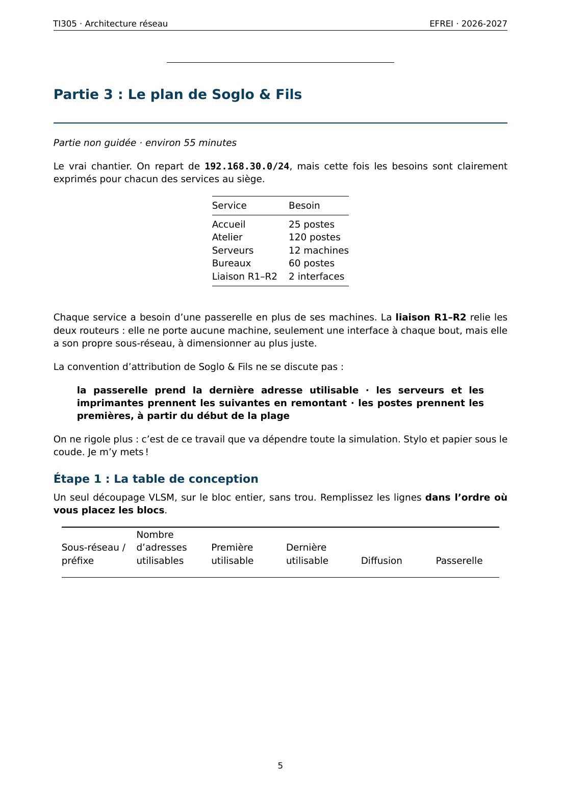
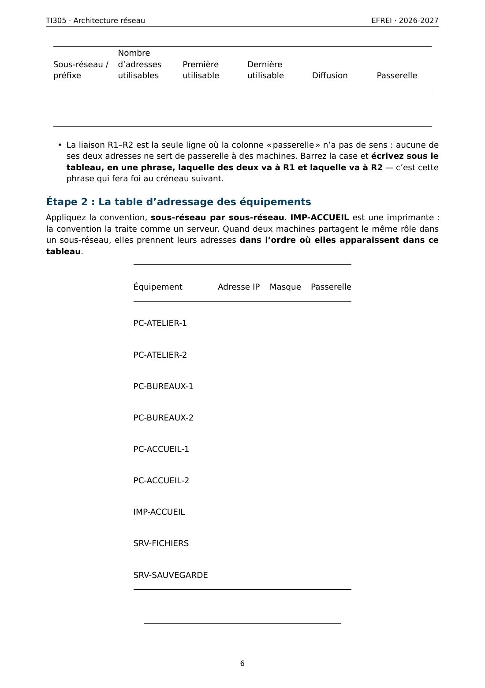
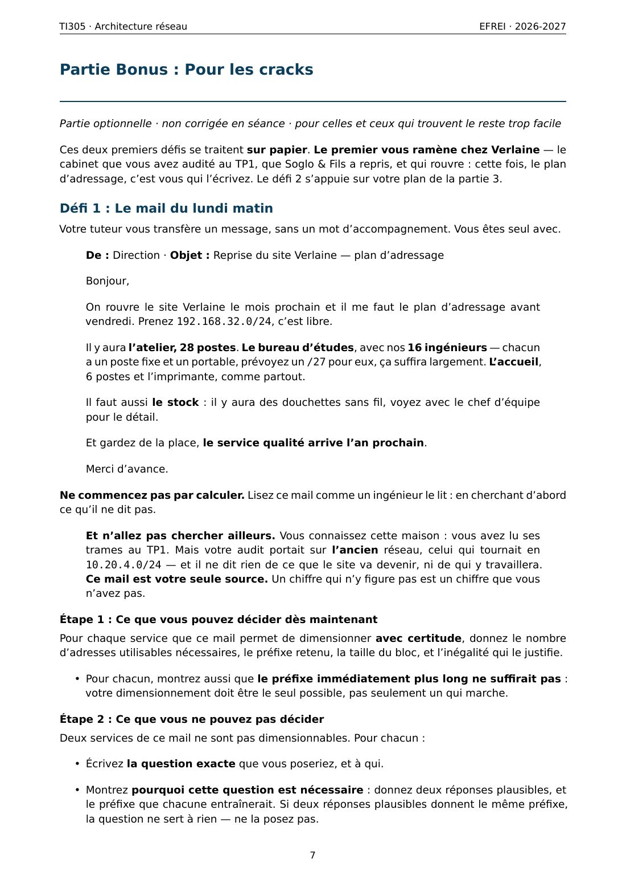
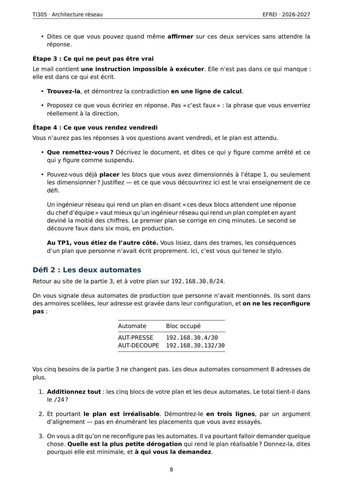
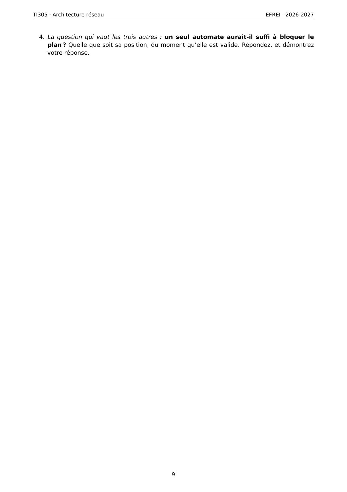

# TP 3.1 — Concevoir un plan d'adressage (sur papier)

=== "Version simplifiée"

    Énoncé dans l'onglet **Version papier**. Rappels : [chapitre 2](../cours/chapitre-2-adressage-ip.md)
    (découpage, VLSM, règle d'alignement) et la convention de Soglo & Fils : **passerelle =
    dernière utilisable**, serveurs et imprimantes = les suivantes en remontant, postes = les
    premières.

    !!! piege "Chaque service a besoin d'une passerelle en plus"
        « 50 postes » = **51** adresses ; « 12 machines » = **13**. La liaison R1–R2 : **2**.

    ## Partie 1 — Les débuts (besoins identiques)

    ### Étape 1 : 5 sous-réseaux identiques dans 192.168.30.0/24

    - $S = 5 \le 2^n$ → $2^2 = 4 < 5 \le 8 = 2^3$ → **8 sous-réseaux** à créer ($n = 3$ bits empruntés).
    - Masque : /24 + 3 = **/27 = 255.255.255.224**, pas de 32 (30 hôtes chacun).
    - Les 5 premiers : **192.168.30.0/27, .32/27, .64/27, .96/27, .128/27**.

    ### Étape 2 : 50 postes + passerelle par sous-réseau

    - Besoin : 51 ≤ $2^n - 2$ → $2^5 - 2 = 30 < 51 \le 62 = 2^6 - 2$ → $n = 6$ : plus petit bloc
      **/26** (64 adresses, 62 utilisables).
    - Dans le /24 : $2^{26-24} = $ **4 sous-réseaux**.

    | N° | Adresse de réseau / préfixe | Plage utilisable | Diffusion |
    |:--:|-----------------------------|------------------|-----------|
    | 1 | 192.168.30.0/26 | .1 à .62 | 192.168.30.63 |
    | 2 | 192.168.30.64/26 | .65 à .126 | 192.168.30.127 |
    | 3 | 192.168.30.128/26 | .129 à .190 | 192.168.30.191 |
    | 4 | 192.168.30.192/26 | .193 à .254 | 192.168.30.255 |

    **Un service passe à 80 postes** : 81 adresses → $2^6 - 2 = 62 < 81 \le 126$ → **/25**.

    **Sans toucher aux autres ? Non.** Un /25 fait 128 adresses et doit commencer à un multiple
    de 128 (.0 ou .128) : il recouvre forcément **deux** /26 (.0 + .64, ou .128 + .192). Les
    quatre /26 étant occupés, le service ne peut grandir qu'en **déplaçant (renumérotant) son
    voisin**. Dans un découpage à taille fixe sans réserve, aucun bloc ne peut grandir sur place.

    ## Partie 2 — L'ordre qui échoue (agence, 192.168.31.0/24)

    | Service | Besoin + passerelle | $n$ | Préfixe | Bloc |
    |---------|:-------------------:|:---:|:-------:|:----:|
    | Logistique | 25 + 1 = 26 | 5 | /27 | 32 |
    | Production | 50 + 1 = 51 | 6 | /26 | 64 |
    | Entrepôt | 100 + 1 = 101 | 7 | /25 | 128 |

    ### Étape 1 : ordre croissant

    - **Logistique** au début : **192.168.31.0/27**, plage .1 à .30, diffusion .31.
    - **Production** : /26, bloc de **64** adresses.
    - Juste après Logistique, Production commencerait en **192.168.31.32**. ET logique avec
      255.255.255.192 : 32 = `00100000`, 192 = `11000000` → `00000000` = **.0**. On ne retombe
      **pas** sur .32 : .32 n'est pas une adresse de réseau /26 (32 n'est pas multiple de 64). Le
      bloc /26 qui contient .32 est .0/26, qui **chevauche** Logistique.
    - Conclusion : **un bloc plus grand ne peut pas suivre directement un bloc plus petit** ; il
      doit sauter jusqu'au multiple suivant de sa taille (chevauchement sinon).

    **Bilan** : Logistique **192.168.31.0/27** (255.255.255.224), Production
    **192.168.31.64/26** (255.255.255.192) ; les adresses .32 à .63 sont perdues (trou).

    ### Étape 2 : où démarre Entrepôt ?

    /25 → début à .0 ou .128 ; .0 est pris → **192.168.31.128/25** (.129 à .254, diffusion .255).
    Ça tient ici, mais au prix d'un **trou de 32 adresses** : avec des besoins un peu plus gros,
    l'ordre croissant ne tiendrait plus du tout.

    ### Étape 3 : ordre décroissant

    | Ordre | Service | Sous-réseau / préfixe | Plage utilisable | Diffusion |
    |:-----:|---------|-----------------------|------------------|-----------|
    | 1er | Entrepôt | 192.168.31.0/25 | .1 à .126 | 192.168.31.127 |
    | 2e | Production | 192.168.31.128/26 | .129 à .190 | 192.168.31.191 |
    | 3e | Logistique | 192.168.31.192/27 | .193 à .222 | 192.168.31.223 |

    Chaque bloc commence naturellement à un multiple de sa taille (0, 128, 192), sans trou ;
    .224 à .255 restent libres d'un seul tenant. **En VLSM, trier par ordre décroissant est une
    condition, pas une préférence.**

    ## Partie 3 — Le plan de Soglo & Fils (192.168.30.0/24)

    Besoins triés par ordre décroissant (passerelle comprise) :

    | Service | Besoin | + passerelle | Inégalité | Préfixe | Bloc |
    |---------|:------:|:------------:|-----------|:-------:|:----:|
    | Atelier | 120 | 121 | $62 < 121 \le 126 = 2^7 - 2$ | /25 | 128 |
    | Bureaux | 60 | 61 | $30 < 61 \le 62 = 2^6 - 2$ | /26 | 64 |
    | Accueil | 25 | 26 | $14 < 26 \le 30 = 2^5 - 2$ | /27 | 32 |
    | Serveurs | 12 | 13 | $6 < 13 \le 14 = 2^4 - 2$ | /28 | 16 |
    | Liaison R1–R2 | 2 | — | $2 \le 2 = 2^2 - 2$ | /30 | 4 |

    Total : 128 + 64 + 32 + 16 + 4 = **244** adresses sur 256.

    ### Étape 1 : table de conception

    | Sous-réseau / préfixe | Adresses utilisables | Première utilisable | Dernière utilisable | Diffusion | Passerelle |
    |-----------------------|:--------------------:|---------------------|---------------------|-----------|------------|
    | **Atelier** 192.168.30.0/25 | 126 | 192.168.30.1 | 192.168.30.126 | 192.168.30.127 | 192.168.30.126 |
    | **Bureaux** 192.168.30.128/26 | 62 | 192.168.30.129 | 192.168.30.190 | 192.168.30.191 | 192.168.30.190 |
    | **Accueil** 192.168.30.192/27 | 30 | 192.168.30.193 | 192.168.30.222 | 192.168.30.223 | 192.168.30.222 |
    | **Serveurs** 192.168.30.224/28 | 14 | 192.168.30.225 | 192.168.30.238 | 192.168.30.239 | 192.168.30.238 |
    | **Liaison R1–R2** 192.168.30.240/30 | 2 | 192.168.30.241 | 192.168.30.242 | 192.168.30.243 | ~~—~~ |

    Alignement : 0 multiple de 128 ✓, 128 de 64 ✓, 192 de 32 ✓, 224 de 16 ✓, 240 de 4 ✓.
    Restent libres : .244 à .255.

    > **Liaison** : **192.168.30.241 va à R1** (G0/2), **192.168.30.242 va à R2** (G0/2).

    ### Étape 2 : table d'adressage des équipements

    | Équipement | Adresse IP | Masque | Passerelle |
    |------------|------------|--------|------------|
    | PC-ATELIER-1 | 192.168.30.1 | 255.255.255.128 | 192.168.30.126 |
    | PC-ATELIER-2 | 192.168.30.2 | 255.255.255.128 | 192.168.30.126 |
    | PC-BUREAUX-1 | 192.168.30.129 | 255.255.255.192 | 192.168.30.190 |
    | PC-BUREAUX-2 | 192.168.30.130 | 255.255.255.192 | 192.168.30.190 |
    | PC-ACCUEIL-1 | 192.168.30.193 | 255.255.255.224 | 192.168.30.222 |
    | PC-ACCUEIL-2 | 192.168.30.194 | 255.255.255.224 | 192.168.30.222 |
    | IMP-ACCUEIL | 192.168.30.221 | 255.255.255.224 | 192.168.30.222 |
    | SRV-FICHIERS | 192.168.30.237 | 255.255.255.240 | 192.168.30.238 |
    | SRV-SAUVEGARDE | 192.168.30.236 | 255.255.255.240 | 192.168.30.238 |

    L'imprimante est traitée comme un serveur : première adresse sous la passerelle (.221).
    Les deux serveurs prennent leurs adresses dans l'ordre du tableau : .237 puis .236.

    !!! methode "Vérification écrite (les 5 contrôles)"
        1. **Alignement** : vérifié ligne par ligne ci-dessus.
        2. **Capacité** : 126 ≥ 121, 62 ≥ 61, 30 ≥ 26, 14 ≥ 13, 2 ≥ 2 ; et le préfixe plus long
           ne suffirait jamais (62 < 121, 30 < 61, 14 < 26, 6 < 13).
        3. **Chevauchement** : .127 < .128, .191 < .192, .223 < .224, .239 < .240.
        4. **Appartenance** : dernière adresse utilisée .243 ≤ .255.
        5. **Liaison** : la liaison R1–R2 a son propre /30, distinct des réseaux d'hôtes.

    ## Partie bonus — Pour les cracks

    ### Défi 1 — Le mail du lundi matin (Verlaine, 192.168.32.0/24)

    **Étape 1 — Ce qu'on peut décider maintenant**

    | Service | Adresses nécessaires | Préfixe | Bloc | Justification | Le préfixe plus long ne suffit pas |
    |---------|:--------------------:|:-------:|:----:|---------------|------------------------------------|
    | Atelier | 28 postes + passerelle = **29** | /27 | 32 | $29 \le 2^5 - 2 = 30$ | /28 : $14 < 29$ |
    | Bureau d'études | 16 ingénieurs × 2 (fixe + portable) + passerelle = **33** | /26 | 64 | $33 \le 2^6 - 2 = 62$ | /27 : $30 < 33$ |
    | Accueil | 6 postes + imprimante + passerelle = **8** | /28 | 16 | $8 \le 2^4 - 2 = 14$ | /29 : $6 < 8$ |

    **Étape 2 — Ce qu'on ne peut pas décider**

    - **Le stock** : « des douchettes sans fil, voyez avec le chef d'équipe ». Question au **chef
      d'équipe du stock** : *« Combien de douchettes (et d'autres équipements réseau : bornes Wi-Fi,
      imprimantes d'étiquettes, poste) seront raccordés au stock, y compris les douchettes de
      rechange ? »* Utile car deux réponses plausibles changent le préfixe : 10 appareils → 11
      adresses → /28 ; 20 appareils → 21 → /27.
    - **Le service qualité** (arrive l'an prochain) : question à la **direction** : *« Combien de
      postes et d'équipements le service qualité aura-t-il à son arrivée, et à trois ans ? »* :
      5 postes → /29 ; 40 postes → /26.
    - Ce qu'on peut affirmer sans attendre : chacun aura **son propre sous-réseau** avec une
      passerelle, et ils devront tenir
      dans ce qui reste : 256 − (64 + 32 + 16) = **144 adresses**.

    **Étape 3 — Ce qui ne peut pas être vrai**

    « Prévoyez un /27 pour eux, ça suffira largement » : **16 × 2 + 1 = 33 > 30 = 2^5 − 2**. Un
    /27 ne loge pas le bureau d'études. Réponse à envoyer :

    > *« Pour le bureau d'études, 16 ingénieurs avec chacun un poste fixe et un portable, plus la
    > passerelle, font 33 adresses ; un /27 n'en offre que 30. Je prévois donc un /26 (62
    > adresses), ce qui laisse aussi de la marge pour de nouveaux arrivants. Si l'un des deux
    > appareils ne se connecte pas au réseau filaire, merci de me le préciser. »*

    **Étape 4 — Ce qu'on rend vendredi**

    Un plan avec les **blocs arrêtés** (Atelier /27, Bureau d'études /26, Accueil /28, avec
    leurs calculs) et les **blocs suspendus** (Stock, Qualité) marqués « en attente de réponse »,
    avec la question posée et à qui.

    **On peut les dimensionner, pas les placer.** Le VLSM place **du plus grand au plus petit** :
    tant qu'on ignore la taille du stock et de la qualité, on ne sait pas s'ils passeront avant ou
    après les blocs connus (un stock de 60 douchettes serait un /25, à placer en premier). Placer
    maintenant risque de rendre le plan impossible à compléter sans tout renuméroter.

    ### Défi 2 — Les deux automates

    1. Total : 244 (plan de la partie 3) + 2 × 4 = **252 ≤ 256** : le compte tient.
    2. **Irréalisable** : l'Atelier est un /25, donc il doit occuper **.0–.127 ou .128–.255**. Or
       AUT-PRESSE (.4/30) est dans la première moitié et AUT-DECOUPE (.132/30) dans la seconde.
       Aucune moitié n'est libre → pas de place pour l'Atelier.
    3. **Plus petite dérogation** : **renuméroter un seul automate** (un seul /30), et le mettre
       dans la même moitié et le même /28 que l'autre. Exemple : AUT-DECOUPE déplacé en
       **192.168.30.8/30** (ou .0/30, .12/30). Le plan devient : Atelier .128/25, Bureaux .64/26,
       Accueil .32/27, Serveurs .16/28, et dans .0/28 : AUT-PRESSE .4/30, AUT-DECOUPE .8/30,
       liaison .12/30 (ou .0/30). Minimale car on ne peut pas faire moins que toucher **un**
       automate, et un seul suffit. À demander au **responsable de la production / maintenance
       des automates** (celui qui peut rouvrir l'armoire et changer la configuration).
    4. **Non, un seul automate ne bloque jamais le plan**, quelle que soit sa position valide
       (un /30 aligné). Démonstration par moitiés successives : l'automate est dans une moitié
       de 128 → l'Atelier prend l'autre. Dans sa moitié, il est dans un quart de 64 → les Bureaux
       prennent l'autre quart. Dans son quart, il est dans un huitième de 32 → l'Accueil prend
       l'autre. Dans son huitième, il est dans un /28 de 16 → les Serveurs prennent l'autre.
       Dans son /28 restent trois /30 libres : la liaison en prend un. ∎

=== "Version papier"

    Énoncé du TP 3.1.

    [{ loading=lazy .papier }](papier/tp3-1/p01.jpg)
    
TP3.1 — Concevoir un plan d’adressage · TP 3.1 — Concevoir un plan d'adressage, p. 1

    [{ loading=lazy .papier }](papier/tp3-1/p02.jpg)
    
TP 3.1 — Concevoir un plan d'adressage, p. 2

    [{ loading=lazy .papier }](papier/tp3-1/p03.jpg)
    
TP 3.1 — Concevoir un plan d'adressage, p. 3

    [{ loading=lazy .papier }](papier/tp3-1/p04.jpg)
    
TP 3.1 — Concevoir un plan d'adressage, p. 4

    [{ loading=lazy .papier }](papier/tp3-1/p05.jpg)
    
TP 3.1 — Concevoir un plan d'adressage, p. 5

    [{ loading=lazy .papier }](papier/tp3-1/p06.jpg)
    
TP 3.1 — Concevoir un plan d'adressage, p. 6

    [{ loading=lazy .papier }](papier/tp3-1/p07.jpg)
    
TP 3.1 — Concevoir un plan d'adressage, p. 7

    [{ loading=lazy .papier }](papier/tp3-1/p08.jpg)
    
TP 3.1 — Concevoir un plan d'adressage, p. 8

    [{ loading=lazy .papier }](papier/tp3-1/p09.jpg)
    
TP 3.1 — Concevoir un plan d'adressage, p. 9

