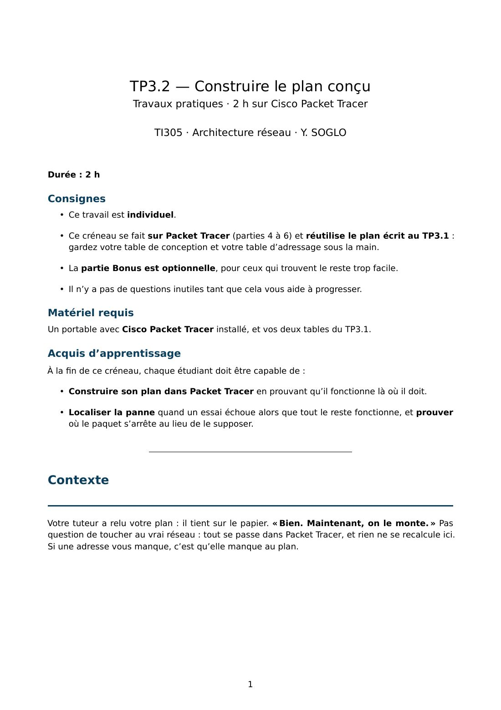
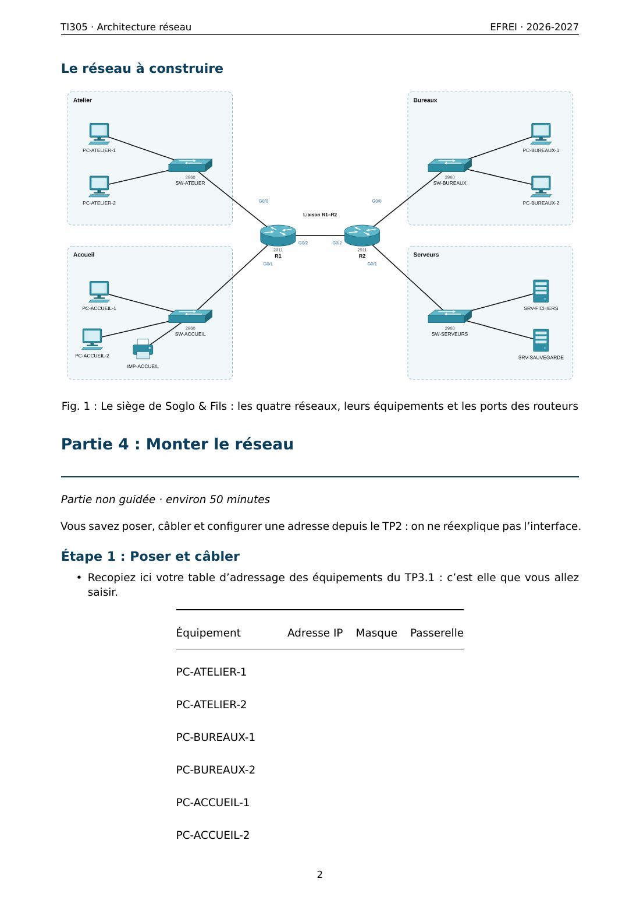
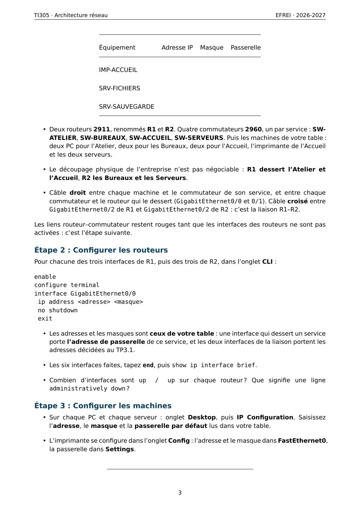
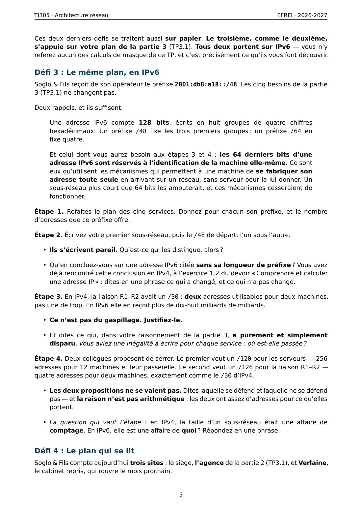
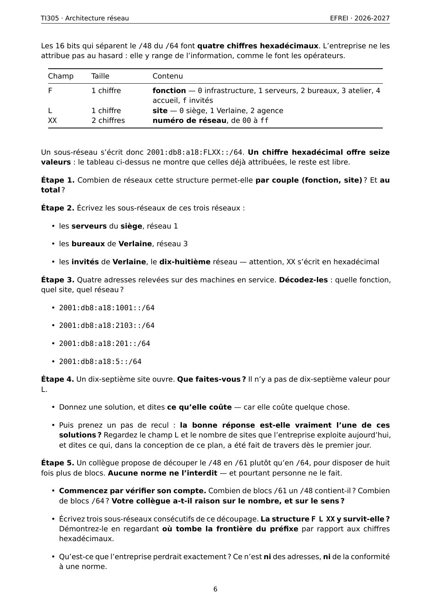

# TP 3.2 — Construire le plan conçu (Packet Tracer)

=== "Version simplifiée"

    Énoncé dans l'onglet **Version papier**. On monte dans Packet Tracer le plan du
    [TP 3.1](tp-3-1-plan-adressage.md#partie-3-le-plan-de-soglo-fils-19216830024) : **rien ne se recalcule
    ici**. Rappels : [chapitre 3](../cours/chapitre-3-routage.md) (CLI, `show ip interface brief`,
    routes statiques, dépannage).

    ## Partie 4 — Monter le réseau

    ### Étape 1 : poser et câbler

    Table d'adressage recopiée du TP 3.1 :

    | Équipement | Adresse IP | Masque | Passerelle |
    |------------|------------|--------|------------|
    | PC-ATELIER-1 | 192.168.30.1 | 255.255.255.128 | 192.168.30.126 |
    | PC-ATELIER-2 | 192.168.30.2 | 255.255.255.128 | 192.168.30.126 |
    | PC-BUREAUX-1 | 192.168.30.129 | 255.255.255.192 | 192.168.30.190 |
    | PC-BUREAUX-2 | 192.168.30.130 | 255.255.255.192 | 192.168.30.190 |
    | PC-ACCUEIL-1 | 192.168.30.193 | 255.255.255.224 | 192.168.30.222 |
    | PC-ACCUEIL-2 | 192.168.30.194 | 255.255.255.224 | 192.168.30.222 |
    | IMP-ACCUEIL | 192.168.30.221 | 255.255.255.224 | 192.168.30.222 |
    | SRV-FICHIERS | 192.168.30.237 | 255.255.255.240 | 192.168.30.238 |
    | SRV-SAUVEGARDE | 192.168.30.236 | 255.255.255.240 | 192.168.30.238 |

    - 2 routeurs **2911** (R1, R2), 4 switchs **2960** (SW-ATELIER, SW-BUREAUX, SW-ACCUEIL, SW-SERVEURS).
    - **R1 dessert l'Atelier et l'Accueil, R2 les Bureaux et les Serveurs.**
    - Câble **droit** machine ↔ switch et switch ↔ routeur (G0/0, G0/1) ; câble **croisé** entre
      G0/2 de R1 et G0/2 de R2 (deux routeurs = même nature).

    ### Étape 2 : configurer les routeurs

    Chaque interface qui dessert un service porte **l'adresse de passerelle** de ce service.
    Ports de la figure 1 : R1 G0/0 = Atelier, G0/1 = Accueil ; R2 G0/0 = Bureaux, G0/1 =
    Serveurs ; G0/2 = liaison des deux côtés.

    === "R1"

        ```text
        enable
        configure terminal
        hostname R1
        interface GigabitEthernet0/0
         ip address 192.168.30.126 255.255.255.128
         no shutdown
         exit
        interface GigabitEthernet0/1
         ip address 192.168.30.222 255.255.255.224
         no shutdown
         exit
        interface GigabitEthernet0/2
         ip address 192.168.30.241 255.255.255.252
         no shutdown
         end
        show ip interface brief
        ```

    === "R2"

        ```text
        enable
        configure terminal
        hostname R2
        interface GigabitEthernet0/0
         ip address 192.168.30.190 255.255.255.192
         no shutdown
         exit
        interface GigabitEthernet0/1
         ip address 192.168.30.238 255.255.255.240
         no shutdown
         exit
        interface GigabitEthernet0/2
         ip address 192.168.30.242 255.255.255.252
         no shutdown
         end
        show ip interface brief
        ```

    `show ip interface brief` : **3 interfaces up / up** par routeur (G0/0, G0/1, G0/2), une
    fois les câbles branchés des deux côtés. Une ligne **administratively down** = interface
    **éteinte par l'administrateur** : le `no shutdown` a été oublié (une interface Cisco est
    éteinte par défaut). `down / down` = problème physique (câble absent ou de mauvais type).

    ### Étape 3 : configurer les machines

    PC et serveurs : *Desktop > IP Configuration* (adresse, masque, passerelle). Imprimante :
    *Config > FastEthernet0* (adresse, masque) et *Config > Settings* (passerelle).

    ## Partie 5 — Vérifier

    - Dans chaque service, `ping` entre machines du service puis vers la passerelle : **tout
      réussit** (routage direct, puis interface du routeur directement connectée).
    - `arp -a` sur PC-ACCUEIL-1 : on y trouve les voisins joints **et la passerelle**
      (192.168.30.222 ↔ MAC de G0/1 de R1). La ligne de la passerelle sert à **tout paquet destiné
      à un autre réseau** : sa trame est adressée à cette MAC (l'IP vise la destination finale, la
      MAC le prochain saut), sans refaire d'ARP à chaque fois.

    ## Partie 6 — Le ping qui ne passe pas

    ### Étape 1 : l'essai

    `ping 192.168.30.129` depuis PC-ATELIER-1 : réponse du type
    **`Reply from 192.168.30.126: Destination host unreachable.`** C'est **R1** (sa passerelle)
    qui répond : il a reçu le paquet mais ne sait pas où l'envoyer, et le signale par un
    message ICMP *destination unreachable*.

    ### Étape 2 : éliminer

    - `ipconfig` sur PC-BUREAUX-1 : conforme à la table (192.168.30.129 /26, passerelle .190).
    - Depuis R1 : `ping 192.168.30.242` → **réussit** : la liaison R1–R2 fonctionne.

    ### Étape 3 : localiser

    - En simulation (ARP + ICMP), le paquet va de PC-ATELIER-1 au switch puis à **R1, et
      s'arrête sur R1** (enveloppe marquée d'une croix).
    - La partie 5 réussissait parce que chaque essai restait **dans un réseau directement
      connecté** (même service, ou passerelle) : aucun routeur n'avait à **choisir une route**.
    - Il manque à R1 une **route vers 192.168.30.128/26** (les Bureaux), qui n'est pas
      directement connecté à lui : `show ip route` sur R1 ne montre que ses trois réseaux en
      **C**. R1 ne peut pas le deviner : un routeur ne connaît que les réseaux **de ses propres
      interfaces** ; les autres, il faut les lui **écrire** (route statique) ou les lui faire
      **apprendre** (routage dynamique). Il ignore que ce réseau est derrière R2.

    !!! tip "Pour la prochaine séance (à ne pas faire aujourd'hui)"
        Ce qui manquera, dans les **deux sens** (sinon le ping part mais la réponse ne revient pas) :

        ```text
        R1(config)# ip route 192.168.30.128 255.255.255.192 192.168.30.242
        R1(config)# ip route 192.168.30.224 255.255.255.240 192.168.30.242
        R2(config)# ip route 192.168.30.0   255.255.255.128 192.168.30.241
        R2(config)# ip route 192.168.30.192 255.255.255.224 192.168.30.241
        ```

    ## Partie bonus (suite) — Pour les cracks

    ### Défi 3 — Le même plan, en IPv6

    **Étape 1.** Chaque service, **liaison comprise**, reçoit un **/64** : c'est la taille
    standard d'un sous-réseau IPv6. Chacun offre $2^{64} \approx 1{,}8 \times 10^{19}$ adresses
    (dix-huit milliards de milliards). Le /48 en contient $2^{16} = 65\,536$.

    | Service | Sous-réseau (exemple) |
    |---------|-----------------------|
    | Atelier | `2001:db8:a18::/64` (= `2001:db8:a18:0::/64`) |
    | Bureaux | `2001:db8:a18:1::/64` |
    | Accueil | `2001:db8:a18:2::/64` |
    | Serveurs | `2001:db8:a18:3::/64` |
    | Liaison R1–R2 | `2001:db8:a18:4::/64` |

    **Étape 2.** `2001:db8:a18::/64` et `2001:db8:a18::/48` s'écrivent pareil : seule la
    **longueur de préfixe** les distingue. Une adresse IPv6 citée sans son préfixe ne dit pas de
    quel réseau elle fait partie. **Ce qui n'a pas changé** depuis l'exercice 1.2 du devoir : une
    adresse seule ne veut rien dire, il faut le préfixe. **Ce qui a changé** : en IPv6, le réseau
    et une machine (ou deux réseaux de tailles différentes) peuvent avoir **exactement la même
    écriture**, la confusion n'est même plus visible.

    **Étape 3.** Ce n'est pas du gaspillage : les 64 derniers bits sont **réservés à
    l'identifiant d'interface**, dont a besoin l'auto-configuration (SLAAC) ; et l'espace est
    tellement grand (65 536 /64 dans un seul /48) que l'économie n'a plus de sens. Ce qui a
    **disparu** : l'inégalité $2^n - 2 \ge S$. On ne **compte plus les machines** : tout
    sous-réseau fait /64, quelle que soit sa population.

    **Étape 4.** Le **/126 pour la liaison se défend** : un lien point-à-point entre deux
    routeurs n'a pas de machines qui s'auto-configurent ; les RFC admettent un préfixe long sur
    ces liens (la RFC 6164 recommande même un /127), et ça limite certaines attaques. Le **/120
    pour les serveurs ne se défend pas** : c'est un réseau de machines, l'amputer des 64 bits
    d'identifiant casse l'auto-configuration et les mécanismes qui en dépendent. En IPv4, la
    taille d'un sous-réseau était une affaire de **comptage** ; en IPv6, c'est une affaire de
    **fonction du lien** (réseau de machines → /64, lien d'infrastructure → au choix).

    ### Défi 4 — Le plan qui se lit (`2001:db8:a18:FLXX::/64`)

    **Étape 1.** XX = 2 chiffres hexadécimaux → $16^2 =$ **256 réseaux** par couple (fonction,
    site). Au total, 16 × 16 × 256 = $16^4 =$ **65 536** réseaux (tous les /64 du /48).

    **Étape 2.**

    | Réseau | F | L | XX | Sous-réseau |
    |--------|:-:|:-:|:--:|-------------|
    | Serveurs du siège, réseau 1 | 1 | 0 | 01 | `2001:db8:a18:1001::/64` |
    | Bureaux de Verlaine, réseau 3 | 2 | 1 | 03 | `2001:db8:a18:2103::/64` |
    | Invités de Verlaine, réseau 18 | f | 1 | **12** | `2001:db8:a18:f112::/64` |

    Le piège : 18 en décimal s'écrit **12** en hexadécimal (1 × 16 + 2). Écrire `f118` donnerait
    le réseau 24. (Si l'on numérote à partir de 00, le dix-huitième réseau serait `11`.)

    **Étape 3.**

    | Sous-réseau | 4e groupe complet | F | L | XX | Décodage |
    |-------------|:-----------------:|:-:|:-:|:--:|----------|
    | `2001:db8:a18:1001::/64` | 1001 | 1 | 0 | 01 | serveurs, siège, réseau 1 |
    | `2001:db8:a18:2103::/64` | 2103 | 2 | 1 | 03 | bureaux, Verlaine, réseau 3 |
    | `2001:db8:a18:201::/64` | **0**201 | 0 | 2 | 01 | infrastructure, agence, réseau 1 |
    | `2001:db8:a18:5::/64` | **000**5 | 0 | 0 | 05 | infrastructure, siège, réseau 5 |

    Les deux derniers obligent à **remettre les zéros de tête** avant de lire F et L.

    **Étape 4.** 17e site : il n'y a que 16 valeurs pour L. Solutions : emprunter un chiffre à
    XX (L sur 2 chiffres, XX sur 1 → seulement 16 réseaux par couple), ou réutiliser une valeur
    de F pour coder des sites, ou demander un second /48. Chacune **coûte** : renumérotation, ou
    perte de la structure lisible, ou deux préfixes à gérer.
    Mais le vrai défaut est ailleurs : l'entreprise a **3 sites** et le champ L en prévoit 16, le
    17e site n'est pas pour demain. Ce qui est fait de travers dès le premier jour, c'est
    **l'ordre des champs** : la **fonction** est au-dessus du **site**, donc les réseaux d'un
    même site sont éparpillés dans tout le /48 et un site ne peut pas être résumé par **un
    seul préfixe** (par exemple un /52 par site si l'on écrivait `LFXX`). La hiérarchie de
    l'adresse devrait suivre la hiérarchie du routage.

    **Étape 5.** Un /48 contient $2^{61-48} = 2^{13} =$ **8 192** blocs /61, contre
    $2^{16} = 65\,536$ blocs /64. Le collègue se trompe de **sens** : un /61 est **plus gros**
    qu'un /64 (8 /64 chacun), il y en a donc **8 fois moins**, pas 8 fois plus.
    Trois /61 consécutifs : `2001:db8:a18::/61`, `2001:db8:a18:8::/61`, `2001:db8:a18:10::/61`.
    61 = 48 + 13 : la frontière tombe **au milieu d'un chiffre hexadécimal** (après 3 chiffres
    et 1 bit du 4e groupe). Le dernier chiffre de XX est coupé en deux : la structure F L XX
    ne survit pas. L'entreprise perdrait la **lisibilité** : un chiffre hexadécimal ne
    correspondrait plus à une information.

=== "Version papier"

    Énoncé du TP 3.2.

    [{ loading=lazy .papier }](papier/tp3-2/p01.jpg)
    <p class="papier-legende">TP3.2 — Construire le plan conçu · TP 3.2 — Construire le plan conçu, p. 1</p>

    [{ loading=lazy .papier }](papier/tp3-2/p02.jpg)
    <p class="papier-legende">TP 3.2 — Construire le plan conçu, p. 2</p>

    [{ loading=lazy .papier }](papier/tp3-2/p03.jpg)
    <p class="papier-legende">TP 3.2 — Construire le plan conçu, p. 3</p>

    [{ loading=lazy .papier }](papier/tp3-2/p04.jpg)
    <p class="papier-legende">TP 3.2 — Construire le plan conçu, p. 4</p>

    [{ loading=lazy .papier }](papier/tp3-2/p05.jpg)
    <p class="papier-legende">TP 3.2 — Construire le plan conçu, p. 5</p>

    [{ loading=lazy .papier }](papier/tp3-2/p06.jpg)
    <p class="papier-legende">TP 3.2 — Construire le plan conçu, p. 6</p>

    [{ loading=lazy .papier }](papier/tp3-2/p07.jpg)
    <p class="papier-legende">TP 3.2 — Construire le plan conçu, p. 7</p>
