# Chapitre 2 — Estimation par intervalles

=== "Version simplifiée"

    Deux questions **inverses** l'une de l'autre :

    | | On connaît | On cherche | Outil |
    |---|---|---|---|
    | **Intervalle de pari** (ou de fluctuation) | la loi (ses paramètres $\mu$, $\sigma$, $p$) | où tomberont les **données** | probabilités |
    | **Intervalle de confiance** | un **échantillon** | où se trouve le **paramètre** inconnu | statistique |

    Dans les deux cas : **risque** $\alpha$ = probabilité d'être en dehors de l'intervalle, **confiance** $1 - \alpha$.

    ## Lire la table de la loi normale

    Pour un intervalle **centré** $[-z_\alpha, z_\alpha]$ au risque $\alpha$, il reste $\frac\alpha2$ de chaque côté :
    on cherche $z_\alpha$ tel que $P(Z < z_\alpha) = 1 - \frac\alpha2$.

    | Risque $\alpha$ | 10 % | 5 % | 1 % |
    |---|---|---|---|
    | $z_\alpha$ | 1,645 | **1,96** | 2,576 |

    Exemple : $\alpha = 5\,\%$ → $P(Z < z) = 0{,}975$ → ligne 1,9, colonne 0,06 → $z = 1{,}96$.
    Plus $\alpha$ est grand, plus l'intervalle est **étroit** (on parie plus risqué).

    ## Intervalles de pari

    !!! theoreme "Les trois intervalles de pari"
        | Variable | Intervalle | Conditions |
        |---|---|---|
        | $X \sim \mathcal N(\mu, \sigma^2)$ | $[\mu - \sigma z_\alpha,\ \mu + \sigma z_\alpha]$ | |
        | Fréquence empirique $F$ | $\left[p \pm z_\alpha\sqrt{\dfrac{p(1 - p)}{n}}\right]$ | $n \ge 30$, $np \ge 5$, $n(1 - p) \ge 5$ |
        | Moyenne empirique $\bar X$ | $\left[\mu \pm z_\alpha\dfrac{\sigma}{\sqrt n}\right]$ | $n \ge 30$ |

    Pourquoi ? $F = \frac1n\sum X_i$ (Bernoulli) a pour moyenne $p$ et variance $\frac{p(1-p)}{n}$ ; $\bar X$ a pour moyenne $\mu$ et variance $\frac{\sigma^2}{n}$.
    Le **théorème central limite** dit que, pour $n$ assez grand ($n \ge 30$ dans ce cours), ces moyennes sont approximativement **normales**.

    !!! tip "La variance de la moyenne diminue avec $n$"
        $V(\bar X) = \sigma^2/n$ : plus l'échantillon est grand, moins sa moyenne fluctue. C'est pour ça que les intervalles
        rétrécissent en $1/\sqrt n$ (il faut 4 fois plus de données pour diviser la largeur par 2).

    Exemple : 40 % des étudiants prennent les transports ; sur 100 étudiants, au risque 5 % :
    $0{,}4 \pm 1{,}96\sqrt{\frac{0{,}4 \times 0{,}6}{100}} = [30{,}4\,\%;\ 49{,}6\,\%]$.

    ## Estimateurs

    !!! definition "Estimateur, convergence, biais"
        - Un **estimateur** $\hat\theta$ d'un paramètre $\theta$ est une fonction des observations $X_1, \dots, X_n$.
        - Il est **convergent** s'il se rapproche de $\theta$ quand $n \to \infty$. En pratique : $E(\hat\theta) \to \theta$ et $V(\hat\theta) \to 0$.
        - Son **biais** est $E(\hat\theta) - \theta$. Il est **sans biais** si $E(\hat\theta) = \theta$.

    | Estimateur | Estime | Biais |
    |---|---|---|
    | Moyenne empirique $\bar X$ | la moyenne $\mu$ | sans biais |
    | Fréquence empirique $F$ | la proportion $p$ | sans biais |
    | Variance observée $S^2_{obs} = \frac1n\sum(X_i - \bar X)^2$ | la variance $\sigma^2$ | **biaisé** : $E(S^2_{obs}) = \frac{n-1}{n}\sigma^2$ |
    | Variance estimée $\sigma_e^2 = \dfrac{n}{n-1}S^2_{obs}$ | la variance $\sigma^2$ | sans biais |

    !!! piege "Observé ou estimé ?"
        Un échantillon **sous-estime** la dispersion (il explore mal les queues de la distribution).
        Dans un intervalle de confiance ou un test sur une moyenne, on utilise toujours $\sigma_e = \sigma_{obs}\sqrt{\frac{n}{n-1}}$.
        Lis bien l'énoncé : « écart-type observé » ou « variance de l'échantillon » → il faut corriger ; « variance estimée » → c'est déjà fait.

    ## Intervalles de confiance

    !!! theoreme "Intervalle de confiance d'une proportion"
        Avec $p_0$ la proportion observée sur l'échantillon, si $n \ge 30$, $np_0 \ge 5$ et $n(1 - p_0) \ge 5$ :

        $$
        IC = \left[p_0 \pm z_\alpha\sqrt{\frac{p_0(1 - p_0)}{n}}\right]
        $$

    Pour une moyenne dont on ne connaît pas $\sigma$, l'estimation de $\sigma$ ajoute de l'incertitude : on remplace la loi normale par la **loi de Student**.

    !!! definition "Lois du $\chi^2$ et de Student"
        - $\chi^2(n)$ : loi de $Z_1^2 + \dots + Z_n^2$, avec $Z_i \sim \mathcal N(0, 1)$ indépendantes.
        - $T(n)$ : loi de $\dfrac{Z}{\sqrt{K/n}}$ avec $Z \sim \mathcal N(0, 1)$ et $K \sim \chi^2(n)$ indépendantes.
          Elle ressemble à la normale avec des queues plus épaisses ; $t \to z$ quand $n \to \infty$.

    !!! theoreme "Intervalle de confiance d'une moyenne"

        $$
        IC = \left[\bar x \pm t_{n-1,\alpha}\,\frac{\sigma_e}{\sqrt n}\right]
        $$

        $t_{n-1,\alpha}$ se lit dans la table de Student **bilatérale**, à $n - 1$ degrés de liberté.
        Si $\sigma$ est **connu**, on prend $\sigma$ et $z_\alpha$ à la place.
        Si $n < 30$, il faut en plus supposer les $X_i$ normaux.

    Exemple : $n = 100$, $\bar x = 121{,}4$, variance observée 0,8, risque 10 %.
    $\sigma_e = \sqrt{\frac{100}{99} \times 0{,}8} \approx 0{,}899$ et $t_{99;\,10\%} \approx 1{,}66$, d'où
    $IC = 121{,}4 \pm 1{,}66 \times \frac{0{,}899}{10} = [121{,}25;\ 121{,}55]$.

    !!! piege "Ne pas confondre pari et confiance"
        L'intervalle de **pari** est fixe (calculé avec les vrais paramètres) et dit où tomberont les données.
        L'intervalle de **confiance** change à chaque nouvel échantillon et dit où est le paramètre : sur 100 échantillons,
        environ $100(1 - \alpha)$ intervalles contiendront la vraie valeur.

=== "Version papier"

    Le chapitre 2 du polycopié 2025-2026 (les exercices sont dans le [TD 2](../td/td-2-estimation.md)).

    <!-- papier: pdf/SM403P/poly.pdf | Poly 2025-2026 | ch2 | page | 26-38 -->

    [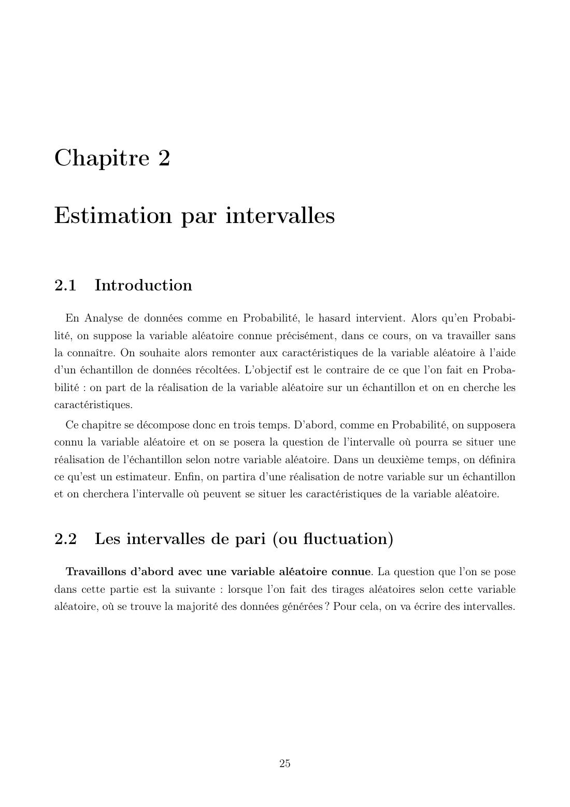{ loading=lazy .papier }](papier/ch2/p26.jpg)
    
Chapitre 2 · Poly 2025-2026, page 26

    [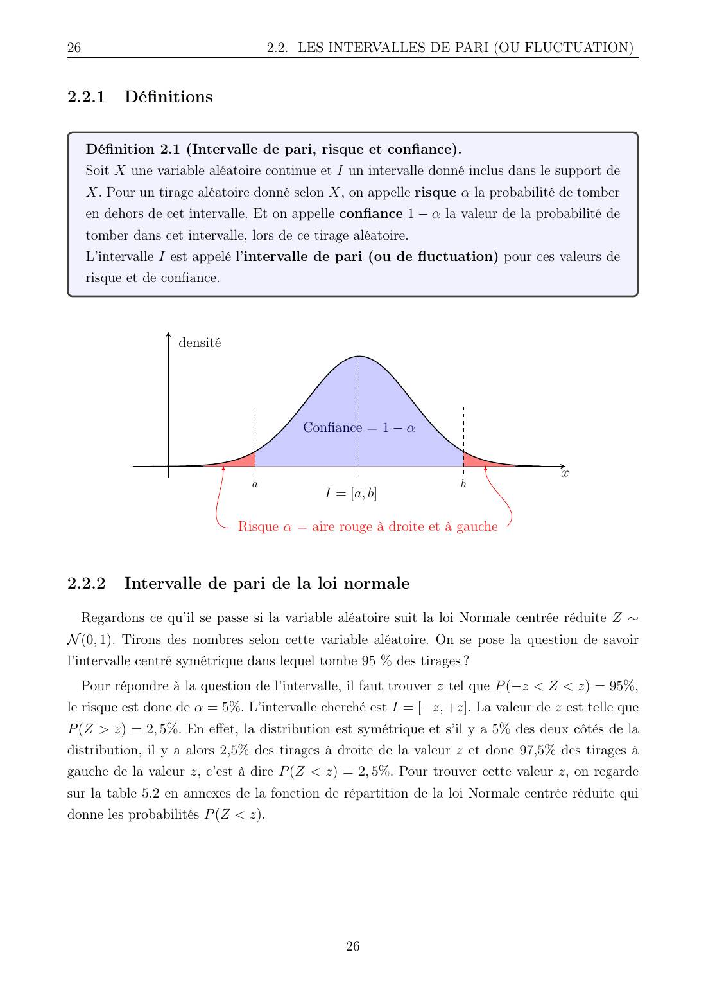{ loading=lazy .papier }](papier/ch2/p27.jpg)
    
2.2. LES INTERVALLES DE PARI (OU FLUCTUATION) · Poly 2025-2026, page 27

    [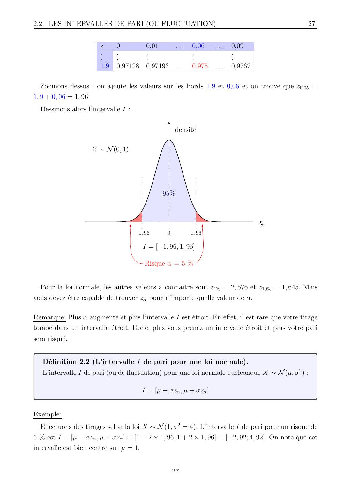{ loading=lazy .papier }](papier/ch2/p28.jpg)
    
2.2. LES INTERVALLES DE PARI (OU FLUCTUATION) · Poly 2025-2026, page 28

    [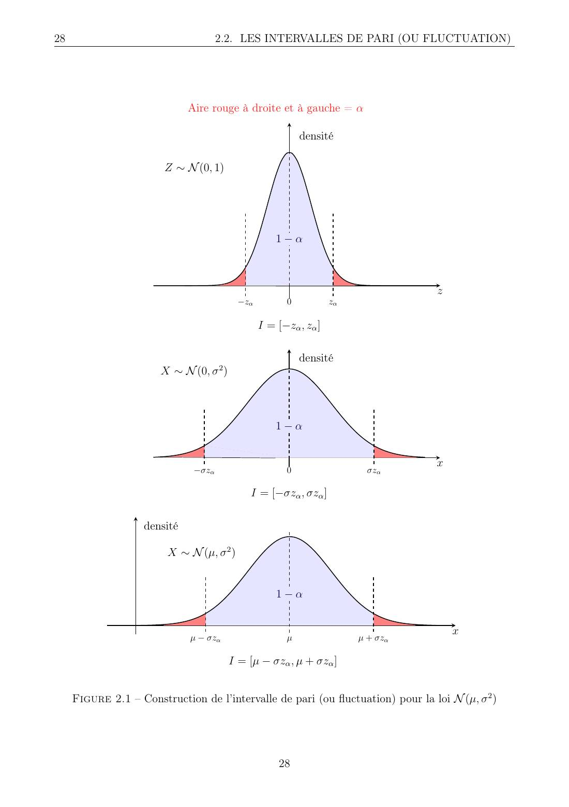{ loading=lazy .papier }](papier/ch2/p29.jpg)
    
2.2. LES INTERVALLES DE PARI (OU FLUCTUATION) · Poly 2025-2026, page 29

    [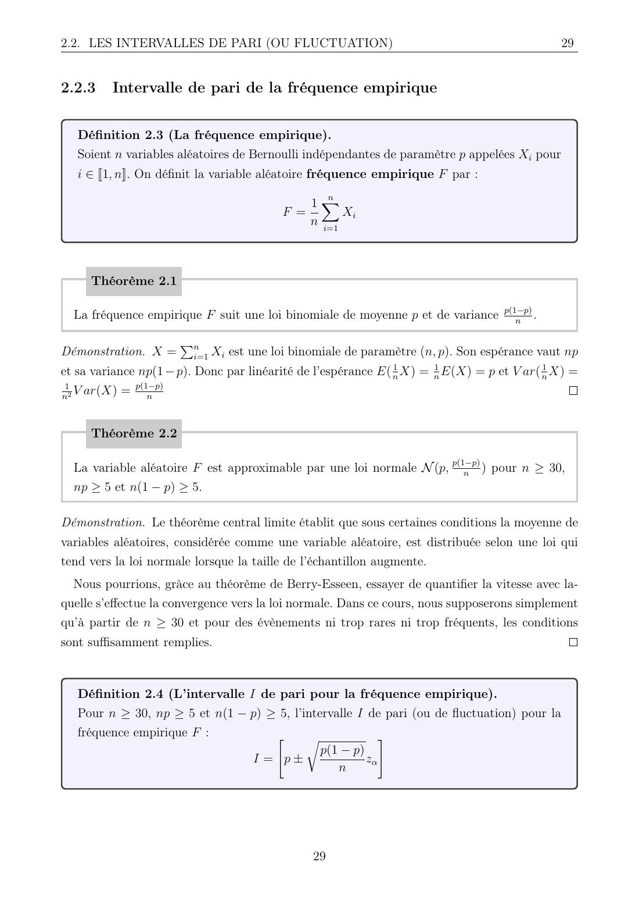{ loading=lazy .papier }](papier/ch2/p30.jpg)
    
2.2. LES INTERVALLES DE PARI (OU FLUCTUATION) · Poly 2025-2026, page 30

    [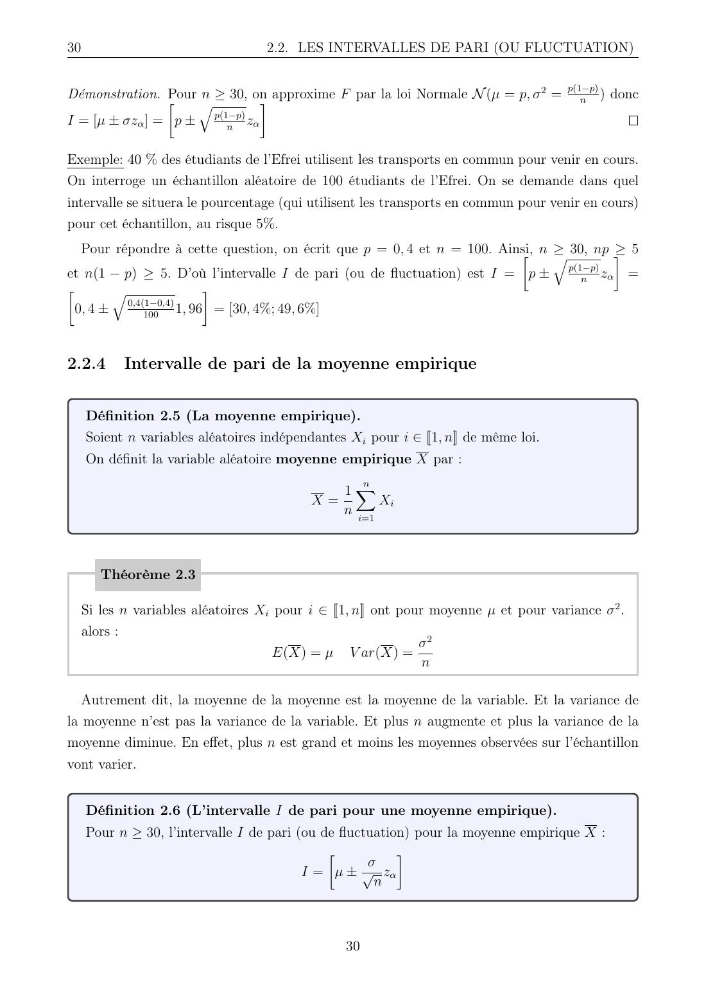{ loading=lazy .papier }](papier/ch2/p31.jpg)
    
2.2. LES INTERVALLES DE PARI (OU FLUCTUATION) · Poly 2025-2026, page 31

    [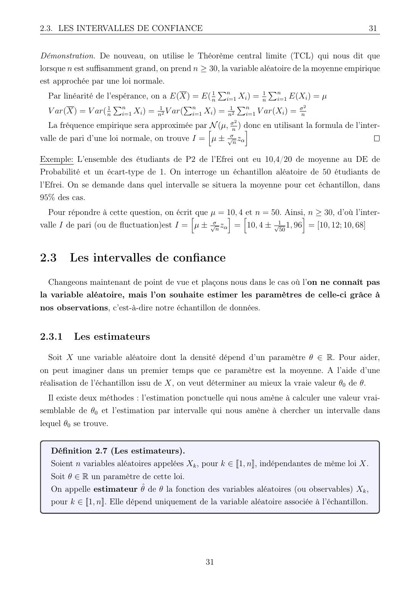{ loading=lazy .papier }](papier/ch2/p32.jpg)
    
2.3. LES INTERVALLES DE CONFIANCE · Poly 2025-2026, page 32

    [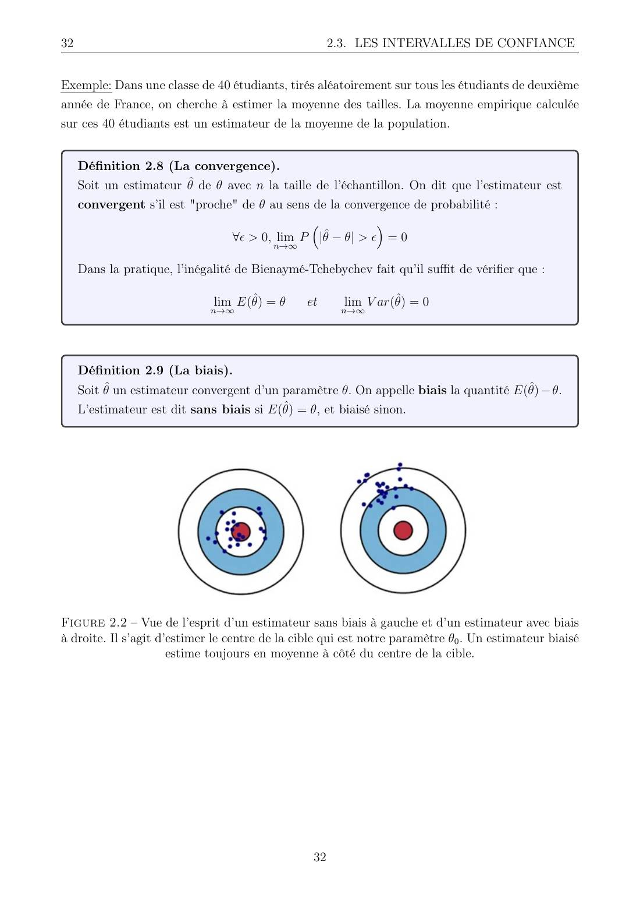{ loading=lazy .papier }](papier/ch2/p33.jpg)
    
2.3. LES INTERVALLES DE CONFIANCE · Poly 2025-2026, page 33

    [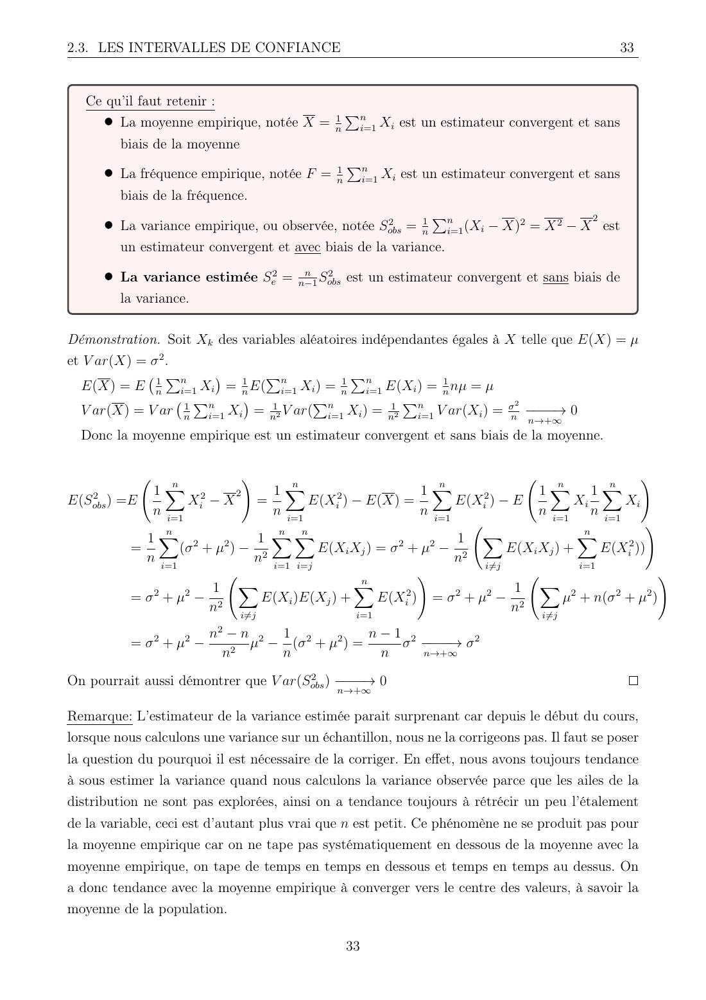{ loading=lazy .papier }](papier/ch2/p34.jpg)
    
2.3. LES INTERVALLES DE CONFIANCE · Poly 2025-2026, page 34

    [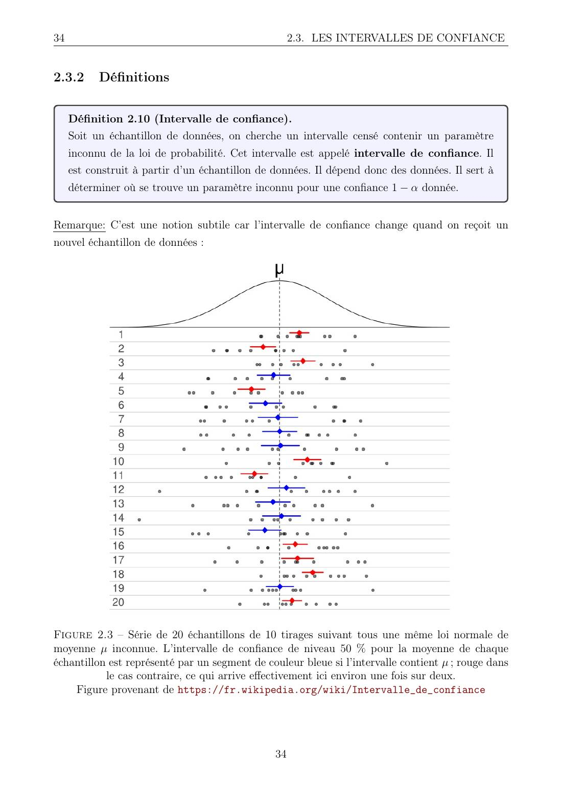{ loading=lazy .papier }](papier/ch2/p35.jpg)
    
2.3. LES INTERVALLES DE CONFIANCE · Poly 2025-2026, page 35

    [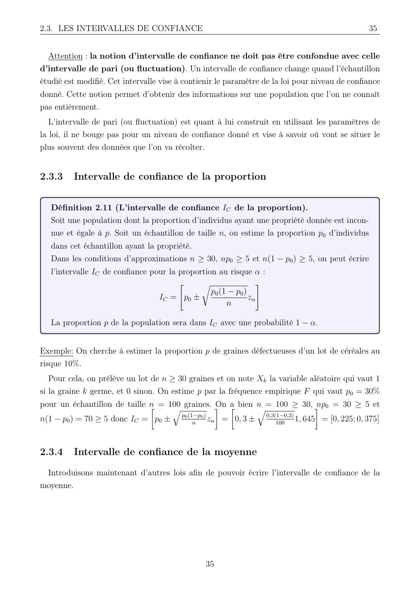{ loading=lazy .papier }](papier/ch2/p36.jpg)
    
2.3. LES INTERVALLES DE CONFIANCE · Poly 2025-2026, page 36

    [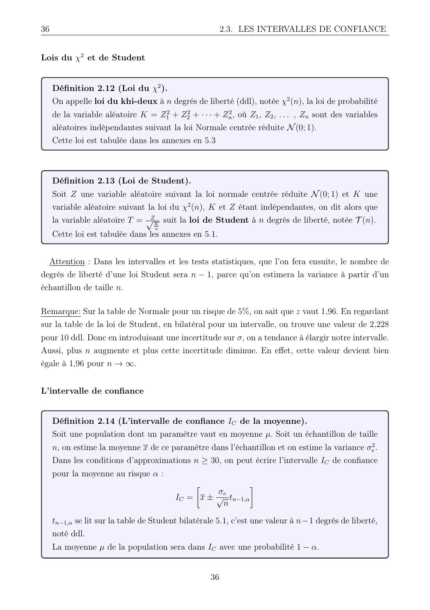{ loading=lazy .papier }](papier/ch2/p37.jpg)
    
2.3. LES INTERVALLES DE CONFIANCE · Poly 2025-2026, page 37

    [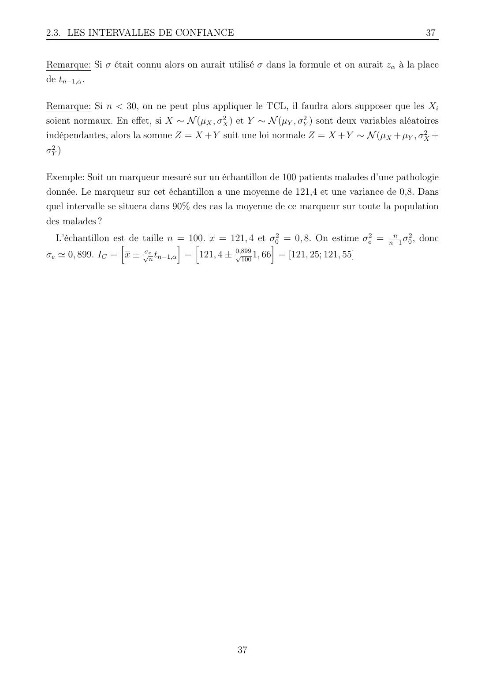{ loading=lazy .papier }](papier/ch2/p38.jpg)
    
2.3. LES INTERVALLES DE CONFIANCE · Poly 2025-2026, page 38

    <!-- /papier -->
