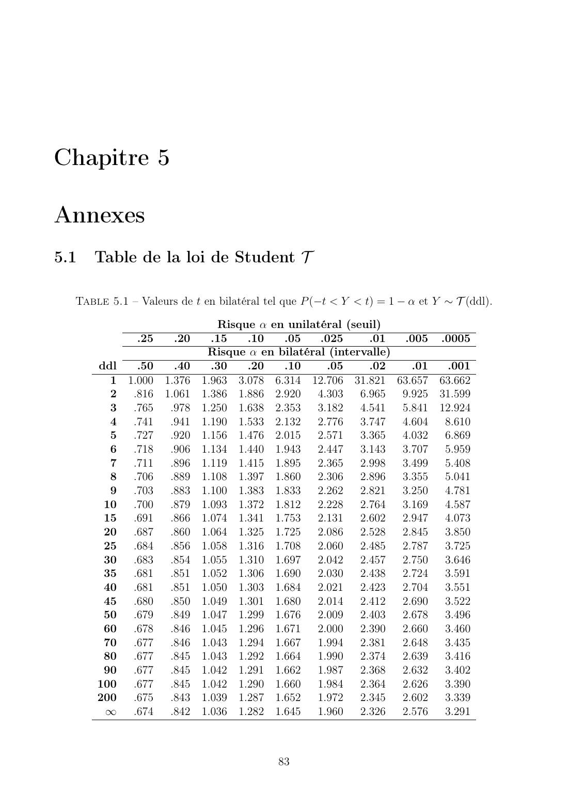
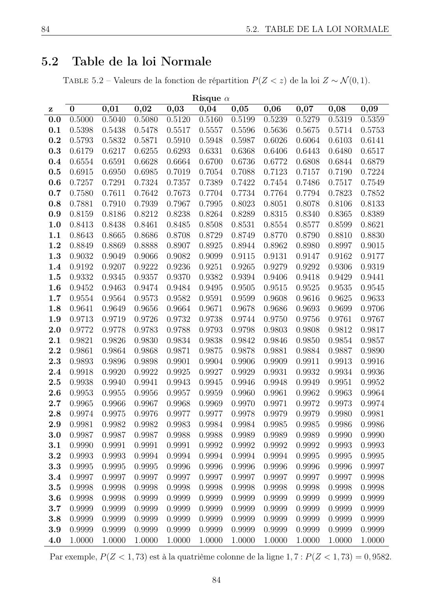
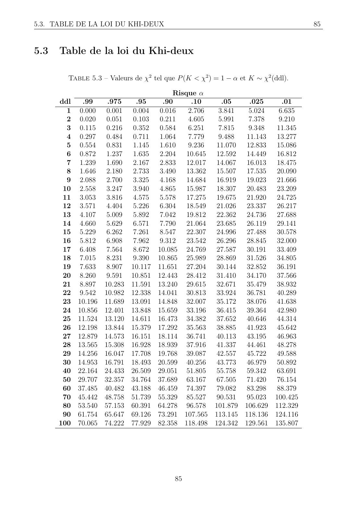

# Fiche — Analyse de données

## Statistique descriptive

| | Formule |
|---|---|
| Moyenne | $\bar x = \frac1n\sum x_i$ |
| Variance observée | $\sigma^2 = \frac1n\sum(x_i - \bar x)^2 = \overline{x^2} - \bar x^2$ |
| Changement affine | $\overline{\alpha x + \beta} = \alpha\bar x + \beta$, $\ \sigma^2_{\alpha x + \beta} = \alpha^2\sigma_x^2$ |
| Asymétrie, aplatissement | $S_k = \frac{\frac1n\sum(x_i - \bar x)^3}{\sigma^3}$ ($>0$ : étalée à droite), $\ K = \frac{\frac1n\sum(x_i - \bar x)^4}{\sigma^4}$ |
| Covariance, corrélation | $\sigma_{xy} = \overline{xy} - \bar x\bar y$, $\ \rho = \frac{\sigma_{xy}}{\sigma_x\sigma_y} \in [-1, 1]$ |
| Droite des moindres carrés | $y = ax + b$, $\ a = \frac{\sigma_{xy}}{\sigma_x^2}$, $\ b = \bar y - a\bar x$ |

**Médiane** : $n$ impair → rang $\frac{n+1}2$ ; $n$ pair → moyenne des rangs $\frac n2$ et $\frac n2 + 1$.
**Quartiles** : $n$ multiple de 4 → moyenne des rangs $\frac n4$ et $\frac n4 + 1$ (idem avec $\frac{3n}4$) ; sinon rang $E(\frac n4) + 1$ (et $E(\frac{3n}4) + 1$).
**Matrices** : $M_c$, $M_s$ ($n \times p$) ; $\Sigma = \frac1n{}^tM_cM_c$ (variances sur la diagonale), $R = \frac1n{}^tM_sM_s$ (des 1 sur la diagonale).

## Intervalles

| Situation | Intervalle | Conditions |
|---|---|---|
| Pari, loi normale | $\mu \pm \sigma z_\alpha$ | |
| Pari, fréquence | $p \pm z_\alpha\sqrt{\frac{p(1-p)}{n}}$ | $n \ge 30$, $np \ge 5$, $n(1-p) \ge 5$ |
| Pari, moyenne | $\mu \pm z_\alpha\frac{\sigma}{\sqrt n}$ | $n \ge 30$ |
| Confiance, proportion | $p_0 \pm z_\alpha\sqrt{\frac{p_0(1-p_0)}{n}}$ | $n \ge 30$, $np_0 \ge 5$, $n(1-p_0) \ge 5$ |
| Confiance, moyenne | $\bar x \pm t_{n-1,\alpha}\frac{\sigma_e}{\sqrt n}$ ($z_\alpha$ et $\sigma$ si $\sigma$ connu) | $n \ge 30$ ou $X$ normale |

$z_{10\%} = 1{,}645$, $z_{5\%} = 1{,}96$, $z_{1\%} = 2{,}576$ (bilatéral). **Variance estimée** : $\sigma_e^2 = \frac{n}{n-1}\sigma^2_{obs}$ (sans biais).

## Tests

**Méthode** : 1. $H_0$ / $H_1$ (bilatéral « ≠ » ou unilatéral « > / < ») · 2. loi sous $H_0$ + conditions · 3. région critique · 4. critère · 5. conclusion en phrase.

| Test | Critère | Loi | Conditions |
|---|---|---|---|
| Moyenne, $\sigma$ inconnu | $\frac{\bar x - \mu}{\sigma_e/\sqrt n}$ | $T(n-1)$ | $n \ge 30$ ou $X$ normale |
| Moyenne, $\sigma$ connu | $\frac{\bar x - \mu}{\sigma/\sqrt n}$ | $\mathcal N(0,1)$ | idem |
| Proportion | $\frac{p_0 - p}{\sqrt{p(1-p)/n}}$ | $\mathcal N(0,1)$ | $n \ge 30$, $np \ge 5$, $n(1-p) \ge 5$ |
| $\chi^2$ conformité | $\sum\frac{(o_i - n_i)^2}{n_i}$, $n_i = n\,P(\text{classe } i)$ | $\chi^2(k-1)$ | $n \ge 50$, $n_i \ge 5$ |
| $\chi^2$ indépendance | $\sum\frac{(o_{ij} - n_{ij})^2}{n_{ij}}$, $n_{ij} = \frac{o_{i\bullet}o_{\bullet j}}{n}$ | $\chi^2((k_1-1)(k_2-1))$ | $n \ge 50$, $n_{ij} \ge 5$ |

Unilatéral à $\alpha$ → lire la colonne $2\alpha$ en bilatéral (5 % → 1,645). $\chi^2$ : toujours unilatéral, on rejette si le critère **dépasse** le seuil.
$\alpha$ = rejeter $H_0$ à tort ; $\beta$ = ne pas la rejeter à tort ; puissance $= 1 - \beta$. Pour 2 modalités : $z^2 = \chi^2$.

## ACP

$R$ → valeurs propres $\lambda_1 \ge \dots \ge \lambda_p$ ($\sum\lambda_i = p$) et vecteurs propres **unitaires** → $P$.

| | Formule |
|---|---|
| qge de l'axe $i$ | $\lambda_i / p$ |
| Coordonnées des individus | $F = M_sP$ (et $M_s = F\,{}^tP$) |
| qlt(individu $i$, axe $j$) | $f_{ij}^2 / \sum_k f_{ik}^2$ |
| Saturations | $S = PD^{1/2}$ ; ligne : $\sum_j s_{ij}^2 = 1$ ; colonne : $\sum_i s_{ij}^2 = \lambda_j$ |

$p = 2$ : $\lambda = 1 \pm \rho$, $P = \frac1{\sqrt2}\begin{pmatrix} 1 & -1 \\ 1 & 1 \end{pmatrix}$ (rotation de 45°).
Interprétation : variables proches du cercle des corrélations ; axe 1 « tout positif » = effet taille ; individus de grande qlt et coordonnées extrêmes.

## Tables statistiques

Les tables du polycopié (Student, loi normale, $\chi^2$), les mêmes que celles fournies en annexe des sujets.

<!-- papier: pdf/SM403P/poly.pdf | Tables du poly | tables | page | 84-86 -->

[{ loading=lazy .papier }](papier/tables/p84.jpg)

Chapitre 5 · Tables du poly, page 84

[{ loading=lazy .papier }](papier/tables/p85.jpg)

5.2. TABLE DE LA LOI NORMALE · Tables du poly, page 85

[{ loading=lazy .papier }](papier/tables/p86.jpg)

5.3. TABLE DE LA LOI DU KHI-DEUX · Tables du poly, page 86

<!-- /papier -->
