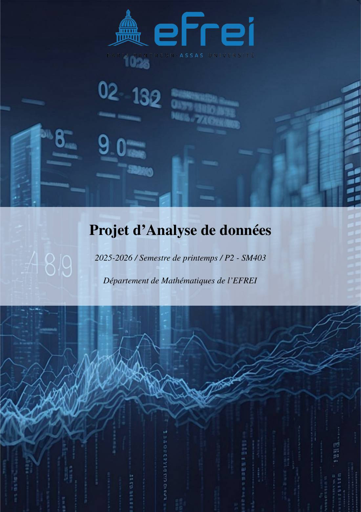
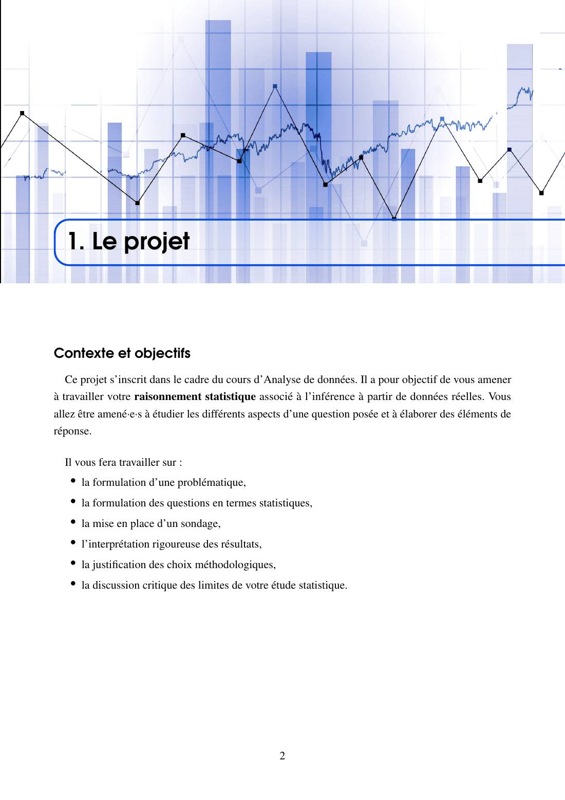
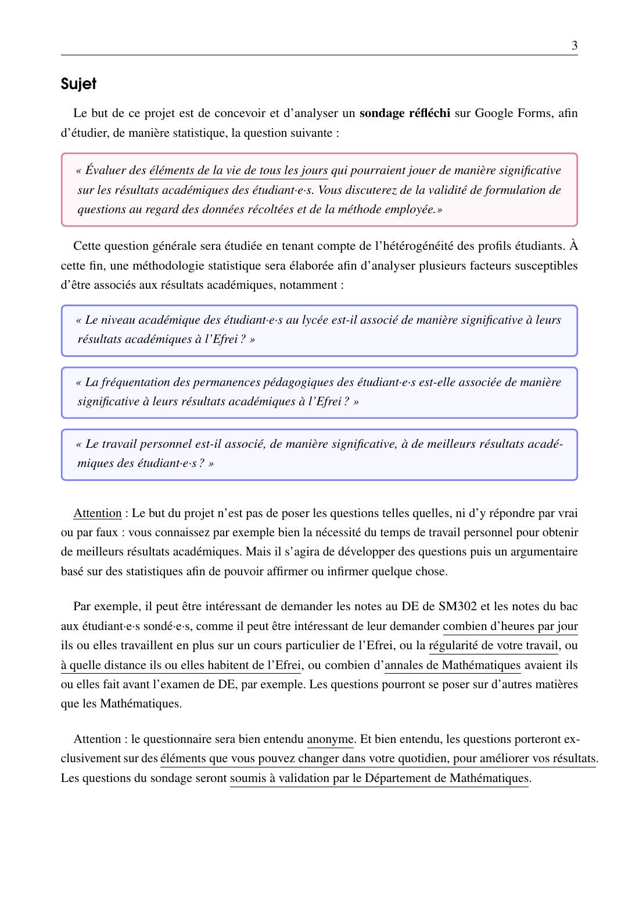
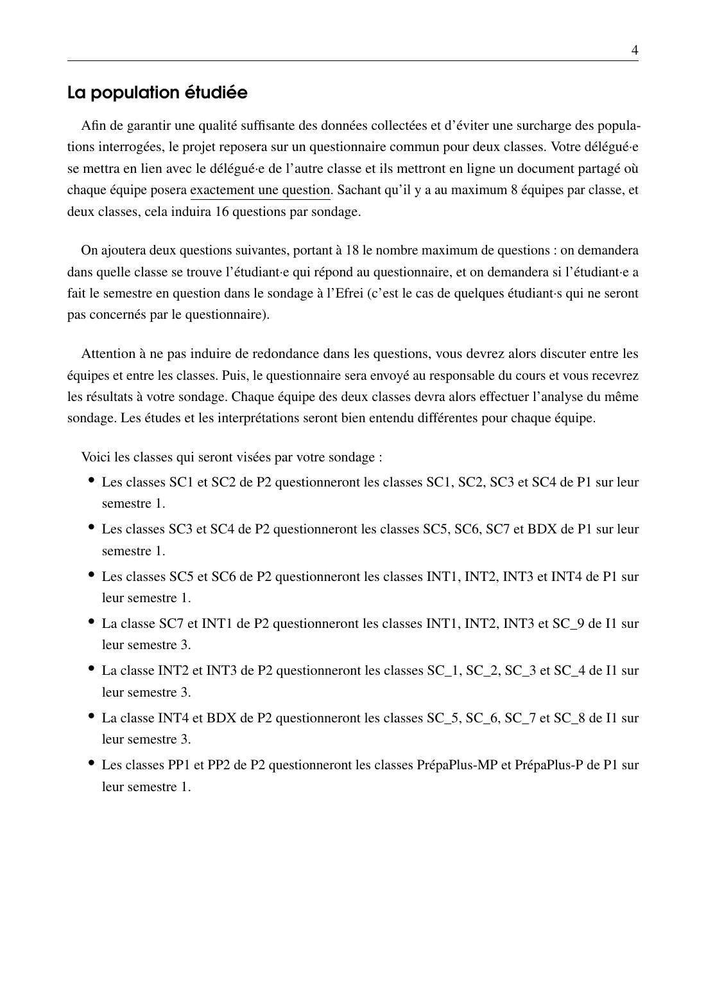
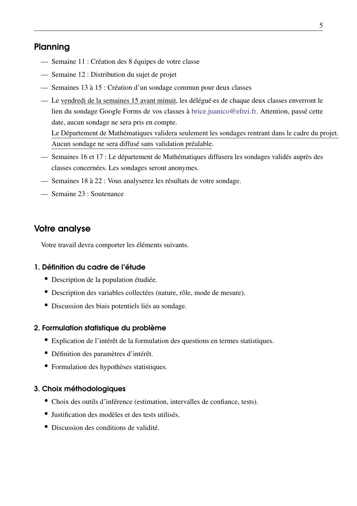
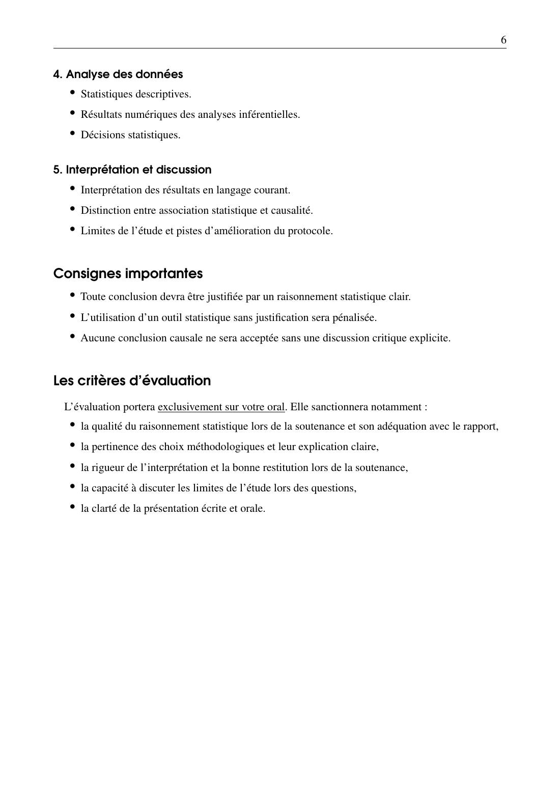
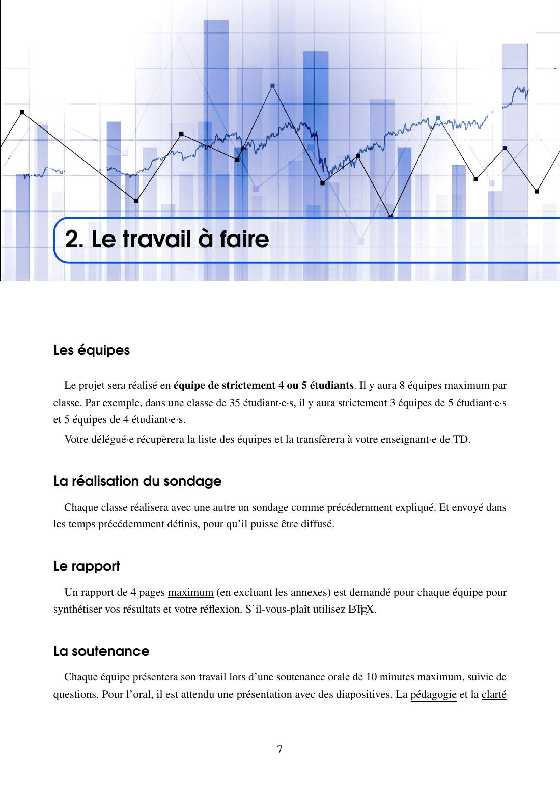
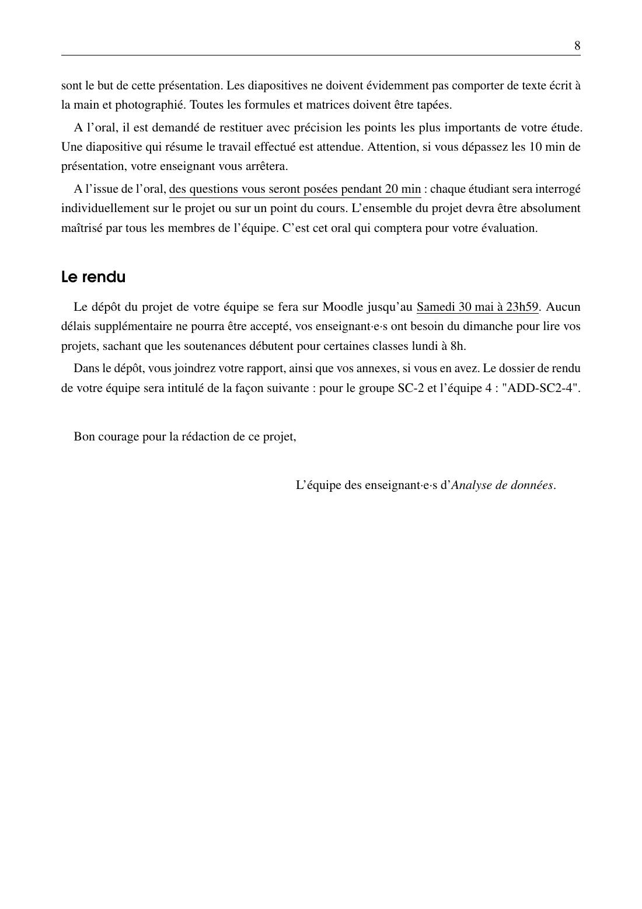

# Projet — Un sondage à analyser

=== "Version simplifiée"

    !!! definition "Le sujet 2025-2026"
        Concevoir un sondage Google Forms, puis l'analyser statistiquement, pour évaluer des **éléments de la vie
        de tous les jours** qui pourraient jouer de façon significative sur les **résultats académiques** des étudiants.
        Pistes : niveau au lycée, fréquentation des permanences, travail personnel… Les questions doivent porter sur
        des choses qu'un étudiant **peut changer** dans son quotidien, et le sondage est **anonyme**.

    ## Organisation

    | Étape | Quand (2025-2026) |
    |---|---|
    | Équipes de **4 ou 5** (8 équipes max par classe) | semaine 11 |
    | Sujet distribué | semaine 12 |
    | Sondage commun à deux classes : **une question par équipe**, plus « ta classe » et « as-tu fait ce semestre à l'Efrei ? » (18 questions max) | semaines 13 à 15 |
    | Envoi du lien par les délégués, validation par le département de maths | vendredi de la semaine 15 |
    | Diffusion aux classes interrogées (P1 ou I1, selon ta classe) | semaines 16 et 17 |
    | Analyse des réponses | semaines 18 à 22 |
    | Dépôt sur Moodle (rapport + annexes, dossier « ADD-SC2-4 » pour SC2 équipe 4) | fin mai |
    | Soutenance | semaine 23 |

    - **Rapport** : 4 pages maximum hors annexes, en LaTeX.
    - **Soutenance** : 10 minutes de diapos (formules et matrices tapées, une diapo de synthèse), puis **20 minutes de questions individuelles**
      sur le projet ou le cours. **Seul l'oral est noté** : chaque membre doit maîtriser tout le projet.

    ## Ce que l'analyse doit contenir

    1. **Cadre** : population étudiée, variables (nature, rôle, mesure), **biais** possibles du sondage.
    2. **Formulation statistique** : paramètres d'intérêt, hypothèses $H_0$ / $H_1$.
    3. **Choix des méthodes** : estimation, intervalles de confiance, tests, et **conditions de validité** vérifiées.
    4. **Analyse** : statistique descriptive, résultats numériques, décisions.
    5. **Discussion** : traduction en langage courant, **association ≠ causalité**, limites et améliorations du protocole.

    !!! methode "Quel outil pour quelle question ?"
        | Ta question | Outil du cours |
        |---|---|
        | Deux variables **qualitatives** liées ? (« fréquente les permanences » × « a validé ») | $\chi^2$ d'**indépendance** ([ch. 3](../cours/chapitre-3-tests.md)) |
        | Une proportion différente d'une référence ? (« 70 % de réussite dans la promo ») | test de **conformité d'une proportion** |
        | Une moyenne différente d'une référence ? | test de **conformité d'une moyenne** (Student) |
        | Où se situe une moyenne ou une proportion de la population ? | **intervalle de confiance** ([ch. 2](../cours/chapitre-2-estimation.md)) |
        | Deux variables **quantitatives** liées ? (heures de travail × note) | nuage de points, $\rho$, régression ([ch. 1](../cours/chapitre-1-statistique-descriptive.md)) |
        | Beaucoup de variables à résumer | ACP ([ch. 4](../cours/chapitre-4-acp.md)) |

    !!! piege "Les erreurs pénalisées"
        - Utiliser un outil **sans justifier** pourquoi ni vérifier ses conditions ($n \ge 50$ et effectifs théoriques $\ge 5$ pour un $\chi^2$, par exemple :
          regroupe des modalités si une case est trop petite).
        - Conclure à une **cause** (« les permanences font réussir ») sans discussion : les étudiants qui vont en permanence sont peut-être déjà les plus motivés.
        - Oublier les **biais** : échantillon de volontaires, notes déclarées (et pas vérifiées), questions mal posées ou trop vagues.
        - Formuler une question dont on ne peut rien tirer : pense dès le départ au **test** que tu feras avec les réponses.

=== "Version papier"

    Le sujet officiel du projet 2025-2026.

    <!-- papier: pdf/SM403P/projet.pdf | Sujet du projet 2025-2026 | sujet | page -->

    [{ loading=lazy .papier }](papier/sujet/p01.jpg)
    
Projet d’Analyse de données · Sujet du projet 2025-2026, page 1

    [{ loading=lazy .papier }](papier/sujet/p02.jpg)
    
1. Le projet · Sujet du projet 2025-2026, page 2

    [{ loading=lazy .papier }](papier/sujet/p03.jpg)
    
Le but de ce projet est de concevoir et d’analyser un sondage réfléchi sur Google Forms, a… · Sujet du projet 2025-2026, page 3

    [{ loading=lazy .papier }](papier/sujet/p04.jpg)
    
La population étudiée · Sujet du projet 2025-2026, page 4

    [{ loading=lazy .papier }](papier/sujet/p05.jpg)
    
— Semaine 11 : Création des 8 équipes de votre classe · Sujet du projet 2025-2026, page 5

    [{ loading=lazy .papier }](papier/sujet/p06.jpg)
    
4. Analyse des données · Sujet du projet 2025-2026, page 6

    [{ loading=lazy .papier }](papier/sujet/p07.jpg)
    
2. Le travail à faire · Sujet du projet 2025-2026, page 7

    [{ loading=lazy .papier }](papier/sujet/p08.jpg)
    
sont le but de cette présentation. Les diapositives ne doivent évidemment pas comporter de… · Sujet du projet 2025-2026, page 8

    <!-- /papier -->
