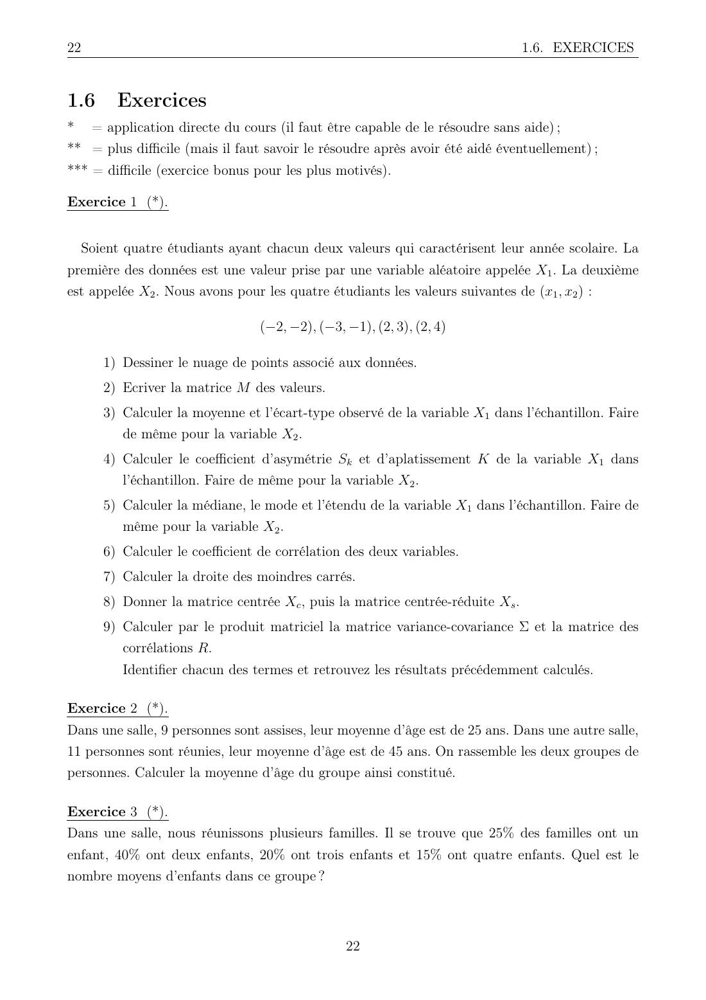
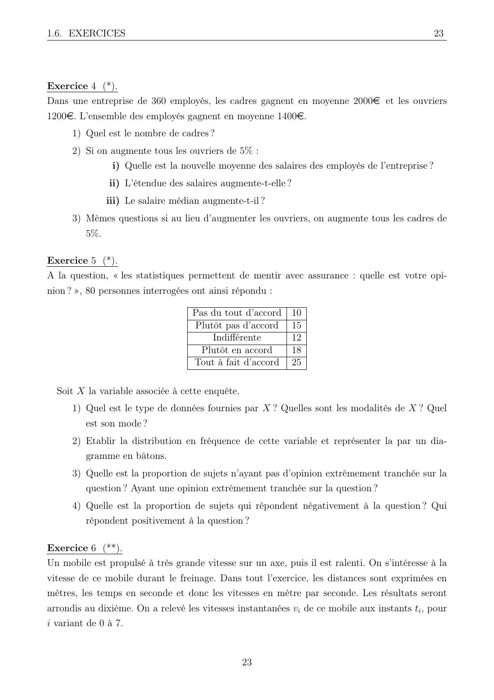
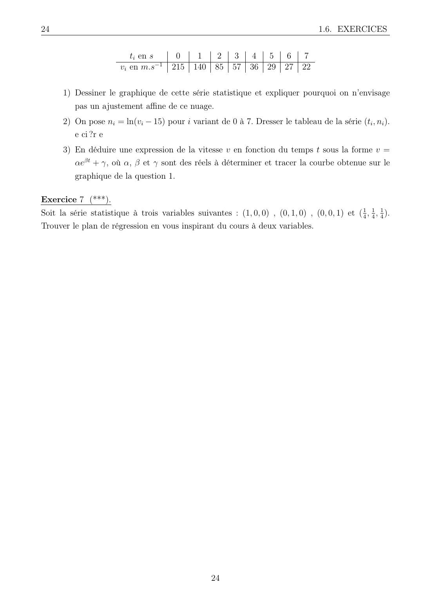

# TD 1 — Statistique descriptive (exercices 1 à 7)

=== "Version simplifiée"

    Rappels : [chapitre 1](../cours/chapitre-1-statistique-descriptive.md). Chaque exercice a sa
    correction repliée : cherche d'abord !

    ## Exercice 1 (\*) — Quatre étudiants, deux variables

    Points $(x_1, x_2)$ : $(-2, -2)$, $(-3, -1)$, $(2, 3)$, $(2, 4)$.

    ??? success "Correction"
        **1-2.** Le nuage est allongé selon une droite croissante. $M = \begin{pmatrix} -2 & -2 \\ -3 & -1 \\ 2 & 3 \\ 2 & 4 \end{pmatrix}$.

        **3.** $\bar x_1 = \frac{-2 - 3 + 2 + 2}{4} = -0{,}25$ et $\overline{x_1^2} = \frac{4 + 9 + 4 + 4}{4} = 5{,}25$, donc
           $\sigma_1^2 = 5{,}25 - 0{,}0625 = 5{,}1875$ et $\sigma_1 \approx 2{,}278$.
           $\bar x_2 = 1$, $\overline{x_2^2} = \frac{4 + 1 + 9 + 16}{4} = 7{,}5$, $\sigma_2^2 = 6{,}5$ et $\sigma_2 \approx 2{,}550$.

        **4.** $S_k(X_1) \approx -0{,}071$ (très légèrement étalée à gauche) et $K(X_1) \approx 1{,}09$.
           $S_k(X_2) = 0$ (écarts $-3, -2, 2, 3$ symétriques) et $K(X_2) \approx 1{,}15$.

        **5.** $X_1$ classée : $-3, -2, 2, 2$ → médiane $\frac{-2 + 2}{2} = 0$, mode 2, étendue $2 - (-3) = 5$.
           $X_2$ classée : $-2, -1, 3, 4$ → médiane 1, **pas de mode** (toutes les valeurs apparaissent une fois), étendue 6.

        **6.** $\overline{x_1x_2} = \frac{4 + 3 + 6 + 8}{4} = 5{,}25$, donc $\sigma_{12} = 5{,}25 - (-0{,}25)(1) = 5{,}5$ et
           $\rho = \dfrac{5{,}5}{2{,}278 \times 2{,}550} \approx 0{,}947$ : forte corrélation positive.

        **7.** $a = \dfrac{\sigma_{12}}{\sigma_1^2} = \dfrac{5{,}5}{5{,}1875} \approx 1{,}060$ et $b = \bar x_2 - a\bar x_1 \approx 1 + 0{,}265 = 1{,}265$ :
           $x_2 \approx 1{,}060\,x_1 + 1{,}265$.

        **8.** On retire les moyennes, puis on divise par les écarts-types :

        $$
        M_c = \begin{pmatrix} -1{,}75 & -3 \\ -2{,}75 & -2 \\ 2{,}25 & 2 \\ 2{,}25 & 3 \end{pmatrix}
        \qquad
        M_s \approx \begin{pmatrix} -0{,}768 & -1{,}177 \\ -1{,}207 & -0{,}784 \\ 0{,}988 & 0{,}784 \\ 0{,}988 & 1{,}177 \end{pmatrix}
        $$

        **9.** $\Sigma = \frac14\,{}^tM_cM_c = \begin{pmatrix} 5{,}1875 & 5{,}5 \\ 5{,}5 & 6{,}5 \end{pmatrix}$ et
           $R = \frac14\,{}^tM_sM_s \approx \begin{pmatrix} 1 & 0{,}947 \\ 0{,}947 & 1 \end{pmatrix}$.
           On retrouve les variances (diagonale de $\Sigma$), la covariance et le coefficient de corrélation.

    ## Exercice 2 (\*) — Deux salles

    ??? success "Correction"
        La moyenne d'un groupe réuni est la moyenne **pondérée** par les effectifs (et non la moyenne des moyennes) :
        $\dfrac{9 \times 25 + 11 \times 45}{20} = \dfrac{225 + 495}{20} = 36$ ans.

    ## Exercice 3 (\*) — Familles

    ??? success "Correction"
        Moyenne pondérée par les fréquences : $1 \times 0{,}25 + 2 \times 0{,}40 + 3 \times 0{,}20 + 4 \times 0{,}15 = 2{,}25$ enfants par famille.

    ## Exercice 4 (\*) — Salaires cadres et ouvriers

    ??? success "Correction"
        1. Avec $c$ cadres : $2000c + 1200(360 - c) = 1400 \times 360$, donc $800c = 72\,000$ et $c = 90$ cadres (et 270 ouvriers).

        2. Ouvriers augmentés de 5 % (leur moyenne passe à 1260 €) :
            - i) nouvelle moyenne $\dfrac{90 \times 2000 + 270 \times 1260}{360} = 1445$ € ;
            - ii) le plus bas salaire (un ouvrier) augmente et le plus haut (un cadre) ne bouge pas : l'étendue **diminue** ;
            - iii) les rangs 180 et 181 (sur 360) sont des ouvriers (il y en a 270) : la médiane **augmente** de 5 %.

        3. Cadres augmentés de 5 % (moyenne 2100 €) : moyenne $\dfrac{90 \times 2100 + 270 \times 1200}{360} = 1425$ € ;
           le maximum augmente donc l'étendue **augmente** ; la médiane (un salaire d'ouvrier) **ne change pas**.

        (On suppose, comme l'énoncé le sous-entend, que tout cadre gagne plus que tout ouvrier.)

    ## Exercice 5 (\*) — Sondage d'opinion

    ??? success "Correction"
        1. Variable **qualitative ordinale**, à 5 modalités (de « pas du tout d'accord » à « tout à fait d'accord »).
           Mode : « tout à fait d'accord » (25 réponses).

        2. Fréquences (sur 80) : 12,5 % ; 18,75 % ; 15 % ; 22,5 % ; 31,25 %. Diagramme en bâtons avec les modalités dans l'ordre.

        3. Opinion non tranchée (les trois modalités du milieu) : $\frac{15 + 12 + 18}{80} = 56{,}25\,\%$ ;
           opinion extrême : $\frac{10 + 25}{80} = 43{,}75\,\%$.

        4. Négative : $\frac{10 + 15}{80} = 31{,}25\,\%$ ; positive : $\frac{18 + 25}{80} = 53{,}75\,\%$ (le reste, 15 %, est indifférent).

    ## Exercice 6 (\*\*) — Freinage d'un mobile

    ??? success "Correction"
        1. La vitesse chute vite puis se stabilise vers une valeur proche de 20 m/s : le nuage est **courbé**, une droite l'ajusterait mal.

        2. $n_i = \ln(v_i - 15)$ (arrondi au dixième) :

            | $t_i$ | 0 | 1 | 2 | 3 | 4 | 5 | 6 | 7 |
            |---|---|---|---|---|---|---|---|---|
            | $n_i$ | 5,3 | 4,8 | 4,2 | 3,7 | 3,0 | 2,6 | 2,5 | 1,9 |

            Ce nuage est presque aligné : $\rho \approx -0{,}99$.

        3. Régression de $n$ en $t$ : $n \approx -0{,}48\,t + 5{,}22$. Comme $v - 15 = e^n$ :

            $$
            v(t) \approx e^{5{,}22}\,e^{-0{,}48t} + 15 \approx 186\,e^{-0{,}5t} + 15
            $$

            soit $\alpha \approx 186$, $\beta \approx -0{,}5$, $\gamma = 15$ (la vitesse limite).

    ## Exercice 7 (\*\*\*) — Plan de régression

    Points $(1, 0, 0)$, $(0, 1, 0)$, $(0, 0, 1)$ et $\left(\frac14, \frac14, \frac14\right)$.

    ??? success "Correction"
        On cherche $z = ax + by + c$ qui minimise $E(a, b, c) = \sum_i (z_i - ax_i - by_i - c)^2$. Les trois dérivées partielles nulles donnent
        le système (équations normales) ; par symétrie entre $x$ et $y$, $a = b$. On trouve

        $$
        a = b = -\frac{21}{22} \approx -0{,}955 \qquad c = \frac{10}{11} \approx 0{,}909.
        $$

        Comme pour la droite, le plan passe par le centre de gravité $G\left(\frac{5}{16}, \frac{5}{16}, \frac{5}{16}\right)$.

=== "Version papier"

    Les énoncés des exercices 1 à 7 du polycopié.

    <!-- papier: pdf/SM403P/poly.pdf | Poly 2025-2026 | td1 | page | 23-25 -->

    [{ loading=lazy .papier }](papier/td1/p23.jpg)
    
1.6. EXERCICES · Poly 2025-2026, page 23

    [{ loading=lazy .papier }](papier/td1/p24.jpg)
    
1.6. EXERCICES · Poly 2025-2026, page 24

    [{ loading=lazy .papier }](papier/td1/p25.jpg)
    
1.6. EXERCICES · Poly 2025-2026, page 25

    <!-- /papier -->
