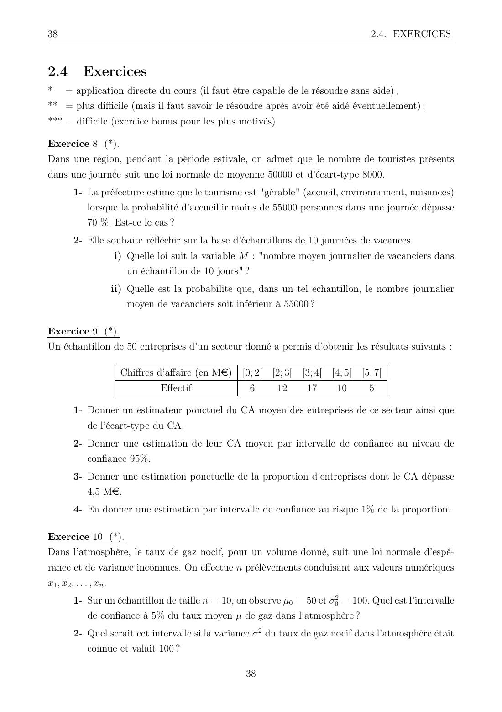
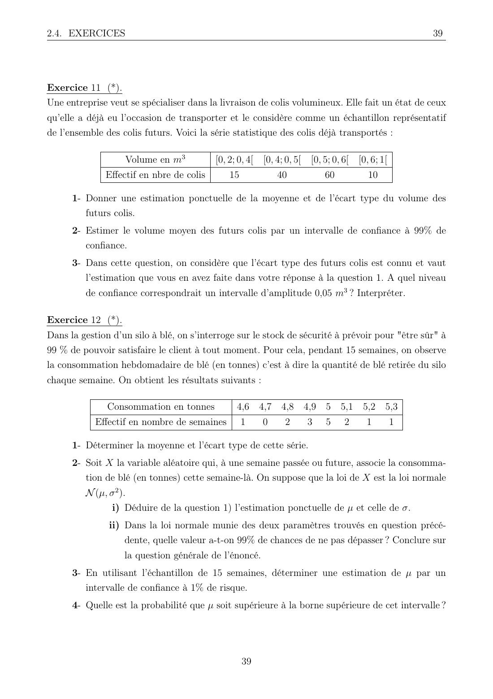

# TD 2 — Estimation par intervalles (exercices 8 à 12)

=== "Version simplifiée"

    Rappels : [chapitre 2](../cours/chapitre-2-estimation.md). Avant tout calcul, demande-toi :
    **pari** (loi connue) ou **confiance** (paramètre inconnu) ? $\sigma$ **connu** ($z$) ou **estimé** ($t$, avec $\sigma_e$) ?

    ## Exercice 8 (\*) — Touristes

    $X \sim \mathcal N(50\,000;\ 8000^2)$ touristes par jour.

    ??? success "Correction"
        1- $P(X < 55\,000) = \Phi\left(\frac{55\,000 - 50\,000}{8000}\right) = \Phi(0{,}625) \approx 0{,}734$.
        C'est plus que 70 % : le tourisme est jugé **gérable**.

        2- i) Moyenne de 10 journées (indépendantes) : $M \sim \mathcal N\left(50\,000;\ \frac{8000^2}{10}\right)$, donc $\sigma_M = \frac{8000}{\sqrt{10}} \approx 2530$.

        ii) $P(M < 55\,000) = \Phi\left(\frac{5000}{2530}\right) = \Phi(1{,}98) \approx 0{,}976$. La moyenne fluctue beaucoup moins qu'une journée isolée.

    ## Exercice 9 (\*) — Chiffres d'affaires de 50 entreprises

    ??? success "Correction"
        On remplace chaque classe par son **centre** : 1 ; 2,5 ; 3,5 ; 4,5 ; 6 (effectifs 6, 12, 17, 10, 5).

        1- $\bar x = \frac{6 + 30 + 59{,}5 + 45 + 30}{50} = 3{,}41$ M€. Écart-type observé $\sigma_{obs} \approx 1{,}344$, donc estimation de l'écart-type
        $\sigma_e = \sigma_{obs}\sqrt{\frac{50}{49}} \approx 1{,}358$ M€.

        2- $n = 50 \ge 30$, $\sigma$ inconnu : $t_{49;\,5\%} \approx 2{,}01$ (entre 2,021 à 40 ddl et 2,009 à 50 ddl).

        $$
        IC = 3{,}41 \pm 2{,}01 \times \frac{1{,}358}{\sqrt{50}} \approx [3{,}02;\ 3{,}80]\ \text{M€}.
        $$

        3- Au-dessus de 4,5 M€ : la moitié de la classe $[4; 5[$ (on suppose la répartition uniforme dans la classe), soit 5, plus les 5 de $[5; 7[$.
        $p_0 = \frac{10}{50} = 0{,}2$.

        4- $n = 50$, $np_0 = 10 \ge 5$, $n(1 - p_0) = 40 \ge 5$. Au risque 1 % ($z = 2{,}576$) :
        $IC = 0{,}2 \pm 2{,}576\sqrt{\frac{0{,}2 \times 0{,}8}{50}} \approx [0{,}054;\ 0{,}346]$. Très large : 50 entreprises, c'est peu.

    ## Exercice 10 (\*) — Gaz nocif

    ??? success "Correction"
        1- $n = 10 < 30$, mais la loi est **normale** : on peut utiliser Student. La variance observée 100 se corrige :
        $\sigma_e^2 = \frac{10}{9} \times 100 \approx 111{,}1$, $\sigma_e \approx 10{,}54$. Avec $t_{9;\,5\%} = 2{,}262$ :

        $$
        IC = 50 \pm 2{,}262 \times \frac{10{,}54}{\sqrt{10}} \approx [42{,}46;\ 57{,}54].
        $$

        2- $\sigma^2 = 100$ connu : on utilise $z = 1{,}96$ et $\sigma = 10$ :
        $IC = 50 \pm 1{,}96 \times \frac{10}{\sqrt{10}} \approx [43{,}80;\ 56{,}20]$. Plus étroit : connaître $\sigma$ enlève une incertitude.

    ## Exercice 11 (\*) — Volume des colis

    ??? success "Correction"
        Centres de classes : 0,3 ; 0,45 ; 0,55 ; 0,8 m³ ; effectif total $n = 125$.

        1- $\bar x = \frac{15 \times 0{,}3 + 40 \times 0{,}45 + 60 \times 0{,}55 + 10 \times 0{,}8}{125} = \frac{63{,}5}{125} = 0{,}508$ m³.
        $\sigma_{obs} \approx 0{,}1181$, donc $\sigma_e = \sigma_{obs}\sqrt{\frac{125}{124}} \approx 0{,}1185$ m³.

        2- À 99 % : $t_{124;\,1\%} \approx 2{,}62$ (entre 2,626 à 100 ddl et 2,602 à 200 ddl).
        $IC = 0{,}508 \pm 2{,}62 \times \frac{0{,}1185}{\sqrt{125}} \approx [0{,}480;\ 0{,}536]$ m³.

        3- $\sigma$ connu → loi normale. Une amplitude de 0,05 veut dire $z\,\frac{\sigma}{\sqrt n} = 0{,}025$, d'où
        $z = \frac{0{,}025\sqrt{125}}{0{,}1185} \approx 2{,}36$ et une confiance $2\Phi(2{,}36) - 1 \approx 0{,}982$, soit environ **98 %**.
        Un intervalle plus étroit que celui du 2- correspond logiquement à une confiance plus faible.

    ## Exercice 12 (\*) — Stock de sécurité d'un silo

    ??? success "Correction"
        1- $n = 15$ semaines. $\bar x = \frac{74{,}6}{15} \approx 4{,}973$ t et $\sigma_{obs} \approx 0{,}165$ t.

        2- i) $\hat\mu = 4{,}973$ et $\hat\sigma = \sigma_e = 0{,}165\sqrt{\frac{15}{14}} \approx 0{,}171$ t.

        ii) On cherche $x$ tel que $P(X < x) = 0{,}99$ : $x = \mu + 2{,}326\,\sigma \approx 4{,}973 + 2{,}326 \times 0{,}171 \approx 5{,}37$ t.
        Avec un stock hebdomadaire de **5,37 t**, on satisfait la demande 99 semaines sur 100.

        3- $t_{14;\,1\%} = 2{,}977$ : $IC = 4{,}973 \pm 2{,}977 \times \frac{0{,}171}{\sqrt{15}} \approx [4{,}84;\ 5{,}10]$ t.

        4- L'intervalle est bilatéral à 1 % : il reste 0,5 % de chaque côté, donc $P(\mu > \text{borne sup}) = 0{,}5\,\%$.

=== "Version papier"

    Les énoncés des exercices 8 à 12 du polycopié.

    <!-- papier: pdf/SM403P/poly.pdf | Poly 2025-2026 | td2 | page | 39-40 -->

    [{ loading=lazy .papier }](papier/td2/p39.jpg)
    
2.4. EXERCICES · Poly 2025-2026, page 39

    [{ loading=lazy .papier }](papier/td2/p40.jpg)
    
2.4. EXERCICES · Poly 2025-2026, page 40

    <!-- /papier -->
