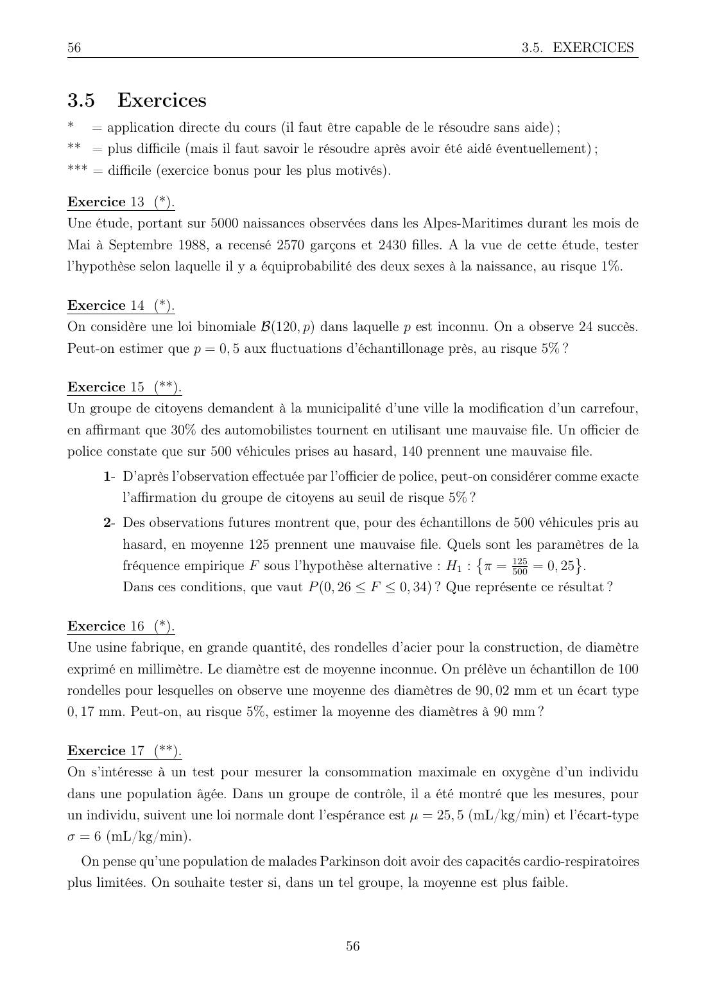
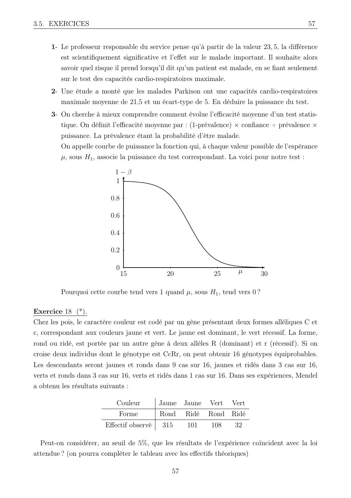
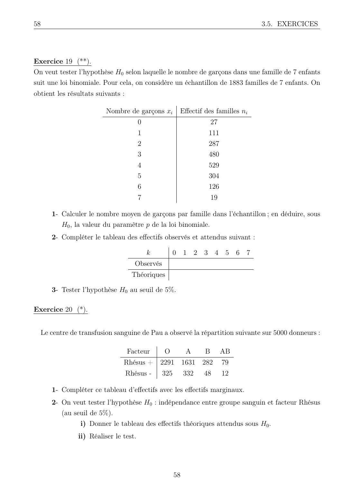
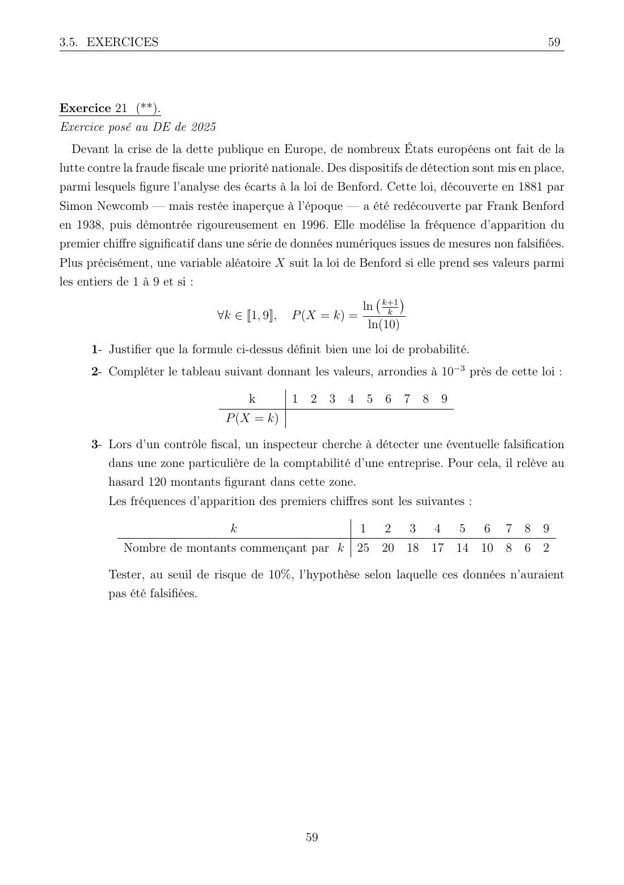

# TD 3 — Tests statistiques (exercices 13 à 21)

=== "Version simplifiée"

    Rappels : [chapitre 3](../cours/chapitre-3-tests.md). Toujours les 5 étapes : hypothèses,
    loi et conditions, région critique, critère, conclusion **en phrase**.

    ## Exercice 13 (\*) — Garçons et filles

    ??? success "Correction"
        $H_0$ : $\pi = 0{,}5$ ; $H_1$ : $\pi \ne 0{,}5$ (bilatéral). $n = 5000$, $np = n(1 - p) = 2500 \ge 5$ : critère normal.
        $p_0 = \frac{2570}{5000} = 0{,}514$ et

        $$
        z = \frac{0{,}514 - 0{,}5}{\sqrt{0{,}25/5000}} = \frac{0{,}014}{0{,}00707} \approx 1{,}98.
        $$

        Au risque 1 %, la zone de non-rejet est $[-2{,}576;\ 2{,}576]$ : $1{,}98$ est dedans, on **ne rejette pas** l'équiprobabilité.
        (À 5 %, on l'aurait rejetée, car $1{,}98 > 1{,}96$ : la conclusion dépend du risque choisi.)

    ## Exercice 14 (\*) — 24 succès sur 120

    ??? success "Correction"
        $H_0$ : $p = 0{,}5$, bilatéral. $p_0 = \frac{24}{120} = 0{,}2$ et $z = \frac{0{,}2 - 0{,}5}{\sqrt{0{,}25/120}} \approx -6{,}57 \notin [-1{,}96;\ 1{,}96]$.
        On **rejette** $p = 0{,}5$ au risque 5 %.

    ## Exercice 15 (\*\*) — Le carrefour

    ??? success "Correction"
        1- $H_0$ : $\pi = 0{,}3$ ; $H_1$ : $\pi \ne 0{,}3$. $p_0 = \frac{140}{500} = 0{,}28$ et

        $$
        z = \frac{0{,}28 - 0{,}3}{\sqrt{0{,}3 \times 0{,}7/500}} = \frac{-0{,}02}{0{,}0205} \approx -0{,}98 \in [-1{,}96;\ 1{,}96].
        $$

        On ne rejette pas $H_0$ : l'affirmation des citoyens est compatible avec l'observation.

        2- Sous $H_1$ ($\pi = 0{,}25$) : $F \sim \mathcal N\left(0{,}25;\ \frac{0{,}25 \times 0{,}75}{500}\right)$, d'écart-type $\approx 0{,}0194$.

        $$
        P(0{,}26 \le F \le 0{,}34) = \Phi\left(\frac{0{,}34 - 0{,}25}{0{,}0194}\right) - \Phi\left(\frac{0{,}26 - 0{,}25}{0{,}0194}\right) \approx \Phi(4{,}65) - \Phi(0{,}52) \approx 0{,}30.
        $$

        $[0{,}26;\ 0{,}34]$ est la zone de non-rejet du test (en fréquence : $0{,}3 \pm 1{,}96 \times 0{,}0205$).
        Ce résultat est donc le **risque $\beta$** : la probabilité de ne pas rejeter $H_0$ alors que la vraie proportion est 25 %.
        La puissance vaut $1 - \beta \approx 0{,}70$.

    ## Exercice 16 (\*) — Diamètre des rondelles

    ??? success "Correction"
        $H_0$ : $m = 90$ ; $H_1$ : $m \ne 90$. $n = 100 \ge 30$, $\sigma$ inconnu : Student à 99 ddl, seuil $t \approx 1{,}984$.
        L'écart-type observé se corrige : $\sigma_e = 0{,}17\sqrt{\frac{100}{99}} \approx 0{,}171$.

        $$
        t = \frac{90{,}02 - 90}{0{,}171/\sqrt{100}} \approx 1{,}17 \in [-1{,}984;\ 1{,}984].
        $$

        On ne rejette pas $H_0$ : on peut estimer la moyenne à 90 mm.

    ## Exercice 17 (\*\*) — Capacité cardio-respiratoire

    ??? success "Correction"
        Un patient est déclaré « malade » si sa mesure est **inférieure à 23,5**.

        1- Le risque de déclarer malade quelqu'un de sain est $\alpha = P(X < 23{,}5)$ avec $X \sim \mathcal N(25{,}5;\ 6^2)$ :
        $\alpha = \Phi\left(\frac{23{,}5 - 25{,}5}{6}\right) = \Phi(-0{,}33) \approx 0{,}37$. Un risque de **37 %** : énorme, le test seul ne suffit pas.

        2- Chez les malades, $X \sim \mathcal N(21{,}5;\ 5^2)$. Puissance $= P(X < 23{,}5) = \Phi(0{,}4) \approx 0{,}655$.

        3- Plus la moyenne des malades est basse, plus leurs mesures tombent sous le seuil 23,5 : la probabilité de les détecter tend vers 1.
        L'efficacité moyenne vaut ici $(1 - \text{prév.}) \times 0{,}63 + \text{prév.} \times 0{,}655$.

    ## Exercice 18 (\*) — Les pois de Mendel

    ??? success "Correction"
        $H_0$ : les proportions sont $\frac9{16}, \frac3{16}, \frac3{16}, \frac1{16}$. $n = 556$.

        | | JR | Jr | VR | Vr |
        |---|---|---|---|---|
        | Observé | 315 | 101 | 108 | 32 |
        | Théorique | 312,75 | 104,25 | 104,25 | 34,75 |

        $n \ge 50$ et tous les théoriques $\ge 5$. $\chi^2 = \frac{2{,}25^2}{312{,}75} + \frac{3{,}25^2}{104{,}25} + \frac{3{,}75^2}{104{,}25} + \frac{2{,}75^2}{34{,}75} \approx 0{,}47$.
        Seuil à 3 ddl et 5 % : 7,815. $0{,}47 < 7{,}815$ : on ne rejette pas $H_0$, les résultats sont conformes à la loi de Mendel
        (ils le sont même étonnamment bien).

    ## Exercice 19 (\*\*) — Garçons dans les familles de 7 enfants

    ??? success "Correction"
        1- $n = 1883$ familles. $\bar x = \frac{\sum k\,n_k}{1883} = \frac{6650}{1883} \approx 3{,}532$ garçons. Pour une binomiale, $E = 7p$, d'où $p \approx 0{,}5045$.

        2- Effectifs théoriques $1883 \times \binom7k p^k(1 - p)^{7-k}$ :

        | $k$ | 0 | 1 | 2 | 3 | 4 | 5 | 6 | 7 |
        |---|---|---|---|---|---|---|---|---|
        | Observés | 27 | 111 | 287 | 480 | 529 | 304 | 126 | 19 |
        | Théoriques | 13,8 | 98,4 | 300,6 | 510,1 | 519,4 | 317,3 | 107,7 | 15,7 |

        3- $\chi^2 \approx 12{,}61 + 1{,}61 + 0{,}61 + 1{,}78 + 0{,}18 + 0{,}56 + 3{,}11 + 0{,}71 \approx 21{,}2$.
        Avec la règle du cours ($k - 1 = 7$ ddl), le seuil à 5 % est 14,07. (En toute rigueur, on retire un ddl de plus parce que $p$ a été estimé : 6 ddl, seuil 12,59.)
        Dans les deux cas, $21{,}2$ dépasse le seuil : on **rejette** le modèle binomial. Les familles sans garçon sont deux fois plus nombreuses que prévu.

    ## Exercice 20 (\*) — Groupe sanguin et rhésus

    ??? success "Correction"
        1- Marges : rhésus + : 4283, rhésus − : 717 ; O : 2616, A : 1963, B : 330, AB : 91 ; total 5000.

        2- i) $n_{ij} = \frac{\text{total ligne} \times \text{total colonne}}{5000}$ :

        | | O | A | B | AB |
        |---|---|---|---|---|
        | Rh + | 2240,9 | 1681,5 | 282,7 | 77,9 |
        | Rh − | 375,1 | 281,5 | 47,3 | 13,1 |

        ii) Tous $\ge 5$. $\chi^2 \approx 1{,}12 + 1{,}52 + 0{,}00 + 0{,}01 + 6{,}70 + 9{,}06 + 0{,}01 + 0{,}08 \approx 18{,}5$.
        $(2 - 1)(4 - 1) = 3$ ddl, seuil 7,815 : on **rejette** l'indépendance. Les rhésus − sont plus souvent du groupe A et moins souvent du groupe O que prévu.

    ## Exercice 21 (\*\*) — Loi de Benford (DE 2025)

    ??? success "Correction"
        1- Chaque $P(X = k) = \frac{\ln(1 + 1/k)}{\ln 10} > 0$, et la somme **télescope** :
        $\sum_{k=1}^9 \ln\frac{k+1}{k} = \ln\frac{2}{1} \cdot \frac32 \cdots \frac{10}{9} = \ln 10$, donc la somme des probabilités vaut 1.

        2- 

        | $k$ | 1 | 2 | 3 | 4 | 5 | 6 | 7 | 8 | 9 |
        |---|---|---|---|---|---|---|---|---|---|
        | $P(X = k)$ | 0,301 | 0,176 | 0,125 | 0,097 | 0,079 | 0,067 | 0,058 | 0,051 | 0,046 |

        3- $H_0$ : les premiers chiffres suivent Benford (pas de falsification). Théoriques $120\,P(X = k)$ :
        36,1 ; 21,1 ; 15,0 ; 11,6 ; 9,5 ; 8,0 ; 7,0 ; 6,1 ; 5,5 (tous $\ge 5$, $n = 120 \ge 50$).
        $\chi^2 \approx 3{,}43 + 0{,}06 + 0{,}60 + 2{,}48 + 2{,}13 + 0{,}48 + 0{,}16 + 0{,}00 + 2{,}22 \approx 11{,}56$.
        Seuil à 8 ddl et 10 % : 13,36. On **ne rejette pas** $H_0$ : rien ne permet de soupçonner une falsification.

=== "Version papier"

    Les énoncés des exercices 13 à 21 du polycopié.

    <!-- papier: pdf/SM403P/poly.pdf | Poly 2025-2026 | td3 | page | 57-60 -->

    [{ loading=lazy .papier }](papier/td3/p57.jpg)
    
3.5. EXERCICES · Poly 2025-2026, page 57

    [{ loading=lazy .papier }](papier/td3/p58.jpg)
    
3.5. EXERCICES · Poly 2025-2026, page 58

    [{ loading=lazy .papier }](papier/td3/p59.jpg)
    
3.5. EXERCICES · Poly 2025-2026, page 59

    [{ loading=lazy .papier }](papier/td3/p60.jpg)
    
3.5. EXERCICES · Poly 2025-2026, page 60

    <!-- /papier -->
