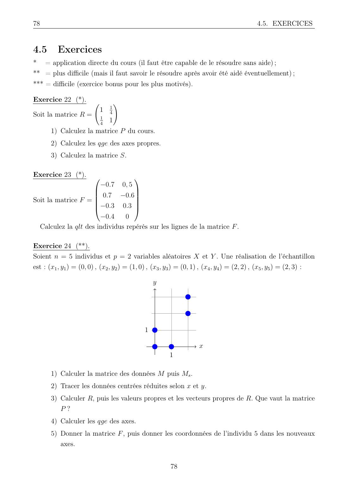
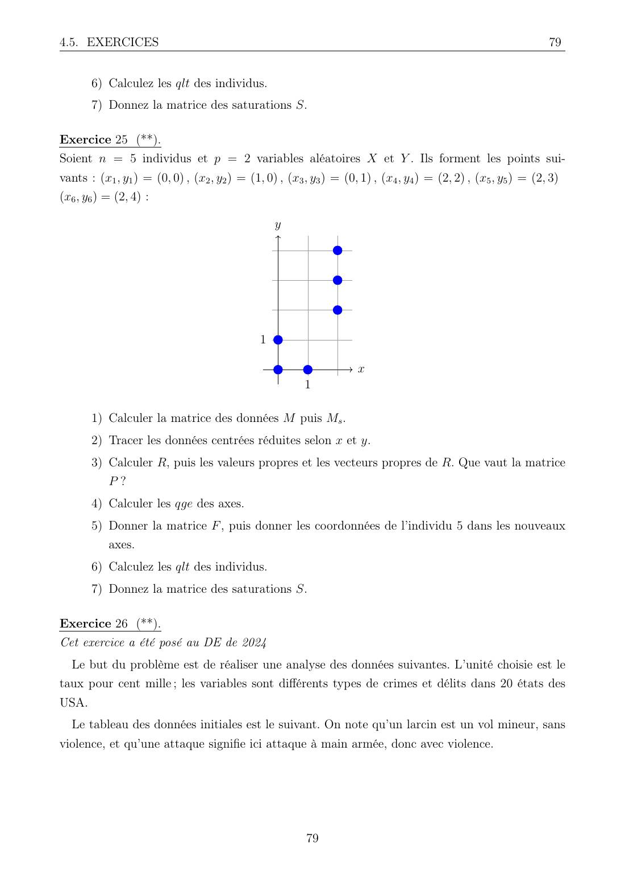
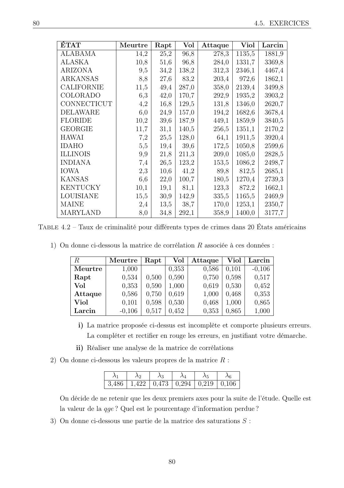
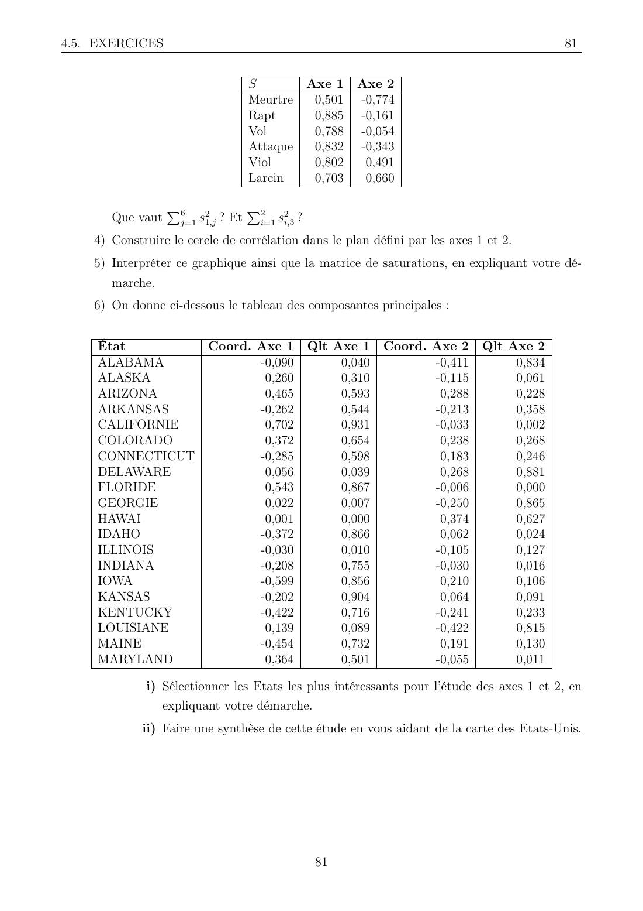

# TD 4 — Analyse en composantes principales (exercices 22 à 27)

=== "Version simplifiée"

    Rappels : [chapitre 4](../cours/chapitre-4-acp.md). Ordre des calculs : $M \to M_s \to R \to$
    valeurs et vecteurs propres $\to P,\ \text{qge} \to F = M_sP \to \text{qlt} \to S = PD^{1/2}$.

    ## Exercice 22 (\*) — $R = \begin{pmatrix} 1 & 1/4 \\ 1/4 & 1 \end{pmatrix}$

    ??? success "Correction"
        1) Cas $\rho = \frac14$ : $\lambda_1 = 1 + \frac14 = \frac54$ et $\lambda_2 = \frac34$, avec $u_1 = \frac{1}{\sqrt2}(1, 1)$ et $u_2 = \frac{1}{\sqrt2}(-1, 1)$ :

        $$
        P = \frac{1}{\sqrt2}\begin{pmatrix} 1 & -1 \\ 1 & 1 \end{pmatrix}.
        $$

        2) $\text{qge}(1) = \frac{5/4}{2} = 62{,}5\,\%$ et $\text{qge}(2) = 37{,}5\,\%$.

        3) $S = PD^{1/2} = \begin{pmatrix} \frac{1}{\sqrt2}\sqrt{\frac54} & -\frac{1}{\sqrt2}\sqrt{\frac34} \\ \frac{1}{\sqrt2}\sqrt{\frac54} & \frac{1}{\sqrt2}\sqrt{\frac34} \end{pmatrix} \approx \begin{pmatrix} 0{,}791 & -0{,}612 \\ 0{,}791 & 0{,}612 \end{pmatrix}$.
        Contrôle : $0{,}791^2 + 0{,}612^2 = 1$ (ligne) et $2 \times 0{,}791^2 = 1{,}25 = \lambda_1$ (colonne).

    ## Exercice 23 (\*) — Qualités de représentation

    ??? success "Correction"
        $\text{qlt}(i, j) = \dfrac{f_{ij}^2}{f_{i1}^2 + f_{i2}^2}$ :

        | Individu | qlt axe 1 | qlt axe 2 |
        |---|---|---|
        | 1 : $(-0{,}7;\ 0{,}5)$ | $\frac{0{,}49}{0{,}74} \approx 0{,}66$ | $\approx 0{,}34$ |
        | 2 : $(0{,}7;\ -0{,}6)$ | $\frac{0{,}49}{0{,}85} \approx 0{,}58$ | $\approx 0{,}42$ |
        | 3 : $(-0{,}3;\ 0{,}3)$ | $0{,}5$ | $0{,}5$ |
        | 4 : $(-0{,}4;\ 0)$ | $1$ | $0$ |

        L'individu 4 est entièrement sur l'axe 1 ; l'individu 3 est sur la bissectrice des deux axes.

    ## Exercice 24 (\*\*) — Cinq individus

    Points $(0, 0)$, $(1, 0)$, $(0, 1)$, $(2, 2)$, $(2, 3)$.

    ??? success "Correction"
        1) $\bar x = 1$, $\sigma_x^2 = 0{,}8$ ; $\bar y = 1{,}2$, $\sigma_y^2 = 1{,}36$ ; $\sigma_{xy} = 0{,}8$. D'où

        $$
        M_s \approx \begin{pmatrix} -1{,}118 & -1{,}029 \\ 0 & -1{,}029 \\ -1{,}118 & -0{,}171 \\ 1{,}118 & 0{,}686 \\ 1{,}118 & 1{,}543 \end{pmatrix}
        $$

        2) Le nuage centré réduit est allongé le long de la première bissectrice.

        3) $\rho = \frac{0{,}8}{\sqrt{0{,}8 \times 1{,}36}} \approx 0{,}767$, $R = \begin{pmatrix} 1 & 0{,}767 \\ 0{,}767 & 1 \end{pmatrix}$,
        $\lambda_1 \approx 1{,}767$, $\lambda_2 \approx 0{,}233$, et $P = \frac{1}{\sqrt2}\begin{pmatrix} 1 & -1 \\ 1 & 1 \end{pmatrix}$ (comme pour toute matrice $2 \times 2$ de ce type).

        4) $\text{qge}(1) \approx 88{,}3\,\%$ et $\text{qge}(2) \approx 11{,}7\,\%$.

        5) $F = M_sP$ : chaque ligne vaut $\left(\frac{a + b}{\sqrt2},\ \frac{b - a}{\sqrt2}\right)$ pour une ligne $(a, b)$ de $M_s$.

        $$
        F \approx \begin{pmatrix} -1{,}518 & 0{,}063 \\ -0{,}728 & -0{,}728 \\ -0{,}912 & 0{,}669 \\ 1{,}276 & -0{,}306 \\ 1{,}882 & 0{,}301 \end{pmatrix}
        $$

        L'individu 5 a pour coordonnées $\approx (1{,}88;\ 0{,}30)$ dans la base propre.

        6) qlt sur l'axe 1 : 0,998 ; 0,5 ; 0,650 ; 0,946 ; 0,975 (et le complément à 1 sur l'axe 2). L'individu 2 est mal représenté par l'axe 1.

        7) $S = PD^{1/2} \approx \begin{pmatrix} 0{,}940 & -0{,}341 \\ 0{,}940 & 0{,}341 \end{pmatrix}$ : $x$ et $y$ sont corrélées à 94 % avec l'axe 1.

        Le signe des vecteurs propres est arbitraire : si ta calculatrice donne $-u_2$, la 2e colonne de $F$ et de $S$ change de signe, et rien d'autre.

    ## Exercice 25 (\*\*) — Six individus

    L'énoncé dit $n = 5$ mais donne 6 points : on ajoute $(2, 4)$, donc $n = 6$.

    ??? success "Correction"
        $\bar x = \frac76$, $\bar y = \frac53$, $\rho \approx 0{,}789$, donc $\lambda_1 \approx 1{,}789$ ($\text{qge} \approx 89{,}4\,\%$) et $\lambda_2 \approx 0{,}211$ ($10{,}6\,\%$).
        Même $P$ qu'à l'exercice 24.

        $$
        M_s \approx \begin{pmatrix} -1{,}300 & -1{,}118 \\ -0{,}186 & -1{,}118 \\ -1{,}300 & -0{,}447 \\ 0{,}928 & 0{,}224 \\ 0{,}928 & 0{,}894 \\ 0{,}928 & 1{,}565 \end{pmatrix}
        \qquad
        F \approx \begin{pmatrix} -1{,}710 & 0{,}129 \\ -0{,}922 & -0{,}659 \\ -1{,}235 & 0{,}603 \\ 0{,}815 & -0{,}498 \\ 1{,}289 & -0{,}024 \\ 1{,}763 & 0{,}450 \end{pmatrix}
        $$

        Individu 5 : $\approx (1{,}29;\ -0{,}02)$, presque exactement sur l'axe 1 (qlt 0,9997).
        qlt axe 1 : 0,994 ; 0,662 ; 0,808 ; 0,728 ; 1,000 ; 0,939.
        $S \approx \begin{pmatrix} 0{,}946 & -0{,}325 \\ 0{,}946 & 0{,}325 \end{pmatrix}$.

    ## Exercice 26 (\*\*) — Criminalité dans 20 États (DE 2024)

    ??? success "Correction"
        **1) i)** Une matrice de corrélation est **symétrique** avec des **1 sur la diagonale**. Deux erreurs :
        le coefficient $R_{\text{Rapt,Rapt}}$ vaut 0,500 au lieu de **1**, et il manque une valeur dans la ligne « Meurtre ».
        Par symétrie (colonne Meurtre de la ligne Rapt), elle vaut **0,534** : la ligne correcte est
        $1{,}000;\ 0{,}534;\ 0{,}353;\ 0{,}586;\ 0{,}101;\ -0{,}106$.

        **ii)** Toutes les corrélations sont positives sauf Meurtre-Larcin (presque nulle). Deux groupes :
        les violences (Meurtre, Attaque, Rapt, très liés : 0,75 entre Rapt et Attaque) et Viol-Larcin (0,865).
        Le meurtre n'est presque pas corrélé au larcin.

        **2)** $\sum\lambda_i = 6$. qge des 2 premiers axes : $\frac{3{,}486 + 1{,}422}{6} \approx 81{,}8\,\%$ ; information perdue : **18,2 %**.

        **3)** $\sum_{j=1}^6 s_{1,j}^2 = 1$ (somme d'une ligne de $S$ sur **tous** les axes). La somme d'une colonne sur toutes les variables
        vaut la valeur propre : $\sum_{i=1}^6 s_{i,3}^2 = \lambda_3 = 0{,}473$ (l'indice « 2 » de l'énoncé est sans doute une coquille pour 6).
        Contrôle sur les colonnes données : $\sum_i s_{i,1}^2 \approx 3{,}485 \approx \lambda_1$ et $\sum_i s_{i,2}^2 \approx 1{,}422 = \lambda_2$.

        **4-5)** Cercle des corrélations : toutes les variables ont une **coordonnée positive** sur l'axe 1 (de 0,50 à 0,89) :
        c'est un **effet taille**, l'axe 1 mesure le **niveau global de criminalité**.
        L'axe 2 **oppose** Meurtre (−0,77) et Attaque (−0,34), les violences graves contre les personnes, à Larcin (+0,66) et Viol (+0,49).
        Dans ce plan, toutes les variables sont proches du cercle (somme des carrés entre 0,81 et 0,93), sauf Vol (0,62), un peu moins bien représenté.

        !!! note "À propos de la colonne « Viol »"
            Ses valeurs (800 à 2300 pour 100 000 habitants) sont celles des **cambriolages** (*burglary*) dans le jeu de données américain
            d'origine ; « Rapt » y correspond au viol (*rape*). C'est probablement une erreur de traduction du sujet. L'axe 2 se lit alors
            très naturellement : **atteintes aux biens** (cambriolage, larcin) contre **violences** (meurtre, agression).

        **6) i)** On garde les États qui ont une **grande qlt** (au moins 0,6) **et** une coordonnée éloignée de 0 :

        - axe 1, côté positif (forte criminalité) : Californie (0,70 ; qlt 0,93), Floride (0,54 ; 0,87), Colorado (0,37 ; 0,65) ;
        - axe 1, côté négatif (faible criminalité) : Iowa (−0,60 ; 0,86), Maine (−0,45 ; 0,73), Kentucky (−0,42 ; 0,72), Idaho (−0,37 ; 0,87) ;
        - axe 2, côté négatif (violences) : Louisiane (−0,42 ; 0,82), Alabama (−0,41 ; 0,83), Géorgie (−0,25 ; 0,87) ;
        - axe 2, côté positif (atteintes aux biens) : Hawaï (0,37 ; 0,63), Delaware (0,27 ; 0,88).

        **ii)** Synthèse : les grands États urbains de l'Ouest et du Sud (Californie, Floride) ont la criminalité la plus élevée ; les États
        ruraux du Nord et du Midwest (Iowa, Maine, Idaho) la plus faible. À niveau égal, le Sud-Est (Louisiane, Alabama, Géorgie) se distingue
        par des crimes violents, tandis que Hawaï et le Delaware se distinguent par des vols.

    ## Exercice 27 (\*\*\*) — ACP en Python

    ??? tip "Squelette de code"
        Le fichier de données est sur Moodle. Une ACP complète tient en quelques lignes avec NumPy :

        ```python
        import numpy as np
        import pandas as pd

        df = pd.read_excel("moyennesclimatiques2023.ods", engine="odf", index_col=0)
        M = df.to_numpy(dtype=float)
        Ms = (M - M.mean(axis=0)) / M.std(axis=0)      # centrée réduite (écart-type observé)
        R = Ms.T @ Ms / len(Ms)                          # matrice des corrélations
        lam, P = np.linalg.eigh(R)                       # R est symétrique
        ordre = lam.argsort()[::-1]
        lam, P = lam[ordre], P[:, ordre]
        qge = lam / len(lam)
        F = Ms @ P                                       # coordonnées des individus
        qlt = F**2 / (F**2).sum(axis=1, keepdims=True)
        S = P * np.sqrt(lam)                             # saturations
        ```

        Ensuite : garder les axes utiles (qge cumulée), tracer le cercle des corrélations avec les colonnes de `S`,
        et placer les individus de grande qlt.

=== "Version papier"

    Les énoncés des exercices 22 à 27 du polycopié.

    <!-- papier: pdf/SM403P/poly.pdf | Poly 2025-2026 | td4 | page | 79-83 -->

    [{ loading=lazy .papier }](papier/td4/p79.jpg)
    <p class="papier-legende">4.5. EXERCICES · Poly 2025-2026, page 79</p>

    [{ loading=lazy .papier }](papier/td4/p80.jpg)
    <p class="papier-legende">4.5. EXERCICES · Poly 2025-2026, page 80</p>

    [{ loading=lazy .papier }](papier/td4/p81.jpg)
    <p class="papier-legende">4.5. EXERCICES · Poly 2025-2026, page 81</p>

    [{ loading=lazy .papier }](papier/td4/p82.jpg)
    <p class="papier-legende">4.5. EXERCICES · Poly 2025-2026, page 82</p>

    [{ loading=lazy .papier }](papier/td4/p83.jpg)
    <p class="papier-legende">4.5. EXERCICES · Poly 2025-2026, page 83</p>

    <!-- /papier -->
