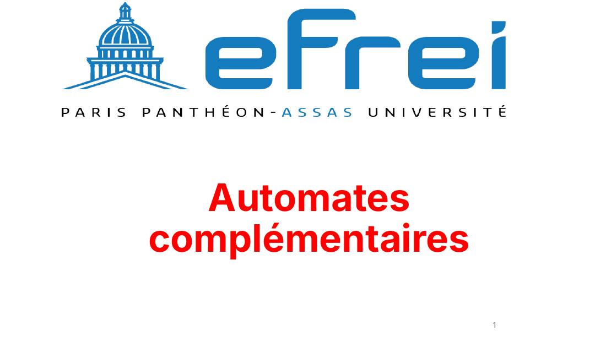
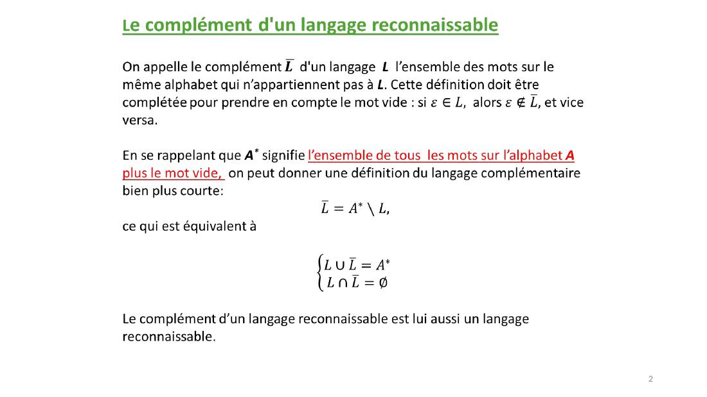
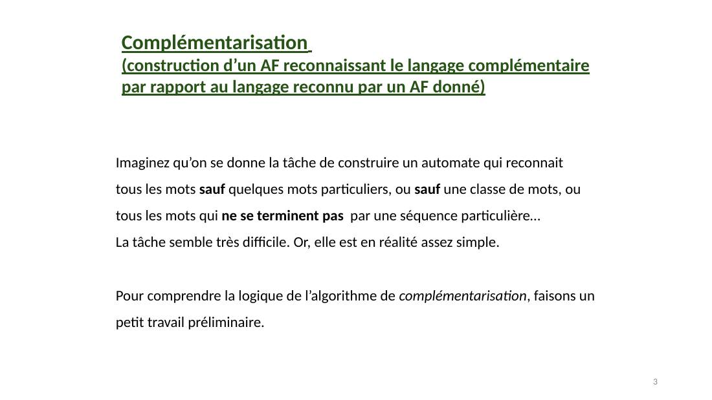
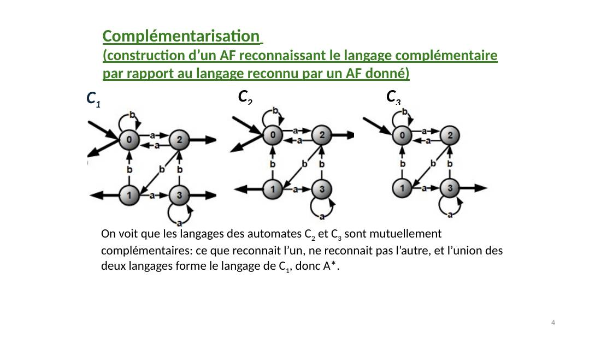
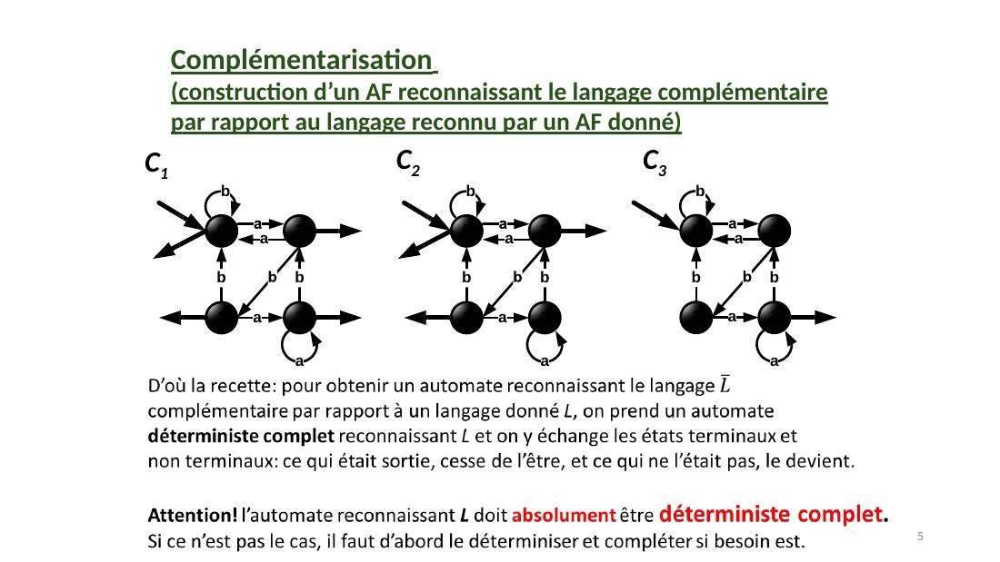
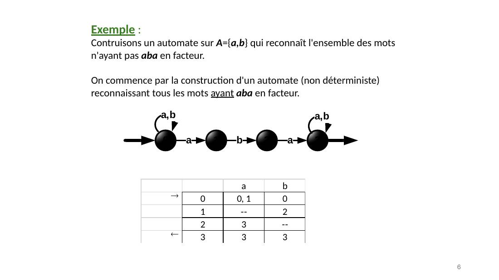
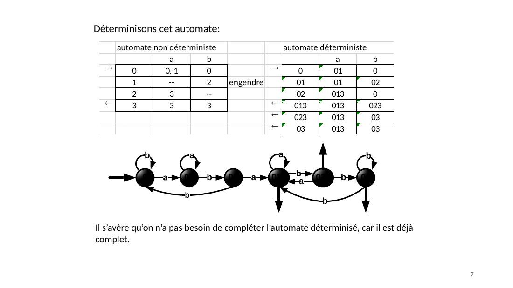
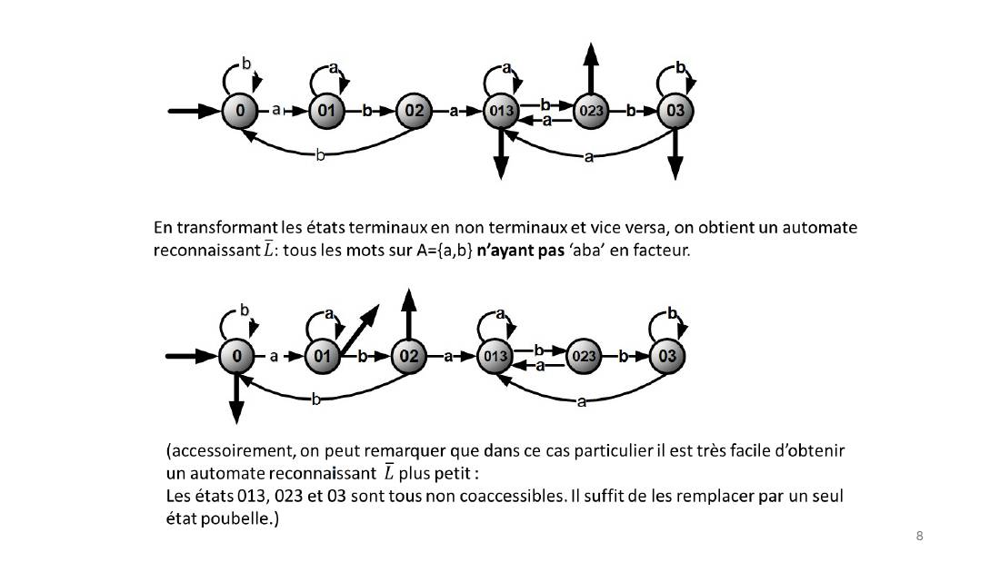
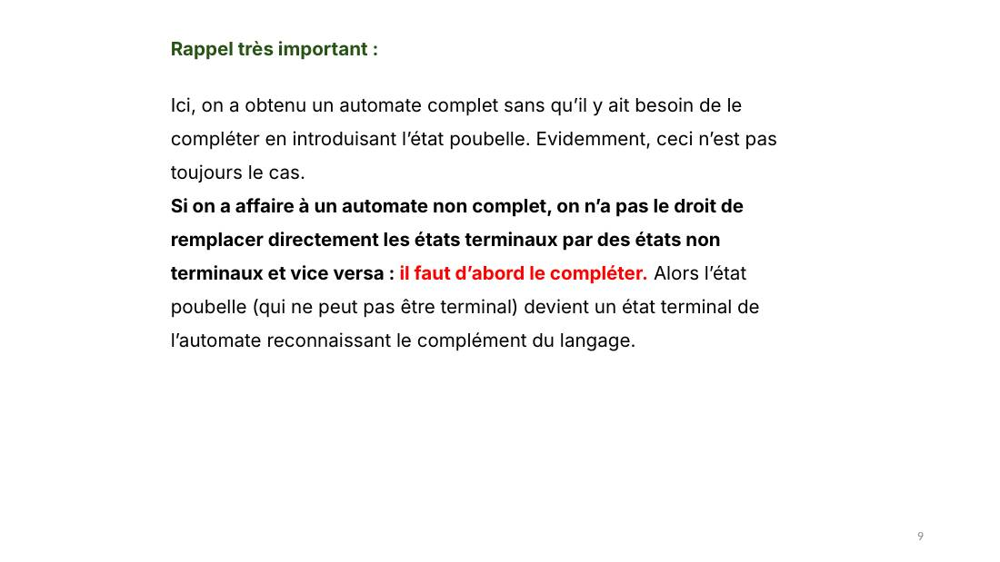
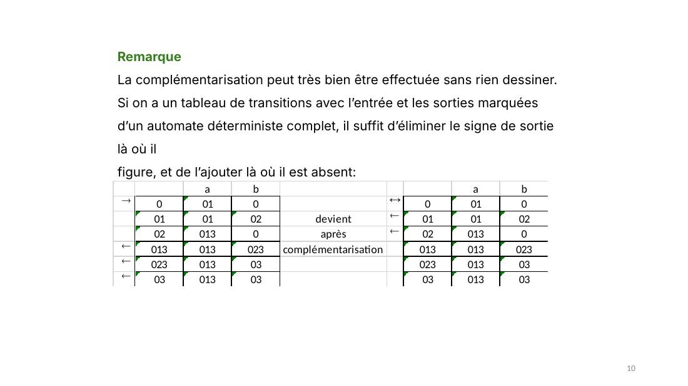

# Chapitre 3 — Automate reconnaissant le langage complémentaire

=== "Version simplifiée"

    Reconnaître « tous les mots **sauf** ceux qui contiennent $aba$ » semble difficile. En fait, c'est presque gratuit :
    on construit l'automate du langage $L$, puis on le transforme pour reconnaître $\overline L = A^* \setminus L$.

    !!! methode "Algorithme du complémentaire"
        1. Partir d'un automate de $L$, le **déterminiser** s'il ne l'est pas.
        2. Le **compléter** (état poubelle) s'il ne l'est pas.
        3. **Échanger** terminaux et non terminaux : chaque S disparaît, chaque état sans S en reçoit un (la poubelle comprise).

    !!! piege "Les deux étapes préalables sont obligatoires"
        - Sur un automate **non complet**, un mot qui « tombe » faute de transition ne serait reconnu par aucun des deux automates.
          C'est l'état poubelle qui, en devenant terminal, récupère ces mots.
        - Sur un automate **non déterministe**, un mot peut avoir un chemin réussi et un chemin raté : échanger les sorties ne donne pas le complémentaire.

    ## Exemple : les mots sans le facteur $aba$

    Automate des mots **contenant** $aba$ : $0 \xrightarrow{a,b} 0$, $0 \xrightarrow{a} 1 \xrightarrow{b} 2 \xrightarrow{a} 3$, $3 \xrightarrow{a,b} 3$, sortie 3.
    Sa déterminisation est déjà complète :

    | Contient $aba$ | état | a | b | | Sans $aba$ | état | a | b |
    |---|---|---|---|---|---|---|---|---|
    | E | 0 | 01 | 0 | | E/S | 0 | 01 | 0 |
    | | 01 | 01 | 02 | | S | 01 | 01 | 02 |
    | | 02 | 013 | 0 | | S | 02 | 013 | 0 |
    | S | 013 | 013 | 023 | | | 013 | 013 | 023 |
    | S | 023 | 013 | 03 | | | 023 | 013 | 03 |
    | S | 03 | 013 | 03 | | | 03 | 013 | 03 |

    La complémentation se fait **directement sur la table**, sans rien dessiner.

=== "Version papier"

    Les diapos du CTD 3.

    <!-- papier: pdf/SM402P/ctd3.pdf | CTD 3 — Automates complémentaires | ctd3 | diapo -->

    [{ loading=lazy .papier }](papier/ctd3/p01.jpg)
    
CTD 3 — Automates complémentaires, diapo 1

    [{ loading=lazy .papier }](papier/ctd3/p02.jpg)
    
CTD 3 — Automates complémentaires, diapo 2

    [{ loading=lazy .papier }](papier/ctd3/p03.jpg)
    
(construction d’un AF reconnaissant le langage complémentaire · CTD 3 — Automates complémentaires, diapo 3

    [{ loading=lazy .papier }](papier/ctd3/p04.jpg)
    
(construction d’un AF reconnaissant le langage complémentaire · CTD 3 — Automates complémentaires, diapo 4

    [{ loading=lazy .papier }](papier/ctd3/p05.jpg)
    
(construction d’un AF reconnaissant le langage complémentaire · CTD 3 — Automates complémentaires, diapo 5

    [{ loading=lazy .papier }](papier/ctd3/p06.jpg)
    
Exemple : · CTD 3 — Automates complémentaires, diapo 6

    [{ loading=lazy .papier }](papier/ctd3/p07.jpg)
    
Déterminisons cet automate: · CTD 3 — Automates complémentaires, diapo 7

    [{ loading=lazy .papier }](papier/ctd3/p08.jpg)
    
CTD 3 — Automates complémentaires, diapo 8

    [{ loading=lazy .papier }](papier/ctd3/p09.jpg)
    
Rappel très important : · CTD 3 — Automates complémentaires, diapo 9

    [{ loading=lazy .papier }](papier/ctd3/p10.jpg)
    
La complémentarisation peut très bien être effectuée sans rien dessiner. · CTD 3 — Automates complémentaires, diapo 10

    <!-- /papier -->
