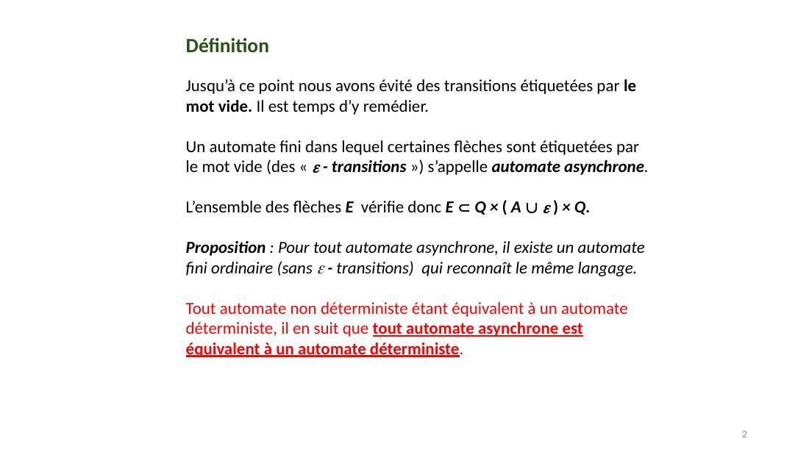
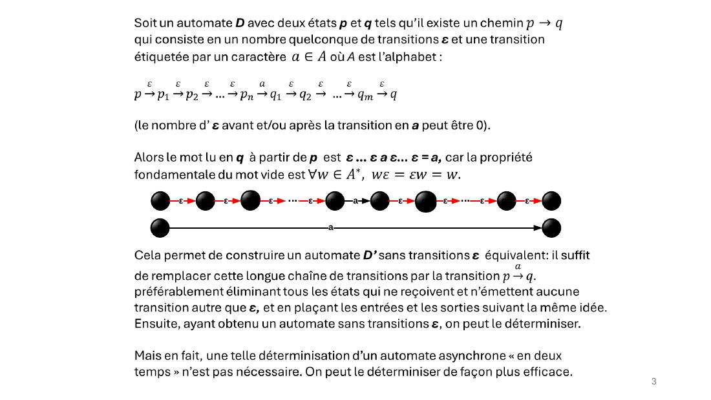
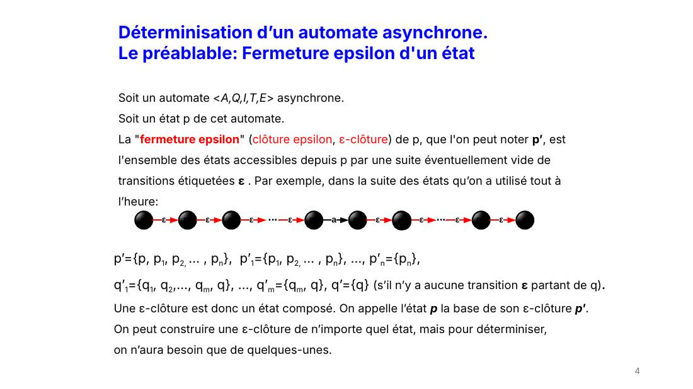
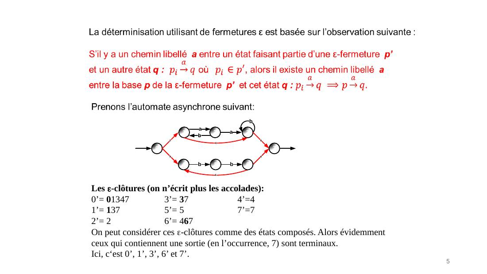
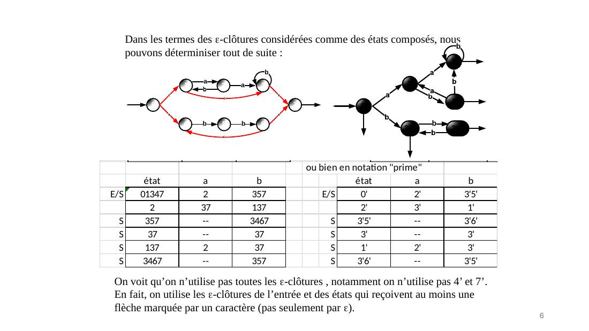
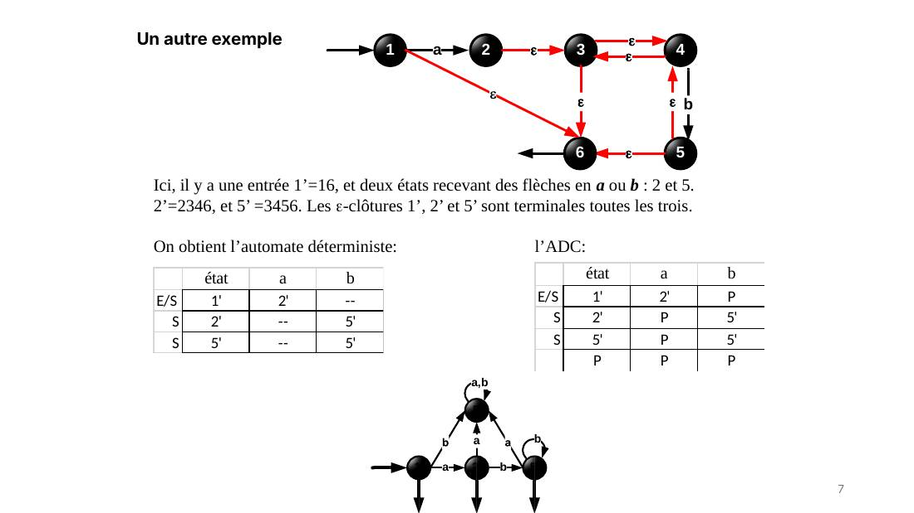

# Chapitre 4 — Automates asynchrones

=== "Version simplifiée"

    !!! definition "Automate asynchrone"
        Un automate est **asynchrone** s'il a des **ε-transitions** : des flèches étiquetées par le mot vide, qu'on peut emprunter
        **sans lire de lettre**. $E \subseteq Q \times (A \cup \{\varepsilon\}) \times Q$.

    Ils apparaissent naturellement quand on construit un automate à partir d'une expression rationnelle ([chapitre 5](chapitre-5-er-vers-automate.md)).

    !!! theoreme "Équivalence"
        Tout automate asynchrone est équivalent à un automate sans ε-transition, donc à un automate **déterministe**.

    ## La ε-clôture

    !!! definition "ε-clôture d'un état"
        La ε-clôture de $p$, notée $p'$, est l'ensemble des états accessibles depuis $p$ en ne suivant **que** des ε-transitions
        (zéro, une ou plusieurs), **$p$ compris**.

    Exemple du cours : avec $0 \xrightarrow{\varepsilon} 1$, $0 \xrightarrow{\varepsilon} 4$, $1 \xrightarrow{\varepsilon} 3$, $3 \xrightarrow{\varepsilon} 7$, $6 \xrightarrow{\varepsilon} 4$…,
    on obtient $0' = \{0, 1, 3, 4, 7\}$, $1' = \{1, 3, 7\}$, $2' = \{2\}$, $3' = \{3, 7\}$, $6' = \{4, 6, 7\}$.

    ## Déterminiser un automate asynchrone

    !!! methode "Algorithme"
        1. Calculer la ε-clôture de l'**entrée** (de toutes les entrées s'il y en a plusieurs) : c'est l'**état initial** du déterminisé.
        2. Pour un état composé $S$ et une lettre $a$ : prendre les cibles des transitions en $a$ partant des états de $S$,
           puis **remplacer chaque cible par sa ε-clôture**.
        3. Continuer comme une déterminisation classique.
        4. **Terminaux** : les états composés qui contiennent un état terminal d'origine.

        On n'a besoin que des ε-clôtures de l'entrée et des états qui **reçoivent une flèche étiquetée par une lettre**.

    !!! piege "La clôture se prend après la lettre"
        Une étape = lire une lettre, **puis** suivre autant d'ε qu'on veut. Oublier la clôture de l'état d'arrivée fait perdre des mots.
        Et l'état initial est la **clôture** de l'entrée, pas l'entrée seule.

    Second exemple du cours : entrée $1' = \{1, 6\}$, et deux états reçoivent une lettre, $2' = \{2, 3, 4, 6\}$ et $5' = \{3, 4, 5, 6\}$, tous terminaux.
    On obtient l'automate déterministe complet $1' \xrightarrow{a} 2' \xrightarrow{b} 5' \xrightarrow{b} 5'$, plus la poubelle pour les autres transitions.

=== "Version papier"

    Les diapos du CTD 4.

    <!-- papier: pdf/SM402P/ctd4.pdf | CTD 4 — Automates asynchrones | ctd4 | diapo -->

    [{ loading=lazy .papier }](papier/ctd4/p01.jpg)
    
CTD 4 — Automates asynchrones, diapo 1

    [{ loading=lazy .papier }](papier/ctd4/p02.jpg)
    
Jusqu’à ce point nous avons évité des transitions étiquetées par le · CTD 4 — Automates asynchrones, diapo 2

    [{ loading=lazy .papier }](papier/ctd4/p03.jpg)
    
CTD 4 — Automates asynchrones, diapo 3

    [{ loading=lazy .papier }](papier/ctd4/p04.jpg)
    
Déterminisation d’un automate asynchrone. · CTD 4 — Automates asynchrones, diapo 4

    [{ loading=lazy .papier }](papier/ctd4/p05.jpg)
    
Les -clôtures (on n’écrit plus les accolades): · CTD 4 — Automates asynchrones, diapo 5

    [{ loading=lazy .papier }](papier/ctd4/p06.jpg)
    
ou bien en notation &quot;prime&quot; : · CTD 4 — Automates asynchrones, diapo 6

    [{ loading=lazy .papier }](papier/ctd4/p07.jpg)
    
Un autre exemple · CTD 4 — Automates asynchrones, diapo 7

    <!-- /papier -->
