# Chapitre 7 — Trouver l'expression rationnelle d'un automate

=== "Version simplifiée"

    Deux méthodes algorithmiques. Elles peuvent donner des ER d'aspect différent, mais **équivalentes**.
    Pour vérifier que deux ER sont équivalentes : construire leurs automates, déterminiser, minimiser, et comparer.

    ## Méthode de l'arrivée (système d'équations)

    Pour chaque état $q$, on note $X_q$ le langage des mots qui **arrivent** en $q$ depuis une entrée.

    !!! methode "Écrire les équations"
        - Pour chaque flèche $p \xrightarrow{a} q$, $X_q$ contient $X_pa$ (la lettre est à **droite**).
        - Si $q$ est une **entrée**, $X_q$ contient $\varepsilon$.
        - $X_q$ est la **somme** de tous ces termes.
        - Le langage de l'automate est la **somme** des $X_t$ pour les états terminaux $t$.

    !!! theoreme "Lemme d'Arden"
        Si $\varepsilon \notin Y$, l'équation $X = XY + Z$ a pour unique solution $X = ZY^*$.

        (Dans la méthode de l'arrivée, l'inconnue est à **gauche** du facteur : $X = XY + Z$ donne $ZY^*$, et non $Y^*Z$.)

    **Exemple du cours** : $1 \xrightarrow{b} 1$, $1 \xrightarrow{a} 2$, $2 \xrightarrow{a} 2$, $2 \xrightarrow{b} 3$, $3 \xrightarrow{b} 1$, entrée 1, sortie 3.

    $$
    \begin{cases} X_1 = X_1b + X_3b + \varepsilon \\ X_2 = X_1a + X_2a \\ X_3 = X_2b \end{cases}
    $$

    Arden sur la 2e : $X_2 = X_1aa^*$. Donc $X_3 = X_1aa^*b$ et $X_1 = X_1(b + aa^*bb) + \varepsilon$, d'où $X_1 = (b + aa^*bb)^*$ et

    $$
    L = X_3 = (b + aa^*bb)^*aa^*b.
    $$

    !!! piege "Ne jamais mélanger avec la méthode du départ"
        Il existe une méthode « du départ » (langages des mots qui **partent** d'un état), où les lettres sont à gauche.
        Les deux marchent, mais mélanger les conventions donne des résultats faux. Le cours utilise la méthode de l'arrivée.

    ## Méthode d'élimination d'états

    On travaille sur un **automate généralisé** dont les flèches portent des ER.

    !!! methode "Algorithme"
        1. Ajouter un état $i$ avec $i \xrightarrow{\varepsilon}$ chaque entrée, et un état $t$ avec chaque sortie $\xrightarrow{\varepsilon} t$.
        2. Éliminer les autres états **un par un** (dans n'importe quel ordre). Pour éliminer $G$ avec une boucle $Z$ :
           chaque chemin $A \xrightarrow{X} G \xrightarrow{Y} B$ devient $A \xrightarrow{XZ^*Y} B$.
        3. Deux flèches parallèles $A \xrightarrow{U} B$ et $A \xrightarrow{V} B$ fusionnent en $A \xrightarrow{U + V} B$.
        4. À la fin, l'ER sur la flèche $i \to t$ est le langage.

    Sur l'exemple : éliminer 3, puis 2, puis 1 redonne $(b + aa^*bb)^*aa^*b$.

=== "Version papier"

    Les diapos du CTD 7.

    <!-- papier: pdf/SM402P/ctd7.pdf | CTD 7 — Automate fini vers ER | ctd7 | diapo -->

    [{ loading=lazy .papier }](papier/ctd7/p01.jpg)
    
Automate fini ER · CTD 7 — Automate fini vers ER, diapo 1

    [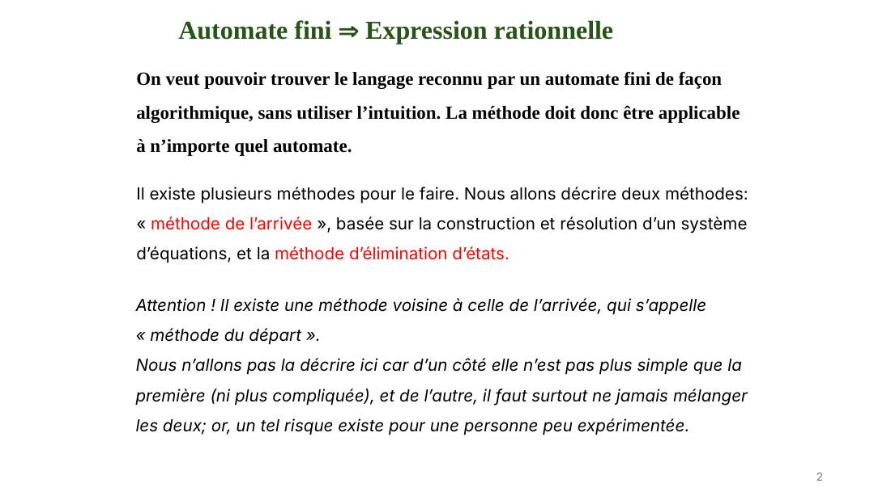{ loading=lazy .papier }](papier/ctd7/p02.jpg)
    
Automate fini  Expression rationnelle · CTD 7 — Automate fini vers ER, diapo 2

    [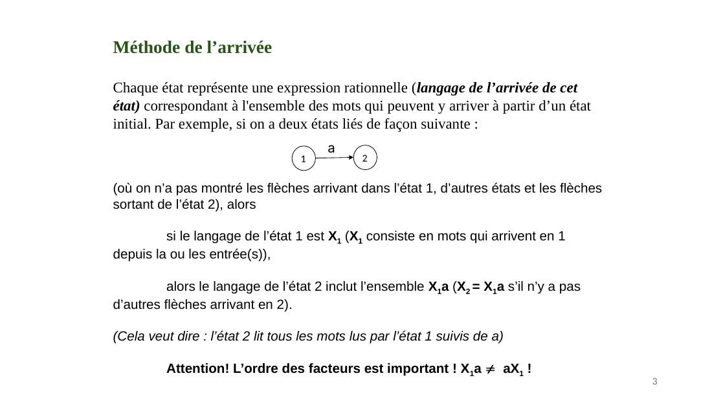{ loading=lazy .papier }](papier/ctd7/p03.jpg)
    
Méthode de l’arrivée · CTD 7 — Automate fini vers ER, diapo 3

    [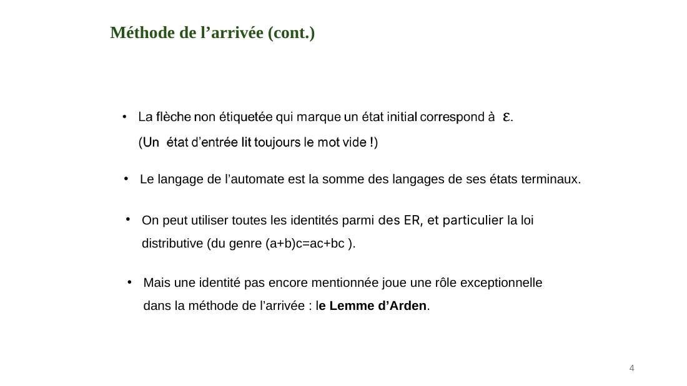{ loading=lazy .papier }](papier/ctd7/p04.jpg)
    
Le langage de l’automate est la somme des langages de ses états terminaux. · CTD 7 — Automate fini vers ER, diapo 4

    [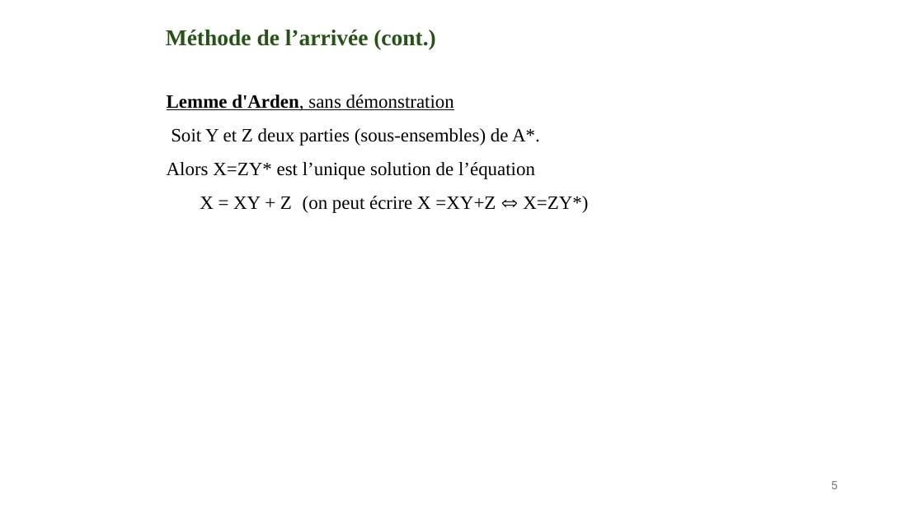{ loading=lazy .papier }](papier/ctd7/p05.jpg)
    
Lemme d&#x27;Arden, sans démonstration · CTD 7 — Automate fini vers ER, diapo 5

    [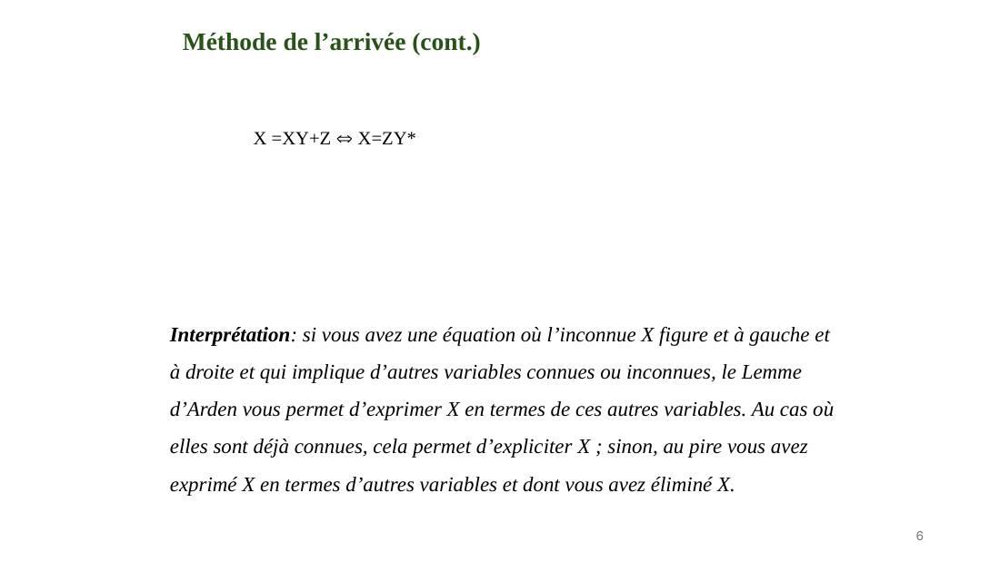{ loading=lazy .papier }](papier/ctd7/p06.jpg)
    
Interprétation: si vous avez une équation où l’inconnue X figure et à gauche et · CTD 7 — Automate fini vers ER, diapo 6

    [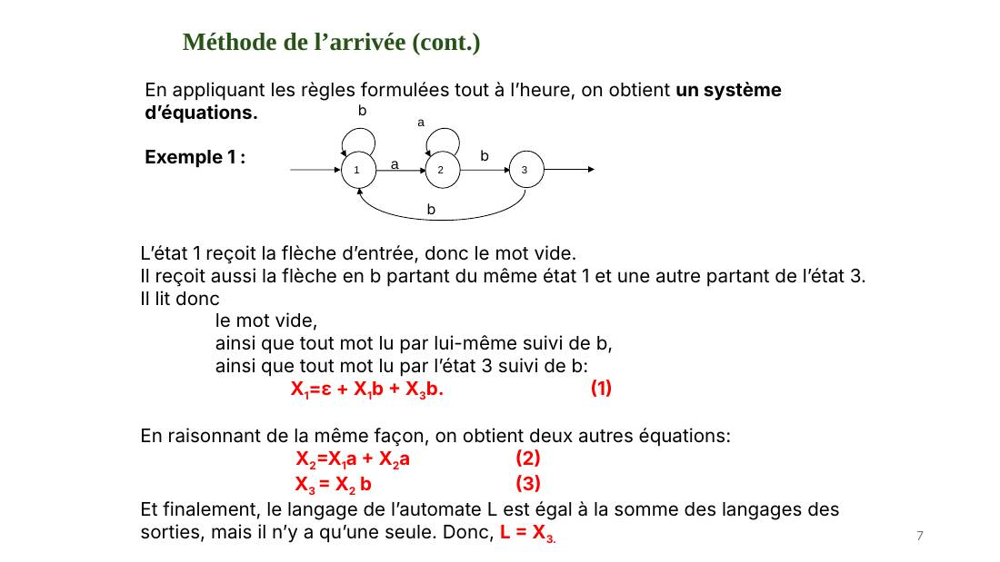{ loading=lazy .papier }](papier/ctd7/p07.jpg)
    
En appliquant les règles formulées tout à l’heure, on obtient un système · CTD 7 — Automate fini vers ER, diapo 7

    [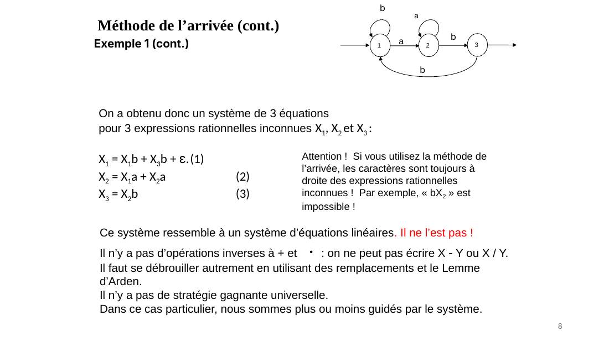{ loading=lazy .papier }](papier/ctd7/p08.jpg)
    
Exemple 1 (cont.) · CTD 7 — Automate fini vers ER, diapo 8

    [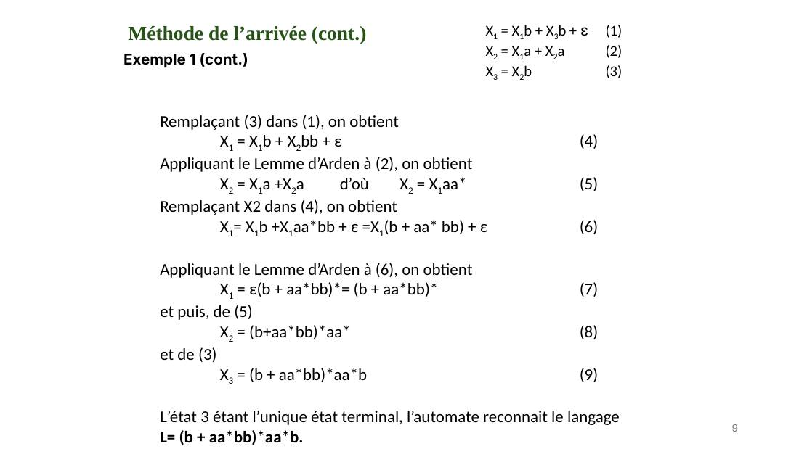{ loading=lazy .papier }](papier/ctd7/p09.jpg)
    
Exemple 1 (cont.) · CTD 7 — Automate fini vers ER, diapo 9

    [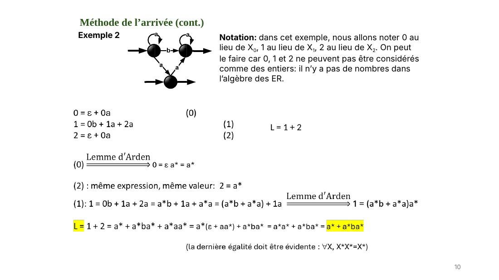{ loading=lazy .papier }](papier/ctd7/p10.jpg)
    
Exemple 2 · CTD 7 — Automate fini vers ER, diapo 10

    [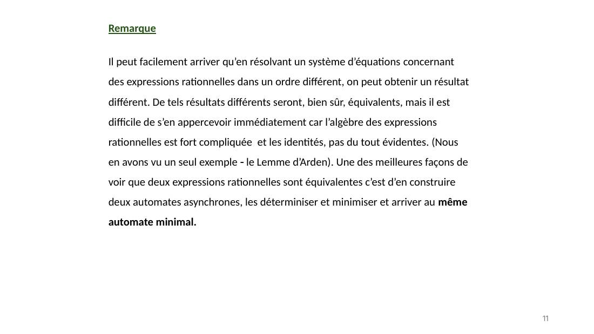{ loading=lazy .papier }](papier/ctd7/p11.jpg)
    
Il peut facilement arriver qu’en résolvant un système d’équations concernant · CTD 7 — Automate fini vers ER, diapo 11

    [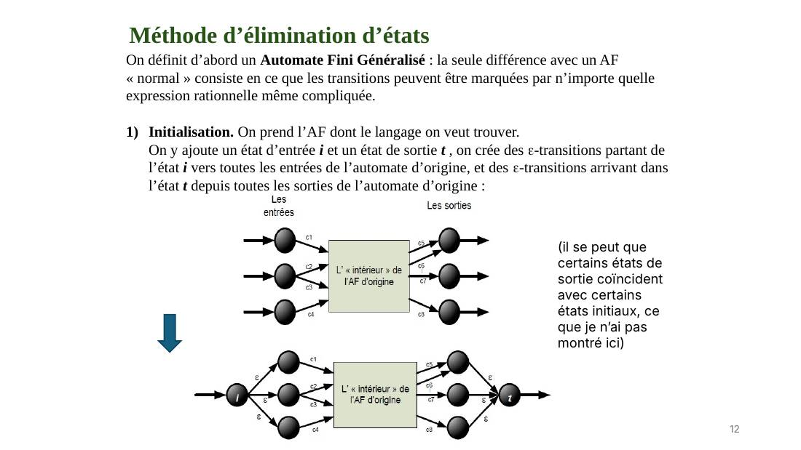{ loading=lazy .papier }](papier/ctd7/p12.jpg)
    
Méthode d’élimination d’états · CTD 7 — Automate fini vers ER, diapo 12

    [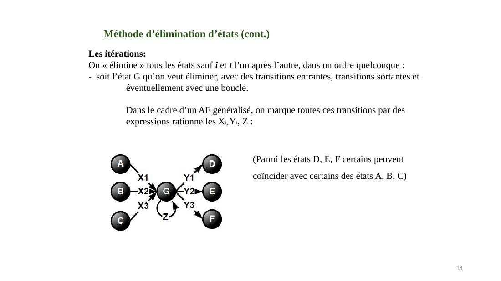{ loading=lazy .papier }](papier/ctd7/p13.jpg)
    
Les itérations: · CTD 7 — Automate fini vers ER, diapo 13

    [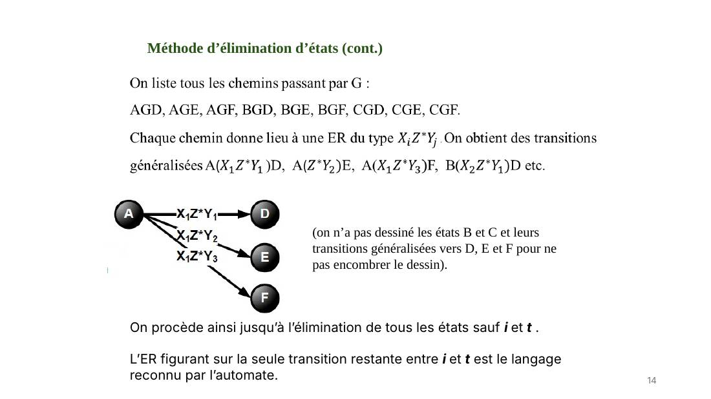{ loading=lazy .papier }](papier/ctd7/p14.jpg)
    
(on n’a pas dessiné les états B et C et leurs · CTD 7 — Automate fini vers ER, diapo 14

    [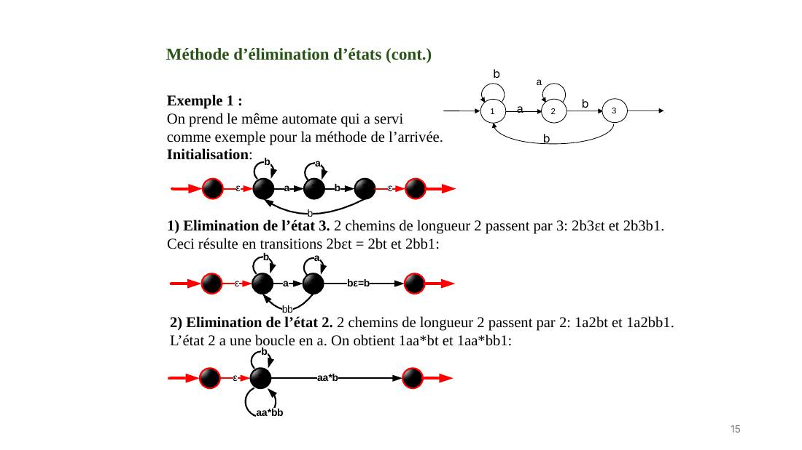{ loading=lazy .papier }](papier/ctd7/p15.jpg)
    
Exemple 1 : · CTD 7 — Automate fini vers ER, diapo 15

    [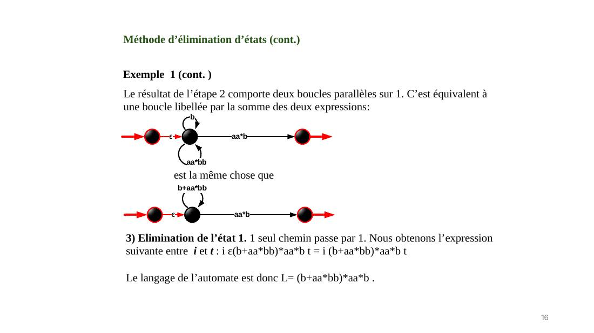{ loading=lazy .papier }](papier/ctd7/p16.jpg)
    
Exemple 1 (cont. ) · CTD 7 — Automate fini vers ER, diapo 16

    [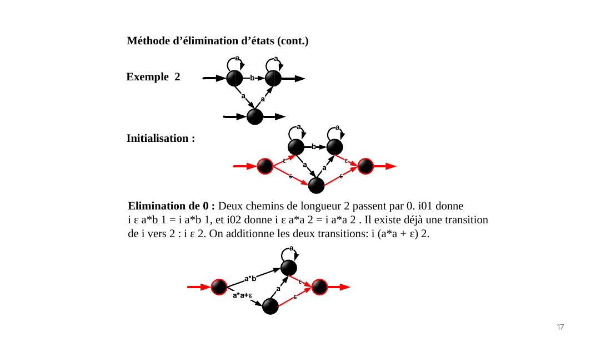{ loading=lazy .papier }](papier/ctd7/p17.jpg)
    
Exemple 2 · CTD 7 — Automate fini vers ER, diapo 17

    [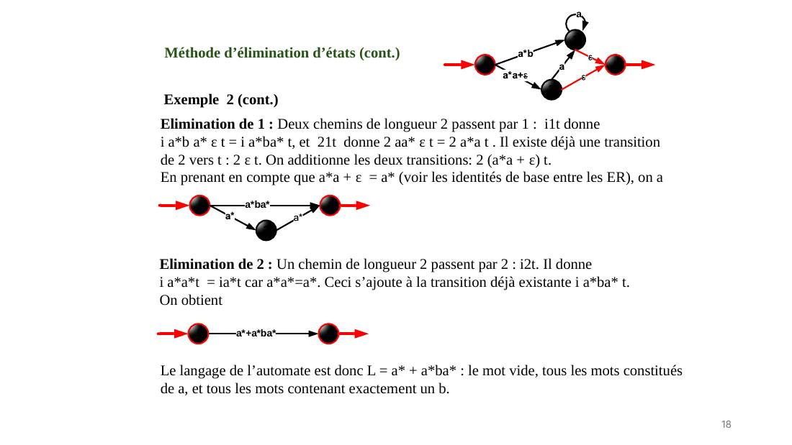{ loading=lazy .papier }](papier/ctd7/p18.jpg)
    
Exemple 2 (cont.) · CTD 7 — Automate fini vers ER, diapo 18

    [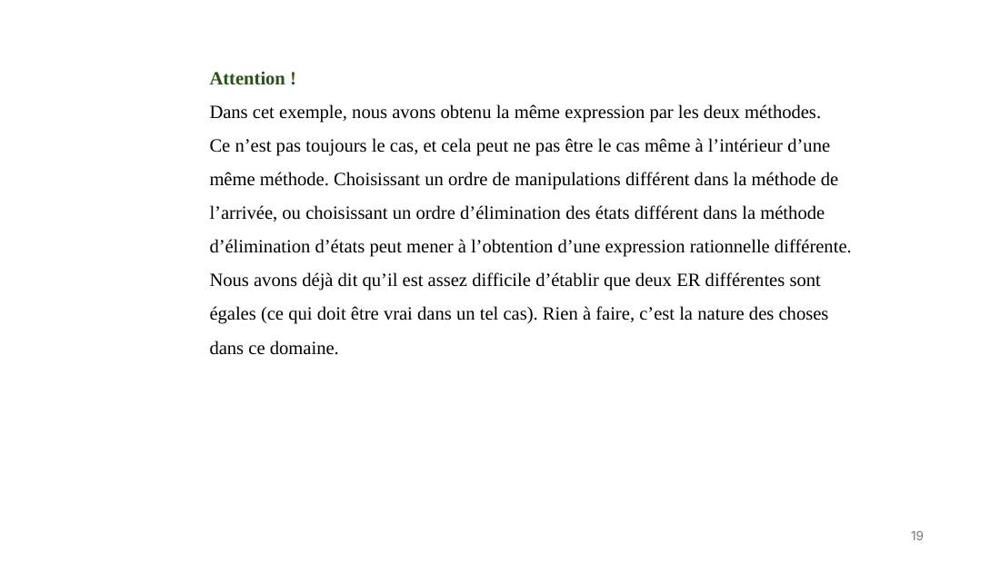{ loading=lazy .papier }](papier/ctd7/p19.jpg)
    
Attention ! · CTD 7 — Automate fini vers ER, diapo 19

    <!-- /papier -->
