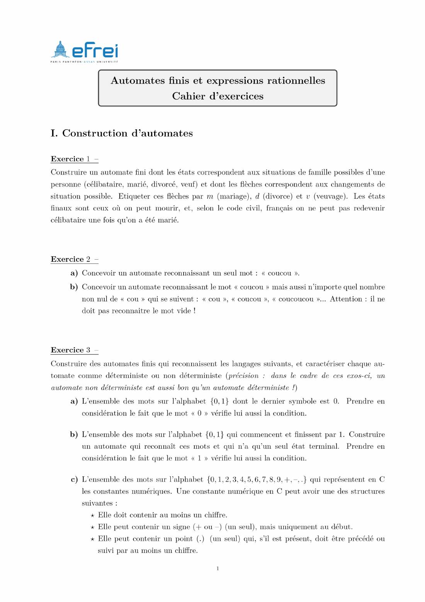
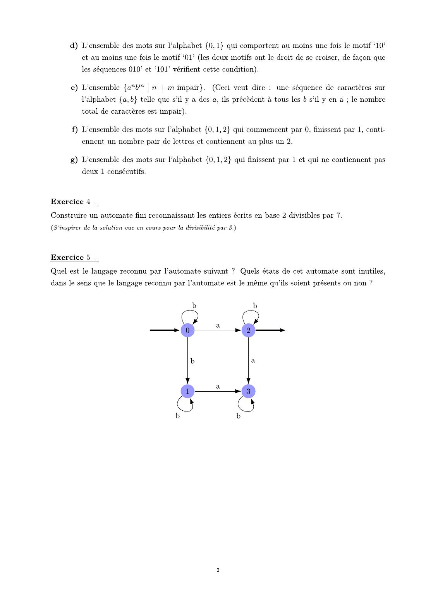

# TD 1 — Construction d'automates (exercices 1 à 5)

=== "Version simplifiée"

    Rappels : [chapitre 1](../cours/chapitre-1-automates-finis.md). Pour construire un automate, demande-toi
    **ce qu'il faut retenir** du début du mot pour décider de la suite : chaque information à retenir devient un état.

    ## Exercice 1 — Situations de famille

    ??? success "Correction"
        États : C (célibataire, entrée), M (marié), D (divorcé), V (veuf). Tous sont **terminaux** (on peut mourir dans n'importe quelle situation).

        | | état | m | d | v |
        |---|---|---|---|---|
        | E/S | C | M | – | – |
        | S | M | – | D | V |
        | S | D | M | – | – |
        | S | V | M | – | – |

        Aucune flèche ne revient vers C : on ne redevient pas célibataire. L'automate est déterministe (non complet).

    ## Exercice 2 — « coucou »

    ??? success "Correction"
        **a)** Une chaîne de 7 états : $0 \xrightarrow{c} 1 \xrightarrow{o} 2 \xrightarrow{u} 3 \xrightarrow{c} 4 \xrightarrow{o} 5 \xrightarrow{u} 6$, entrée 0, sortie 6.

        **b)** Le langage est $(cou)^+ = cou(cou)^*$ : $0 \xrightarrow{c} 1 \xrightarrow{o} 2 \xrightarrow{u} 3$, sortie 3, et **retour** $3 \xrightarrow{c} 1$.
        L'entrée 0 n'est pas une sortie : le mot vide n'est pas reconnu.

    ## Exercice 3 — Sept langages

    ??? success "Correction"
        Tous les automates proposés sont **déterministes**.

        **a) Mots sur $\{0, 1\}$ qui finissent par 0** : l'état retient la dernière lettre lue.

        | | état | 0 | 1 |
        |---|---|---|---|
        | E | A | B | A |
        | S | B | B | A |

        **b) Commencent et finissent par 1** (une seule sortie) : 0 = début, 1 = « a commencé par 1 et le dernier symbole est 1 », 2 = « a commencé par 1, dernier symbole 0 ».

        | | état | 0 | 1 |
        |---|---|---|---|
        | E | 0 | – | 1 |
        | S | 1 | 2 | 1 |
        | | 2 | 2 | 1 |

        **c) Constantes numériques du C** (signe facultatif, au moins un chiffre, au plus un point) :

        | | état | chiffre | + ou − | . |
        |---|---|---|---|---|
        | E | 0 | 2 | 1 | 3 |
        | | 1 (signe lu) | 2 | – | 3 |
        | S | 2 (chiffres avant le point) | 2 | – | 4 |
        | | 3 (point sans chiffre avant) | 4 | – | – |
        | S | 4 (après le point, au moins un chiffre au total) | 4 | – | – |

        Reconnus : `12`, `-3.`, `+.5`, `4.25` ; refusés : `.`, `+-2`, `1.2.3`, `5+`.

        **d) Contient 10 et 01** : il faut avoir changé de symbole **deux fois** au moins.

        | | état | 0 | 1 |
        |---|---|---|---|
        | E | S (début) | Z | U |
        | | Z (que des 0) | Z | B |
        | | U (que des 1) | C | U |
        | | B (vu 01) | F | B |
        | | C (vu 10) | C | F |
        | S | F (vu les deux) | F | F |

        **e) $a^nb^m$ avec $n + m$ impair** : on retient la **parité** de la longueur et si l'on a commencé les $b$.

        | | état | a | b |
        |---|---|---|---|
        | E | pair, phase a | impair, phase a | impair, phase b |
        | S | impair, phase a | pair, phase a | pair, phase b |
        | | pair, phase b | – | impair, phase b |
        | S | impair, phase b | – | pair, phase b |

        **f) Commence par 0, finit par 1, longueur paire, au plus un 2** : on retient (parité, nombre de 2 déjà lus, dernière lettre = 1 ?).
        Après minimisation, 8 états (poubelle comprise) :

        | | état | 0 | 1 | 2 |
        |---|---|---|---|---|
        | E | début | A | P | P |
        | | A (impair, aucun 2) | B | S₀ | C |
        | | B (pair, aucun 2, fin ≠ 1) | A | A | D |
        | S | S₀ (pair, aucun 2, fin = 1) | A | A | D |
        | | C (pair, un 2) | D | D | P |
        | | D (impair, un 2) | C | S₁ | P |
        | S | S₁ (pair, un 2, fin = 1) | D | D | P |
        | | P | P | P | P |

        **g) Finit par 1, sans deux 1 consécutifs** :

        | | état | 0 | 1 | 2 |
        |---|---|---|---|---|
        | E | N (dernier ≠ 1) | N | U | N |
        | S | U (dernier = 1) | N | P | N |
        | | P | P | P | P |

    ## Exercice 4 — Divisibilité par 7 en base 2

    ??? success "Correction"
        Même idée que pour 3 ([chapitre 8](../cours/chapitre-8-standardisation.md)) : l'état est le reste $r$ modulo 7, et lire le bit $b$ mène à $(2r + b) \bmod 7$.

        | | $r$ | 0 | 1 |
        |---|---|---|---|
        | E/S | 0 | 0 | 1 |
        | | 1 | 2 | 3 |
        | | 2 | 4 | 5 |
        | | 3 | 6 | 0 |
        | | 4 | 1 | 2 |
        | | 5 | 3 | 4 |
        | | 6 | 5 | 6 |

        Exemple : $1110_2 = 14$ passe par 1, 3, 0, 0 : reconnu. Pour ne pas reconnaître le mot vide, standardiser puis retirer la sortie du nouvel état initial.

    ## Exercice 5 — Langage et états inutiles

    ??? success "Correction"
        Depuis 0 : on lit des $b$ (boucle), puis un $a$ vers 2 (sortie), puis des $b$ (boucle). Langage : **$b^*ab^*$**, les mots qui contiennent **exactement un** $a$.

        Les états **1 et 3** sont inutiles : ils ne sont pas **coaccessibles** (aucun chemin ne mène d'eux vers la sortie 2). On peut les supprimer sans changer le langage.

=== "Version papier"

    Les énoncés de la partie I du cahier d'exercices.

    <!-- papier: pdf/SM402P/td.pdf | Cahier d'exercices | td1 | page | 1-2 -->

    [{ loading=lazy .papier }](papier/td1/p01.jpg)
    
Cahier d&#x27;exercices, page 1

    [{ loading=lazy .papier }](papier/td1/p02.jpg)
    
Cahier d&#x27;exercices, page 2

    <!-- /papier -->
