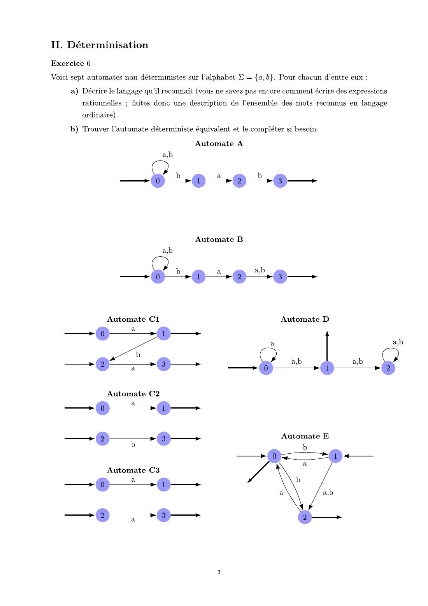
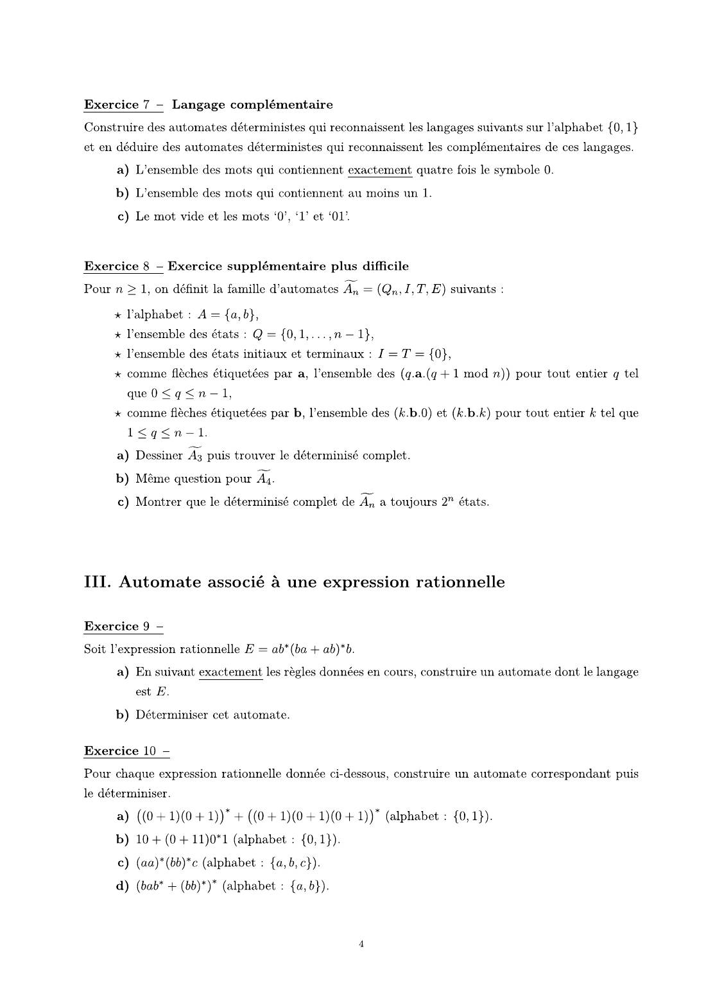

# TD 2 — Déterminisation et langage complémentaire (exercices 6 à 8)

=== "Version simplifiée"

    Rappels : [chapitre 2](../cours/chapitre-2-determinisation.md) et [chapitre 3](../cours/chapitre-3-complementaire.md).
    Dans les tables des déterminisés, « 013 » désigne l'état composé $\{0, 1, 3\}$ et P l'état poubelle (ensemble vide) ajouté pour compléter.

    ## Exercice 6 — Sept automates non déterministes

    ??? success "Automate A"
        **Langage** : les mots qui **finissent par $bab$**.

        | | état | a | b |
        |---|---|---|---|
        | E | 0 | 0 | 01 |
        | | 01 | 02 | 01 |
        | | 02 | 0 | 013 |
        | S | 013 | 02 | 01 |

        Déjà complet (4 états, et il est minimal).

    ??? success "Automate B"
        **Langage** : les mots qui finissent par $ba$ suivi d'une lettre quelconque, $(a + b)^*ba(a + b)$ (l'antépénultième lettre est $b$ et l'avant-dernière $a$).

        | | état | a | b |
        |---|---|---|---|
        | E | 0 | 0 | 01 |
        | | 01 | 02 | 01 |
        | | 02 | 03 | 013 |
        | S | 03 | 0 | 01 |
        | S | 013 | 02 | 01 |

        Complet, 5 états (minimal).

    ??? success "Automates C1, C2, C3"
        **C1** : deux entrées 0 et 2 ; langage $\{a,\ aba\}$.

        | | état | a | b |
        |---|---|---|---|
        | E | 02 | 13 | P |
        | S | 13 | P | 2 |
        | | 2 | 3 | P |
        | S | 3 | P | P |
        | | P | P | P |

        **C2** : langage $\{a, b\}$. Déterminisé : $02 \xrightarrow{a} 1$, $02 \xrightarrow{b} 3$, sorties 1 et 3, tout le reste vers P.

        **C3** : langage $\{a\}$ (les deux branches lisent le même mot). Déterminisé : $02 \xrightarrow{a} 13$ (sortie), tout le reste vers P.
        Morale : la déterminisation **fusionne** les branches qui lisent les mêmes mots.

    ??? success "Automate D"
        **Langage** : des $a$ puis une dernière lettre quelconque, $a^*(a + b)$ : les mots non vides dont toutes les lettres sauf la dernière sont des $a$.

        | | état | a | b |
        |---|---|---|---|
        | E | 0 | 01 | 1 |
        | S | 01 | 012 | 12 |
        | S | 1 | 2 | 2 |
        | S | 012 | 012 | 12 |
        | S | 12 | 2 | 2 |
        | | 2 | 2 | 2 |

        L'état 2 joue le rôle de poubelle (non terminal, boucle sur tout) : pas besoin d'en ajouter une. Après minimisation, 4 états
        (01 et 012 fusionnent, 1 et 12 aussi) : c'est l'automate de l'[exercice 12](td-4-minimisation.md).

    ??? success "Automate E"
        Entrées 0 et 1, sorties 0 et 2.

        | | état | a | b |
        |---|---|---|---|
        | E/S | 01 | 02 | 12 |
        | S | 02 | 0 | 12 |
        | S | 12 | 02 | 2 |
        | S | 0 | P | 12 |
        | S | 2 | 0 | P |
        | | P | P | P |

        Tous les états sauf P sont terminaux. **Langage** : les mots qui ne contiennent **ni $aaa$, ni $bbb$, ni $bbaa$** (vérifié par programme sur tous les mots jusqu'à 9 lettres).

    ## Exercice 7 — Langages complémentaires

    ??? success "Correction"
        Méthode : automate **déterministe complet**, puis échange des terminaux et non terminaux.

        **a) Exactement quatre 0** : on compte les 0 (états 0 à 4, et P au-delà) ; les 1 bouclent.

        | | état | 0 | 1 | complémentaire |
        |---|---|---|---|---|
        | E | 0 | 1 | 0 | S |
        | | 1 | 2 | 1 | S |
        | | 2 | 3 | 2 | S |
        | | 3 | 4 | 3 | S |
        | S | 4 | P | 4 | non |
        | | P | P | P | S |

        Le complémentaire (« pas exactement quatre 0 ») a pour sorties 0, 1, 2, 3 et P.

        **b) Au moins un 1** : $A \xrightarrow{0} A$, $A \xrightarrow{1} B$, $B \xrightarrow{0,1} B$, sortie B. Complémentaire : sortie A seulement, il reconnaît $0^*$ (mot vide compris).

        **c) $\{\varepsilon, 0, 1, 01\}$** :

        | | état | 0 | 1 | complémentaire |
        |---|---|---|---|---|
        | E/S | 0 | 1 | 2 | non |
        | S | 1 (lu « 0 ») | P | 2 | non |
        | S | 2 (lu « 1 » ou « 01 ») | P | P | non |
        | | P | P | P | S |

        Le complémentaire n'a qu'une sortie, la poubelle : il reconnaît tous les mots sauf ces quatre-là.

    ## Exercice 8 — Famille $\widetilde{A_n}$ (plus difficile)

    ??? success "Correction"
        $a$ fait tourner : $q \xrightarrow{a} q + 1 \bmod n$. $b$ : $k \xrightarrow{b} 0$ et $k \xrightarrow{b} k$ pour $k \ge 1$ (rien en $b$ depuis 0). Entrée et sortie : 0.

        **a)** $\widetilde{A_3}$, déterminisé complet :

        | | état | a | b |
        |---|---|---|---|
        | E/S | 0 | 1 | P |
        | | 1 | 2 | 01 |
        | | 2 | 0 | 02 |
        | S | 01 | 12 | 01 |
        | S | 02 | 01 | 02 |
        | | 12 | 02 | 012 |
        | S | 012 | 012 | 012 |
        | | P | P | P |

        $8 = 2^3$ états : **toutes** les parties de $\{0, 1, 2\}$, l'ensemble vide (P) compris.

        **b)** Pour $\widetilde{A_4}$, on obtient de même les $2^4 = 16$ parties (vérifié par programme ; pareil pour $n = 5$ avec 32 états).

        **c)** Idée de preuve. Pour un ensemble $S$ : $a$ fait **tourner** $S$ ($S + 1 \bmod n$) ; $b$ envoie $S$ sur $S \cup \{0\}$ si $S$ contient un état non nul,
        et sur $\varnothing$ si $S = \{0\}$. En partant de $\{0\}$, en tournant avec $a$ et en ajoutant 0 avec $b$ au bon moment, on construit n'importe quel ensemble
        (récurrence sur la taille de $S$) : les $2^n$ parties sont **accessibles**. De plus, deux parties différentes sont distinguées :
        si $k \in S$ et $k \notin S'$, le mot $a^{n-k}$ amène 0 dans l'une et pas dans l'autre. Le déterminisé a donc exactement $2^n$ états, et il est même **minimal** :
        la déterminisation peut vraiment faire exploser le nombre d'états.

=== "Version papier"

    Les énoncés de la partie II du cahier d'exercices.

    <!-- papier: pdf/SM402P/td.pdf | Cahier d'exercices | td2 | page | 3-4 -->

    [{ loading=lazy .papier }](papier/td2/p03.jpg)
    
Cahier d&#x27;exercices, page 3

    [{ loading=lazy .papier }](papier/td2/p04.jpg)
    
Cahier d&#x27;exercices, page 4

    <!-- /papier -->
