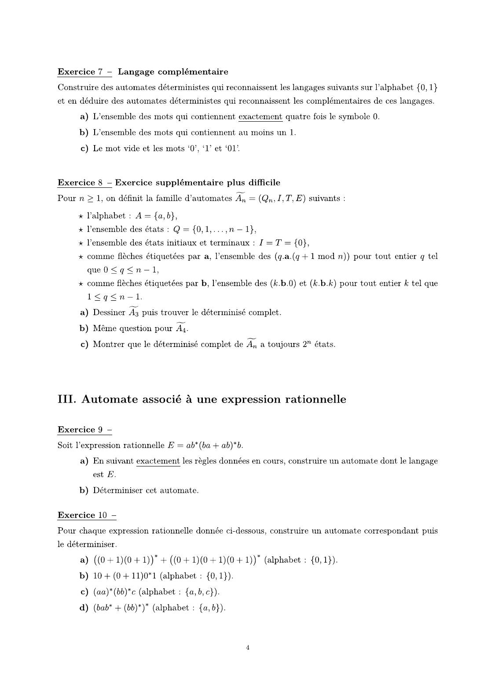

# TD 3 — Automate associé à une expression rationnelle (exercices 9 et 10)

=== "Version simplifiée"

    Rappels : [chapitre 4](../cours/chapitre-4-asynchrones.md) et [chapitre 5](../cours/chapitre-5-er-vers-automate.md).
    La construction « selon les règles » donne un automate asynchrone avec beaucoup d'états ; ses noms dépendent de l'ordre
    dans lequel on numérote. Ce qui ne dépend de rien, c'est l'**automate minimal** : c'est lui que je donne pour vérifier ton résultat
    (et c'est la réponse de l'[exercice 18](td-4-minimisation.md)).

    ## Exercice 9 — $E = ab^*(ba + ab)^*b$

    ??? success "Correction"
        **a) Construction par modules.** $E$ est la concaténation de quatre modules : $a$, $b^*$, $(ba + ab)^*$ et $b$.

        - $a$ et $b$ : une flèche chacun.
        - $b^*$ : nouveaux $i$, $f$ autour de $\xrightarrow{b}$, avec la ε « saut » $i \to f$ et la ε « retour ».
        - $ba + ab$ : nouvel $i$ avec ε vers les deux branches $\xrightarrow{b}\xrightarrow{a}$ et $\xrightarrow{a}\xrightarrow{b}$, qui se rejoignent par ε dans un nouveau $f$ ;
          puis l'étoile ajoute encore deux états et les ε « saut » et « retour ».
        - Les quatre modules sont mis **bout à bout** (sortie de l'un = entrée du suivant).

        **b) Déterminisation** (ε-clôtures), puis complétion. Après minimisation, il reste 9 états (P comprise) :

        | | état | a | b |
        |---|---|---|---|
        | E | 0 | 1 | P |
        | | 1 (lu $a$) | 3 | 4 |
        | | 3 (un $a$ en attente de $b$) | P | 5 |
        | S | 4 | 6 | 4 |
        | | 5 | 3 | 7 |
        | | 6 | 3 | 8 |
        | S | 7 | 5 | P |
        | S | 8 | 6 | 7 |
        | | P | P | P |

        Mots reconnus les plus courts : $ab$, $abb$, $abbb$, $aabb$, $abab$…

    ## Exercice 10 — Quatre expressions

    ??? success "a) $((0 + 1)(0 + 1))^* + ((0 + 1)(0 + 1)(0 + 1))^*$"
        Langage : les mots dont la **longueur** est multiple de 2 **ou** de 3, c'est-à-dire de longueur $\equiv 0, 2, 3$ ou $4 \pmod 6$.
        Automate minimal : un cycle de 6 états qui compte la longueur modulo 6.

        | | longueur mod 6 | 0 | 1 |
        |---|---|---|---|
        | E/S | 0 | 1 | 1 |
        | | 1 | 2 | 2 |
        | S | 2 | 3 | 3 |
        | S | 3 | 4 | 4 |
        | S | 4 | 5 | 5 |
        | | 5 | 0 | 0 |

    ??? success "b) $10 + (0 + 11)0^*1$"
        Langage : $10$, et les mots $00^*1$ ou $110^*1$.

        | | état | 0 | 1 |
        |---|---|---|---|
        | E | 0 | 1 | 2 |
        | | 1 (lu $00^*$ ou $110^*$) | 1 | 3 |
        | | 2 (lu $1$) | 3 | 1 |
        | S | 3 | P | P |
        | | P | P | P |

    ??? success "c) $(aa)^*(bb)^*c$ sur $\{a, b, c\}$"

        | | état | a | b | c |
        |---|---|---|---|---|
        | E | 0 (nombre pair de $a$) | 1 | 2 | 3 |
        | | 1 (nombre impair de $a$) | 0 | P | P |
        | | 2 ($b$ impair) | P | 5 | P |
        | S | 3 (après $c$) | P | P | P |
        | | 5 ($b$ pair, au moins deux) | P | 2 | 3 |
        | | P | P | P | P |

    ??? success "d) $(bab^* + (bb)^*)^*$ sur $\{a, b\}$"

        | | état | a | b |
        |---|---|---|---|
        | E/S | 0 | P | 2 |
        | | 2 (un $b$ en attente) | 3 | 0 |
        | S | 3 (lu $ba$) | P | 4 |
        | S | 4 (lu $bab^+$) | 3 | 4 |
        | | P | P | P |

        Les mots qui commencent par $a$ sont refusés, ainsi que $aa$ n'importe où.

=== "Version papier"

    Les énoncés de la partie III du cahier d'exercices (même page que les exercices 7 et 8).

    <!-- papier: pdf/SM402P/td.pdf | Cahier d'exercices | td3 | page | 4 -->

    [{ loading=lazy .papier }](papier/td3/p04.jpg)
    
Cahier d&#x27;exercices, page 4

    <!-- /papier -->
