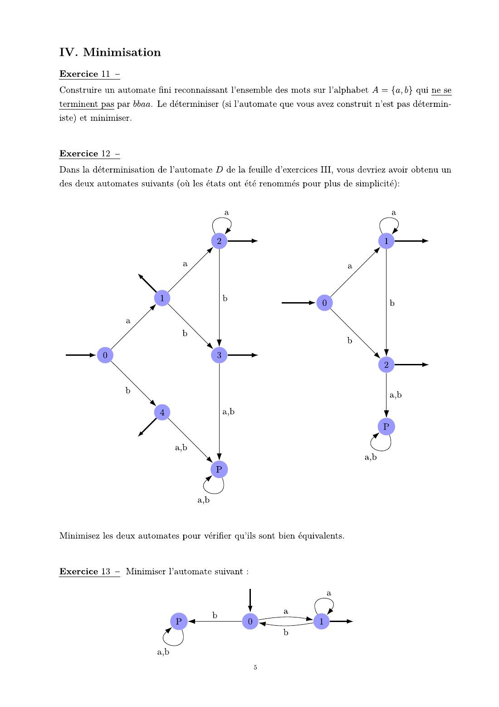
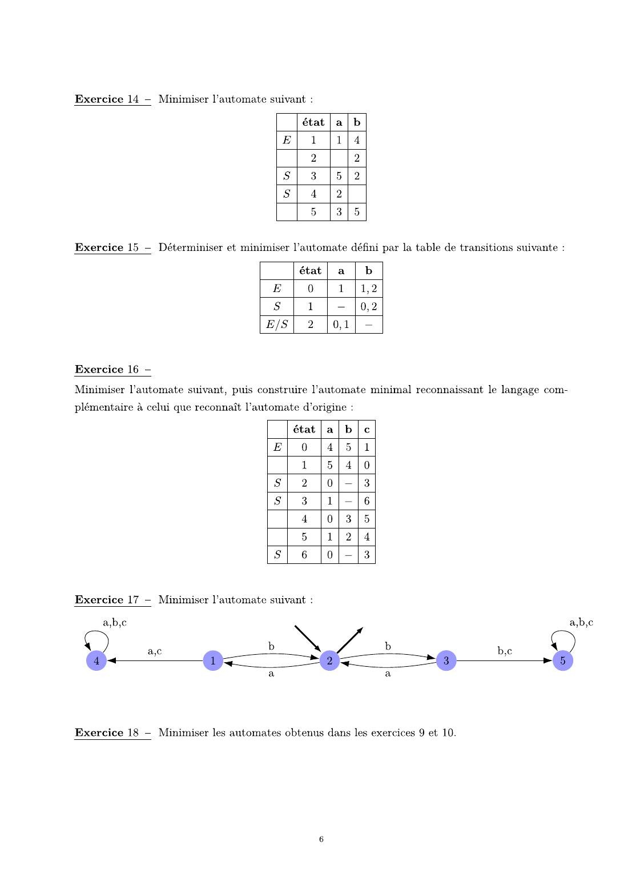

# TD 4 — Minimisation (exercices 11 à 18)

=== "Version simplifiée"

    Rappels : [chapitre 6](../cours/chapitre-6-minimisation.md). Toujours : **déterministe**, **complet**, sans état **inaccessible**, puis
    partitions $\Theta_0 = \{T, NT\}$, $\Theta_1$, … jusqu'à stabilité.

    ## Exercice 11 — Les mots qui ne finissent pas par $bbaa$

    ??? success "Correction"
        On construit d'abord l'automate (non déterministe) des mots qui **finissent** par $bbaa$ : $0 \xrightarrow{a,b} 0$, $0 \xrightarrow{b} 1 \xrightarrow{b} 2 \xrightarrow{a} 3 \xrightarrow{a} 4$, sortie 4.
        Sa déterminisation est complète et minimale (5 états) ; on prend son **complémentaire** :

        | | état (suffixe utile lu) | a | b |
        |---|---|---|---|
        | E/S | 0 (rien) | 0 | 1 |
        | S | 1 ($b$) | 0 | 2 |
        | S | 2 ($bb$) | 3 | 2 |
        | S | 3 ($bba$) | 4 | 1 |
        | | 4 ($bbaa$) | 0 | 1 |

        La minimisation sépare les 5 états : l'automate est déjà minimal.

    ## Exercice 12 — Deux déterminisés de l'automate D

    ??? success "Correction"
        **Automate de gauche** (0 entrée ; 1, 2, 3, 4 sorties ; P poubelle) :

        - $\Theta_0$ : $T = \{1, 2, 3, 4\}$, $NT = \{0, P\}$.
        - Motifs : 1 et 2 → (T, T) ; 3 et 4 → (NT, NT) ; 0 → (T, T) ; P → (NT, NT). $\Theta_1 = \{12, 34, 0, P\}$.
        - Motifs sous $\Theta_1$ : 1 et 2 → (12, 34) ; 3 et 4 → (P, P). Plus de séparation : $\Theta_2 = \Theta_1$.

        Automate minimal :

        | | état | a | b |
        |---|---|---|---|
        | E | 0 | 12 | 34 |
        | S | 12 | 12 | 34 |
        | S | 34 | P | P |
        | | P | P | P |

        L'**automate de droite** est exactement celui-ci (avec 1 = 12 et 2 = 34) : sa minimisation sépare tous ses états. Les deux sont donc équivalents.

    ## Exercice 13

    ??? success "Correction"
        $\Theta_0 = \{\{1\}, \{0, P\}\}$. Sous $\Theta_0$ : 0 → (T, NT) et P → (NT, NT) : séparés. Tous les groupes sont des singletons :
        l'automate est **déjà minimal**.

    ## Exercice 14

    ??? success "Correction"
        **Préalable** : depuis l'entrée 1, on atteint 1, 4 et 2 seulement. Les états **3 et 5 sont inaccessibles** : on les supprime.
        On complète avec P (2 n'a pas de transition en $a$, 4 pas en $b$).

        | | état | a | b |
        |---|---|---|---|
        | E | 1 | 1 | 4 |
        | | 2 | P | 2 |
        | S | 4 | 2 | P |
        | | P | P | P |

        $\Theta_0 = \{\{4\}, \{1, 2, P\}\}$. Motifs : 1 → (NT, T) ; 2 → (NT, NT) ; P → (NT, NT). $\Theta_1 = \{4, 1, 2P\}$, puis stable.
        Minimal : $1 \xrightarrow{a} 1$, $1 \xrightarrow{b} 4$, $4 \xrightarrow{a,b} 2P$, $2P \xrightarrow{a,b} 2P$. Langage : **$a^*b$**.

    ## Exercice 15

    ??? success "Correction"
        Deux entrées (0 et 2), donc on part de « 02 ».

        | | état | a | b |
        |---|---|---|---|
        | E/S | 02 | 01 | 12 |
        | S | 01 | 1 | 012 |
        | S | 12 | 01 | 02 |
        | S | 1 | P | 02 |
        | S | 012 | 01 | 012 |
        | | P | P | P |

        Minimisation :

        - $\Theta_0 = \{T = \{02, 01, 12, 1, 012\},\ \{P\}\}$. Motifs : 02, 01, 12, 012 → (T, T) ; 1 → (NT, T) car $1 \xrightarrow{a} P$. $\Theta_1 = \{\{02, 01, 12, 012\}, \{1\}, \{P\}\}$.
        - Sous $\Theta_1$ : 01 va dans $\{1\}$ sur $a$, les trois autres restent dans leur groupe : $\Theta_2 = \{\{02, 12, 012\}, \{01\}, \{1\}, \{P\}\}$.
        - $\Theta_3 = \Theta_2$ : fin.

        | | état | a | b |
        |---|---|---|---|
        | E/S | A = $\{02, 12, 012\}$ | B | A |
        | S | B = $\{01\}$ | C | A |
        | S | C = $\{1\}$ | P | A |
        | | P | P | P |

        Langage : les mots qui **ne contiennent pas $aaa$** (A, B, C comptent les $a$ consécutifs).

    ## Exercice 16

    ??? success "Correction"
        On complète d'abord (2, 3 et 6 n'ont pas de transition en $b$) avec P.

        - $\Theta_0$ : $T = \{2, 3, 6\}$, $NT = \{0, 1, 4, 5, P\}$.
        - Dans $T$ : 2, 3, 6 ont le motif (NT, NT, T) : pas de séparation. Dans $NT$ : 0 et 1 → (NT, NT, NT) ; 4 et 5 → (NT, T, NT) ; P → (NT, NT, NT).
          $\Theta_1 = \{236, 01P, 45\}$… puis 0, 1 (qui vont en 45 sur $a$) se séparent de P (qui reste en P) : $\Theta_2 = \{236, 01, 45, P\}$, stable.

        | | état | a | b | c |
        |---|---|---|---|---|
        | E | 01 | 45 | 45 | 01 |
        | | 45 | 01 | 236 | 45 |
        | S | 236 | 01 | P | 236 |
        | | P | P | P | P |

        **Complémentaire** (l'automate est déterministe complet) : on échange les sorties. Sorties : 01, 45 et P ; 236 n'est plus terminal.

    ## Exercice 17

    ??? success "Correction"
        Alphabet $\{a, b, c\}$, entrée et sortie 2. On complète avec P (l'état 2 n'a pas de transition en $c$).
        Les états 4, 5 et P sont des puits non terminaux : ils sont **équivalents** et fusionnent.

        | | état | a | b | c |
        |---|---|---|---|---|
        | E/S | 2 | 1 | 3 | P |
        | | 1 | P | 2 | P |
        | | 3 | 2 | P | P |
        | | P (= 4, 5) | P | P | P |

        Langage : **$(ab + ba)^*$**.

    ## Exercice 18 — Minimiser les automates des exercices 9 et 10

    ??? success "Correction"
        Les automates minimaux sont donnés dans le [TD 3](td-3-er-vers-automate.md) : 9 états pour l'exercice 9, puis 6, 5, 6 et 5 états pour l'exercice 10 a), b), c) et d)
        (état poubelle compris quand il y en a un).

=== "Version papier"

    Les énoncés de la partie IV du cahier d'exercices.

    <!-- papier: pdf/SM402P/td.pdf | Cahier d'exercices | td4 | page | 5-6 -->

    [{ loading=lazy .papier }](papier/td4/p05.jpg)
    
Cahier d&#x27;exercices, page 5

    [{ loading=lazy .papier }](papier/td4/p06.jpg)
    
Cahier d&#x27;exercices, page 6

    <!-- /papier -->
