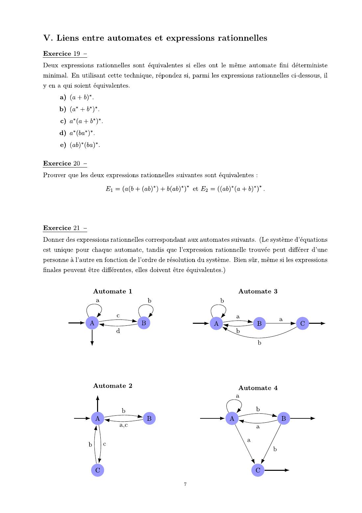
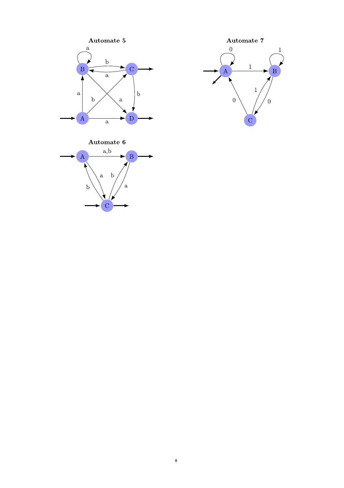

# TD 5 — Liens entre automates et expressions rationnelles (exercices 19 à 21)

=== "Version simplifiée"

    Rappels : [chapitre 5](../cours/chapitre-5-er-vers-automate.md) et [chapitre 7](../cours/chapitre-7-automate-vers-er.md).
    Toutes les expressions ci-dessous ont été comparées par programme aux automates (mêmes mots reconnus jusqu'à 8 lettres).

    ## Exercice 19 — Expressions équivalentes

    ??? success "Correction"
        On construit l'automate minimal de chaque expression :

        - **a)** $(a + b)^*$, **b)** $(a^* + b^*)^*$, **c)** $a^*(a + b^*)^*$ et **d)** $a^*(ba^*)^*$ ont toutes le **même** automate minimal :
          un seul état, initial et terminal, avec une boucle en $a$ et $b$. Elles décrivent toutes **$\{a, b\}^*$** : elles sont équivalentes.
          (Pour d) : tout mot s'écrit comme un bloc de $a$, puis des blocs « un $b$ suivi de $a$ ».)
        - **e)** $(ab)^*(ba)^*$ est différente : $aa$ n'y est pas. Son automate minimal a 5 états :

        | | état | a | b |
        |---|---|---|---|
        | E/S | 0 | 1 | 2 |
        | | 1 | P | 0 |
        | | 2 | 4 | P |
        | S | 4 | P | 2 |
        | | P | P | P |

    ## Exercice 20 — Prouver $E_1 = E_2$

    ??? success "Correction"
        $E_2 = ((ab)^*(a + b)^*)^*$ contient $(a + b)^*$ (prendre $(ab)^0 = \varepsilon$), donc $E_2 = \{a, b\}^*$.

        Dans $E_1 = (a(b + (ab)^*) + b(ab)^*)^*$, le terme $a(ab)^*$ contient $a$ (avec $(ab)^0$) et $b(ab)^*$ contient $b$.
        Donc $E_1 \supseteq (a + b)^*$, et comme $E_1 \subseteq \{a, b\}^*$, $E_1 = \{a, b\}^*$.

        Les deux ont le même automate minimal (un état, boucle sur $a$ et $b$) : elles sont équivalentes.

    ## Exercice 21 — Expressions des automates (méthode de l'arrivée)

    ??? success "Automate 1"
        $X_A = \varepsilon + X_Aa + X_Bd$ et $X_B = X_Ac + X_Bb$. Arden : $X_B = X_Acb^*$, puis $X_A = \varepsilon + X_A(a + cb^*d)$.

        $$
        L = X_A = (a + cb^*d)^*
        $$

    ??? success "Automate 2"
        $X_A = \varepsilon + X_B(a + c) + X_Cb$, $X_B = X_Ab$, $X_C = X_Ac$. En remplaçant : $X_A = \varepsilon + X_A\big(b(a + c) + cb\big)$.

        $$
        L = X_A = \big(b(a + c) + cb\big)^*
        $$

    ??? success "Automate 3"
        $X_A = \varepsilon + X_Ab + X_Bb + X_Cb$, $X_B = X_Aa$, $X_C = X_Ba = X_Aaa$. Donc $X_A = \varepsilon + X_A(b + ab + aab)$ et

        $$
        L = X_C = (b + ab + aab)^*aa
        $$

    ??? success "Automate 4"
        $X_A = \varepsilon + X_Aa + X_Ba$, $X_B = X_Ab$, $X_C = X_Aa + X_Bb$. On obtient $X_A = (a + ba)^*$, $X_B = (a + ba)^*b$, $X_C = (a + ba)^*(a + bb)$ et

        $$
        L = X_B + X_C = (a + ba)^*(a + b + bb)
        $$

    ??? success "Automate 5"
        $X_A = \varepsilon$ (aucune flèche n'arrive en A). $X_B = a + X_Ba + X_Ca$, $X_C = b + X_Bb$, $X_D = a + X_Ba + X_Cb$.
        En remplaçant $X_C$ dans $X_B$ : $X_B = (a + ba) + X_B(a + ba)$, donc $X_B = (a + ba)(a + ba)^*$. Puis
        $L = X_C + X_D = (a + b + bb) + X_B(a + b + bb)$ :

        $$
        L = (a + ba)^*(a + b + bb)
        $$

        Le même langage que l'automate 4 !

    ??? success "Automate 6"
        Entrées A et C ; sorties B et C.
        $X_A = \varepsilon + X_Cb$, $X_B = X_A(a + b) + X_Cb$, $X_C = \varepsilon + X_Aa + X_Ba$.

        En remplaçant $X_A$ puis $X_B$ dans $X_C$ :
        $X_C = \big(\varepsilon + a + (a + b)a\big) + X_C\big(ba + b(a + b)a\big)$, donc $X_C = \big(\varepsilon + a + (a + b)a\big)\big(ba + b(a + b)a\big)^*$, et

        $$
        L = X_B + X_C = (a + b) + X_C\big(\varepsilon + b + b(a + b)\big).
        $$

        Ce langage est celui des mots qui ne contiennent ni $aaa$, ni $bbb$, ni $bbaa$ (le même que l'automate E du [TD 2](td-2-determinisation.md)).

    ??? success "Automate 7 (alphabet $\{0, 1\}$)"
        $X_A = \varepsilon + X_A0 + X_C0$, $X_B = X_A1 + X_B1 + X_C1$, $X_C = X_B0$.
        $X_B = X_A1 + X_B(1 + 01)$, donc $X_B = X_A1(1 + 01)^*$. Puis $X_A = \varepsilon + X_A\big(0 + 1(1 + 01)^*00\big)$ :

        $$
        L = X_A = \big(0 + 1(1 + 01)^*00\big)^*
        $$

        Plus simplement : $L = 0^* + (0 + 1)^*00$, les mots formés uniquement de 0 (mot vide compris) ou qui finissent par $00$.

=== "Version papier"

    Les énoncés de la partie V du cahier d'exercices.

    <!-- papier: pdf/SM402P/td.pdf | Cahier d'exercices | td5 | page | 7-8 -->

    [{ loading=lazy .papier }](papier/td5/p07.jpg)
    
Cahier d&#x27;exercices, page 7

    [{ loading=lazy .papier }](papier/td5/p08.jpg)
    
Cahier d&#x27;exercices, page 8

    <!-- /papier -->
