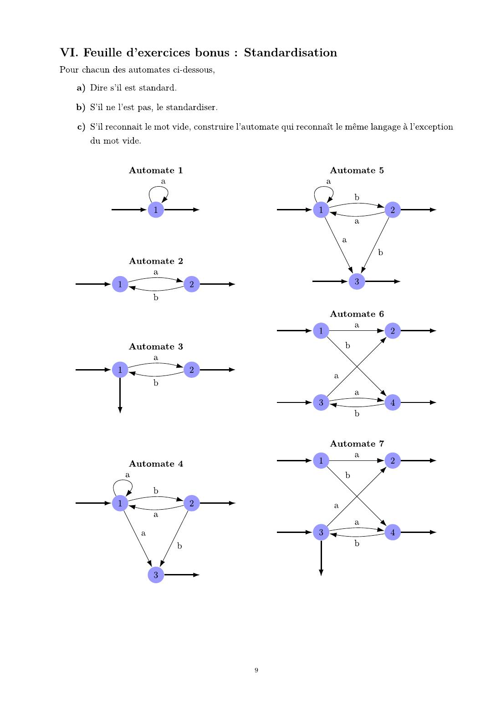

# TD 6 — Feuille bonus : standardisation

=== "Version simplifiée"

    Rappels : [chapitre 8](../cours/chapitre-8-standardisation.md). Un automate est **standard** s'il a une seule entrée et **qu'aucune flèche n'arrive sur elle**.
    Pour standardiser : nouvel état $i$, seule entrée, qui reçoit une copie de **toutes** les transitions sortant des anciennes entrées ;
    $i$ est terminal si une ancienne entrée l'était. Pour enlever le mot vide d'un automate standard : retirer la sortie de $i$.

    Dans chaque tableau, seules les lignes de $i$ sont nouvelles : les autres états gardent leurs transitions, mais ne sont plus des entrées.

    ??? success "Automate 1 — un état, boucle en $a$, entrée et sortie"
        **a)** Non standard : la boucle arrive sur l'entrée. **b)** $i \xrightarrow{a} 1$, $i$ terminal (1 l'était), et $1 \xrightarrow{a} 1$, 1 terminal.
        **c)** Le langage est $a^*$ : il contient $\varepsilon$. On retire la sortie de $i$ : il reste $a^+ = aa^*$.

    ??? success "Automate 2 — $1 \xrightarrow{a} 2$, $2 \xrightarrow{b} 1$, entrée 1, sortie 2"
        **a)** Non standard : $2 \xrightarrow{b} 1$ arrive sur l'entrée. **b)** Ajouter $i \xrightarrow{a} 2$, $i$ non terminal. Langage : $a(ba)^*$.
        **c)** Sans objet : 1 n'étant pas terminal, le mot vide n'est pas reconnu.

    ??? success "Automate 3 — le même, 1 étant aussi une sortie"
        **a)** Non standard. **b)** $i \xrightarrow{a} 2$, et $i$ **terminal** (1 l'était). Langage : $(ab)^*(\varepsilon + a)$, mot vide compris.
        **c)** On retire la sortie de $i$ : on obtient le langage $(ab)^*(\varepsilon + a)$ privé de $\varepsilon$, soit $a(ba)^*(\varepsilon + b)$. Les mots $ab$, $abab$… restent reconnus grâce à la sortie sur 1.

    ??? success "Automate 4 — entrée 1, sorties 2 et 3"
        Transitions : $1 \xrightarrow{a} 1$, $1 \xrightarrow{b} 2$, $2 \xrightarrow{a} 1$, $1 \xrightarrow{a} 3$, $2 \xrightarrow{b} 3$.

        **a)** Non standard (la boucle sur 1 et $2 \xrightarrow{a} 1$). **b)** On ajoute $i$ (entrée, non terminal) avec les transitions de 1 :
        $i \xrightarrow{a} 1$, $i \xrightarrow{a} 3$, $i \xrightarrow{b} 2$. **c)** Sans objet (pas de mot vide).

    ??? success "Automate 5 — le même, 3 étant aussi une entrée (et une sortie)"
        **a)** Non standard (deux entrées). **b)** $i$ reçoit les transitions de 1 **et** de 3 (3 n'en a pas) : $i \xrightarrow{a} 1$, $i \xrightarrow{a} 3$, $i \xrightarrow{b} 2$.
        $i$ est **terminal**, car 3 est à la fois entrée et sortie. 1 et 3 ne sont plus des entrées.
        **c)** Le mot vide était reconnu (par l'entrée-sortie 3) : on retire la sortie de $i$.

    ??? success "Automate 6 — entrées 1 et 3, sorties 2 et 4"
        Transitions : $1 \xrightarrow{a} 2$, $1 \xrightarrow{b} 4$, $3 \xrightarrow{a} 2$, $3 \xrightarrow{a} 4$, $4 \xrightarrow{b} 3$.

        **a)** Non standard (deux entrées, et $4 \xrightarrow{b} 3$ arrive sur une entrée).
        **b)** $i$ reçoit les transitions de 1 et de 3 : $i \xrightarrow{a} 2$, $i \xrightarrow{a} 4$, $i \xrightarrow{b} 4$ ; $i$ non terminal (aucune entrée n'était sortie).
        **c)** Sans objet.

    ??? success "Automate 7 — le même, 3 étant aussi une sortie"
        **a)** Non standard. **b)** Mêmes transitions que pour l'automate 6, mais $i$ est **terminal** (3 est entrée et sortie).
        **c)** On retire la sortie de $i$ : le mot vide disparaît, et tous les autres mots restent reconnus (3 reste terminal pour les mots qui y reviennent, comme $bb$ depuis 1).

=== "Version papier"

    La feuille bonus du cahier d'exercices.

    <!-- papier: pdf/SM402P/td.pdf | Cahier d'exercices | td6 | page | 9 -->

    [{ loading=lazy .papier }](papier/td6/p09.jpg)
    
Cahier d&#x27;exercices, page 9

    <!-- /papier -->
