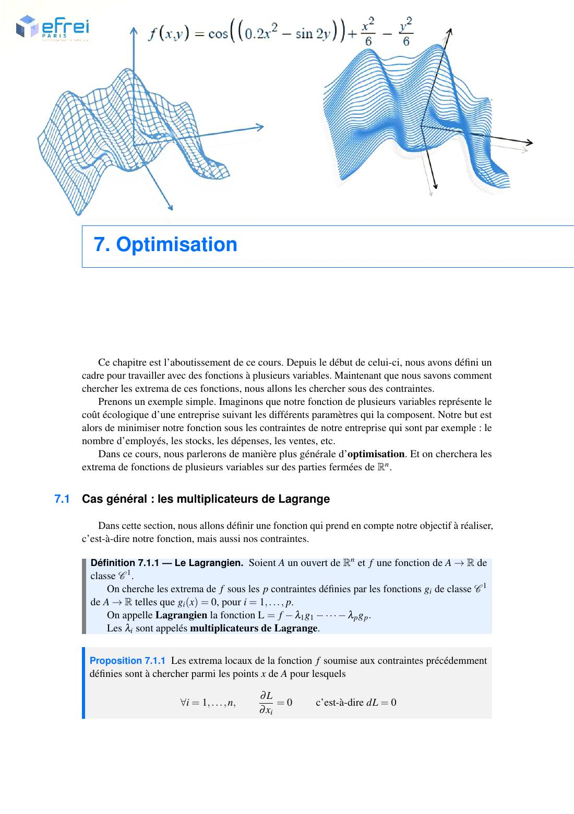
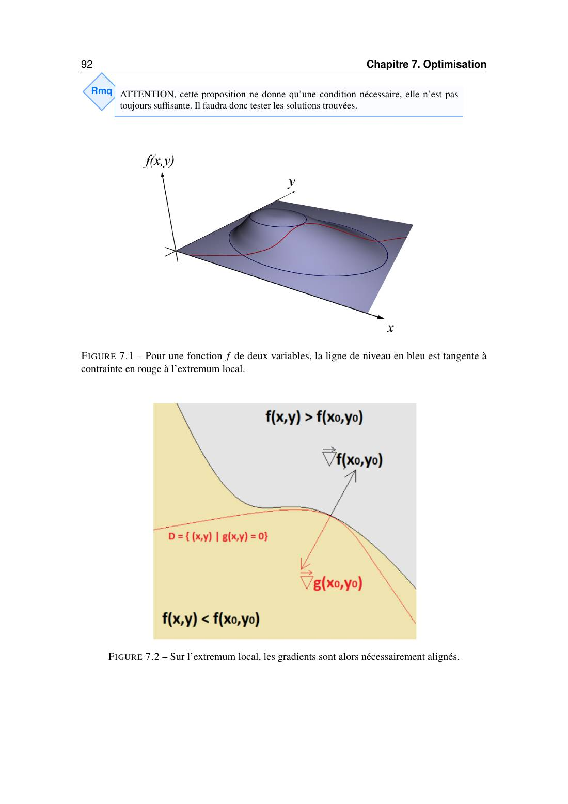
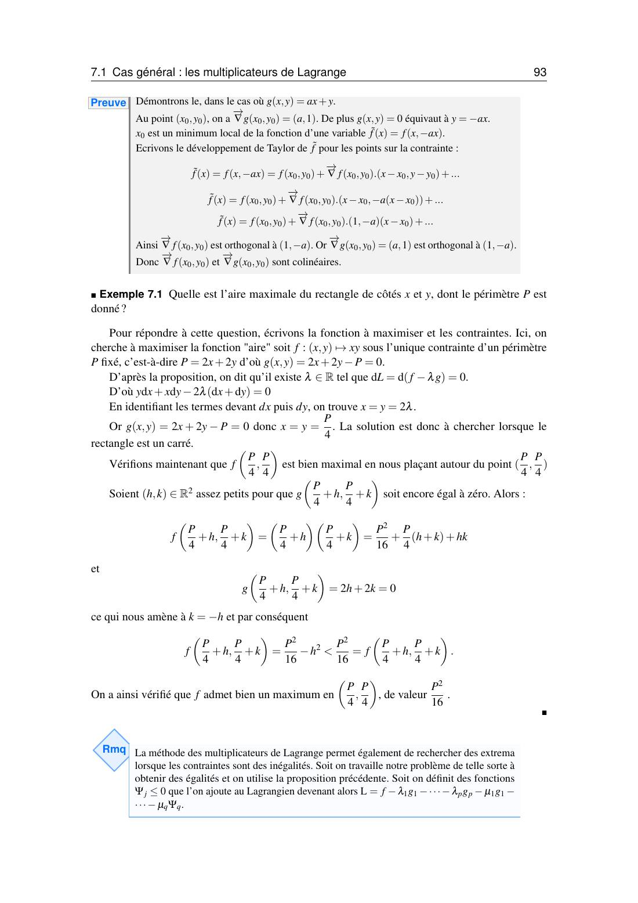
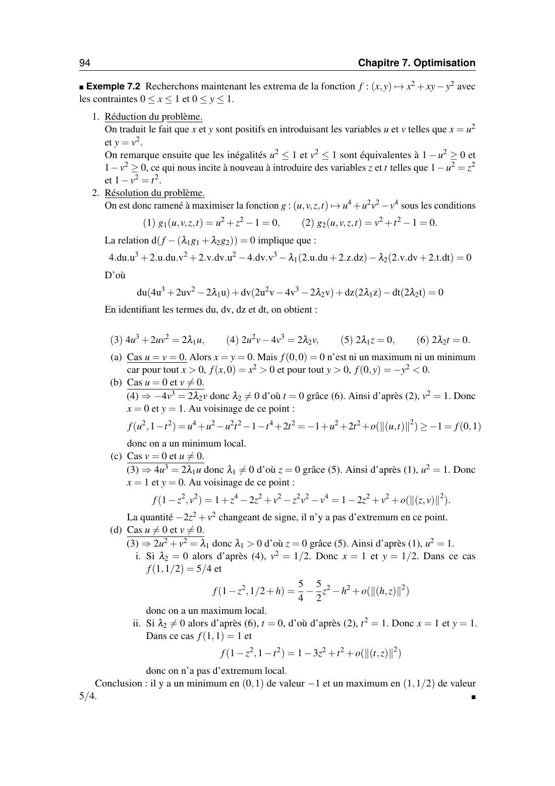
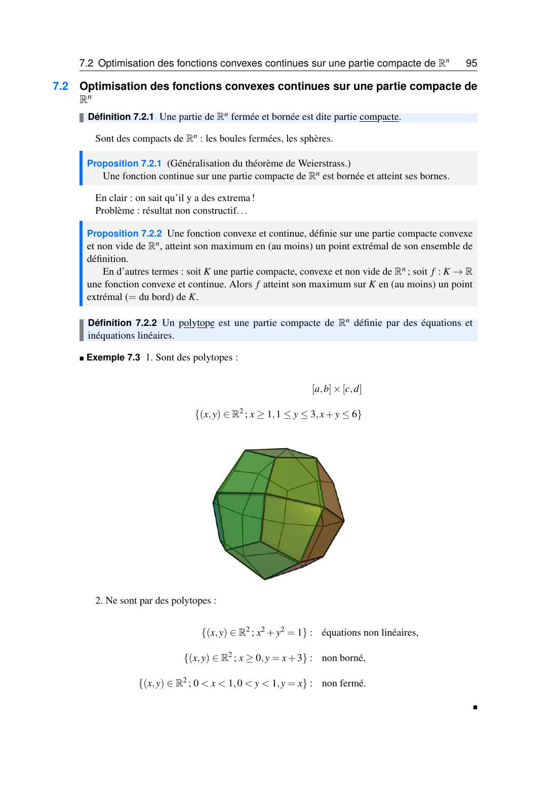
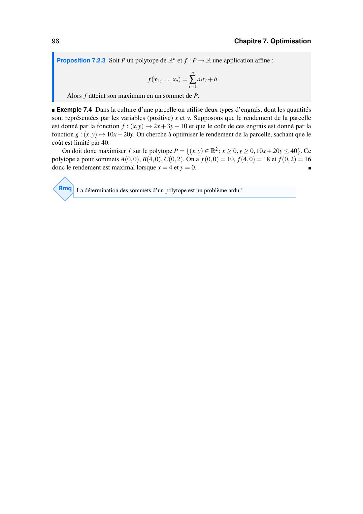

# Chapitre 7 — Optimisation

=== "Version simplifiée"

    Le dernier chapitre du cours. Au chapitre 6 on cherchait les extrema de $f$ « librement » ;
    ici on les cherche **sous contraintes** : sur une courbe $g(x, y) = 0$, sur une sphère,
    sur un domaine fermé (disque, triangle, polytope…). Exemple concret : minimiser un coût
    quand le budget, le nombre d'employés ou les stocks sont imposés.

    ## Les multiplicateurs de Lagrange

    !!! definition "Lagrangien"
        $A$ ouvert de $\mathbb{R}^n$, $f : A \to \mathbb{R}$ de classe $C^1$. On cherche les extrema de $f$
        sous $p$ contraintes $g_1(x) = 0, \dots, g_p(x) = 0$ (les $g_i$ de classe $C^1$).

        $$
        L = f - \lambda_1 g_1 - \dots - \lambda_p g_p
        $$

        Les réels $\lambda_i$ sont les **multiplicateurs de Lagrange** : une inconnue de plus par contrainte.

    !!! theoreme "Condition nécessaire (prop. 7.1.1)"
        Les extrema locaux de $f$ sous les contraintes sont à chercher parmi les points où

        $$
        \frac{\partial L}{\partial x_i} = 0 \quad \text{pour tout } i = 1, \dots, n, \qquad \text{c'est-à-dire } dL = 0,
        $$

        **et** les contraintes $g_i = 0$ sont vérifiées.

    !!! piege "Condition nécessaire, pas suffisante"
        Comme $\nabla f = 0$ au chapitre 6, $dL = 0$ donne des **candidats**. Il faut ensuite
        **tester** chaque point : comparer les valeurs (domaine compact), étudier $f$ autour du point
        en restant sur la contrainte, ou se ramener à une fonction d'une variable.

    !!! analogie "Pourquoi ça marche : les gradients alignés"
        Une seule contrainte $g(x, y) = 0$, c'est une courbe (en rouge sur la figure 7.1 du poly).
        On s'y promène en regardant les lignes de niveau de $f$. Tant qu'on **traverse** une ligne
        de niveau, $f$ augmente d'un côté et diminue de l'autre : pas d'extremum. À l'extremum, la
        courbe **touche** la ligne de niveau sans la traverser : elles sont tangentes.

        Or $\nabla f$ est perpendiculaire aux lignes de niveau de $f$, et $\nabla g$ à la courbe $g = 0$.
        Tangentes $\Rightarrow$ gradients **colinéaires** : $\nabla f = \lambda \nabla g$. C'est exactement $dL = 0$.

    En pratique, avec une contrainte en deux variables, on résout :

    $$
    \begin{cases}
    f_x = \lambda\, g_x \\
    f_y = \lambda\, g_y \\
    g(x, y) = 0
    \end{cases}
    $$

    trois équations, trois inconnues $(x, y, \lambda)$.

    !!! methode "Extrema sous contrainte, pas à pas"
        1. Écrire $f$ (à optimiser) et mettre chaque contrainte sous la forme $g_i = 0$.
        2. **Si on peut isoler une variable** dans les contraintes, substituer : on retombe sur un extremum sans contrainte (souvent en une variable). C'est souvent le plus rapide, et le TD le demande « sans le Lagrangien ».
        3. Sinon, écrire $L = f - \sum \lambda_i g_i$ et résoudre $\nabla L = 0$ avec les contraintes.
        4. Astuce de résolution : quand les équations ont la forme $f_{x_i} = \lambda\, g_{x_i}$, on **divise** ou on **multiplie** les équations entre elles pour éliminer $\lambda$ (ex. $\frac{y}{x} = \dots$). Penser aux cas $x = 0$, $\lambda = 0$…
        5. Classer chaque candidat : si la contrainte définit un compact (cercle, sphère), il suffit de **comparer les valeurs** ; sinon étudier $f$ au voisinage en restant sur la contrainte.

    **Exemple 7.1 — Rectangle d'aire maximale à périmètre $P$ fixé.**
    $f(x, y) = xy$, $g(x, y) = 2x + 2y - P = 0$.
    $dL = y\,dx + x\,dy - 2\lambda(dx + dy) = 0$, donc $y = 2\lambda$ et $x = 2\lambda$ : $x = y$.
    Avec la contrainte, $x = y = \frac P4$ : c'est un **carré**.

    Vérification : on se déplace sur la contrainte, $\big(\frac P4 + h, \frac P4 + k\big)$ avec $2h + 2k = 0$, donc $k = -h$.

    $$
    f\Big(\frac P4 + h, \frac P4 - h\Big) = \frac{P^2}{16} - h^2 \leq \frac{P^2}{16}
    $$

    **Maximum** $\frac{P^2}{16}$ en $\big(\frac P4, \frac P4\big)$.

    ## Contraintes en inégalités

    Pour $0 \leq x \leq 1$ par exemple, deux options :

    - **Se ramener à des égalités** avec des variables auxiliaires : $x \geq 0$ devient $x = u^2$, et $1 - x \geq 0$ devient $1 - x = z^2$. On applique ensuite Lagrange avec les contraintes $u^2 + z^2 - 1 = 0$ (exemple 7.2 du poly).
    - **Ou, plus simple en 2 variables**, travailler comme au chapitre 6 : points critiques à l'intérieur, puis étude de chaque morceau du bord (où la contrainte est une égalité), puis comparaison des valeurs.

    **Exemple 7.2** : $f(x, y) = x^2 + xy - y^2$ sur le carré $[0, 1]^2$.

    - Intérieur : $f_x = 2x + y = 0$ et $f_y = x - 2y = 0$ donnent $(0, 0)$, qui est un coin, pas un point intérieur.
    - $x = 0$ : $f = -y^2$, de $0$ à $-1$ (en $y = 1$).
    - $x = 1$ : $f = 1 + y - y^2$, maximale en $y = \frac12$ : $f = \frac54$.
    - $y = 0$ : $f = x^2$, de $0$ à $1$. $\quad y = 1$ : $f = x^2 + x - 1$, de $-1$ à $1$.

    Conclusion : **minimum $-1$ en $(0, 1)$**, **maximum $\frac54$ en $\big(1, \frac12\big)$**. C'est le résultat du poly, obtenu là-bas avec $x = u^2$, $y = v^2$ et deux multiplicateurs.

    ## Optimisation sur un compact

    !!! definition "Compact"
        Une partie de $\mathbb{R}^n$ **fermée et bornée** est dite **compacte**.
        Exemples : boules fermées, sphères, pavés $[a, b] \times [c, d]$, triangles pleins.

    !!! theoreme "Weierstrass (généralisé)"
        Une fonction **continue** sur un compact de $\mathbb{R}^n$ est bornée et **atteint ses bornes** :
        il existe un maximum et un minimum globaux.

        En clair : on sait qu'il y a des extrema. Mais le théorème ne dit pas où : il faut les chercher.

    C'est ce théorème qui justifie la méthode « on compare toutes les valeurs candidates » :
    l'extremum existe et il est forcément parmi les candidats (points critiques intérieurs,
    points de Lagrange sur le bord, coins).

    !!! theoreme "Fonctions convexes sur un compact convexe (prop. 7.2.2)"
        $K$ compact, convexe, non vide, et $f : K \to \mathbb{R}$ **convexe et continue**.
        Alors $f$ atteint son **maximum** en (au moins) un point **extrémal**, c'est-à-dire sur le **bord** de $K$.

        (Le minimum d'une fonction convexe, lui, se trouve au point critique s'il y en a un : chapitre 6.)

    ### Polytopes et fonctions affines

    !!! definition "Polytope"
        Une partie **compacte** de $\mathbb{R}^n$ définie par des **équations et inéquations linéaires**.

    - Polytopes : $[a, b] \times [c, d]$ ; $\{x \geq 1,\ 1 \leq y \leq 3,\ x + y \leq 6\}$.
    - **Pas** des polytopes : le cercle $x^2 + y^2 = 1$ (pas linéaire), $\{x \geq 0,\ y = x + 3\}$ (pas borné),
      $\{0 < x < 1,\ 0 < y < 1,\ y = x\}$ (pas fermé).

    !!! theoreme "Fonction affine sur un polytope (prop. 7.2.3)"
        Si $f(x_1, \dots, x_n) = \sum a_i x_i + b$ est **affine** et $P$ un polytope, alors $f$ atteint
        son maximum (et son minimum, en appliquant le résultat à $-f$) en un **sommet** de $P$.

    !!! methode "Programmation linéaire en 2 variables"
        1. Tracer les droites des contraintes et hachurer la zone admissible.
        2. Trouver les **sommets** (intersections de deux droites qui vérifient toutes les contraintes).
        3. Calculer $f$ en chaque sommet : la plus grande valeur est le max, la plus petite le min.

    **Exemple 7.4 — Engrais.** Rendement $f = 2x + 3y + 10$, coût $10x + 20y \leq 40$, $x, y \geq 0$.
    Sommets $A(0, 0)$, $B(4, 0)$, $C(0, 2)$ : $f = 10$, $18$, $16$. Rendement maximal pour $x = 4$, $y = 0$.

    !!! piege "Bien choisir sa méthode"
        | Situation | Méthode |
        |-----------|---------|
        | Contrainte d'où on isole une variable ($y = 2x - 1$) | **Substitution**, puis une variable |
        | Contrainte « ronde » (cercle, sphère, $\sum x_i^2 = 1$) | **Lagrange**, puis comparer les valeurs (compact) |
        | Domaine fermé borné en 2D (disque, triangle) | Intérieur ($\nabla f = 0$) + **chaque bord** + **coins** |
        | $f$ affine, contraintes linéaires | Valeurs aux **sommets** du polytope |

=== "Version papier"

    Les pages du poly pour le chapitre 7 (support 2026-2027). Les exercices sont dans la [version papier du TD 7](../td/td-7-optimisation.md).

    [{ loading=lazy .papier }](papier/ch7/p91.jpg)
    
Introduction et lagrangien · Chapitre 7, p. 91

    [{ loading=lazy .papier }](papier/ch7/p92.jpg)
    
Interprétation géométrique · Chapitre 7, p. 92

    [{ loading=lazy .papier }](papier/ch7/p93.jpg)
    
Preuve et exemple du rectangle · Chapitre 7, p. 93

    [{ loading=lazy .papier }](papier/ch7/p94.jpg)
    
Contraintes en inégalités · Chapitre 7, p. 94

    [{ loading=lazy .papier }](papier/ch7/p95.jpg)
    
Compacts, convexité, polytopes · Chapitre 7, p. 95

    [{ loading=lazy .papier }](papier/ch7/p96.jpg)
    
Fonctions affines sur un polytope · Chapitre 7, p. 96

