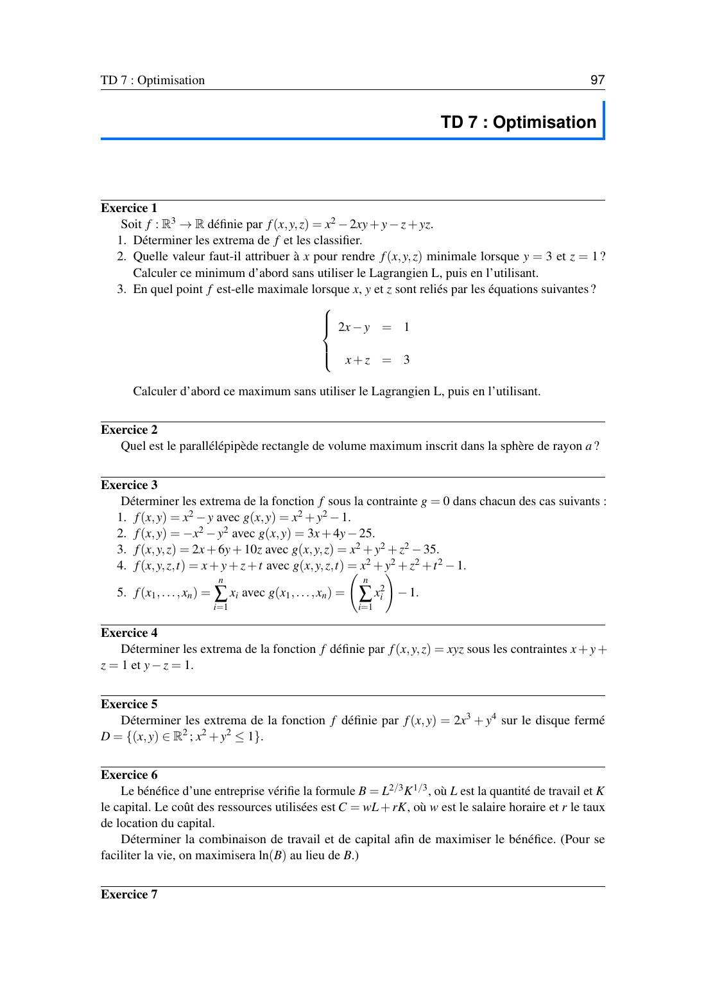
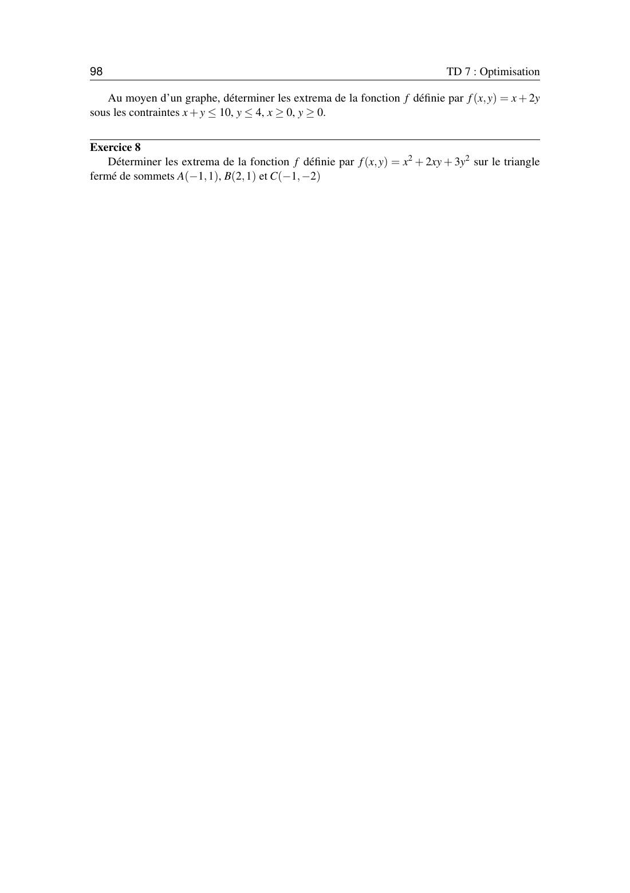

# TD 7 — Optimisation

=== "Version simplifiée"

    Énoncés complets : onglet **Version papier**. Rappels : [chapitre 7](../cours/chapitre-7-optimisation.md).

    !!! methode "Rappel"
        Une contrainte $g = 0$ : on résout $\nabla f = \lambda \nabla g$ et $g = 0$.
        Si la contrainte définit un compact (cercle, sphère), on **compare les valeurs** des candidats.
        Si on peut isoler une variable, la **substitution** est souvent plus rapide.

    ## Exercice 1 — $f(x, y, z) = x^2 - 2xy + y - z + yz$

    ### 1. Extrema libres

    $$
    f_x = 2x - 2y, \qquad f_y = -2x + 1 + z, \qquad f_z = -1 + y
    $$

    $f_z = 0$ donne $y = 1$, puis $f_x = 0$ donne $x = 1$, puis $f_y = 0$ donne $z = 1$. Seul point critique : $(1, 1, 1)$, où $f = 0$.

    $$
    H_f = \begin{pmatrix} 2 & -2 & 0 \\ -2 & 0 & 1 \\ 0 & 1 & 0 \end{pmatrix}
    $$

    Mineurs : $\Delta_1 = 2 > 0$ mais $\Delta_2 = 0 - 4 = -4 < 0$ : ni définie positive ni définie négative ($\det H = -2 \neq 0$). **Point selle**, $f$ n'a **aucun extremum**.

    ### 2. $y = 3$, $z = 1$

    **Sans Lagrangien** : $f(x, 3, 1) = x^2 - 6x + 5 = (x - 3)^2 - 4$. **Minimum $-4$ pour $x = 3$.**

    **Avec Lagrangien** : $L = f - \lambda_1(y - 3) - \lambda_2(z - 1)$.

    $$
    \begin{cases}
    L_x = 2x - 2y = 0 \\
    L_y = -2x + 1 + z - \lambda_1 = 0 \\
    L_z = -1 + y - \lambda_2 = 0
    \end{cases}
    $$

    Avec $y = 3$ et $z = 1$ : $x = 3$, $\lambda_1 = -4$, $\lambda_2 = 2$. Même point $(3, 3, 1)$, $f = -4$. C'est un minimum car la fonction restreinte $(x - 3)^2 - 4$ est convexe.

    ### 3. Contraintes $2x - y = 1$ et $x + z = 3$

    **Sans Lagrangien** : $y = 2x - 1$ et $z = 3 - x$, qu'on remplace :

    $$
    f = x^2 - 2x(2x - 1) + (2x - 1) - (3 - x) + (2x - 1)(3 - x) = -5x^2 + 12x - 7
    $$

    Parabole tournée vers le bas, maximale en $x = \frac{12}{10} = \frac65$. Alors $y = \frac75$, $z = \frac95$ et

    $$
    f\Big(\frac65, \frac75, \frac95\Big) = -5 \cdot \frac{36}{25} + \frac{72}{5} - 7 = \frac15
    $$

    **Maximum $\frac15$ en $\big(\frac65, \frac75, \frac95\big)$.**

    **Avec Lagrangien** : $L = f - \lambda(2x - y - 1) - \mu(x + z - 3)$.

    $$
    \begin{cases}
    L_x = 2x - 2y - 2\lambda - \mu = 0 \\
    L_y = -2x + 1 + z + \lambda = 0 \\
    L_z = -1 + y - \mu = 0
    \end{cases}
    $$

    On exprime $\mu = y - 1 = 2x - 2$ et $\lambda = 2x - 1 - z = 3x - 4$, puis dans $L_x$ :
    $2x - 2(2x - 1) - 2(3x - 4) - (2x - 2) = -10x + 12 = 0$, donc $x = \frac65$. On retrouve le même point, avec $\lambda = -\frac25$ et $\mu = \frac25$.

    ## Exercice 2 — Parallélépipède inscrit dans une sphère

    On centre la sphère en $O$. Un pavé inscrit a ses sommets en $(\pm x, \pm y, \pm z)$ avec $x, y, z > 0$ : ses côtés valent $2x$, $2y$, $2z$.

    - À maximiser : $V = 8xyz$.
    - Contrainte : $g = x^2 + y^2 + z^2 - a^2 = 0$.

    $\nabla V = \lambda \nabla g$ :

    $$
    8yz = 2\lambda x, \qquad 8xz = 2\lambda y, \qquad 8xy = 2\lambda z
    $$

    On multiplie la 1re par $x$, la 2e par $y$, la 3e par $z$ : $8xyz = 2\lambda x^2 = 2\lambda y^2 = 2\lambda z^2$. Comme $V > 0$, $\lambda \neq 0$, donc $x^2 = y^2 = z^2$, soit $x = y = z = \frac{a}{\sqrt3}$.

    Le pavé optimal est un **cube** de côté $\frac{2a}{\sqrt3}$ et de volume

    $$
    V_{\max} = \Big(\frac{2a}{\sqrt3}\Big)^3 = \frac{8a^3}{3\sqrt3} = \frac{8\sqrt3}{9}\,a^3
    $$

    !!! tip "Pourquoi c'est bien un maximum"
        La portion de sphère avec $x, y, z \geq 0$ est compacte et $V$ continue : le max existe (Weierstrass).
        Sur le bord de cette portion (un des $x, y, z$ nul), $V = 0$ : le max est donc à l'intérieur, au seul candidat trouvé.

    ## Exercice 3 — Une contrainte $g = 0$

    ### 1. $f = x^2 - y$ sur le cercle $x^2 + y^2 = 1$

    $$
    2x = 2\lambda x, \qquad -1 = 2\lambda y
    $$

    La première donne $x = 0$ **ou** $\lambda = 1$.

    - $x = 0$ : $y = \pm1$. $f(0, 1) = -1$ et $f(0, -1) = 1$.
    - $\lambda = 1$ : $y = -\frac12$, $x^2 = \frac34$, $x = \pm\frac{\sqrt3}{2}$. $f = \frac34 + \frac12 = \frac54$.

    Le cercle est compact : **maximum $\frac54$ en $\big(\pm\frac{\sqrt3}2, -\frac12\big)$**, **minimum $-1$ en $(0, 1)$**.
    Le point $(0, -1)$ est un minimum **local** : sur le cercle près de lui, $y \approx -1 + \frac{x^2}{2}$, donc $f \approx 1 + \frac{x^2}{2} \geq 1$.

    ### 2. $f = -x^2 - y^2$ sur la droite $3x + 4y = 25$

    $-2x = 3\lambda$ et $-2y = 4\lambda$ donnent $y = \frac43 x$. Dans la contrainte : $\frac{25}{3}x = 25$, donc $(3, 4)$, $f = -25$.

    $-f = x^2 + y^2$ est le carré de la distance à l'origine : sur la droite, elle est minimale en $(3, 4)$ (le pied de la perpendiculaire) et tend vers $+\infty$ au loin.
    Donc **maximum $-25$ en $(3, 4)$**, pas de minimum.

    ### 3. $f = 2x + 6y + 10z$ sur la sphère $x^2 + y^2 + z^2 = 35$

    $2 = 2\lambda x$, $6 = 2\lambda y$, $10 = 2\lambda z$ : $(x, y, z) = \frac1\lambda(1, 3, 5)$.
    Contrainte : $\frac{35}{\lambda^2} = 35$, $\lambda = \pm1$.

    **Maximum $70$ en $(1, 3, 5)$**, **minimum $-70$ en $(-1, -3, -5)$** (sphère compacte).

    ### 4. $f = x + y + z + t$ avec $x^2 + y^2 + z^2 + t^2 = 1$

    $1 = 2\lambda x = 2\lambda y = 2\lambda z = 2\lambda t$ : les quatre variables valent $\frac{1}{2\lambda}$. Contrainte : $\frac{4}{4\lambda^2} = 1$, $\lambda = \pm1$.

    **Maximum $2$ en $\big(\frac12, \frac12, \frac12, \frac12\big)$**, **minimum $-2$ en $\big(-\frac12, \dots, -\frac12\big)$**.

    ### 5. Cas général : $f = \sum x_i$ avec $\sum x_i^2 = 1$

    Même calcul : $x_i = \frac{1}{2\lambda}$ pour tout $i$, puis $\frac{n}{4\lambda^2} = 1$.
    **Maximum $\sqrt n$** en $x_i = \frac{1}{\sqrt n}$, **minimum $-\sqrt n$** en $x_i = -\frac1{\sqrt n}$.

    !!! analogie "Lecture géométrique"
        $f = \vec u \cdot \vec x$ avec $\vec u = (1, \dots, 1)$, et $\vec x$ parcourt la sphère unité.
        Le produit scalaire est maximal quand $\vec x$ pointe dans la direction de $\vec u$ :
        $\max = \lVert \vec u \rVert = \sqrt n$ (inégalité de Cauchy-Schwarz). Même idée pour le 3 : $\lVert(2, 6, 10)\rVert \cdot \sqrt{35} = \sqrt{140}\sqrt{35} = 70$.

    ## Exercice 4 — $f = xyz$ avec $x + y + z = 1$ et $y - z = 1$

    Les contraintes sont linéaires : on substitue. $y = z + 1$ et $x = 1 - y - z = -2z$, d'où

    $$
    h(z) = f(-2z, z + 1, z) = -2z^2(z + 1) = -2z^3 - 2z^2
    $$

    $h'(z) = -6z^2 - 4z = -2z(3z + 2)$ s'annule en $z = 0$ et $z = -\frac23$. $h''(z) = -12z - 4$.

    - $z = 0$ : $h''(0) = -4 < 0$, **maximum local** $0$ en $(0, 1, 0)$.
    - $z = -\frac23$ : $h'' = 4 > 0$, **minimum local** en $\big(\frac43, \frac13, -\frac23\big)$, de valeur $-\frac{8}{27}$.

    Extrema seulement **locaux** : $h$ est un polynôme de degré 3, il tend vers $\pm\infty$.

    Avec le Lagrangien $L = xyz - \lambda(x + y + z - 1) - \mu(y - z - 1)$ : $yz = \lambda$, $xz = \lambda + \mu$, $xy = \lambda - \mu$. On retrouve les mêmes points, mais la substitution est bien plus rapide.

    ## Exercice 5 — $f = 2x^3 + y^4$ sur le disque fermé unité

    Le disque est compact : max et min globaux existent.

    **Intérieur** : $f_x = 6x^2 = 0$ et $f_y = 4y^3 = 0$, seul point $(0, 0)$, $f = 0$. Ce n'est pas un extremum : $f(x, 0) = 2x^3$ change de signe.

    **Bord** $x^2 + y^2 = 1$ : $y^2 = 1 - x^2$ avec $x \in [-1, 1]$, donc

    $$
    \varphi(x) = 2x^3 + (1 - x^2)^2 = x^4 + 2x^3 - 2x^2 + 1
    $$

    $\varphi'(x) = 4x^3 + 6x^2 - 4x = 2x(2x - 1)(x + 2)$, qui s'annule sur $[-1, 1]$ en $x = 0$ et $x = \frac12$.

    | Point | $(0, \pm1)$ | $\big(\frac12, \pm\frac{\sqrt3}2\big)$ | $(1, 0)$ | $(-1, 0)$ |
    |-------|:-----------:|:-----------:|:--------:|:---------:|
    | $f$ | $1$ | $\frac{13}{16}$ | $2$ | $-2$ |

    **Maximum global $2$ en $(1, 0)$**, **minimum global $-2$ en $(-1, 0)$**.

    ## Exercice 6 — Maximiser le bénéfice $B = L^{2/3} K^{1/3}$

    Le budget est fixé : $wL + rK = C$. On maximise $\ln B = \frac23 \ln L + \frac13 \ln K$ (même maximum, car $\ln$ est croissante).

    $$
    \frac{2}{3L} = \lambda w, \qquad \frac{1}{3K} = \lambda r
    $$

    Donc $wL = \frac{2}{3\lambda}$ et $rK = \frac{1}{3\lambda}$. En sommant : $C = \frac1\lambda$, d'où

    $$
    L = \frac{2C}{3w}, \qquad K = \frac{C}{3r}
    $$

    On dépense **$\frac23$ du budget en travail** et **$\frac13$ en capital** (les exposants de la formule). C'est bien un maximum : $\ln B$ est concave et la contrainte est linéaire.

    ## Exercice 7 — $f = x + 2y$ sur un polytope

    Contraintes $x + y \leq 10$, $y \leq 4$, $x \geq 0$, $y \geq 0$ : un quadrilatère de sommets

    | Sommet | $(0, 0)$ | $(10, 0)$ | $(6, 4)$ | $(0, 4)$ |
    |--------|:--------:|:---------:|:--------:|:--------:|
    | $f$ | $0$ | $10$ | $14$ | $8$ |

    ($(6, 4)$ est l'intersection de $x + y = 10$ et $y = 4$.) $f$ est affine : **maximum $14$ en $(6, 4)$**, **minimum $0$ en $(0, 0)$**.

    Sur le graphe : les lignes de niveau $x + 2y = c$ sont des droites de pente $-\frac12$ ; on fait glisser la droite vers le haut jusqu'au dernier point du domaine touché, le sommet $(6, 4)$.

    ## Exercice 8 — $f = x^2 + 2xy + 3y^2$ sur le triangle $A(-1, 1)$, $B(2, 1)$, $C(-1, -2)$

    Côtés : $[AB]$ sur $y = 1$, $[AC]$ sur $x = -1$, $[BC]$ sur $y = x - 1$.

    **Intérieur** : $f_x = 2x + 2y = 0$ et $f_y = 2x + 6y = 0$ donnent $(0, 0)$, bien dans le triangle. $f(0, 0) = 0$.
    Comme $f = (x + y)^2 + 2y^2 \geq 0$, c'est le **minimum global**.

    **Bords**

    - $[AB]$, $y = 1$, $x \in [-1, 2]$ : $f = x^2 + 2x + 3$, dérivée nulle en $x = -1$ (le coin $A$).
    - $[AC]$, $x = -1$, $y \in [-2, 1]$ : $f = 3y^2 - 2y + 1$, dérivée nulle en $y = \frac13$ : $f\big(-1, \frac13\big) = \frac23$.
    - $[BC]$, $y = x - 1$, $x \in [-1, 2]$ : $f = 6x^2 - 8x + 3$, dérivée nulle en $x = \frac23$ : $f\big(\frac23, -\frac13\big) = \frac13$.

    **Coins** : $f(A) = 2$, $f(B) = 11$, $f(C) = 17$.

    Comparaison : **maximum global $17$ en $C(-1, -2)$**, **minimum global $0$ en $(0, 0)$**.

=== "Version papier"

    L'énoncé officiel du TD 7, tel qu'il est dans le poly (support 2026-2027).

    [{ loading=lazy .papier }](papier/td7/p97.jpg)
    
TD 7 · page 1/2 · poly p. 97

    [{ loading=lazy .papier }](papier/td7/p98.jpg)
    
TD 7 · page 2/2 · poly p. 98

