# Annales

=== "Version simplifiée"

    Le DE du 5 juin 2026 (1 h 50, calculatrice autorisée, résultats arrondis à $10^{-3}$), avec ma correction.
    Trois exercices de DE plus anciens sont aussi dans le poly : TD 1 exercices 2 (DE 2024) et 4 (DE 2025),
    TD 3 exercice 5 (DE 2025), TD 4 exercice 4 (DE 2024).

    !!! methode "La structure du DE"
        Un exercice par chapitre : une **EDO** (solution exacte, puis Euler et RK4), une **équation non linéaire**
        (existence des racines, point fixe, Newton), une **interpolation** (souvent pour construire une formule de quadrature)
        et une **intégration numérique** (trapèzes, Simpson, majoration d'erreur).

    ## DE 2025-2026

    ### Exercice 1 — $y' = -2y + \sin t$, $y(0) = 1$ (6 points)

    ??? success "Correction"
        **1. a)** $y_h(t) = Ce^{-2t}$.
        **b)** $y_p = A\cos t + B\sin t$ : $-A\sin t + B\cos t = -2A\cos t - 2B\sin t + \sin t$. En identifiant : $B = -2A$ et $-A = -2B + 1$, d'où
        $A = -\frac15$, $B = \frac25$. Avec $y(0) = 1$ : $C = \frac65$ et

        $$
        y(t) = \frac65e^{-2t} - \frac15\cos t + \frac25\sin t.
        $$

        **2.** Euler : $y_{n+1} = y_n + h(-2y_n + \sin t_n) = 0{,}8\,y_n + 0{,}1\sin t_n$.
        $y_1 = 0{,}8$, puis $y_2 = 0{,}64 + 0{,}1\sin(0{,}1) \approx 0{,}650$.

        **3.** RK4 de $t = 0{,}1$ à $0{,}2$ à partir de $y_1 = 0{,}823$ : $K_1 \approx -1{,}546$, $K_2 \approx -1{,}342$, $K_3 \approx -1{,}362$, $K_4 \approx -1{,}175$, et
        $y_2 = 0{,}823 + \frac{0{,}1}{6}(K_1 + 2K_2 + 2K_3 + K_4) \approx 0{,}688$.

        **4.** $y(0{,}2) \approx 0{,}688$. Erreur d'Euler $\approx 0{,}038$ ; erreur de RK4 $\approx 3 \times 10^{-4}$ (elle vient surtout de l'arrondi de $y(0{,}1)$ à 0,823).

    ### Exercice 2 — $f(x) = e^{x^2} - 4x^2$ (5 points)

    ??? success "Correction"
        **Partie A.** $f$ est **paire**. Sur $\mathbb R_+$ : $f'(x) = 2x(e^{x^2} - 4)$, nulle en 0 et en $\sqrt{\ln 4} \approx 1{,}177$.
        $f$ décroît de $f(0) = 1$ à $f(\sqrt{\ln 4}) = 4 - 4\ln 4 \approx -1{,}55$, puis croît vers $+\infty$.
        Par le TVI, une racine dans $]0, \sqrt{\ln 4}[$ et une dans $]\sqrt{\ln 4}, +\infty[$ ; par parité, deux autres négatives : **4 racines**.
        Comme $f(0) = 1 > 0$ et $f(1) = e - 4 < 0$ avec $f$ décroissante sur $[0, 1]$, une seule est dans $[0, 1]$.

        **Partie B.**

        1. Pour $x \in [0, 1]$ : $g(x) = x \iff \sqrt{e^{x^2}} = 2x \iff e^{x^2} = 4x^2$ (les deux membres sont positifs) $\iff f(x) = 0$.
        2. $g'(x) = \frac x2e^{x^2/2} \ge 0$ : $g$ croissante, $g([0, 1]) = [0{,}5;\ 0{,}824] \subset [0, 1]$, et $|g'| \le \frac{\sqrt e}{2} \approx 0{,}824 < 1$.
           Le point fixe est unique et la méthode converge. $x_0 = 0{,}5$ : $x_1 \approx 0{,}567$, $x_2 \approx 0{,}587$.
        3. $x_{n+1} = x_n - \dfrac{e^{x_n^2} - 4x_n^2}{2x_n(e^{x_n^2} - 4)}$ ; $x_1 \approx 0{,}605$, $x_2 \approx 0{,}598$, $x_3 \approx 0{,}598$ ($\alpha \approx 0{,}5978$).
           Newton a convergé en 2 itérations, le point fixe est encore loin ($k \approx 0{,}8$ : convergence lente).

    ### Exercice 3 — Une formule de quadrature à 4 points (4 points)

    ??? success "Correction"
        **1.** Nœuds $0, \frac13, \frac23, 1$ :
        $\ell_0 = -\frac92\left(x - \frac13\right)\left(x - \frac23\right)(x - 1)$, $\ell_1 = \frac{27}{2}x\left(x - \frac23\right)(x - 1)$,
        $\ell_2 = -\frac{27}{2}x\left(x - \frac13\right)(x - 1)$, $\ell_3 = \frac92x\left(x - \frac13\right)\left(x - \frac23\right)$, et $P_3 = \sum f(x_i)\ell_i$.

        **2.** $\int_0^1\ell_0 = \int_0^1\ell_3 = \frac18$ et $\int_0^1\ell_1 = \int_0^1\ell_2 = \frac38$, d'où
        $\int_0^1 f \approx \frac18\left(f(0) + 3f\left(\tfrac13\right) + 3f\left(\tfrac23\right) + f(1)\right)$ (règle des **3/8** de Simpson).

        **3.** $\ln 2 = \int_0^1\frac{dx}{1 + x} \approx \frac18\left(1 + \frac94 + \frac95 + \frac12\right) = 0{,}69375 \approx 0{,}694$ (exact : 0,6931).

    ### Exercice 4 — Noyau gaussien (7 points)

    ??? success "Correction"
        **1.** En polaires, $dx\,dy = r\,dr\,d\theta$ : $I = \int_0^{2\pi}\int_0^{+\infty}re^{-r^2}dr\,d\theta = 2\pi \times \frac12 = \pi$.

        **2.** $h = 0{,}5$, valeurs de $e^{-x^2}$ en $-1, -0{,}5, 0, 0{,}5, 1$ : 0,368 ; 0,779 ; 1 ; 0,779 ; 0,368.
        **(a)** Trapèzes : $\frac{0{,}5}{2}\big(0{,}368 + 2(0{,}779 + 1 + 0{,}779) + 0{,}368\big) \approx 1{,}463$.
        **(b)** Simpson : $\frac{0{,}5}{3}\big(0{,}368 + 4(0{,}779 + 0{,}779) + 2 \times 1 + 0{,}368\big) \approx 1{,}494$ (valeur exacte : 1,4936).

        **3. (a)** $g^{(4)}(x) = (16x^4 - 48x^2 + 12)e^{-x^2}$, paire. $g^{(5)}$ s'annule en 0 et en $x = \sqrt{\frac{5 - \sqrt{10}}{2}} \approx 0{,}96$, où $|g^{(4)}| \approx 7{,}4$.
        Aux bornes, $|g^{(4)}(1)| \approx 7{,}4$. Le maximum est $|g^{(4)}(0)| = 12$.

        **(b)** $|E| \le \frac{b - a}{180}h^4\max|g^{(4)}| = \frac{2}{180} \times \frac{1}{16} \times 12 = \frac{1}{120} \approx 8 \times 10^{-3}$.

        !!! note "Une remarque que le sujet ne fait pas"
            $J^2 \approx 2{,}23$ est loin de $\pi$ : tronquer à $[-1, 1]^2$ perd une grande partie de la cloche. Il faudrait intégrer sur $[-3, 3]$ environ
            pour approcher $\pi$ à $10^{-3}$ près (comme dans l'exercice 4 du TD 4).

=== "Version papier"

    Le sujet du DE 2025-2026, puis le corrigé officiel avec son barème.

    <!-- papier: pdf/SM401P/de-2026.pdf | DE 2025-2026 — sujet | de2526 | page -->

    [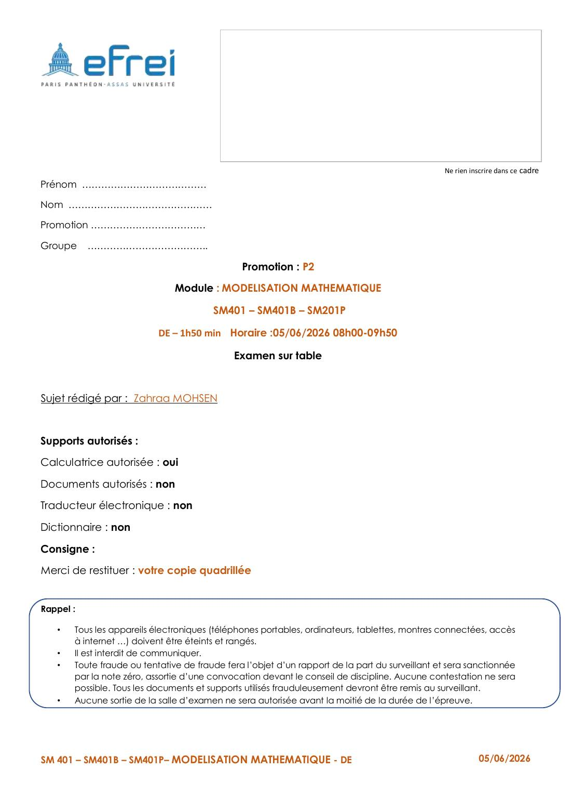{ loading=lazy .papier }](papier/de2526/p01.jpg)
    
Ne rien inscrire dans ce cadre · DE 2025-2026 — sujet, page 1

    [{ loading=lazy .papier }](papier/de2526/p02.jpg)
    
DE 2025-2026 — sujet, page 2

    [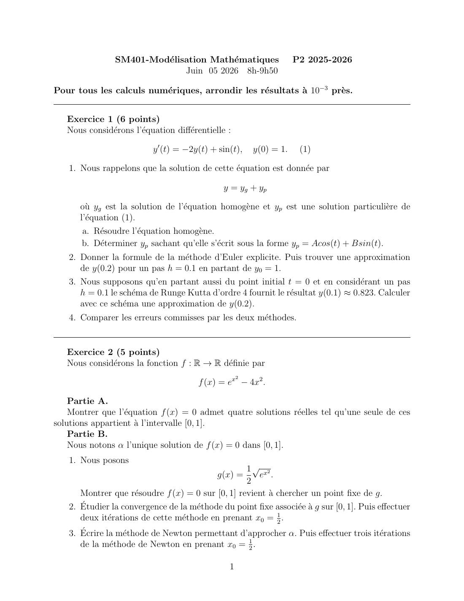{ loading=lazy .papier }](papier/de2526/p03.jpg)
    
SM401-Modélisation Mathématiques · DE 2025-2026 — sujet, page 3

    [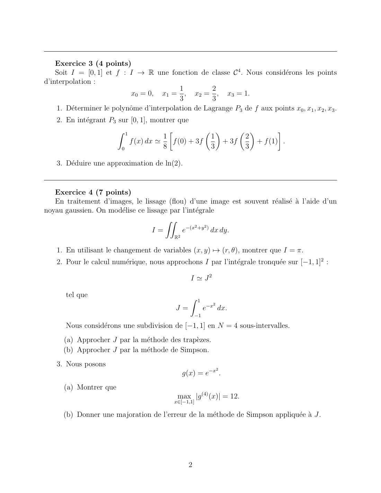{ loading=lazy .papier }](papier/de2526/p04.jpg)
    
Exercice 3 (4 points) · DE 2025-2026 — sujet, page 4

    <!-- /papier -->

    <!-- papier: pdf/SM401P/de-2026-corrige.pdf | DE 2025-2026 — corrigé | de2526-corr | page -->

    [{ loading=lazy .papier }](papier/de2526-corr/p01.jpg)
    
DE 2025-2026 — corrigé, page 1

    [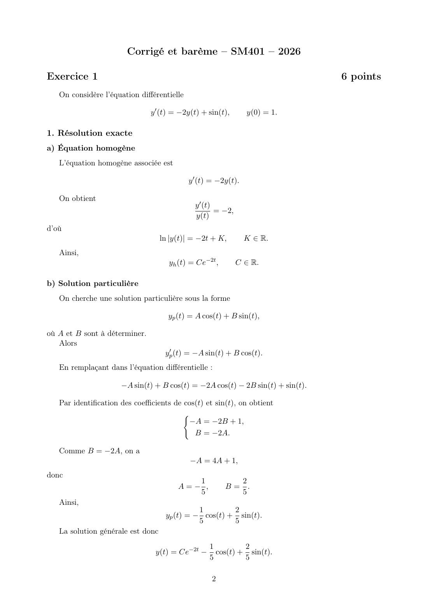{ loading=lazy .papier }](papier/de2526-corr/p02.jpg)
    
Corrigé et barème – SM401 – 2026 · DE 2025-2026 — corrigé, page 2

    [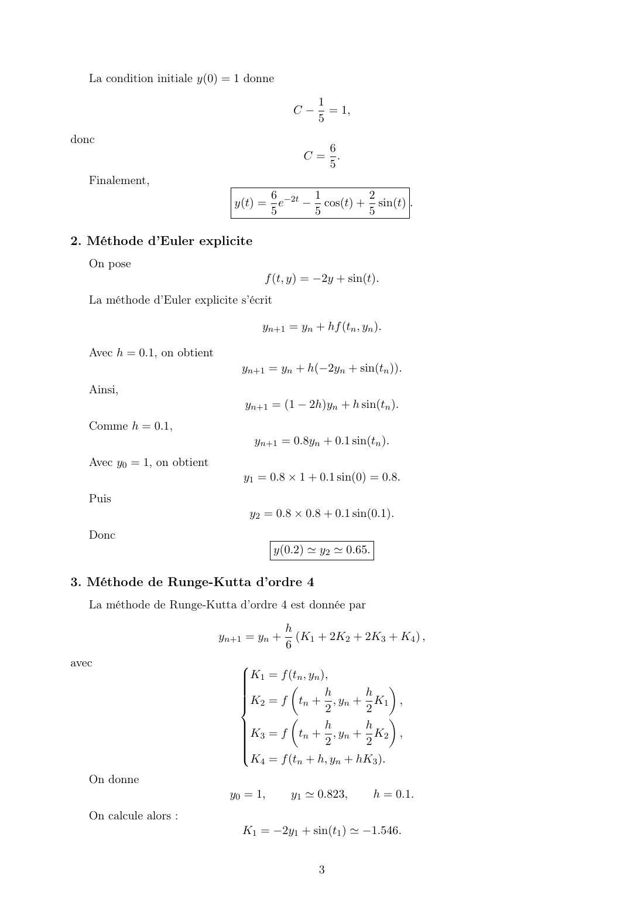{ loading=lazy .papier }](papier/de2526-corr/p03.jpg)
    
La condition initiale y(0) = 1 donne · DE 2025-2026 — corrigé, page 3

    [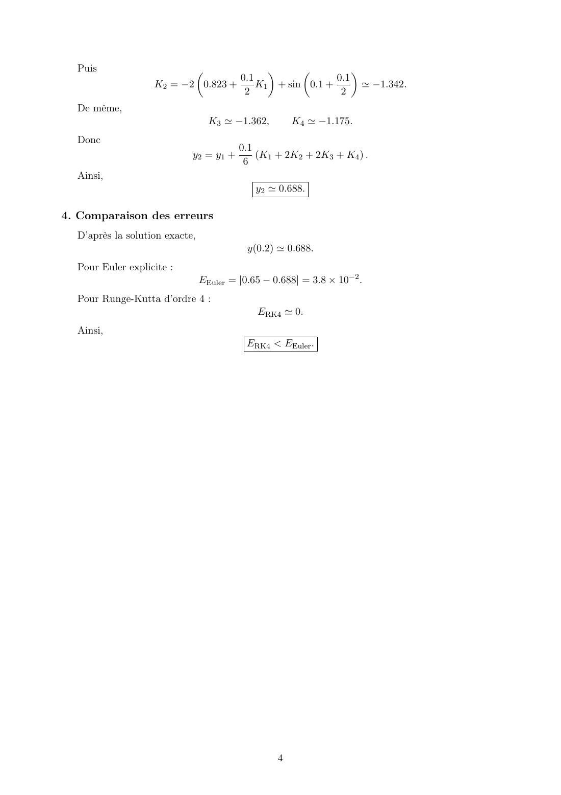{ loading=lazy .papier }](papier/de2526-corr/p04.jpg)
    
De même, · DE 2025-2026 — corrigé, page 4

    [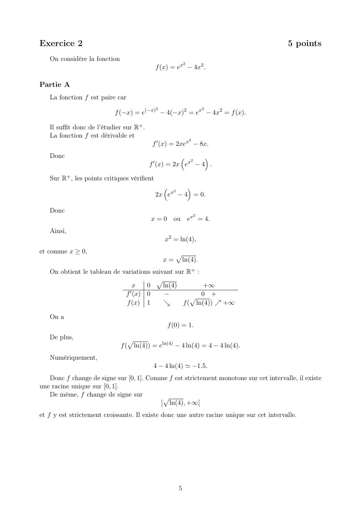{ loading=lazy .papier }](papier/de2526-corr/p05.jpg)
    
Exercice 2 · DE 2025-2026 — corrigé, page 5

    [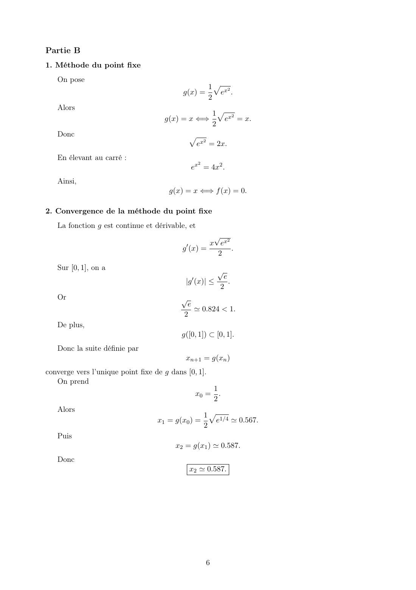{ loading=lazy .papier }](papier/de2526-corr/p06.jpg)
    
Partie B · DE 2025-2026 — corrigé, page 6

    [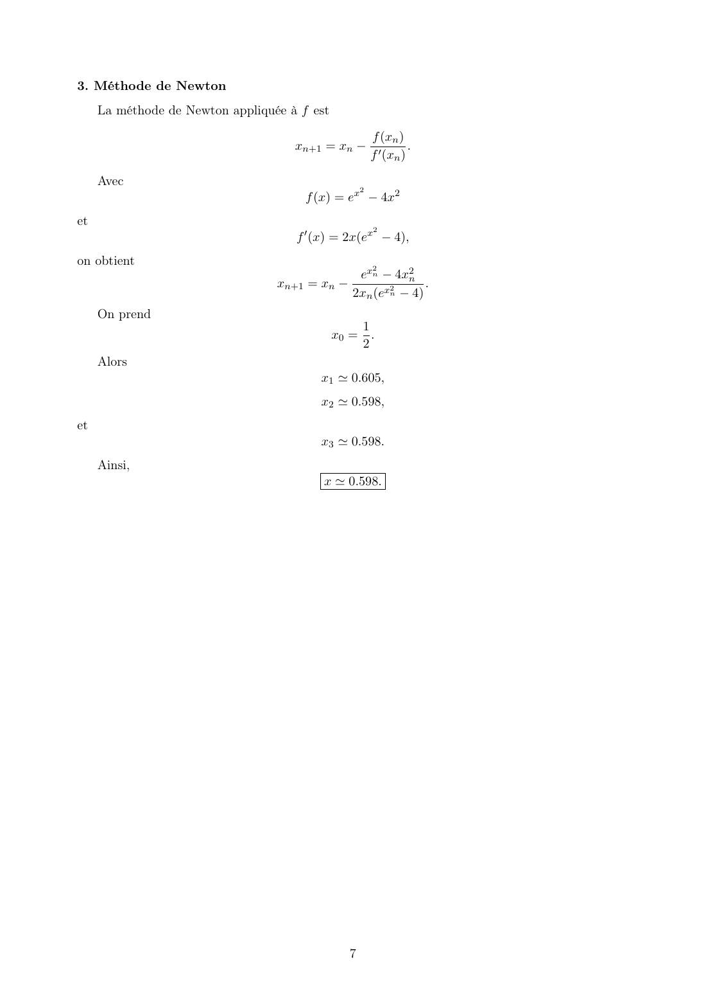{ loading=lazy .papier }](papier/de2526-corr/p07.jpg)
    
3. Méthode de Newton · DE 2025-2026 — corrigé, page 7

    [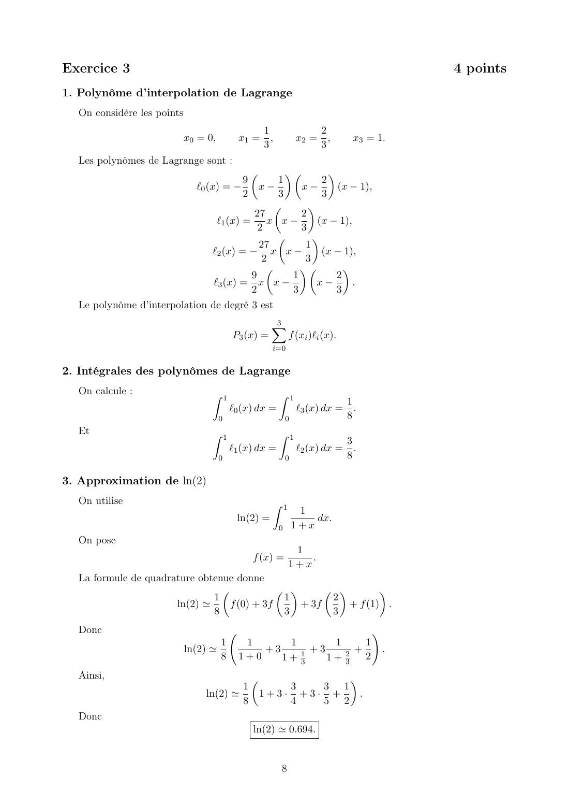{ loading=lazy .papier }](papier/de2526-corr/p08.jpg)
    
Exercice 3 · DE 2025-2026 — corrigé, page 8

    [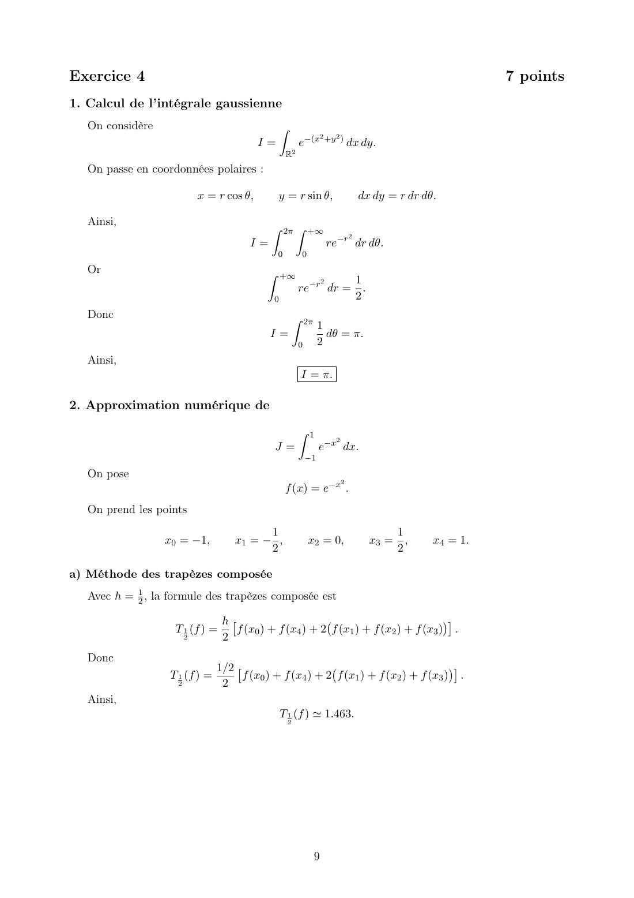{ loading=lazy .papier }](papier/de2526-corr/p09.jpg)
    
Exercice 4 · DE 2025-2026 — corrigé, page 9

    [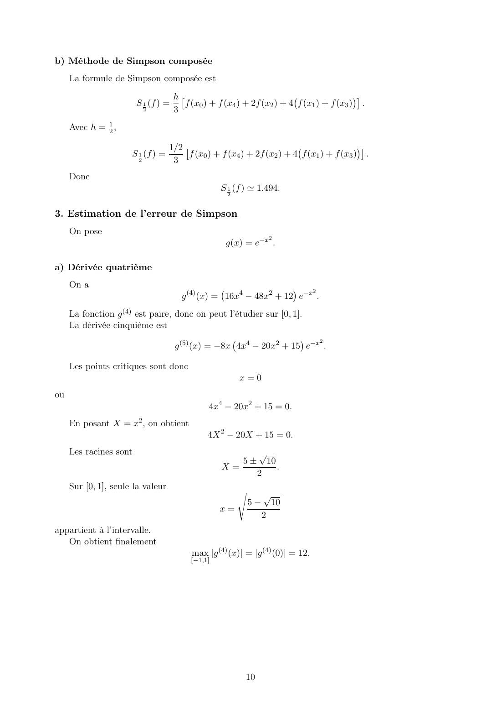{ loading=lazy .papier }](papier/de2526-corr/p10.jpg)
    
b) Méthode de Simpson composée · DE 2025-2026 — corrigé, page 10

    [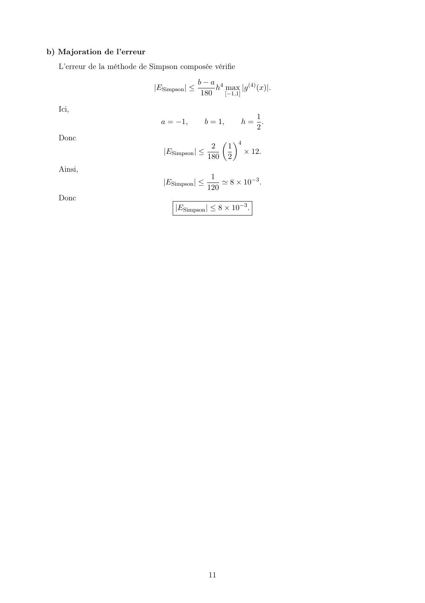{ loading=lazy .papier }](papier/de2526-corr/p11.jpg)
    
b) Majoration de l’erreur · DE 2025-2026 — corrigé, page 11

    <!-- /papier -->
