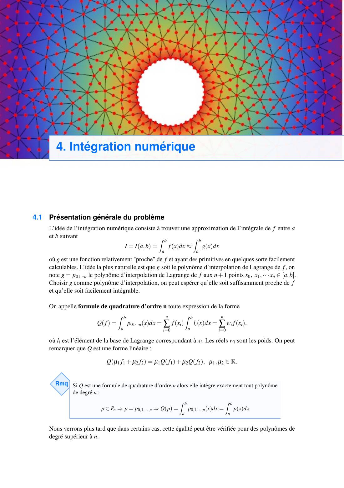
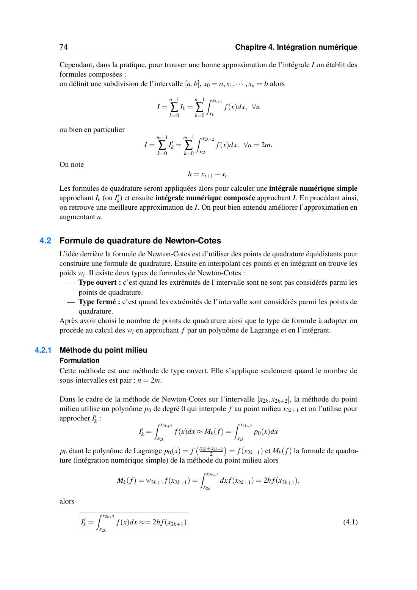
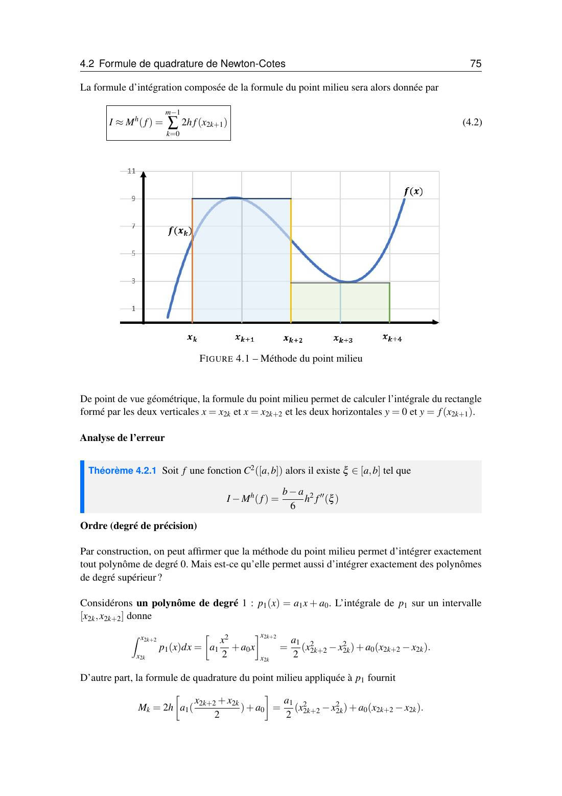
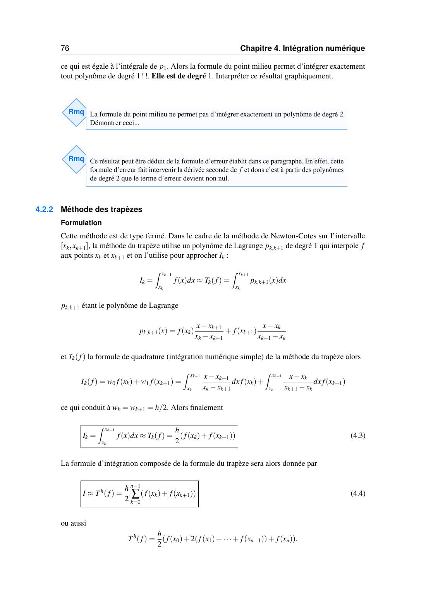
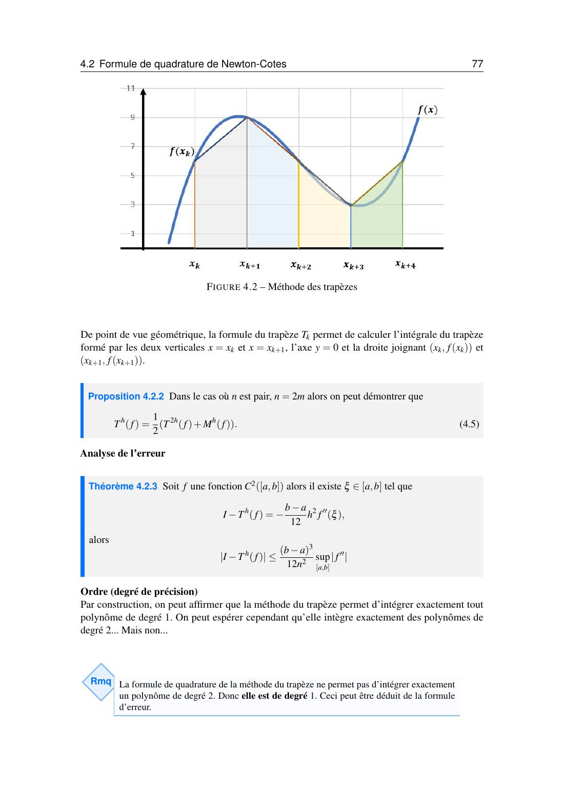
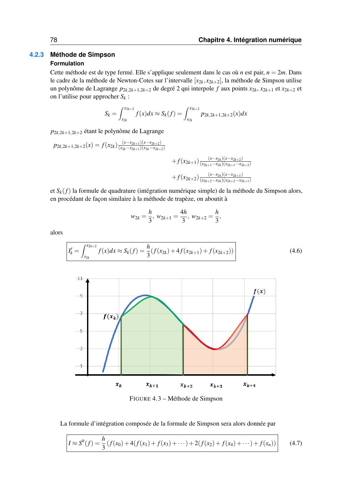
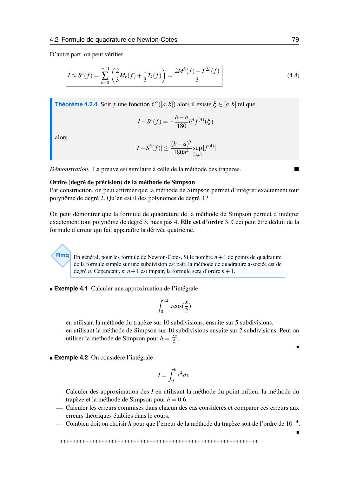
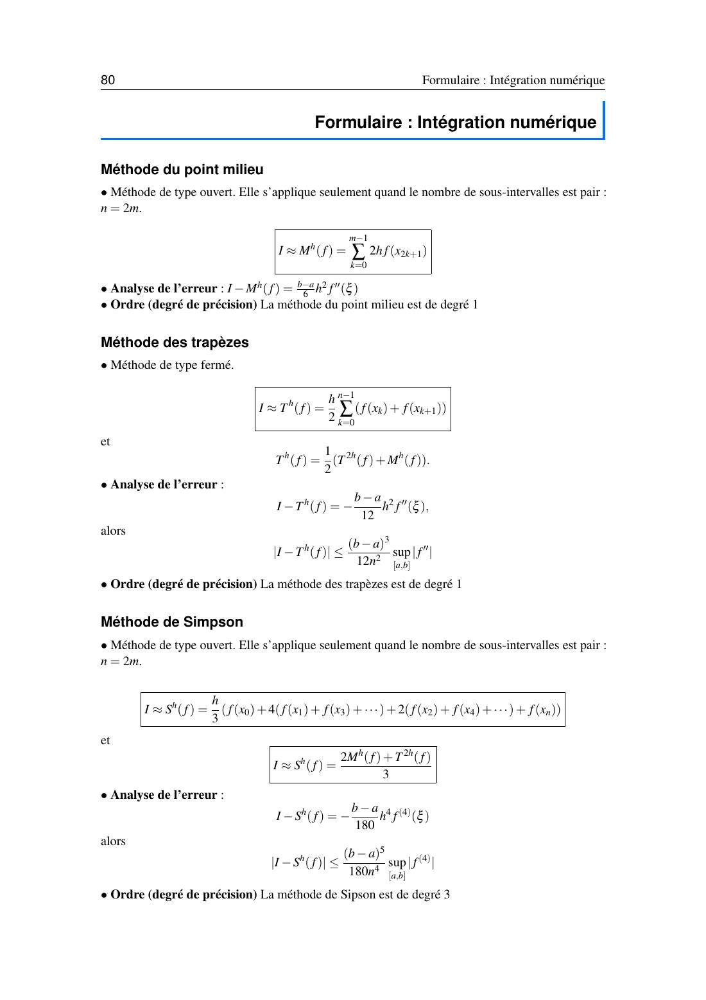

# Chapitre 4 — Intégration numérique

=== "Version simplifiée"

    Pour approcher $I = \int_a^b f(x)\,dx$, on remplace $f$ par un **polynôme d'interpolation** facile à intégrer.
    On obtient une **formule de quadrature** $Q(f) = \sum w_i f(x_i)$ (les $w_i$ sont les **poids**).

    En pratique, on découpe $[a, b]$ en $n$ sous-intervalles de **pas $h = \frac{b - a}{n}$**, points $x_k = a + kh$,
    et on applique la formule simple sur chaque morceau : c'est la **formule composée**.

    !!! definition "Degré de précision"
        Une formule est **de degré $d$** si elle intègre exactement tous les polynômes de degré $\le d$, mais pas $x^{d+1}$.

    ## Les trois méthodes (notations du poly)

    !!! theoreme "Méthode des trapèzes (type fermé)"
        Sur chaque $[x_k, x_{k+1}]$, on remplace $f$ par la droite qui joint les deux extrémités :

        $$
        T_h(f) = \frac h2\Big(f(x_0) + 2\big(f(x_1) + \dots + f(x_{n-1})\big) + f(x_n)\Big)
        $$

        Erreur : $I - T_h = -\dfrac{b - a}{12}h^2 f''(\xi)$, donc $|I - T_h| \le \dfrac{(b - a)^3}{12n^2}\sup|f''|$. **Degré 1**.

    !!! theoreme "Méthode de Simpson (type fermé, $n$ pair)"
        Sur chaque paire $[x_{2k}, x_{2k+2}]$, on remplace $f$ par la parabole passant par les 3 points :

        $$
        S_h(f) = \frac h3\Big(f(x_0) + 4\big(f(x_1) + f(x_3) + \dots\big) + 2\big(f(x_2) + f(x_4) + \dots\big) + f(x_n)\Big)
        $$

        Erreur : $I - S_h = -\dfrac{b - a}{180}h^4 f^{(4)}(\xi)$, donc $|I - S_h| \le \dfrac{(b - a)^5}{180n^4}\sup|f^{(4)}|$. **Degré 3**.

    !!! theoreme "Méthode du point milieu (type ouvert, $n$ pair)"
        Sur chaque paire $[x_{2k}, x_{2k+2}]$ (de longueur $2h$), on prend la valeur au milieu $x_{2k+1}$ :

        $$
        M_h(f) = \sum_{k=0}^{m-1} 2h\,f(x_{2k+1}) \qquad (n = 2m)
        $$

        Erreur : $I - M_h = \dfrac{b - a}{6}h^2 f''(\xi)$. **Degré 1** (elle intègre exactement les droites, pas seulement les constantes).

    !!! piege "Le pas du point milieu"
        Dans le poly, $h$ est l'écart entre deux points **consécutifs**, et un rectangle s'étend sur **deux** pas.
        Avec la convention plus courante « $n$ rectangles de largeur $H$ », c'est $H\sum f(\text{milieux})$ et l'erreur s'écrit $\frac{b - a}{24}H^2 f''(\xi)$ :
        c'est la même chose avec $H = 2h$. Lis bien l'énoncé.

    ## Comparer les méthodes

    | Méthode | Nb de sous-intervalles | Degré | Erreur en | Si on divise $h$ par 2, l'erreur est divisée par |
    |---|---|---|---|---|
    | Point milieu | pair | 1 | $h^2$ | 4 |
    | Trapèzes | quelconque | 1 | $h^2$ | 4 |
    | Simpson | **pair** | 3 | $h^4$ | 16 |

    Relations utiles : $T_h = \frac12(T_{2h} + M_h)$ et $S_h = \frac{2M_h + T_{2h}}{3}$ (Simpson combine point milieu et trapèzes).
    Pour les formules de Newton-Cotes, si le nombre de points $n + 1$ est impair, on gagne un degré (Simpson : 3 points, degré 3).

    !!! methode "Trouver le nombre de subdivisions"
        Majorer $|f''|$ (trapèzes) ou $|f^{(4)}|$ (Simpson) par $M$ sur $[a, b]$, puis résoudre en $n$ :
        $\frac{(b - a)^3}{12n^2}M \le \varepsilon$ (trapèzes) ou $\frac{(b - a)^5}{180n^4}M \le \varepsilon$ (Simpson, et $n$ doit être **pair**).
        Arrondir à l'entier supérieur.

    !!! piege "Quand l'ordre théorique n'est pas atteint"
        Les formules d'erreur supposent $f$ assez régulière ($C^2$ ou $C^4$). Pour $x^{5/2}$ sur $[0, 1]$, la dérivée quatrième explose en 0 :
        Simpson converge moins vite que prévu ([TD 4, exercice 6](../td/td-4-integration.md)).

=== "Version papier"

    Le chapitre 4 du polycopié 2025-2026 et son formulaire (le TD est dans le [TD 4](../td/td-4-integration.md)).

    <!-- papier: pdf/SM401P/poly.pdf | Poly 2025-2026 | ch4 | page | 73-80 -->

    [{ loading=lazy .papier }](papier/ch4/p73.jpg)
    
4. Intégration numérique · Poly 2025-2026, page 73

    [{ loading=lazy .papier }](papier/ch4/p74.jpg)
    
Chapitre 4. Intégration numérique · Poly 2025-2026, page 74

    [{ loading=lazy .papier }](papier/ch4/p75.jpg)
    
4.2 Formule de quadrature de Newton-Cotes · Poly 2025-2026, page 75

    [{ loading=lazy .papier }](papier/ch4/p76.jpg)
    
Chapitre 4. Intégration numérique · Poly 2025-2026, page 76

    [{ loading=lazy .papier }](papier/ch4/p77.jpg)
    
4.2 Formule de quadrature de Newton-Cotes · Poly 2025-2026, page 77

    [{ loading=lazy .papier }](papier/ch4/p78.jpg)
    
Chapitre 4. Intégration numérique · Poly 2025-2026, page 78

    [{ loading=lazy .papier }](papier/ch4/p79.jpg)
    
4.2 Formule de quadrature de Newton-Cotes · Poly 2025-2026, page 79

    [{ loading=lazy .papier }](papier/ch4/p80.jpg)
    
Formulaire : Intégration numérique · Poly 2025-2026, page 80

    <!-- /papier -->
